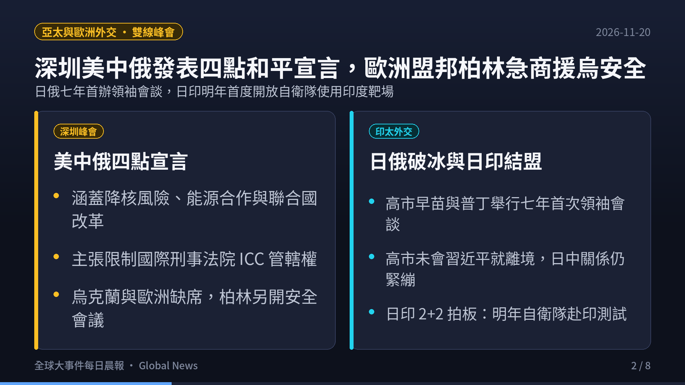
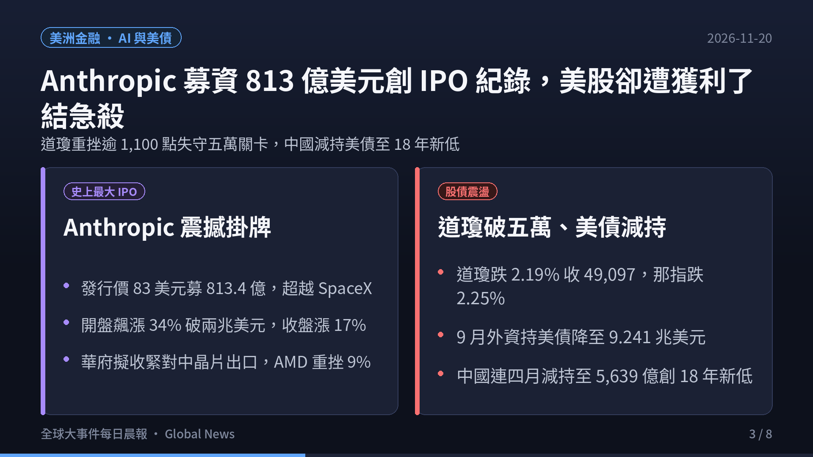
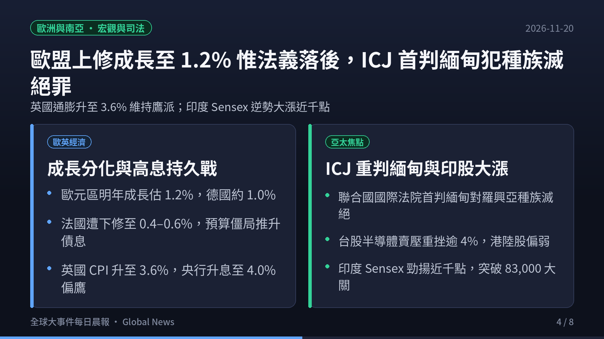
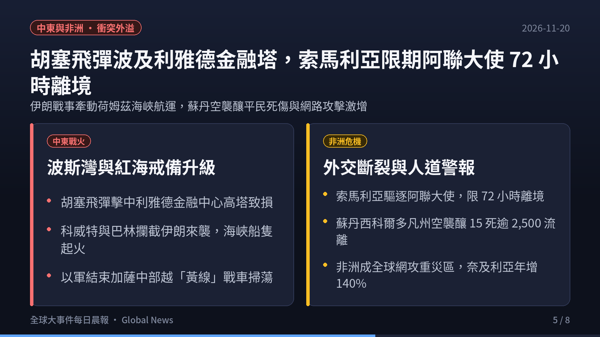
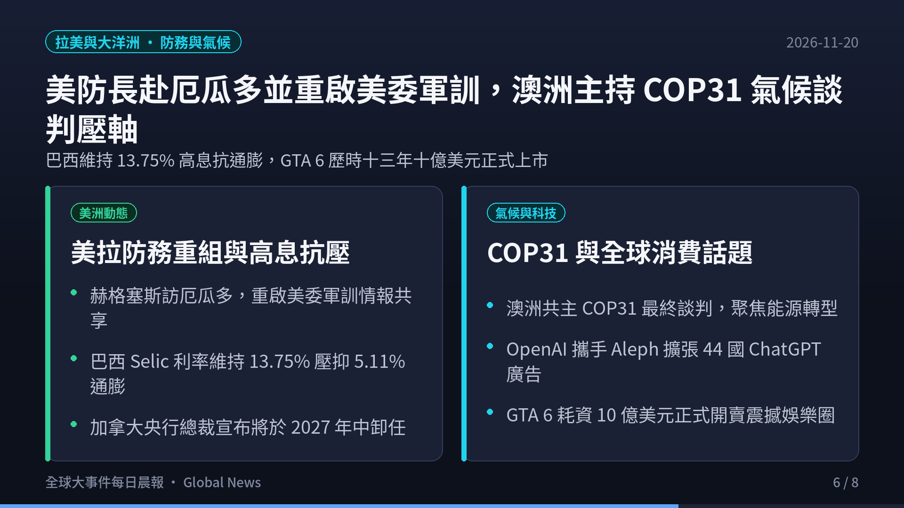
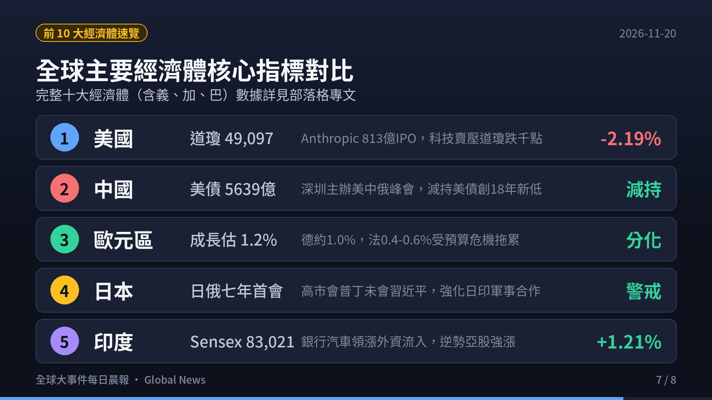
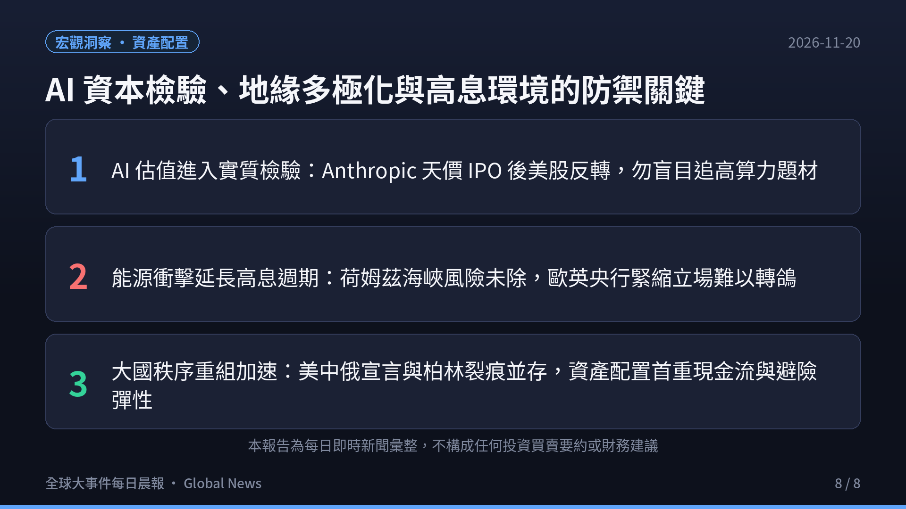

> **觀測週期**：2026-11-20 晨間即時彙整  
> **情報涵蓋**：全球各大洲（亞太、美洲、歐洲、中東、非洲、大洋洲）與全球前 10 大經濟體  
> **核心來源**：BBC、CNBC、Reuters、AP News、Euronews、Al Jazeera、Kyodo News、The Hindu、歐盟執委會秋季經濟預測與各國央行公報  
> **定位宗旨**：以客觀數據、官方決策與供應鏈結構為準繩，剔除短期情緒噪音，提煉出真正驅動全球資金流向與地緣版圖重構的核心脈絡。

  

    <iframe src="https://www.youtube.com/embed/SVkzb4LLzwE" title="2026-11-20 全球大事件每日晨報" style="position: absolute; top:0; left: 0; width: 100%; height: 100%; border: 0;" allow="accelerometer; autoplay; clipboard-write; encrypted-media; gyroscope; picture-in-picture; web-share" allowfullscreen></iframe>
  

  

    🎬 <strong>120 秒晨間快報影音動態版</strong>（含 AI 自然神經語音朗讀與背景配樂）
  

---

## 🎯 今日全球前 6 大核心事件深度拆解

### 1. 亞太與歐洲外交：美中俄深圳發表「四點和平宣言」，柏林另開援烏會議、日俄七年首會與日印強化軍事合作
- **美中俄三方峰會簽署四點和平宣言，歐烏缺席引裂痕**：
  - 美國總統川普、中國國家主席習近平與俄羅斯總統普丁在深圳 APEC 峰會場邊結束史無前例的三邊會談，並共同發表「四點和平宣言」，主張降低核武風險、擴大能源合作、推動聯合國體系改革，並限制國際刑事法院（ICC）的管轄權。
  - 由於烏克蘭與歐洲領袖並未獲邀參與深圳會談，歐洲多國表達強烈關切；歐洲主導的「自願者聯盟」（Coalition of the Willing）與烏克蘭總統澤倫斯基於 19 日在德國柏林緊急召開高峰會，並與美方特使 Jared Kushner 及 Steve Witkoff 磋商未來安全保障與停火授權架構。
- **日俄領袖七年首會，高市早苗未會習近平、日印軍事合作升級**：
  - 日本首相高市早苗（Sanae Takaichi）在深圳與普丁舉行日俄七年來首次領袖面對面會談；然而她在結束行程返國前並未與習近平舉行雙邊峰會，凸顯日中關係在持續逾一年的摩擦後仍顯緊繃。
  - 另一方面，日本與印度於東京舉行外交與國防「2+2」部長級會談，日本防衛大臣小泉進次郎宣布雙方將大幅深化印太安全合作，並力拚明年首度開放日本自衛隊使用印度軍事測試場；日本汽車工業會（JAMA）同日亦宣布將針對鋼材、樹脂與線束推進跨車廠標準化，降低採購成本以應對海外競爭。

---

### 2. 美洲金融與資本市場：Anthropic 募資 813.4 億美元創史上最大 IPO，然美股反轉重挫、道瓊跌逾 1,100 點失守五萬關卡
- **Anthropic 震撼登陸那斯達克，盤中市值破 2 兆美元後回吐**：
  - Claude 開發商 Anthropic（NASDAQ: ANT）以每股 **83 美元** 定價發行 9.8 億股，募資高達 **813.4 億美元**，超越今年 6 月 SpaceX 紀錄，成為人類資本市場史上規模最大的 IPO。
  - 掛牌首日早盤股價一度狂飆 **34%** 至 **111.50 美元**、總市值突破 2 兆美元；但隨著科技板塊獲利了結賣壓湧現，終場收在 **97.17 美元**（仍較發行價上漲約 17%）。同時，馬斯克（Elon Musk）在《紐約時報》活動上公開與「MAGA」運動切割並對期中選舉鉅額政治獻金表達遺憾。
- **半導體出口管制陰霾拖累大盤，外資連續減持美國公債**：
  - 華府研擬收緊對中晶片出口限制，引發空頭機構 Hunterbrook Capital 狙擊 AMD，拖累 AMD 股價單日暴跌 **9%**；美股三大指數全面反轉急殺，**道瓊工業指數重挫 2.19%（下跌逾 1,100 點）收 49,097.06 點**，**標普 500 跌 2.02% 收 7,175.83 點**，**那斯達克跌 2.25% 收 23,879.20 點**。
  - 美國財政部最新統計亦顯示，9 月外國持有美國國債總額降至 **9.241 兆美元**；其中**中國連續四個月減持至 5,639 億美元**，創下逾 **18 年來新低**，日本與英國亦同步縮減美債部位。

---

### 3. 歐洲總經與東南亞司法：歐盟秋季預測上修歐元區至 1.2% 惟法義受困預算與債息；ICJ 歷史性裁定緬甸犯下種族滅絕罪
- **歐元區成長分化加劇，英國高通膨迫使央行維持鷹派**：
  - 歐盟執委會發布秋季經濟預測，微幅上調歐元區 2026 與 2027 年實質 GDP 成長預估至 **1.2%**，但強調成長極不均衡：德國呈現溫和復甦（2027 年估約 1.0%），**法國卻因 2027 年國家預算政治僵局與極端氣候重創農業，成長預估遭下修至 0.4%–0.6%**，推升法國 10 年期公債殖利率承壓；義大利預估亦僅約 0.7%。
  - 歐元區 10 月整體通膨仍徘徊在 **4%** 左右，歐盟預估 2027 年仍將高於 3%；英國 10 月 CPI 則由 3.5% 升至 **3.6%**（受柴油與汽油飆升帶動），英國央行（BoE）本月初已升息一碼至 **4.0%**，行長貝利（Andrew Bailey）並警告尚未排除進一步升息可能。金融機構方面，滙豐（HSBC）在摩根大通歐洲金融會議上強調其亞洲財富管理資產已達 1.1 兆美元、英國企業放款年增逾 10%。
- **聯合國國際法院首判「國家」犯下種族滅絕罪；印度股市逆勢大漲近千點**：
  - 設於荷蘭海牙的聯合國國際法院（ICJ）19 日做出史無前例判決，認定緬甸軍方於 2017 年鎮壓羅興亞穆斯林少數族群具備「摧毀該族群的意圖」，首度裁定一個主權國家犯下種族滅絕罪。
  - 亞太股市表現分歧：台股受科技與半導體賣壓衝擊大跌逾 4%，港股與陸股走低；反觀印度受惠銀行股創歷史新高、汽車股領漲與外資流入，**孟買 Sensex 指數逆勢大漲近 1,000 點（+1.21%）收 83,021.75 點**，Nifty 指數重返 25,500 點之上。

---

### 4. 中東與非洲衝突：胡塞飛彈襲擊利雅德金融中心、荷姆茲海峽戰火延燒；索馬利亞驅逐阿聯大使、蘇丹空襲釀平民死傷
- **波斯灣防空攔截不斷，紅海與加薩安全情勢升溫**：
  - 葉門胡塞武裝發射飛彈波及沙烏地阿拉伯首都利雅德金融中心（KAFD）高塔造成建物財損，沙國聯軍隨即對葉門目標發動空襲報復；科威特與巴林亦攔截來自伊朗的空中襲擊，荷姆茲海峽仍有商船遇襲起火，促使美國總統川普警告「明年 1 月 1 日後再看伊朗局勢如何演變」。
  - 葉門總統領導委員會主席阿利米（Rashad al-Alimi）正式簽署法律將胡塞武裝列為恐怖組織；另方面，以軍宣布結束在加薩中部跨越停火「黃線」摧毀地下通道的戰車突襲行動，但國防部長卡茨（Israel Katz）稱有意將新控制區轉為永久安全邊界。阿布達比法院同日亦下令多家加密貨幣平台凍結高達數十億美元資產，追查 63 億美元幣安錢包失竊案。
- **非洲外交斷裂、人道危機與網路攻擊創高**：
  - 東非索馬利亞政府 19 日宣布驅逐阿拉伯聯合大公國大使，限期 **72 小時內離境** 並召回駐阿聯大使；蘇丹西科爾多凡州（West Kordofan）村莊遭空襲造成 **15 名平民喪生（含 4 名兒童）**、逾 **2,500 人**流離失所，蘇丹軍方同時向鄰近衣索比亞邊境增兵。
  - Check Point 最新安全報告指出，非洲重回全球遭受網路攻擊最密集的地區，其中奈及利亞每週平均遭遇近 6,700 次攻擊，年增幅高達 **140%**。

---

### 5. 美洲防務與大洋洲前沿：美防長赫格塞斯赴厄瓜多並重啟美委軍訓；澳洲共主 COP31 壓軸談判、巴西高息抗通膨與《GTA 6》問世
- **美洲防務重組與拉美貨幣緊縮**：
  - 美國戰爭部長赫格塞斯（Pete Hegseth）在與委內瑞拉達成重大破冰協議（馬杜洛倒台近一年後重啟美委聯合軍訓與情報共享）後，19 日飛抵厄瓜多展開拉美反毒安全訪問，下一站將前往宏都拉斯。
  - 南美最大經濟體巴西面對通膨預期高於目標（約 **5.11%**）與財政赤字疑慮，央行持續將基準 **Selic 利率維持在 13.75%** 的高壓水準，拖累國內經濟動能放緩至 1.4%–1.9%；加拿大總理卡尼出席深圳 APEC 力拓多元供應鏈，加拿大央行（BoC）總裁麥克勒姆（Tiff Macklem）宣布將於 2027 年中卸任。
- **COP31 氣候最終談判與全球科技娛樂里程碑**：
  - 澳洲共同主持進入最後關鍵階段的 **COP31 氣候峰會** 談判，焦點鎖定能源安全轉型、關鍵礦產供應鏈與綠色基建融資；IMF 總裁喬治艾娃（Kristalina Georgieva）在深圳指出，全球經濟正同時面對「能源供給負面衝擊」與「AI 投資加速」兩股力量的拉扯，並警告全球公共債務將觸及 GDP 100% 的二戰以來新高。
  - 科技與娛樂消費領域方面，OpenAI 宣布攜手 Aleph 將 ChatGPT 廣告服務擴展至拉美、中東與非洲共 **44 個新興市場**；而開發長達 13 年、據報耗資 10 億美元的《俠盜獵車手 VI》（*Grand Theft Auto VI*）正式全球上市，迅速洗版全球社群與消費市場。

---

### 6. 全球前十大經濟體核心指標與趨勢橫向全景

| 排名 | 國家 / 經濟體 | 核心總體經濟數據 / 最新指標 | 2026-11-20 即時動態與政策取向 | 全球產業鏈與市場意涵 |
|:---:|:---|:---|:---|:---|
| **1** | **美國 (USA)** | 道瓊 **49,097.06 (-2.19%)** · 標普 **7,175.83 (-2.02%)** | Anthropic 募資 813.4 億美元創史上最大 IPO 然尾盤回吐；對中晶片出口管制疑慮拖累 AMD 重挫 9% | AI 估值迎來資本市場實質壓力測試，聯準會高息預期與分裂國會掣肘並存，科技股波動劇增。 |
| **2** | **中國 (China)** | 9 月持美債降至 **5,639 億美元**（逾 18 年新低） | 深圳主辦美中俄三方峰會並發表四點和平宣言；連四月減持美債；陸港股大盤走勢偏軟 | 透過多邊外交強化全球南方與歐亞話語權，並持續去美元儲備配置，聚焦高階製造自給率。 |
| **3** | **德國 (Germany)** | 歐元區成長估 **1.2%** · 德國 2027 預估 **~1.0%** | 柏林主持「自願者聯盟」與澤倫斯基商討對烏安全保障；AI 與科技基建需求帶動溫和修復 | 歐洲工業龍頭試圖在美中俄三方架構之外鞏固歐洲防務自主，惟高能源成本仍壓抑重工業利潤。 |
| **4** | **日本 (Japan)** | 日股漲跌互見 · 同步減持美國國債部位 | 首相高市早苗與普丁七年首會（未會習近平）；日印 2+2 拍板明年自衛隊赴印測試；車廠標準化零件 | 印太安保格局明顯向「日印美澳」靠攏，國內製造業透過跨廠標準化抵禦海外電動車與匯率衝擊。 |
| **5** | **印度 (India)** | Sensex **83,021.75 (+1.21%)** · Nifty **> 25,500** | 銀行股創高與汽車股勁揚推升孟買股市大漲近千點；日印防務升級；10 月原油進口帳單因中東戰事攀升 | 外資持續將印度視為亞太非美中供應鏈首選避風港，但高度依賴進口原油使其易受荷姆茲海峽風險衝擊。 |
| **6** | **英國 (UK)** | 10 月 CPI **3.6%** · BoE 基準利率 **4.0%** · Q3 GDP **+0.7%** | 柴油汽油漲價推升通膨，央行本月已升息一碼且預警可能續緊；滙豐展現 1.1 兆亞洲財管與企業放款動能 | 英國陷入「能源輸入型通膨 vs 成長韌性」兩難，高按揭利率將持續考驗內需消費與不動產市場。 |
| **7** | **法國 (France)** | 歐盟下修成長預估至 **0.4%–0.6%** · 10 年期法債殖利率飆升 | 2027 年度預算政治僵局加上極端氣候重創農業產出；財政赤字審查引發主權債市震盪 | 法國政治與財政不確定性已成歐元區最大內部風險點，壓抑歐盟整體投資信心。 |
| **8** | **義大利 (Italy)** | 歐元區通膨 **~4%** · 義大利 2027 成長預估 **~0.7%** | 受制高能源融資成本與歐盟財政紀律規範，復甦動能顯著落後德國與西班牙 | 高債務經濟體在歐洲央行緊縮週期延長下財政空間有限，仰賴歐盟復甦資金支撐基建。 |
| **9** | **加拿大 (Canada)** | 國內 GDP 與就業偏軟 · 核心通膨受能源溢波有限 | 總理卡尼出席深圳 APEC 拓展多元貿易；央行總裁麥克勒姆宣布將於 2027 年中卸任 | 短期暫無急迫升息壓力，政策核心轉向透過基建與亞太自貿對沖北美關稅不確定性。 |
| **10** | **巴西 (Brazil)** | 基準 Selic 利率 **13.75%** · 通膨預期 **5.11%** | 央行暫停降息維持限制性高利率抗通膨與財政疑慮；經濟活動指標出現降溫收縮跡象 | 拉美最大經濟體以高實質利率換取匯率與物價穩定，高息環境考驗大宗商品與內需企業獲利。 |

---

## 💡 總結與投資者生存指南

1. **AI 泡沫與資本定價進入「實質檢驗期」**：
   - Anthropic 以 813.4 億美元創下史上最大 IPO 並一度衝破兩兆美元市值，卻成為華爾街資金獲利了結的觸發點，反映市場對算力資本支出的回報週期與地緣晶片管制風險轉趨謹慎。
2. **能源供給衝擊延長全球高息週期**：
   - 荷姆茲海峽戰火與利雅德遇襲推升運輸與能源保費，導致英國與歐元區通膨居高不下，也使 IMF 警告的全球債務破表壓力更加棘手，央行短期內難以重啟寬鬆降息。
3. **多極秩序重組下的防禦性配置紀律**：
   - 美中俄深圳四點宣言與柏林歐洲安全會議並存，顯示全球地緣規則正在碎片化。投資者應維持高確定性自由現金流部位、嚴控槓桿倍數，並保留適度黃金、短債與非美元多元化資產彈性。

---

### ☕ 支持與精選推薦

如果你覺得這份每日晨報對你的宏觀視野與決策有實質幫助，歡迎透過以下方式支持我們持續產出深度內容：

- ☕ **請我喝杯咖啡**：[Ko-fi 小費贊助 (ytstories0413)](https://ko-fi.com/ytstories0413) 或 [Ko-fi 贊助 (slashman413)](https://ko-fi.com/slashman413)（支持每日自動化調研、語音合成與雲端運算）
- 📚 **數位產品與高人效生產力工具**：
  - [Gumroad 數位商品專區](https://slashmaster6.gumroad.com/)：收錄精選 AI Prompt 庫、生產力自動化工作流與實戰腳本
  - [SlashmanTools 免費 Web 工具集](https://slashmantools.us/)：Token 成本計算器、顯存預估、開源 AI 工具導航
- 📖 **精選經典閱讀推薦**：
  - [《晶片戰爭》（Chip War）](https://www.amazon.com/dp/059371671X?tag=ytstories0413-20)：理解全球晶片霸權與印太供應鏈重組的必讀經典
  - [《原子習慣》— 細微改變帶來巨大成就](https://www.books.com.tw/products/0010792915)
  - [《人生的智慧》— 叔本華處世哲學經典](https://www.books.com.tw/products/0010613113)
