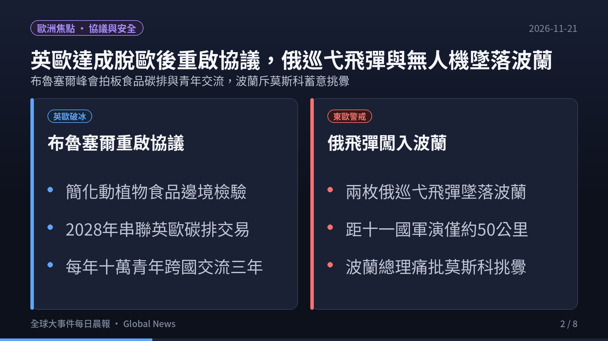
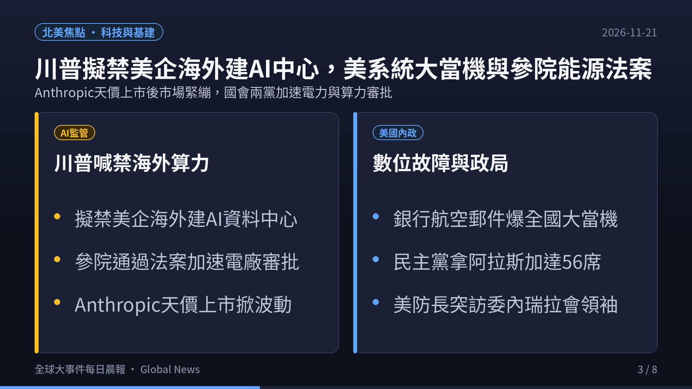
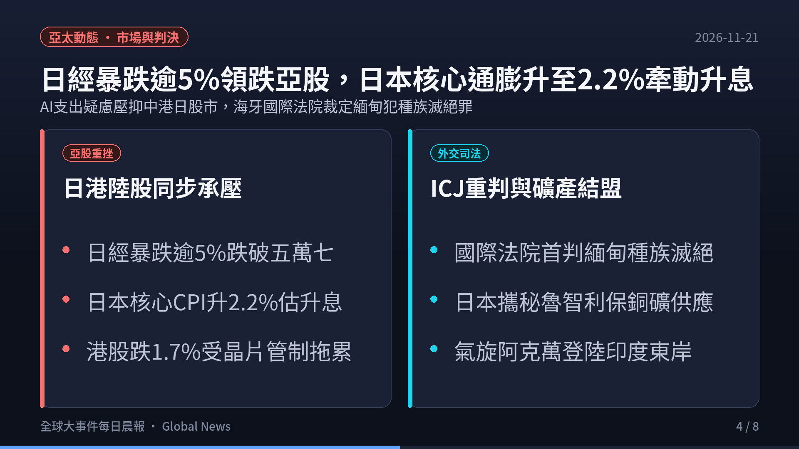
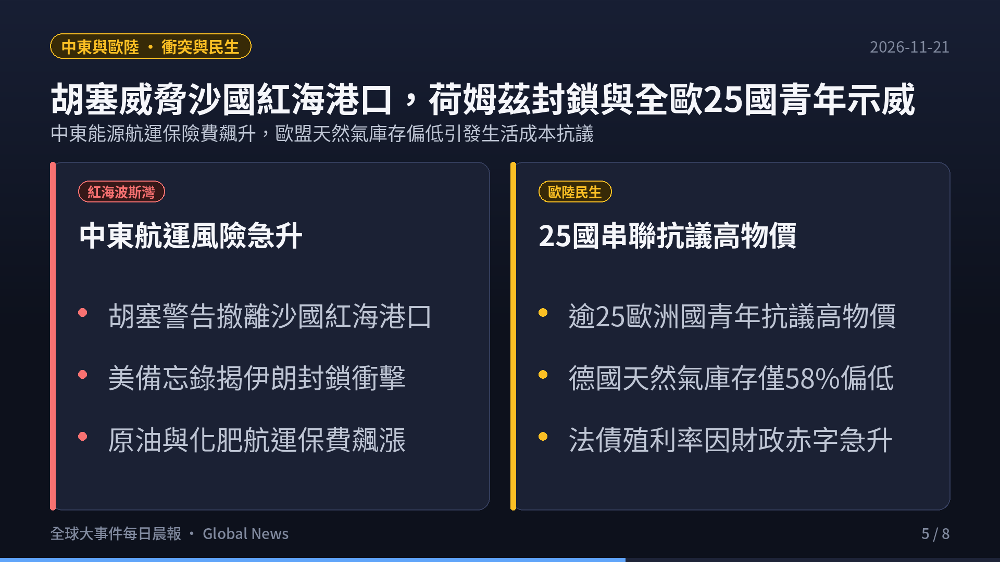
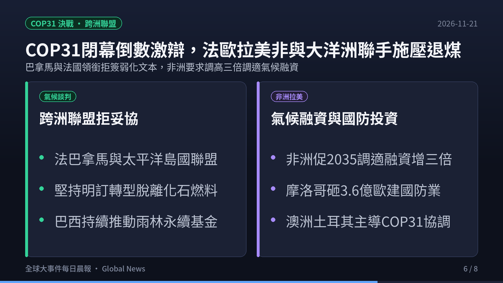
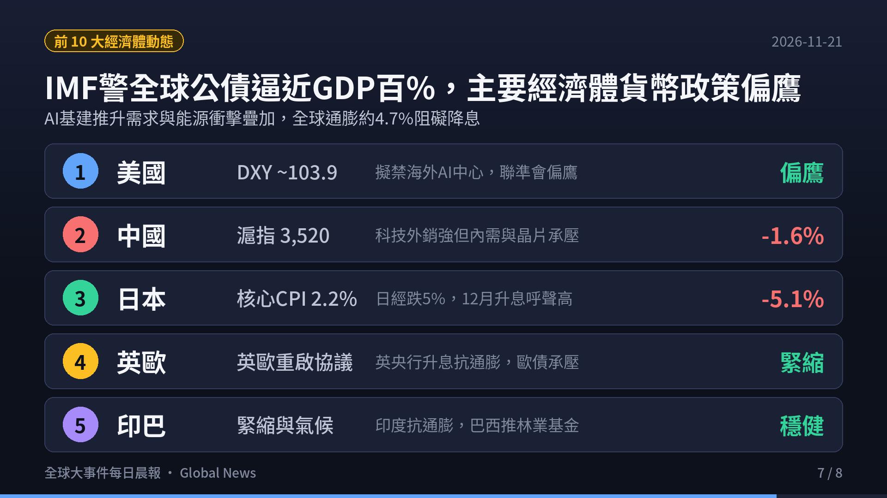
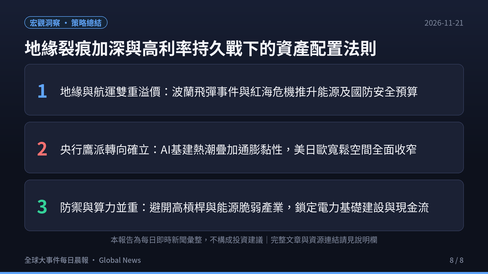

  

    <iframe src="https://www.youtube.com/embed/-GHLNbDvQhs" title="2026-11-21 全球大事件每日晨報" style="position: absolute; top:0; left: 0; width: 100%; height: 100%; border: 0;" allow="accelerometer; autoplay; clipboard-write; encrypted-media; gyroscope; picture-in-picture; web-share" allowfullscreen></iframe>
  

  

    🎬 <strong>120 秒晨間快報影音動態版</strong>（含 AI 自然神經語音朗讀與背景配樂 · <a href="https://youtu.be/-GHLNbDvQhs" target="_blank" rel="noopener">YouTube 觀看</a>）
  

> **觀測週期**：2026-11-21 晨間即時彙整  
> **情報涵蓋**：全球各大洲（歐洲、北美、亞太、中東、拉美、非洲、大洋洲）與全球前 10 大經濟體  
> **核心來源**：BBC News、英國衛報（The Guardian）、半島電視台（Al Jazeera）、UN News、共同社（Kyodo News）、CNBC、NPR 與 Euronews  
> **定位宗旨**：以官方公報、金融市場實盤數據與各洲一線通訊社報導為基準，提煉真正驅動全球地緣格局與資本定價的核心脈絡。

---

## 🎯 今日全球前 6 大核心事件深度拆解

### 1. 歐洲外交與東歐安全：英歐布魯塞爾達成「脫歐後重啟協議」，俄國兩枚巡弋飛彈與無人機闖入波蘭墜毀
- **英歐關係歷史性破冰**：
  - 英國首相柏南（Andy Burnham）於 11 月 20 日在布魯塞爾與歐盟執委會主席馮德萊恩（Ursula von der Leyen）、歐洲理事會主席柯斯塔（António Costa）會談後，正式拍板脫歐十年來最具突破性的「重啟協議」（Reset Deal）。
  - 協議核心涵蓋三大支柱：（1）建立動植物衛生與植物檢疫（SPS）協定，預計 2028 年 3 月起大幅削減食品與農產品邊境檢查；（2）2028 年起串聯英歐碳排放交易體系（ETS）以降低碳邊境貿易壁壘；（3）推動青年體驗交流計畫，每年開放最多 10 萬名英歐青年跨國生活、工作或進修最長三年。歐盟學生學費減免議題則另設 6 個月談判窗口。
- **俄國飛彈入侵波蘭領空引發北約警戒**：
  - 俄軍對烏克蘭發動大規模空襲（造成至少 8 人死亡）期間，兩枚俄製 Kh-101 巡弋飛彈與一架噴射動力無人機飛越波蘭領空，墜毀於波蘭東南部（距「志願者聯盟」11 國部隊在諾瓦德巴舉行的聯合軍演僅約 50 至 75 公里）。
  - 波蘭總理圖斯克（Donald Tusk）痛批莫斯科此舉為「蓄意挑釁」，波蘭並聯同瑞典「獅鷲」戰機與荷蘭加油機加強東翼防空警戒。

---

### 2. 北美科技監管與內政：川普揚言禁止美企海外建 AI 資料中心，美國多項關鍵數位系統接連當機
- **AI 算力主權與電力基建競速**：
  - 繼 AI 指標廠 Anthropic 以每股 83 美元在納斯達克（代碼 `ANT`）完成史上最大規模 IPO（募資約 813 億美元、估值突破 1.3 至 1.8 兆美元級距）後，美國總統川普最新揚言考慮禁止美國企業在海外興建 AI 資料中心，引發全球雲端與算力供應鏈震盪。
  - 與此同時，美國參議院以 62 比 33 的跨黨派票數通過《美國可負擔性與就業法案》（American Affordability and Jobs Act），大幅簡化電廠與資料中心能源專案的聯邦審批流程。
- **基礎設施中斷與政局變化**：
  - 美國銀行業、航空運輸、電子郵件與資安系統連續兩週爆發全國性技術當機，引發國會對數位基礎設施韌性的高度質疑。
  - 政治版圖方面，民主黨人瑪麗·佩爾托拉（Mary Peltola）在阿拉斯加州擊敗共和黨現任參議員，使民主黨在參議院席次推進至 56 席；美國防長赫格塞斯（Pete Hegseth）則突訪委內瑞拉，會晤代理領袖德爾西·羅德里格斯（Delcy Rodríguez）。

---

### 3. 亞太市場與國際司法：日經指數暴跌逾 5% 領跌亞股、日本核心 CPI 升至 2.2%，ICJ 裁定緬甸犯下種族滅絕罪
- **AI 資本支出疑慮與晶片禁令壓垮亞股**：
  - 儘管 Anthropic 完成天價上市，市場對 AI 鉅額資本開支回報率與美國新晶片出口管制的擔憂於 11 月 20 日全面引爆：東京日經 225 指數重挫 **5.06%**（大跌 3,007.56 點，收 56,436.65 點），東證指數（TOPIX）下跌 3.88%。
  - 香港恆生指數下跌 **1.7%** 至約 22,450 點（創 2025 年 5 月以來新低），騰訊財報中針對算力受限與美國晶片管制影響次世代 AI 模型訓練的預警拖累科技股；上證綜指跌 1.57% 收 3,520 點，深證成指跌 2.05%。
  - 日本公布最新核心 CPI 年增率攀升至 **2.2%**（受能源補貼退場推動），大幅推升市場對日本銀行（BOJ）於 12 月將政策利率調升至 1.50% 的預期。此外，日本與秘魯、智利達成關鍵礦產（含銅礦）供應鏈合作協議。
- **國際司法與南亞氣候衝擊**：
  - 海牙國際法院（ICJ）作出歷史性裁決，認定緬甸政府須對若開邦羅興亞人遭「種族滅絕」負起國家責任，這是聯合國最高司法機構首次依 1948 年《防止及懲治滅絕種族罪公約》對單一國家作出直接究責判決。南亞方面，熱帶氣旋「阿克萬」（Akvan）橫掃印度奧里薩邦與安得拉邦沿海。

---

### 4. 中東航運危機與歐洲民生抗爭：胡塞要求撤離沙國紅海港口，荷姆茲封鎖推升油價與全歐 25 國示威
- **紅海與波斯灣能源走廊雙重封鎖風險**：
  - 葉門胡塞武裝在荷台達與薩那遭空襲後，公開要求撤離沙烏地阿拉伯紅海港口，並威脅鎖定沙國發電廠與首都利雅德。
  - 根據外洩的美國海事管理局（MARAD）內部備忘錄，華府對伊朗實施的海軍封鎖與荷姆茲海峽航運中斷，已導致全球原油與化肥航運的戰爭險保費急遽飆升；川普則於白宮記者會指控伊朗不誠實並要求達成「真正協議」。
- **歐洲冬日能源焦慮與 25 國串聯示威**：
  - 荷姆茲海峽 LNG 運輸受阻使歐洲批發天然氣價格居高不下，歐盟整體儲氣率僅約 **72%**、德國更低至 **58%**。
  - 高生活成本與軍費擴張引爆怒火，超過 **25 個歐洲國家**（涵蓋法國、德國、英國、義大利、西班牙、葡萄牙等）於 11 月 20 日發起名為「為我們的未來而戰」（Fight For Our Future）的跨國青年與勞工示威，法國 10 年期公債殖利率亦因財政與政經壓力顯著走升。

---

### 5. 拉美、非洲與大洋洲焦點：COP31 閉幕倒數爆發跨洲對峙，法國與巴拿馬、非洲、太平洋島國聯手施壓化石燃料退場
- **跨洲氣候聯盟強硬表態**：
  - 由土耳其主辦、澳洲擔任談判主席國的 **COP31 聯合國氣候峰會**在安塔利亞進入最終決戰時刻（11 月 20–21 日）。法國生態轉型部長與**巴拿馬**、瓜地馬拉、非洲（象牙海岸等）及大洋洲島國（萬那杜等）罕見同台發聲，公開拒絕任何未明確納入「有序轉型脫離化石燃料」條文的決議草案。
  - **非洲談判集團**強力要求將每年 400 億美元基準的氣候調適融資在 2035 年前提高三倍，以應對極端旱災與洪澇；**巴西**則持續推進 COP30 啟動的「熱帶雨林永續基金」（TFFF）募資承諾。
- **北非自主國防佈局**：
  - 摩洛哥王室宣布投入 **3.66 億歐元**啟動十年國家國防工業計畫，目標於 2035 年實現 40% 軍警裝備國產化並透過兩個新設工業區創造逾 65% 的出口產值。

---

### 6. 全球前十大經濟體宏觀座標：IMF 警告公債逼近 GDP 100%，降息潮反轉進入「謹慎偏鷹」週期

國際貨幣基金（IMF）總裁喬治艾娃警告，AI 基礎設施龐大投資潮雖支撐成長，卻與地緣能源衝擊疊加推升物價——全球通膨預估維持在 **4.7%** 高檔，全球公共債務更直逼 **GDP 的 100%**，迫使各國央行中止寬鬆、全面轉向偏鷹防禦。

| 排名 | 經濟體 | 核心利率 / 市場指標 | 2026-11-21 即時動態與政策動向 | 產業鏈與資本市場影響 |
|:---:|:---|:---|:---|:---|
| **1** | **美國 (USA)** | 聯邦基金利率偏高 · DXY **~103.9** | 川普威脅禁美企海外建 AI 中心；參院通過能源加速審批法案；Anthropic 完成 $81.3B 破紀錄 IPO | 美元強勢吸納避險資金，AI 電力基建受惠，跨國雲端資本開支面臨監管重估 |
| **2** | **中國 (China)** | 上證 **3,520** (-1.57%) · 恆指 **22,450** (-1.7%) | 科技硬件外銷具韌性，但受美國晶片管制與騰訊等財報預警拖累，內需與地產信用仍疲弱 | 算力受限壓抑互聯網估值，人行寬鬆空間受全球緊縮週期掣肘 |
| **3** | **德國 (Germany)** | 儲氣率僅 **58%** · 成長約 **1.1%** | 面對冬季能源價格雙倍壓力與青年生活成本示威；外長積極拓展南高加索戰略走廊 | 歐洲製造業能源成本高企，工業鏈轉型與防務預算擠壓財政彈性 |
| **4** | **日本 (Japan)** | 核心 CPI **2.2%** · 日經 **-5.06%** | 能源補貼退場推升通膨，市場強烈預期日銀 12 月升息至 **1.50%**；與秘魯智利簽署銅礦合作 | 日股遭遇 AI 估值修正重擊，日銀正常化牽動全球套息資金回流 |
| **5** | **印度 (India)** | 央行維持緊縮防禦姿態 | 熱帶氣旋「阿克萬」侵襲東岸奧里薩邦；COP31 談判力爭發展中經濟體氣候融資與技術轉移 | 維持高利率穩固盧比與抗通膨，同時承接全球製造業分散佈局 |
| **6** | **英國 (UK)** | 英央行 11 月已實施升息 | 首相柏南與歐盟在布魯塞爾達成脫歐後重啟協議（涵蓋食品檢驗、碳交易與青年交流） | 服務業通膨黏性迫使利率高企，但英歐貿易摩擦有望於 2028 年起顯著緩解 |
| **7** | **法國 (France)** | 10 年期公債殖利率急升 | 全國爆發生活成本與軍費抗議；與巴拿馬、非洲、大洋洲於 COP31 領銜施壓化石燃料退場 | 主權債利差擴大引發歐元區財政焦慮，綠色轉型政策主導權升溫 |
| **8** | **義大利 (Italy)** | 受歐洲央行偏鷹基準利率制約 | 歐元區服務與能源通膨黏性壓縮降息空間；COP31 積極推動氣候調適標準與歐盟預算協調 | 高負債結構對歐債殖利率波動敏感，聚焦歐盟基建與能源安全轉型 |
| **9** | **加拿大 (Canada)** | 緊跟北美高息與貿易調整週期 | 面對 COP31 氣候融資（NCQG）達標壓力；同步協調北美能源與房市降溫帶來的成長挑戰 | 資源出口與跨境供應鏈緊密綁定美國能源及 AI 基礎設施政策變化 |
| **10** | **巴西 (Brazil)** | 實質高息防禦通膨 | 主導熱帶雨林永續基金（TFFF）於 COP31 尋求國際撥款延續；聯合 IMF 分享抗通膨目標經驗 | 先前果斷升息展現新興市場抗震韌性，綠色林業融資成為核心外交籌碼 |

---

## 💡 總結與資產配置生存法則

1. **地緣風險與航運雙重定價**：波蘭領空飛彈事件與紅海／荷姆茲海峽封鎖危機，代表國防安全開支與能源運輸風險溢價已成為長期結構變數，而非短期噪音。
2. **「高利率持久戰」取代降息預期**：IMF 明確示警全球公債逼近 GDP 100% 且通膨維持 4.7%，美、歐、英、日央行政策全面偏鷹，依賴低息融資的高槓桿資產估值仍將面臨下修測試。
3. **聚焦電力基建與高確定性現金流**：美國參議院加速電廠審批與歐洲儲氣危機共同指向同一主線——「算力背後是電力，亂世之中看現金流」，建議嚴控槓桿、優先配置具備剛性定價權的能源基建與實質獲利資產。

---

### ☕ 支持與精選數位資源推薦

如果你覺得這份每日清晨 5:30 的全球情報梳理對你的宏觀判斷有所幫助，歡迎透過以下方式支持或取得我們實戰使用的自動化工具：

- ☕ **請我喝杯咖啡（Ko-fi 小費支持）**：[Ko-fi (ytstories0413)](https://ko-fi.com/ytstories0413) ｜ [Ko-fi (slashman413)](https://ko-fi.com/slashman413)（支持每日自動化調研、語音合成與影音渲染運作）
- 🚀 **高人效數位商品與自動化模板**：
  - [Gumroad 數位商品專區](https://slashmaster6.gumroad.com/)：收錄繁體 AI Prompt 提示詞百寶箱、Slashman Tools OS 實戰工作流與飛書/自動化模板
  - [SlashmanTools 免費 AI Web 工具箱](https://slashmantools.us/)：免費 Token 成本試算、LLM 顯存預估與開發者工具導航
- 📚 **推薦經典閱讀（聯盟行銷）**：
  - [《晶片戰爭》（Chip War）— 理解地緣算力與半導體供應鏈必讀](https://www.amazon.com/dp/059371671X?tag=ytstories0413-20)
  - [《原子習慣》— 打造複利效應的每日系統](https://www.books.com.tw/products/0010792915)
  - [《人生的智慧》— 叔本華處世哲學經典](https://www.books.com.tw/products/0010613113)
