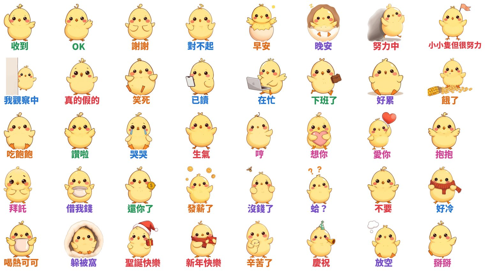

這週（11/21）再翻一次台灣與日本的 LINE 貼圖排行榜（LineStickerRanking 台灣 Top 50、日本 LINEスタンプズ 人氣特集），幾個元素很明顯：

- **「小小隻但很努力」**：台灣榜 #8「Mama2hard: Tiny but Still Trying!」上週才上架就衝進前 10，自嘲型努力梗正紅。
- **借錢／還錢、錢包梗**：#9 鯊嗨咪「Borrow and repay」，月底聊天永遠用得到。
- **人生觀察員**：Dylan 的「life Observer」系列仍霸佔 #2、#3。
- **冬季＋年末年始**：日本人氣特集主打「毎年使える冬のスタンプ（年賀入り）」——一套買了每年都能用。

所以這次的新角色是**小雞嗶嗶（Bibi）**：蛋形圓滾滾、頭上一撮呆毛，小小隻但每件事都拼盡全力。

> 🐤 **小雞嗶嗶・小小隻也很努力40入**（40 張靜態貼圖，70 LINE 代幣）👉 [Massor 的 LINE 貼圖小舖](https://line.me/S/shop/sticker/author/6564520?utm_source=ghpages&utm_medium=bridge&utm_campaign=bibi-chick)
> 本套已送審，審核通過後會出現在同一個作者頁面。

## 40 種表情，從上班到過年一套搞定

收到、OK、謝謝、對不起、早安、晚安、努力中、小小隻但很努力、我觀察中、真的假的、笑死、已讀、在忙、下班了、好累、餓了、吃飽飽、讚啦、哭哭、生氣、哼、想你、愛你、抱抱、拜託、借我錢、還你了、發薪了、沒錢了、蛤？、不要、好冷、喝熱可可、躲被窩、聖誕快樂、新年快樂、辛苦了、慶祝、放空、掰掰。

工作群組用「收到／在忙／下班了／辛苦了」，朋友之間用「借我錢／還你了／沒錢了」互虧，冬天有「好冷／躲被窩／喝熱可可」，12 月到農曆年直接用「聖誕快樂／新年快樂」，而且沒有寫年份，明年後年都能繼續用。全部配上大字繁中、白色貼紙描邊，深色模式也清楚。

## 怎麼做的

1. **趨勢調研**：firecrawl 抓台灣 Top 50 排行、agent-reach 搜日本人氣特集，歸納出「小小但努力」、借還錢、觀察員、冬季年末四個元素。
2. **角色生成**：本地 ComfyUI 跑 FLUX schnell + 繪本風 LoRA（flux-whimsical-storybook-lora），40 張固定同一個 seed，角色長相一致。
3. **後製**：自動去背、加白邊、壓繁中字，輸出 LINE 規格（370×320 以內、偶數尺寸、main 240×240、tab 96×74）。

## 日本・香港的朋友

- 🇯🇵 「ひよこのピピ ちいさくても頑張る40」— まんまるひよこが小さな体で全力投球。了解・忙しい・お疲れさま・給料日・寒い、そしてクリスマスとお正月のあいさつまで 40 種類（年号なしで毎年使えます）。
- 🇭🇰 小雞嗶嗶細細粒但好努力：收到、好忙、放工、借錢還錢、出糧、好凍，連聖誕同新年都有，40 款一套搞掂。

👉 [LINE 貼圖小舖：Massor](https://line.me/S/shop/sticker/author/6564520?utm_source=ghpages&utm_medium=bridge&utm_campaign=bibi-chick)

更多貼圖作品整理在 [LINE 貼圖合集](/blog/line-stickers/)。
