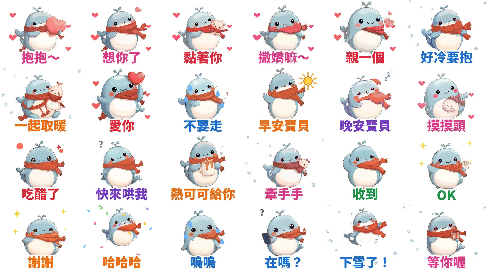

上一套「小鯨魚泡泡・黏黏戀愛日常」是我們目前賣得最快的一套，所以續集來了。天氣一冷，最常傳的就是「好冷要抱」「想你了」「晚安寶貝」，這次就把冬天情侶最常說的話做成 **24 張動態貼圖**，還請來新角色 **粉鯨啵啵** 當泡泡的另一半。

> 🐋 **小鯨魚泡泡・黏黏戀愛日常2（冬季抱抱撒嬌）**（動態貼圖 24 張）👉 [Massor 的 LINE 貼圖小舖](https://line.me/S/shop/sticker/author/6564520?utm_source=ghpages&utm_medium=bridge&utm_campaign=paopao-winter-hugs&utm_content=author-6564520)（本套已送審，通過後同一頁開賣）

## 這套的重點

- **冬天限定的黏人台詞**：好冷要抱、一起取暖、熱可可給你、牽手手、下雪了。
- **新角色粉鯨啵啵**：黏著你、摸摸頭、牽手手、不要走，兩隻一起出場。
- **17 張都是戀愛日常**：抱抱、想你、撒嬌、親一個、吃醋、哄我，傳給另一半剛剛好。
- **日常也好用**：收到、OK、謝謝、哈哈哈、在嗎，朋友群組也能用。

## 🔊 點一下，聽泡泡對你說

每張都配了一句台灣軟萌女聲（下面的影片有聲音，點開取消靜音就能聽）：

  <figure class="ms-c">
    <video src="https://github.com/ckw19810413/ckw19810413.github.io/releases/download/media-line-animated-sticker-whale-paopao-winter-hugs/paopao2-01.mp4" poster="sound/01.jpg" muted autoplay loop playsinline preload="metadata"></video>
    <figcaption>抱抱～抱緊緊！</figcaption>
  </figure>
  <figure class="ms-c">
    <video src="https://github.com/ckw19810413/ckw19810413.github.io/releases/download/media-line-animated-sticker-whale-paopao-winter-hugs/paopao2-02.mp4" poster="sound/02.jpg" muted autoplay loop playsinline preload="metadata"></video>
    <figcaption>人家想你了啦～</figcaption>
  </figure>
  <figure class="ms-c">
    <video src="https://github.com/ckw19810413/ckw19810413.github.io/releases/download/media-line-animated-sticker-whale-paopao-winter-hugs/paopao2-03.mp4" poster="sound/03.jpg" muted autoplay loop playsinline preload="metadata"></video>
    <figcaption>我要一直黏著你！</figcaption>
  </figure>
  <figure class="ms-c">
    <video src="https://github.com/ckw19810413/ckw19810413.github.io/releases/download/media-line-animated-sticker-whale-paopao-winter-hugs/paopao2-04.mp4" poster="sound/04.jpg" muted autoplay loop playsinline preload="metadata"></video>
    <figcaption>嗯～人家要嘛～</figcaption>
  </figure>
  <figure class="ms-c">
    <video src="https://github.com/ckw19810413/ckw19810413.github.io/releases/download/media-line-animated-sticker-whale-paopao-winter-hugs/paopao2-05.mp4" poster="sound/05.jpg" muted autoplay loop playsinline preload="metadata"></video>
    <figcaption>啾～親一個！</figcaption>
  </figure>
  <figure class="ms-c">
    <video src="https://github.com/ckw19810413/ckw19810413.github.io/releases/download/media-line-animated-sticker-whale-paopao-winter-hugs/paopao2-06.mp4" poster="sound/06.jpg" muted autoplay loop playsinline preload="metadata"></video>
    <figcaption>好冷喔～要抱抱！</figcaption>
  </figure>
  <figure class="ms-c">
    <video src="https://github.com/ckw19810413/ckw19810413.github.io/releases/download/media-line-animated-sticker-whale-paopao-winter-hugs/paopao2-07.mp4" poster="sound/07.jpg" muted autoplay loop playsinline preload="metadata"></video>
    <figcaption>一起取暖最幸福～</figcaption>
  </figure>
  <figure class="ms-c">
    <video src="https://github.com/ckw19810413/ckw19810413.github.io/releases/download/media-line-animated-sticker-whale-paopao-winter-hugs/paopao2-08.mp4" poster="sound/08.jpg" muted autoplay loop playsinline preload="metadata"></video>
    <figcaption>愛你喔！</figcaption>
  </figure>
  <figure class="ms-c">
    <video src="https://github.com/ckw19810413/ckw19810413.github.io/releases/download/media-line-animated-sticker-whale-paopao-winter-hugs/paopao2-09.mp4" poster="sound/09.jpg" muted autoplay loop playsinline preload="metadata"></video>
    <figcaption>不要走嘛～</figcaption>
  </figure>
  <figure class="ms-c">
    <video src="https://github.com/ckw19810413/ckw19810413.github.io/releases/download/media-line-animated-sticker-whale-paopao-winter-hugs/paopao2-10.mp4" poster="sound/10.jpg" muted autoplay loop playsinline preload="metadata"></video>
    <figcaption>早安寶貝～</figcaption>
  </figure>
  <figure class="ms-c">
    <video src="https://github.com/ckw19810413/ckw19810413.github.io/releases/download/media-line-animated-sticker-whale-paopao-winter-hugs/paopao2-11.mp4" poster="sound/11.jpg" muted autoplay loop playsinline preload="metadata"></video>
    <figcaption>晚安寶貝，好夢喔～</figcaption>
  </figure>
  <figure class="ms-c">
    <video src="https://github.com/ckw19810413/ckw19810413.github.io/releases/download/media-line-animated-sticker-whale-paopao-winter-hugs/paopao2-12.mp4" poster="sound/12.jpg" muted autoplay loop playsinline preload="metadata"></video>
    <figcaption>乖～摸摸頭</figcaption>
  </figure>
  <figure class="ms-c">
    <video src="https://github.com/ckw19810413/ckw19810413.github.io/releases/download/media-line-animated-sticker-whale-paopao-winter-hugs/paopao2-13.mp4" poster="sound/13.jpg" muted autoplay loop playsinline preload="metadata"></video>
    <figcaption>哼！我吃醋了！</figcaption>
  </figure>
  <figure class="ms-c">
    <video src="https://github.com/ckw19810413/ckw19810413.github.io/releases/download/media-line-animated-sticker-whale-paopao-winter-hugs/paopao2-14.mp4" poster="sound/14.jpg" muted autoplay loop playsinline preload="metadata"></video>
    <figcaption>快來哄我啦～</figcaption>
  </figure>
  <figure class="ms-c">
    <video src="https://github.com/ckw19810413/ckw19810413.github.io/releases/download/media-line-animated-sticker-whale-paopao-winter-hugs/paopao2-15.mp4" poster="sound/15.jpg" muted autoplay loop playsinline preload="metadata"></video>
    <figcaption>熱可可給你，暖暖的～</figcaption>
  </figure>
  <figure class="ms-c">
    <video src="https://github.com/ckw19810413/ckw19810413.github.io/releases/download/media-line-animated-sticker-whale-paopao-winter-hugs/paopao2-16.mp4" poster="sound/16.jpg" muted autoplay loop playsinline preload="metadata"></video>
    <figcaption>牽手手～</figcaption>
  </figure>
  <figure class="ms-c">
    <video src="https://github.com/ckw19810413/ckw19810413.github.io/releases/download/media-line-animated-sticker-whale-paopao-winter-hugs/paopao2-17.mp4" poster="sound/17.jpg" muted autoplay loop playsinline preload="metadata"></video>
    <figcaption>收到！</figcaption>
  </figure>
  <figure class="ms-c">
    <video src="https://github.com/ckw19810413/ckw19810413.github.io/releases/download/media-line-animated-sticker-whale-paopao-winter-hugs/paopao2-18.mp4" poster="sound/18.jpg" muted autoplay loop playsinline preload="metadata"></video>
    <figcaption>OK！沒問題！</figcaption>
  </figure>
  <figure class="ms-c">
    <video src="https://github.com/ckw19810413/ckw19810413.github.io/releases/download/media-line-animated-sticker-whale-paopao-winter-hugs/paopao2-19.mp4" poster="sound/19.jpg" muted autoplay loop playsinline preload="metadata"></video>
    <figcaption>謝謝你～</figcaption>
  </figure>
  <figure class="ms-c">
    <video src="https://github.com/ckw19810413/ckw19810413.github.io/releases/download/media-line-animated-sticker-whale-paopao-winter-hugs/paopao2-20.mp4" poster="sound/20.jpg" muted autoplay loop playsinline preload="metadata"></video>
    <figcaption>哈哈哈！笑死！</figcaption>
  </figure>
  <figure class="ms-c">
    <video src="https://github.com/ckw19810413/ckw19810413.github.io/releases/download/media-line-animated-sticker-whale-paopao-winter-hugs/paopao2-21.mp4" poster="sound/21.jpg" muted autoplay loop playsinline preload="metadata"></video>
    <figcaption>嗚嗚嗚…</figcaption>
  </figure>
  <figure class="ms-c">
    <video src="https://github.com/ckw19810413/ckw19810413.github.io/releases/download/media-line-animated-sticker-whale-paopao-winter-hugs/paopao2-22.mp4" poster="sound/22.jpg" muted autoplay loop playsinline preload="metadata"></video>
    <figcaption>在嗎？在嗎？</figcaption>
  </figure>
  <figure class="ms-c">
    <video src="https://github.com/ckw19810413/ckw19810413.github.io/releases/download/media-line-animated-sticker-whale-paopao-winter-hugs/paopao2-23.mp4" poster="sound/23.jpg" muted autoplay loop playsinline preload="metadata"></video>
    <figcaption>哇～下雪了！</figcaption>
  </figure>
  <figure class="ms-c">
    <video src="https://github.com/ckw19810413/ckw19810413.github.io/releases/download/media-line-animated-sticker-whale-paopao-winter-hugs/paopao2-24.mp4" poster="sound/24.jpg" muted autoplay loop playsinline preload="metadata"></video>
    <figcaption>我等你喔～</figcaption>
  </figure>

## 24 款貼圖對照表

| 編號 | 貼圖 | 戀愛日常 | 語音 |
|:---:|:---|:---:|:---|
| 01 | 抱抱～ | 💕 | 抱抱～抱緊緊！ |
| 02 | 想你了 | 💕 | 人家想你了啦～ |
| 03 | 黏著你 | 💕 | 我要一直黏著你！ |
| 04 | 撒嬌嘛～ | 💕 | 嗯～人家要嘛～ |
| 05 | 親一個 | 💕 | 啾～親一個！ |
| 06 | 好冷要抱 | 💕 | 好冷喔～要抱抱！ |
| 07 | 一起取暖 | 💕 | 一起取暖最幸福～ |
| 08 | 愛你 | 💕 | 愛你喔！ |
| 09 | 不要走 | 💕 | 不要走嘛～ |
| 10 | 早安寶貝 | 💕 | 早安寶貝～ |
| 11 | 晚安寶貝 | 💕 | 晚安寶貝，好夢喔～ |
| 12 | 摸摸頭 | 💕 | 乖～摸摸頭 |
| 13 | 吃醋了 | 💕 | 哼！我吃醋了！ |
| 14 | 快來哄我 | 💕 | 快來哄我啦～ |
| 15 | 熱可可給你 | 💕 | 熱可可給你，暖暖的～ |
| 16 | 牽手手 | 💕 | 牽手手～ |
| 17 | 收到 |  | 收到！ |
| 18 | OK |  | OK！沒問題！ |
| 19 | 謝謝 |  | 謝謝你～ |
| 20 | 哈哈哈 |  | 哈哈哈！笑死！ |
| 21 | 嗚嗚 |  | 嗚嗚嗚… |
| 22 | 在嗎？ |  | 在嗎？在嗎？ |
| 23 | 下雪了！ |  | 哇～下雪了！ |
| 24 | 等你喔 | 💕 | 我等你喔～ |

## 怎麼做的

角色圖由 FLUX schnell 加繪本風 LoRA 在本機生成，再用程式做成 3 秒循環的 APNG 動畫，語音用 edge-tts 的台灣女聲。

👉 [前往 LINE 貼圖小舖看泡泡的所有貼圖](https://line.me/S/shop/sticker/author/6564520?utm_source=ghpages&utm_medium=bridge&utm_campaign=paopao-winter-hugs&utm_content=author-6564520)
