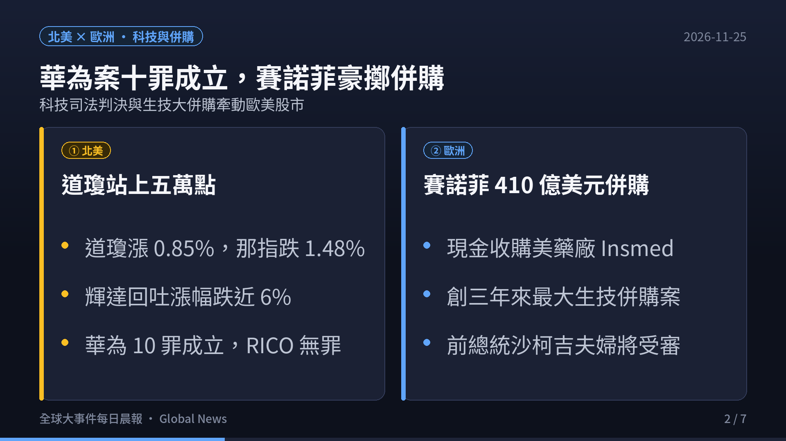
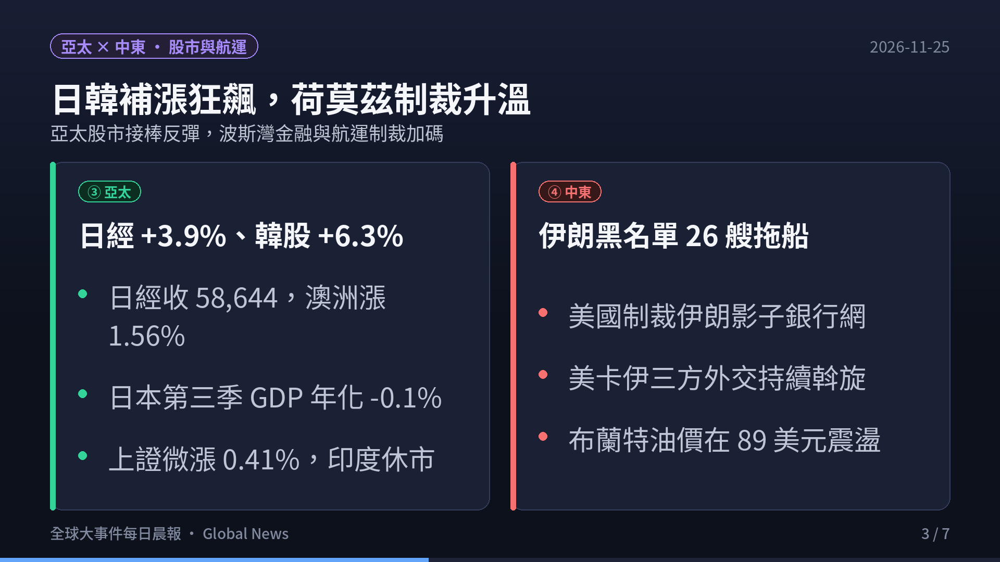
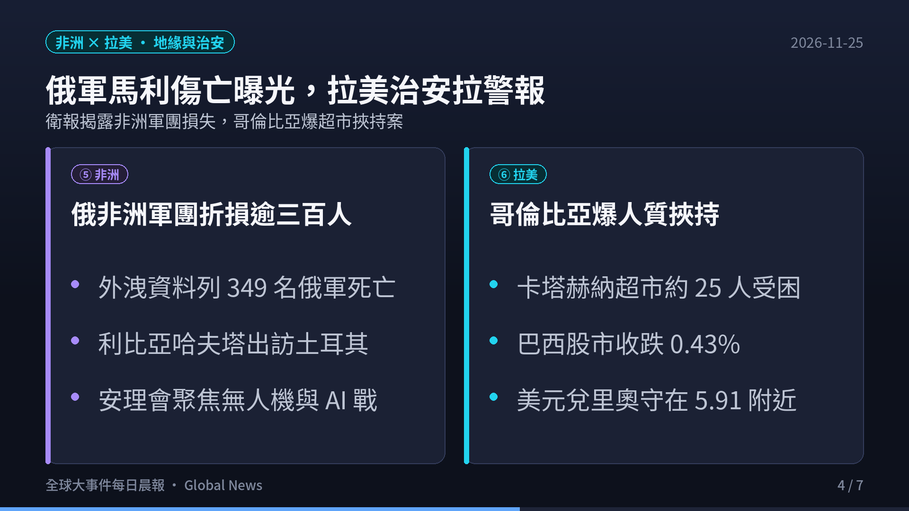
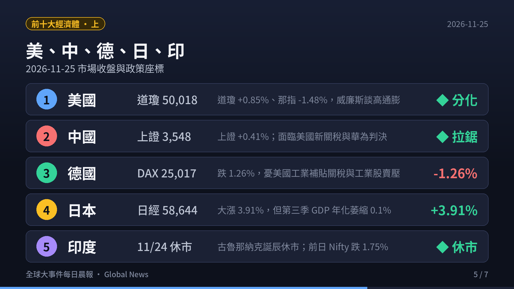
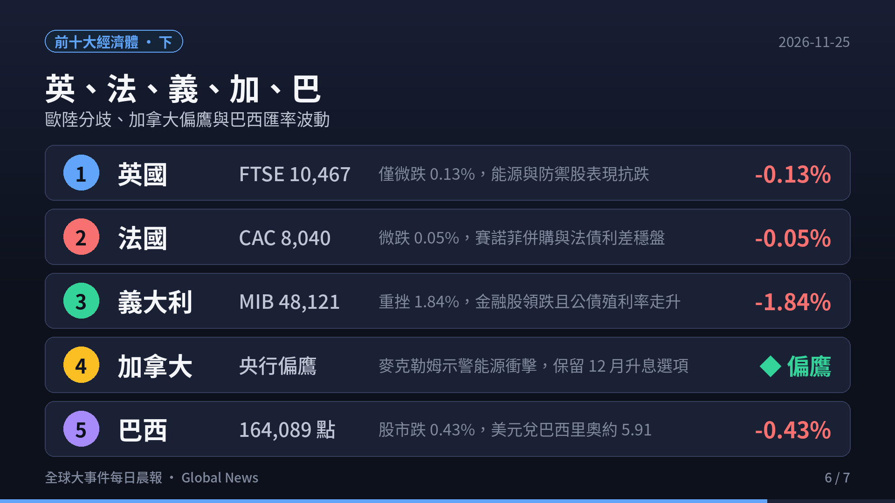
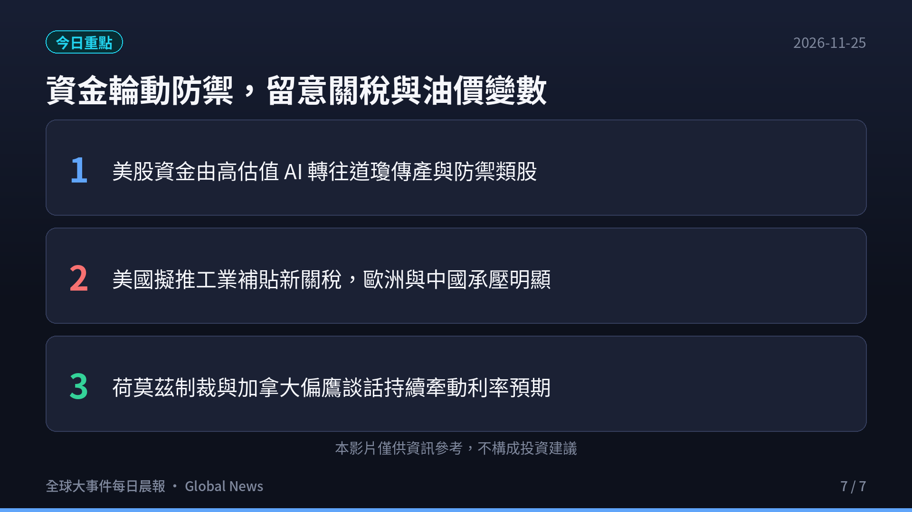

  

    <iframe src="https://www.youtube.com/embed/vXVNYXcD3pI" title="2026-11-25 全球大事件晨報" style="position: absolute; top:0; left: 0; width: 100%; height: 100%; border: 0;" allow="accelerometer; autoplay; clipboard-write; encrypted-media; gyroscope; picture-in-picture; web-share" allowfullscreen></iframe>
  

> **一句話看今天：** 資金由高估值 AI 類股轉進傳統藍籌與防禦股，道瓊工業指數漲 0.85% 收 50,018.70 點首度站上五萬關口，那斯達克則因輝達回跌近 6% 收跌 1.48%；司法與生技領域分別爆出華為 10 項罪名成立（RICO 獲判無罪）及法國賽諾菲 410 億美元收購美商 Insmed 兩大震撼彈。

## 今日六大焦點（各大洲）

### ① 北美｜道瓊首破 50,000 點但科技回檔；華為 10 罪成立、RICO 無罪
美股週二（11/24）呈現明顯板塊輪動：道瓊工業指數上漲 423.39 點（+0.85%）收 **50,018.70 點**，站上五萬點大關；標普 500 小跌 0.50% 收 7,201.09 點，那斯達克則受晶片與 AI 獲利了結拖累下跌 1.48% 收 23,733.53 點，輝達（Nvidia）回吐部分前日暴漲幅度、收跌近 6%，同時紐約聯準銀行總裁威廉斯（John Williams）示警通膨仍偏高。司法與監管方面，紐約布魯克林聯邦陪審團裁定華為（Huawei）共謀竊取商業機密、銀行與電信詐欺、洗錢及違反伊朗制裁等 **10 項刑事罪名成立**，但駁回檢方最重大的《反勒索及受賄組織法》（RICO）敲詐勒索罪及妨礙司法共謀指控；華為表示將提出上訴。

來源：[BBC World](https://www.bbc.co.uk/news/articles/cmy49ngydqzpo)、[AP News](https://apnews.com/article/wall-street-stocks-dow-nasdaq-6cc4e580290aadf304ee316d6d46dd81)、[Yahoo Finance](https://finance.yahoo.com/markets/live/stock-market-today-tuesday-november-24-dow-sp-500-nasdaq-chip-stocks-nvidia-140629923.html)、[TheCloseReport](https://theclosereport.com/)

### ② 歐洲｜賽諾菲 410 億美元現金併購 Insmed；沙柯吉夫婦面臨受審
法國製藥大廠賽諾菲（Sanofi）週二宣布以每股 175 美元現金、總價 **410 億美元**收購美國呼吸系統疾病藥廠 Insmed（激勵 Insmed 股價勁揚逾 14%），寫下自 2023 年底輝瑞收購 Seagen 以來全球生技製藥業最大宗併購案。歐股整體受美國擬推動工業補貼新關稅及科技股降溫影響收黑，泛歐 Euro Stoxx 50 跌 1.15%、德國 DAX 跌 1.26%、義大利 FTSE MIB 重挫 1.84%，英國 FTSE 100（-0.13%）與法國 CAC 40（-0.05%）相對抗跌。此外，法國法院裁定前總統沙柯吉（Nicolas Sarkozy）與夫人 Carla Bruni 將因選舉資金調查相關指控面臨審判。

來源：[CNBC](https://www.cnbc.com/2026/11/24/insmed-sanofi-deal-stock-pharma.html)、[Newsquawk](https://www.newsquawk.com/headlines/european-closes-euro-stoxx-50--115-at-6005-dax-40--131-at-25006-ftse-100--013-at-10467-cac-40--005-at-8040-ftse-mib--184-at-48121-ibex-35--086-at-19016-psi-019-at-9334-smi--001-at-14734-aex--107-at-1077)、[BBC World](https://www.bbc.co.uk/news/articles/c65y17pwv1z7o)、[La Repubblica](https://www.repubblica.it/en/economy/2026/11/24/diretta/today_s_stock_markets_24_november_markets_rise_as_huang_returns-425745546/)

### ③ 亞太與大洋洲｜日韓股市補漲狂飆，日本 Q3 GDP 微幅萎縮
亞太股市週二全面反應美股前日大漲的補漲行情：假期後復市的日本日經 225 指數大漲 **3.91%**（+2,207.98 點）收 58,644.63 點，南韓 KOSPI 狂飆 **6.32%** 重返 5,006.03 點，澳洲 ASX 200 上漲 **1.56%** 收 8,726.4 點，中國上證指數小漲 0.41% 收 3,548.37 點（深證成指 +1.63%）。不過日本宏觀數據呈現「股強經弱」，第三季實質 GDP 年化季減 0.1%、民間消費下滑 0.3%；印度 BSE 與 NSE 股市週二因古魯那納克誕辰（Guru Nanak Jayanti）休市一天。

來源：[TheCloseReport](https://theclosereport.com/)、[ABC News](https://www.abc.net.au/news/2026-11-24/asx-markets-business-news-live-updates-nov-24-2026/107419524)、[Times of India](https://timesofindia.indiatimes.com/business/india-business/stock-market-holiday-today-are-bse-nse-closed-on-november-24-for-guru-nanak-jayanti/articleshow/136118430.cms)

### ④ 中東｜荷莫茲海峽制裁與航運角力升溫，油價止跌反彈
中東航運危機持續發酵，伊朗新設的海灣水道管理機構將 **26 艘協助船隻改道南線的拖船列入黑名單**，美軍海上封鎖與海峽水雷傳聞仍未平息；同時美國財政部宣布新一輪針對伊朗「影子銀行網路」與相關個人的金融制裁。卡達、美國與伊朗高層持續進行幕後外交斡旋；也門胡塞武裝則向亞丁（Aden）逼近。油市在供應寬鬆與荷莫茲船隻遇襲風險之間劇烈拉鋸，布蘭特原油亞盤徘徊每桶 88.97 美元後，美盤因航運風險再度走高約 2 美元。

來源：[CNBC](https://www.cnbc.com/2026/11/24/oil-wti-brent-hormuz-supply.html)、[AP News](https://apnews.com/article/mideast-iran-gaza-israel-houthis-libya-november-24-2026-ba01cb036a849ba69873da5000ee08d5)、[Anadolu Agency](https://www.aa.com.tr/en/world/morning-briefing-nov-24-2026/4135240)

### ⑤ 非洲與聯合國｜外洩資料揭俄非洲軍團馬利折損 349 人；利比亞哈夫塔訪土
《衛報》獨家報導指出，外洩的軍事紀錄顯示過去三年間，俄羅斯「非洲軍團」（Africa Corps）在支援馬利軍政府作戰期間已有 **349 名俄方人員陣亡**，突顯莫斯科在薩赫勒地區面臨的高昂戰損。北非方面，在烏克蘭確認以無人艇擊中利比亞班加西外海兩艘俄艦數日後，利比亞東部強人哈夫塔（Khalifa Haftar）訪問土耳其。聯合國安理會亦召開會議，檢視無人機與 AI 武器如何重塑現代衝突與平民風險。

來源：[The Guardian](https://www.theguardian.com/world/2026/nov/24/russian-fighters-killed-in-mali-africa-leaked-data)、[Al Jazeera](https://www.aljazeera.com/news/2026/11/24/libyas-haftar-visits-turkiye-days-after-ukraine-hits-russian-warship)、[UN News](https://news.un.org/feed/view/en/story/2026/11/1168866)

### ⑥ 拉丁美洲｜哥倫比亞超市驚傳 25 人質挾持案；巴西股匯微幅回檔
拉丁美洲方面，哥倫比亞港口城市卡塔赫納（Cartagena）發生武裝嫌犯逃入 Éxito 超市並挾持約 **25 名人質**事件，警方封鎖現場展開談判營救；巴西方面則出現極端降雨災情與治安插曲。金融市場上，巴西聖保羅 Ibovespa 指數收跌 0.43% 至 **164,089.81 點**，商業美元兌巴西里奧報 **5.9107**（小跌 0.26%），持續消化大宗商品價格與全球貿易變數。

來源：[Al Jazeera](https://www.aljazeera.com/news/2026/11/24/hostage-situation-reported-in-colombia-as-armed-men-flee-into-supermarket)、[TheCloseReport](https://theclosereport.com/)、[InfoMoney](https://www.infomoney.com.br/mercados/ibovespa-hoje-bolsa-de-valores-ao-vivo-24112026/)

## 前十大經濟體總覽

| # | 經濟體 | 今日焦點 | 訊號 |
|---|---|---|---|
| 1 | 美國 | 道瓊漲 0.85% 首破五萬（50,018.70）；那指跌 1.48%、輝達回跌近 6%；紐約 Fed 威廉斯指通膨仍偏高，華為 10 罪成立 | ◆ 分化 |
| 2 | 中國 | 上證漲 0.41% 收 3,548.37、深證 +1.63%；工業產出與內需仍偏溫和，正面臨美國工業補貼關稅與華為判決雙重壓力 | ◆ 拉鋸 |
| 3 | 德國 | DAX 指數收跌 1.26% 至 25,017.81 點（失守 25,100），市場憂心美國擬對歐盟等 16 國加徵工業補貼關稅衝擊出口製造業 | ▼ 承壓 |
| 4 | 日本 | 日經 225 補漲 3.91% 收 58,644.63 點；但最新數據顯示 Q3 GDP 年化季減 0.1%、民間消費 -0.3%，呈現「股強經弱」 | ▲ 股強經弱 |
| 5 | 印度 | BSE 與 NSE 因古魯那納克誕辰（11/24）休市一天；前一日 Nifty 50 收 25,349.65 點（-1.75%），醫療診斷與內需板塊仍是長線亮點 | ◆ 休市 |
| 6 | 英國 | FTSE 100 僅微跌 0.13% 收 10,467.07 點，受惠能源與防禦性權值股支撐，表現明顯優於歐陸股市 | ◆ 抗跌 |
| 7 | 法國 | CAC 40 幾乎收平（-0.05% 至 8,040.49 點）；賽諾菲宣布 410 億美元現金併購美商 Insmed，法債利差相對穩定 | ◆ 穩健 |
| 8 | 義大利 | FTSE MIB 下跌 1.84% 收 48,121 點領跌歐洲主要股市，金融股承壓且 10 年期公債殖利率走升約 2.6 個基點 | ▼ 領跌 |
| 9 | 加拿大 | 央行總裁麥克勒姆（Tiff Macklem）演說警告中東能源衝擊恐延續至 2027 年推升通膨，語氣偏鷹保留 12 月升息選項；TSX 盤中小跌 | ◆ 偏鷹 |
| 10 | 巴西 | Ibovespa 收跌 0.43% 至 164,089.81 點，美元兌里奧收 5.9107，持續反映原物料波動與外部貿易政策不確定性 | ◆ 震盪 |

來源：[TheCloseReport](https://theclosereport.com/)、[Newsquawk](https://www.newsquawk.com/headlines/european-closes-euro-stoxx-50--115-at-6005-dax-40--131-at-25006-ftse-100--013-at-10467-cac-40--005-at-8040-ftse-mib--184-at-48121-ibex-35--086-at-19016-psi-019-at-9334-smi--001-at-14734-aex--107-at-1077)、[Sharecast](https://www.sharecast.com/news/market-report-europe-close/stoxx-600-nvidia-jensen-huang-basic-resources-aixtron-sanofi--24277218.html)、[Scotiabank Daily Points](https://www.scotiabank.com/ca/en/about/economics/economics-publications/post.daily-publications.daily-points.daily-points.capital-markets.2026-issues.november-24-2026.html)、[Investcom](https://www.investcom.com/2026-11-24/market-report/nasdaq-sp-500-tsx-jump-as-nvidia-reinstates-huang.htm)、[Times of India](https://timesofindia.indiatimes.com/business/india-business/stock-market-holiday-today-are-bse-nse-closed-on-november-24-for-guru-nanak-jayanti/articleshow/136118430.cms)、[InfoMoney](https://www.infomoney.com.br/mercados/ibovespa-hoje-bolsa-de-valores-ao-vivo-24112026/)

## 今日重點

1. **美股資金由高估值 AI 轉往道瓊傳產與防禦類股**，道瓊首度突破 50,000 點但科技股震盪加劇。
2. **美國擬推工業補貼新關稅**，歐洲製造業（德國 DAX、義大利 MIB）與中國資產承壓明顯。
3. **荷莫茲制裁與加拿大央行偏鷹談話**提醒市場：能源衝擊帶來的「第二輪通膨」仍是年底利率最大變數。

*本文僅供資訊參考，不構成任何投資建議。*

---

### 🔧 這份晨報是怎麼做出來的？
從多源新聞調研、AI 旁白配音、配樂混音到 YouTube 上架與部落格發布，全部由一套自動化工作流完成。想把同樣的工具用在你的工作上：

- 🛒 **[Slashman Tools 全套數位工具包（Everything Bundle）](https://slashmaster6.gumroad.com/l/everything-bundle)**
- 🛒 [Gumroad 數位商品專區](https://slashmaster6.gumroad.com/)（範本、提示詞、自動化教學）
- 🧰 [SlashmanTools 免費線上工具箱](https://slashmantools.us/)
- ☕ **Ko-fi 支持**：[ytstories0413](https://ko-fi.com/ytstories0413) ｜ [slashman413](https://ko-fi.com/slashman413)
- 📚 延伸閱讀：[《晶片戰爭》Chip War](https://www.amazon.com/dp/059371671X?tag=ytstories0413-20) ｜ [《原子習慣》](https://www.books.com.tw/products/0010792915) ｜ [《人生的智慧》](https://www.books.com.tw/products/0010613113)
