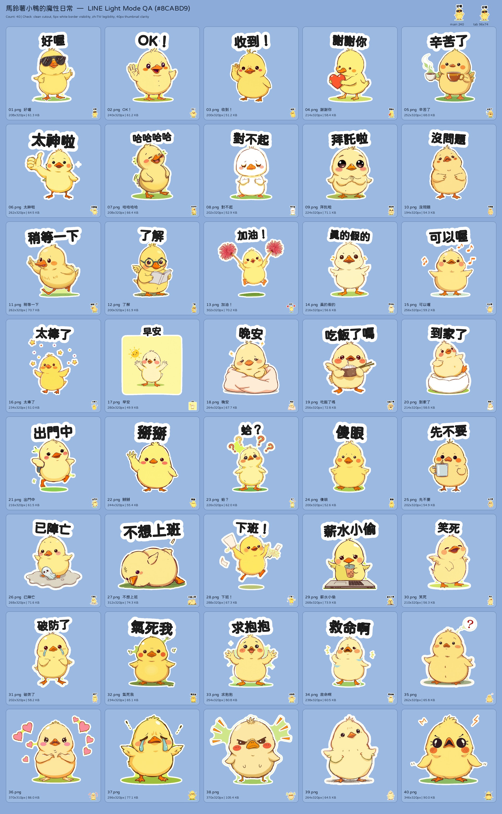

圓滾滾像一顆馬鈴薯、長著短短小翅膀與呆萌橘色扁嘴的**「馬鈴薯小鴨」（Potato Duck）**報到！

這次帶來 **40 張純圖片誇張表情靜態貼圖**，刻意不放文字，讓每個誇張動作、死魚眼、崩潰攤平與魔性偷笑自己說話——不論在台灣、香港還是日本的聊天室，都能一秒精準傳達情緒。

> 🥔🐥 **馬鈴薯小鴨的魔性日常**（40 張純圖靜態貼圖）👉 [Massor 的 LINE 貼圖小舖](https://line.me/S/shop/sticker/author/6564520?utm_source=ghpages&utm_medium=bridge&utm_campaign=5s-hook&utm_content=author-6564520)
> 本套已於 2026-11-25 送審（Creators Market ID `49451304`，[商店頁面](https://store.line.me/stickershop/product/49451304/zh-Hant?utm_source=ghpages&utm_medium=bridge&utm_campaign=5s-hook&utm_content=potato-duck-quirky-daily-49451304)），已開啟自動上架，審核通過後立即開放下載。

## 為什麼做「純圖片」誇張表情貼圖？

1. **跨語言零障礙**：沒有文字限制，台灣、香港、日本的朋友都能直接看圖會意、當成萬用反應或連環接龍。
2. **醜萌 2 頭身魔性比例**：固定使用 `ugly_cute_office` 手繪麥克筆醜萌風格，40 張角色一致度高，死魚眼與誇張嘴型反差感滿分。
3. **深色模式也清晰**：每張貼圖都經過自動去背與 **5px 純白貼紙描邊**，並通過 LINE 官方規格檢查（`370×320` 以內偶數尺寸、`main.png 240×240`、`tab.png 96×74`）。

## 台灣 / 香港 / 日本 同步推廣中

- 🇹🇼🇭🇰 **台灣・香港**：從群組已讀不回的死魚眼、上班想躺平的癱軟鴨，到狂喜打Call與大哭崩潰，40 張日常神救援。
- 🇯🇵 **日本のみなさまへ**：「じゃがいもアヒルのゆるっと毎日スタンプ（全40種・文字なし）」— 脱力系でちょっとシュールなじゃがいもアヒルが、毎日のトークをゆるく盛り上げます！

👉 [立即前往 LINE 貼圖小舖（Massor）](https://line.me/S/shop/sticker/author/6564520?utm_source=ghpages&utm_medium=bridge&utm_campaign=5s-hook&utm_content=author-6564520)

更多貼圖作品整理在 [LINE 貼圖合集](/blog/line-stickers/)，英文版製作紀錄可見 [slashmantools.us](https://slashmantools.us/blog/line-sticker-potato-duck-quirky-daily/)。
