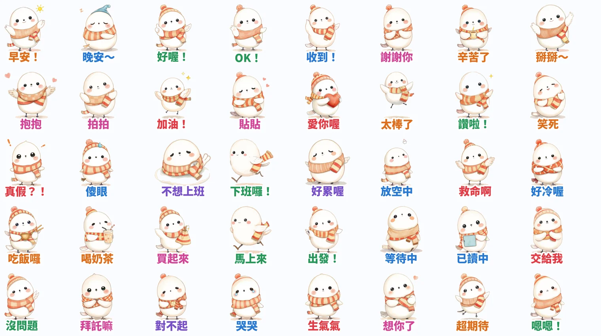
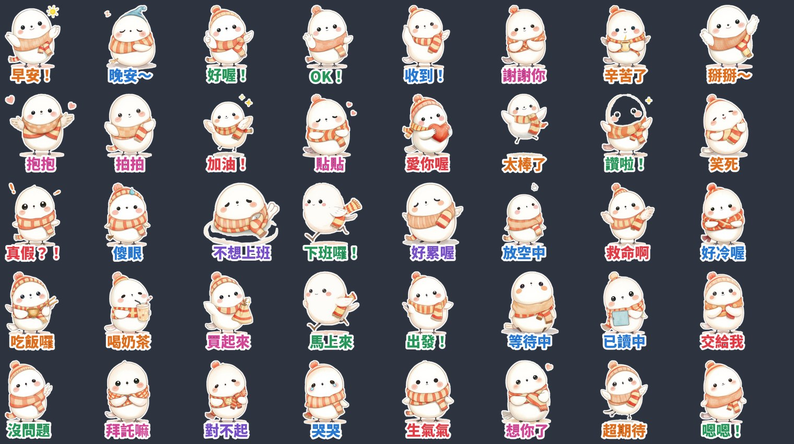

天氣轉涼，來自北海道的「**雪之妖精**」銀喉長尾山雀（シマエナガ）化身圓滾滾的「**雪球糰子**」，圍上紅白條紋針織圍巾來陪你聊天啦！

這次推出的《**雪球糰子・銀喉山雀的軟萌日常**》一次收錄 **40 張高實用度靜態貼圖**，售價只要 **70 代幣（NT$42）**，從早安晚安、好冷喔、喝奶茶，到上班族最懂的「不想上班」、「已讀中」、「放空中」、「下班囉！」通通都有。

> 🐦❄️ **雪球糰子・銀喉山雀的軟萌日常**（靜態貼圖 40 張，70 代幣 / NT$42）👉 [Massor 的 LINE 貼圖小舖](https://line.me/S/shop/sticker/author/6564520?utm_source=ghpages&utm_medium=bridge&utm_campaign=snowball-mochi&utm_content=author-6564520)（已送審，審核通過後自動開賣）

## 深色模式也超清晰！

每張貼圖都加上手繪感粗白邊與高對比粗體大字，不論你用 LINE 預設白底還是深色模式，聊天室裡一眼就能看清楚：

## 四大聊天情境一次滿足

- **日常高頻問候**：早安！、晚安～、好喔！、OK！、收到！、謝謝你、辛苦了、掰掰～、嗯嗯！
- **冬日療癒＆撒嬌貼貼**：好冷喔、抱抱、拍拍、加油！、貼貼、愛你喔、想你了、拜託嘛、超期待
- **微厭世上班＆幽默吐槽**：不想上班、下班囉！、好累喔、放空中、已讀中、笑死、真假？！、傻眼、救命啊
- **約吃約玩＆生活回應**：吃飯囉、喝奶茶、買起來、馬上來、出發！、等待中、交給我、沒問題、對不起、哭哭、生氣氣、太棒了、讚啦！

## 40 款貼圖文字一覽

| 編號 | 貼圖文字 |
|:---:|:---|
| 01 | 早安！ |
| 02 | 晚安～ |
| 03 | 好喔！ |
| 04 | OK！ |
| 05 | 收到！ |
| 06 | 謝謝你 |
| 07 | 辛苦了 |
| 08 | 掰掰～ |
| 09 | 抱抱 |
| 10 | 拍拍 |
| 11 | 加油！ |
| 12 | 貼貼 |
| 13 | 愛你喔 |
| 14 | 太棒了 |
| 15 | 讚啦！ |
| 16 | 笑死 |
| 17 | 真假？！ |
| 18 | 傻眼 |
| 19 | 不想上班 |
| 20 | 下班囉！ |
| 21 | 好累喔 |
| 22 | 放空中 |
| 23 | 救命啊 |
| 24 | 好冷喔 |
| 25 | 吃飯囉 |
| 26 | 喝奶茶 |
| 27 | 買起來 |
| 28 | 馬上來 |
| 29 | 出發！ |
| 30 | 等待中 |
| 31 | 已讀中 |
| 32 | 交給我 |
| 33 | 沒問題 |
| 34 | 拜託嘛 |
| 35 | 對不起 |
| 36 | 哭哭 |
| 37 | 生氣氣 |
| 38 | 想你了 |
| 39 | 超期待 |
| 40 | 嗯嗯！ |

---

### 🇭🇰 香港朋友睇呢度（廣東話介紹）
北海道人氣「雪之妖精」銀喉長尾山雀化身軟綿綿「雪球糰子」，圍住紅白頸巾陪你過冬！一套 40 張實用日常、返工放空、飲奶茶同暖心抱抱貼圖，只需 70 代幣，LINE 深色模式一樣超清超可愛！

### 🇯🇵 日本の皆さまへ（日本語紹介）
北海道の「雪の妖精」シマエナガが、ふわふわもちもちの『ゆきだま』になってLINEスタンプ（40個セット）に登場！毎日のあいさつ、冬のほっこり、ちょっとしたツッコミまで使いやすい40種類を70コインでお届けします。

## 製作幕後

本套貼圖先以台灣與日本 LINE 貼圖即時排行榜調研近期熱門元素（日本冬季爆紅的「シマエナガ」雪之妖精、圓滾滾糰子系輪廓與台灣高互動日常大字回應），再透過本機 **FLUX schnell + 繪本風 LoRA** 生成 40 款一致角色動作，最後以 Python 自動化管線完成去背、白邊、排版與規格驗證。

- 立即收藏 👉 [前往 Massor 的 LINE 貼圖小舖](https://line.me/S/shop/sticker/author/6564520?utm_source=ghpages&utm_medium=bridge&utm_campaign=snowball-mochi&utm_content=author-6564520)
