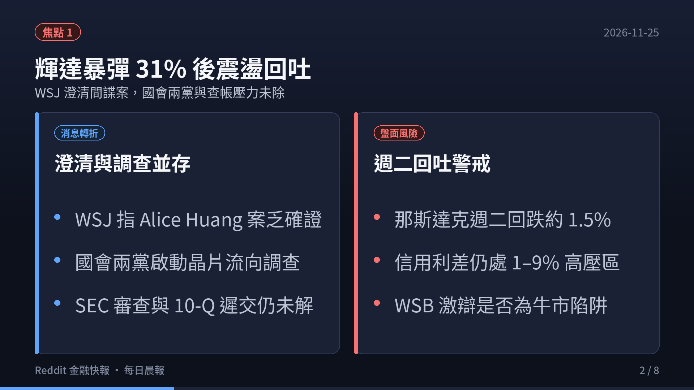
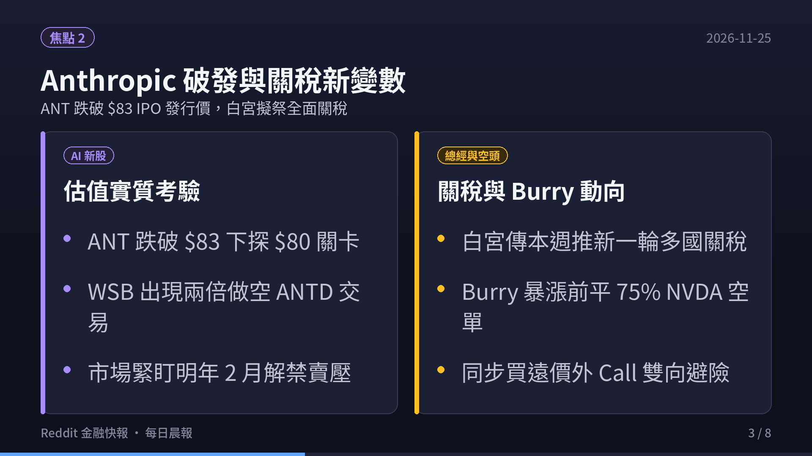
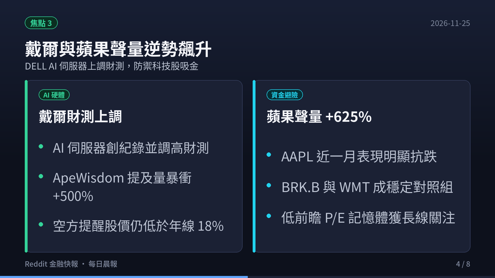
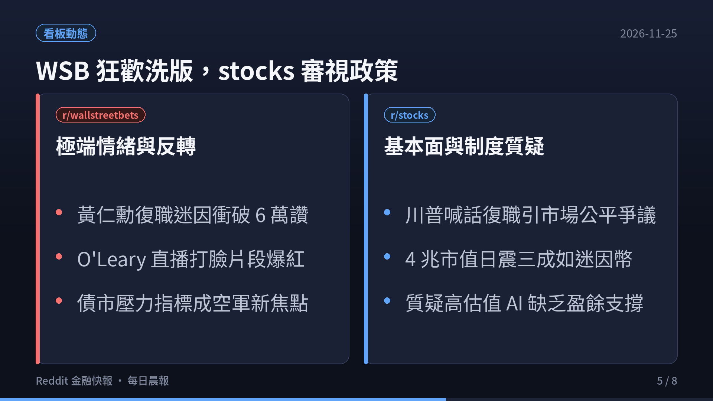
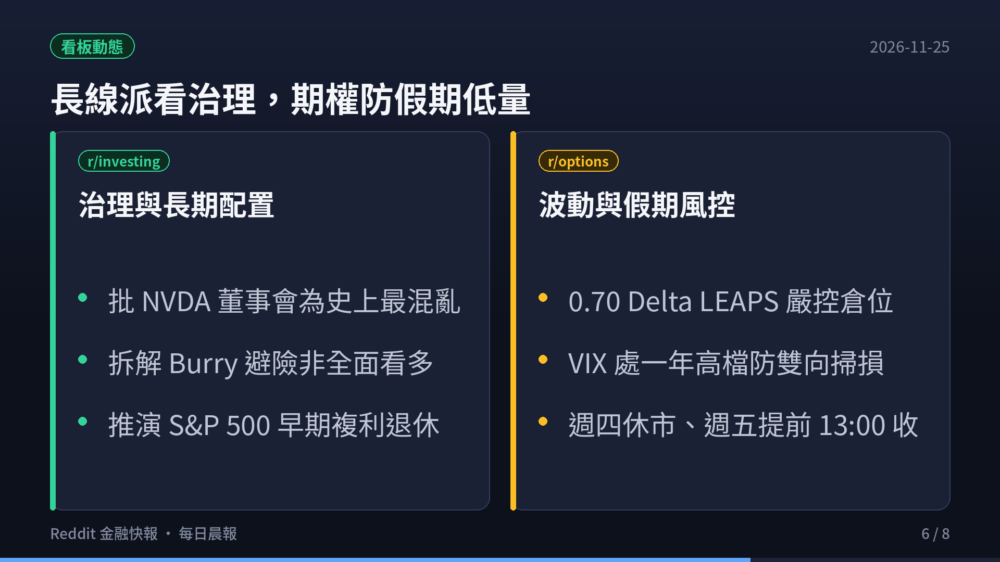
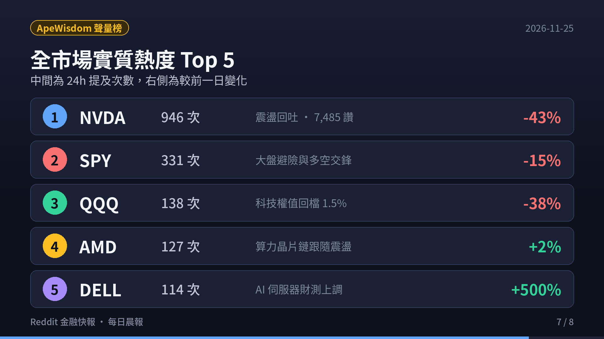
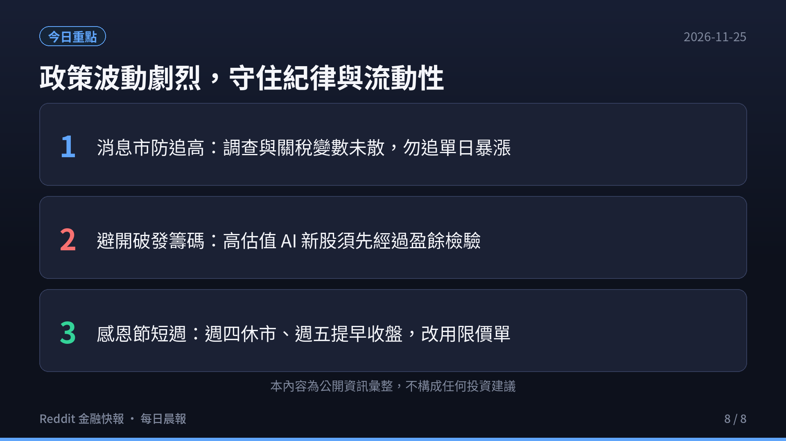

  <video controls width="100%" poster="s01.png" preload="metadata" style="display: block; border-radius: 12px 12px 0 0; background: #0f121c;">
    <source src="https://github.com/ckw19810413/ckw19810413.github.io/releases/download/media-reddit-finance-daily/reddit-finance-2026-11-25.mp4" type="video/mp4">
    您的瀏覽器不支援直接播放 MP4 影片。
  </video>
  

    🎬 <strong>60 秒晨間快報影音動態版</strong>（含 AI 摘要朗讀語音與專屬背景音樂 · YouTube 同步觀看：<a href="https://youtu.be/IBfgGBKtsGA" target="_blank" rel="noopener">點此前往 @kwc1933</a>）
  

> **監控頻道**：`r/wallstreetbets`、`r/stocks`、`r/investing`、`r/options`、`r/StockMarket`  
> **觀測區間**：近 3 日（2026-11-22 06:00 至 2026-11-25 06:00 UTC+8）  
> **資料來源**：Arctic Shift Reddit 72 小時公開貼文串、ApeWisdom 即時聲量監控 API  
> **判讀原則**：Reddit 反映的是市場「注意力、資金流向與情緒溫度」，而非買賣依據；所有投資論點仍須回到公司財報、監管文件與客觀現金流驗證。

---

## 🎯 跨板塊三大核心主線

1. **黃仁勳復職效應從狂歡轉為多空拉鋸：WSJ 澄清間諜疑雲，但國會兩黨調查與週二回吐升溫**
   - 週一（11/23 美股盤）NVIDIA 董事會一致決議讓黃仁勳復職，帶動 NVDA 單日暴彈逾 **31%**、那斯達克上漲 **6.5%**、標普 500 漲 **4.7%**，WBS 與 `r/StockMarket` 湧現數萬讚熱議。
   - 然而進入週二（11/24 美股盤），雖《華爾街日報》（WSJ）修正報導指出 Alice Huang 與國安間諜指控缺乏確鑿證據，但國會兩黨宣布對 NVDA 晶片流向與白宮介入展開調查，加上 SEC 會計審查與 10-Q 遲交問題未解，NVDA 震盪回落、那斯達克回吐約 **1.5%**；WSB 更有貼文指出信用市場（`HYG/LQD` 風險偏好比）仍停在 **1%–9%** 高壓區間，警示「牛市陷阱」風險。

2. **Anthropic（ANT）跌破 $83 IPO 發行價 + 新關稅風暴 + Michael Burry 雙向對沖轉向**
   - 剛創下史上最大規模科技 IPO 的 Anthropic（ANT）週二一度跌破 $83 發行價（下探 $80 以下），`r/stocks` 熱議其 $1.5 兆估值能否支撐，WSB 甚至出現重倉 2 倍做空 ETF（`ANTD`）並類比 2012 年 Facebook 上市次日破發走勢的交易帖。
   - WSJ 披露白宮擬於本週對中國、歐盟等數十國祭出新一輪全面關稅，再度壓抑期指與科技股風險偏好；同時 Michael Burry 在週一暴漲前平倉 75% NVDA Put、清光半導體 ETF Put 並買入遠價外 Call 避險（隨後於 SEC 調查消息出爐後出清剩餘 25% Put），被 `r/investing` 視為「雙向鎖定波動」而非轉多。

3. **硬體與防禦股逆勢突圍：DELL AI 伺服器財測上調聲量暴衝 +500%，AAPL 聲量 +625%**
   - ApeWisdom（11/25 06:00 快照）顯示全網提及量雖仍由 `NVDA`（946 次，較前日 -43% 降溫）居首，但 **DELL** 因 AI 伺服器創紀錄季度並上調全年財測，提及量暴增 **+500%**（114 次）躍居前五；**AAPL** 提及數亦跳升 **+625%**（87 次），與 MA、WMT、BRK.B 同列抗跌資金避風港。
   - 衍生品方面，`r/options` 聚焦 400+ DTE 深價內 LEAPS 回檔風控、VIX 百分位極值下的做空與避險策略，並提醒週四（11/26）感恩節休市、週五（11/27）美東 13:00 提早收盤的低流動性滑價風險。

---

## 📊 五大核心訂閱頻道：近 3 日最火熱 Top 3 話題

### 1. r/wallstreetbets（規模：1,800 萬+ · 類型：情緒／動能 · 雜訊：🔴 極高）

1. **黃仁勳復職「第二次當 CEO 會更好」引爆 WSB 史詩級狂歡與迷因洗版**
   - **來源貼文**：
     - [literally no fucking comment](https://www.reddit.com/r/wallstreetbets/comments/1y3n3u9/literally_no_fucking_comment/)（61,182 讚 / 3,101 留言 · 2026-11-24）
     - [JENSEN HUANG TELLS NVIDIA EMPLOYEES: "I'M GOING TO BE A BETTER CEO THE SECOND TIME AROUND"](https://www.reddit.com/r/wallstreetbets/comments/1y3qi6t/jensen_huang_tells_nvidia_employees_im_going_to/)（60,050 讚 / 6,383 留言 · 2026-11-24）
     - [Kevin O’Leary says Jensen Huang has zero chance of coming back, then gets the reinstatement news live on air](https://www.reddit.com/r/wallstreetbets/comments/1y4bir8/kevin_oleary_says_jensen_huang_has_zero_chance_of/)（24,034 讚 / 1,365 留言 · 2026-11-24）
   - **內容要點**：黃仁勳回歸並向員工喊話「第二次當 CEO 會做得更好」，加上節目來賓 Kevin O'Leary 才斷言「復職機率為零」隨即在直播中被新聞打臉的片段，單日席捲逾 14 萬讚；隔夜「Buy the dip」迷因（6,732 讚）與明日動向討論串（10,370 留言）持續維持極高交易熱度。

2. **WSJ 爆黃仁勳週日復職會議坦承更多婚外情，國會兩黨揚言啟動晶片出口調查**
   - **來源貼文**：
     - [Just In: Jensen Huang admitted to having more affairs to the board before getting reinstated on Sunday meeting](https://www.reddit.com/r/wallstreetbets/comments/1y425wd/just_in_jensen_huang_admitted_to_having_more/)（28,867 讚 / 2,714 留言 · 2026-11-24）
     - [Congress is going to war with NVIDIA.](https://www.reddit.com/r/wallstreetbets/comments/1y4hhge/congress_is_going_to_war_with_nvidia/)（150 讚 / 125 留言 · 2026-11-25）
   - **內容要點**：WSJ 揭露黃仁勳在週日董事會復職前向董事會坦承更多私德情節，但 Politico 同時報導國會兩黨正針對 AI 晶片疑似繞道流入中國與白宮介入疑雲展開調查，黃仁勳預計面臨國會聽證，顯示政治與監管不確定性並未隨復職落幕。

3. **狂歡後的冷思考：信用市場發警報、牛市陷阱辯論與 2 倍做空 Anthropic（ANTD）**
   - **來源貼文**：
     - [Yesterday's massive rally: Sustainable recovery or a bull trap?](https://www.reddit.com/r/wallstreetbets/comments/1y4bv5d/yesterdays_massive_rally_sustainable_recovery_or/)（145 讚 / 276 留言 · 2026-11-24）
     - [Credit markets tell a different story](https://www.reddit.com/r/wallstreetbets/comments/1y4kue6/credit_markets_tell_a_different_story/)（193 讚 / 78 留言 · 2026-11-25）
     - [Shorting the biggest IPO in history with 2x leverage. $39K on ANTD](https://www.reddit.com/r/wallstreetbets/comments/1y41kqz/shorting_the_biggest_ipo_in_history_with_2x/)（135 讚 / 103 留言 · 2026-11-24）
   - **內容要點**：有交易員引用野村報告指週一大漲受空頭回補與槓桿 ETF 再平衡放大，並指出投資級與高收益債（`HYG/LQD` 風險偏好比）仍困在 1%–9% 極端壓力區，股市反彈恐為機構出貨流動性；另一派空軍則鎖定跌破發行價的 Anthropic，重金做空並緊盯明年 2 月 16 億股解禁賣壓。

---

### 2. r/stocks（規模：約 900 萬 · 類型：綜合討論／個股研討 · 🟡 中雜訊）

1. **NVDA 董事會全票復職與「自造危機—總統救市」政策套利模式爭議**
   - **來源貼文**：
     - [NVIDIA Board Reinstates Jensen Huang as President, CEO and Board Director](https://www.reddit.com/r/stocks/comments/1y3ix82/nvidia_board_reinstates_jensen_huang_as_president/)（9,390 讚 / 2,548 留言 · 2026-11-23）
     - [Admin insiders get Jensen fired. POTUS rehires Jensen. Resolved a self-initiated crisis. Market down big, then up. Starting to be a pattern.](https://www.reddit.com/r/stocks/comments/1y3l7sg/admin_insiders_get_jensen_fired_potus_rehires/)（2,119 讚 / 203 留言 · 2026-11-23）
     - [Trump tells CNBC ‘I convinced’ Nvidia board to reinstate Jensen Huang](https://www.reddit.com/r/stocks/comments/1y3m63u/trump_tells_cnbc_i_convinced_nvidia_board_to/)（782 讚 / 272 留言 · 2026-11-24）
   - **內容要點**：川普向 CNBC 公開表示是自己「說服」NVIDIA 董事會讓黃仁勳復職；基本面與總經投資人高度質疑這種「先釋放利空砸盤、再由高層喊話救市拉抬」的劇本，認為繼 2025 關稅震盪後已形成常態，大幅削弱傳統財報研究的定價權。

2. **WSJ 改口稱 Alice Huang 非間諜，但 SEC 查帳、加州傳票與國會聽證仍在**
   - **來源貼文**：
     - [WSJ now says Alice Huang was not a spy and NVDA/Jensen Huang was not breaking any espionage laws](https://www.reddit.com/r/stocks/comments/1y4c5nd/wsj_now_says_alice_huang_was_not_a_spy_and/)（1,174 讚 / 435 留言 · 2026-11-24）
     - [Jensen’s back, Nvidia +30% - but nothing that tanked the stock got fixed](https://www.reddit.com/r/stocks/comments/1y3lpls/jensens_back_nvidia_30_but_nothing_that_tanked/)（818 讚 / 471 留言 · 2026-11-23）
     - [Congress is going to war with Nvidia](https://www.reddit.com/r/stocks/comments/1y438ty/congress_is_going_to_war_with_nvidia/)（179 讚 / 482 留言 · 2026-11-24）
   - **內容要點**：WSJ 澄清司法部、商務部與情報簡報均未發現 Alice Huang 從事間諜活動或 NVDA 違法的確鑿證據。但投資人冷靜盤點：SEC 會計詢問與未申報的 10-Q 季報、加州檢察總長傳票、H200 對中禁令以及國會閉門聽證與國防法案出口限制，沒有任何一項真正獲得解決。

3. **Anthropic 跌破 $83 IPO 發行價，極端敘事驅動交易引發社群困惑**
   - **來源貼文**：
     - [Did you miss the Anthropic IPO? Worry not, it's now about 5% cheaper!](https://www.reddit.com/r/stocks/comments/1y4gfuh/did_you_miss_the_anthropic_ipo_worry_not_its_now/)（682 讚 / 162 留言 · 2026-11-24）
     - [Can someone explain to me what the actual fuck is going on?](https://www.reddit.com/r/stocks/comments/1y4i023/can_someone_explain_to_me_what_the_actual_fuck_is/)（681 讚 / 318 留言 · 2026-11-25）
     - [Nasdaq slumps about 1.5% as Nvidia comeback reverses course and Anthropic breaks IPO price](https://www.reddit.com/r/stocks/comments/1y4pugi/nasdaq_slumps_about_15_as_nvidia_comeback/)（1 讚 / 0 留言 · 2026-11-25 快訊）
   - **內容要點**：Anthropic（ANT）週二盤中跌破 $83 發行價下探 $80 關卡，那斯達克隨 NVDA 回吐下跌近 1.5%。討論串直言 2026 年兩大破兆美元 IPO 幾乎沒有對應盈餘支撐，幾兆美元市值的龍頭卻像三期臨床前的生技股一樣單日劇震 30%，市場已進入極端敘事交易階段。

---

### 3. r/investing（規模：約 300 萬 · 類型：中長期／資產配置 · 🟢 低雜訊）

1. **「巨型股史上最混亂董事會？」——治理公信力折價與國會擴大審查**
   - **來源貼文**：
     - [Nvidia just reinstated Jensen Huang 12 days after he "resigned." Is this the most chaotic board in mega-cap history?](https://www.reddit.com/r/investing/comments/1y3j30o/nvidia_just_reinstated_jensen_huang_12_days_after/)（4,478 讚 / 1,182 留言 · 2026-11-23）
     - [The cloud over Nvidia isn’t gone just because Jensen is back](https://www.reddit.com/r/investing/comments/1y4b2l7/the_cloud_over_nvidia_isnt_gone_just_because/)（119 讚 / 85 留言 · 2026-11-24）
   - **內容要點**：長線資金指出 NVIDIA 董事會在 6 天前財報電話會議還明確拒絕請回黃仁勳，卻在幾天後全票翻盤，且獨立調查仍在持續、川普介入復職更引來民主黨擴大國會調查範圍。對長線機構而言，這種治理反覆將提高風險溢價要求。

2. **Michael Burry 暴漲前平倉 75% NVDA 賣權並買進遠價外買權：是轉多還是雙向避險？**
   - **來源貼文**：
     - [Michael Burry cut 75% of his Nvidia puts and bought calls right before Monday's +31.48% jump](https://www.reddit.com/r/investing/comments/1y47ick/michael_burry_cut_75_of_his_nvidia_puts_and/)（1,887 讚 / 215 留言 · 2026-11-24）
   - **內容要點**：針對市場誤傳《大賣空》原型 Burry 翻多，貼文還原其操作細節：他在週五急殺時賣出 75% NVDA Put、清光半導體 ETF Put、減半 Nasdaq 100 Put，同時買進遠價外 NVDA Call 作為上檔對沖；並在 SEC 查帳消息出爐後出清剩餘 25% Put，實為高波動下的風險中性對沖，且他仍公開呼籲監管機構持續追查。

3. **S&P 500 早期資本複利試算、低前瞻 P/E 科技股清單與新關稅衝擊評估**
   - **來源貼文**：
     - [If I invested about 160-200k in the s&p 500 by the time Im 35 (28 now), wouldnt that essentially be enough to retire on at age 65?](https://www.reddit.com/r/investing/comments/1y33a0c/if_i_invested_about_160200k_in_the_sp_500_by_the/)（311 讚 / 220 留言 · 2026-11-23）
     - [CHEAPEST Tech Stocks Right Now based on P/E](https://www.reddit.com/r/investing/comments/1y2smcu/cheapest_tech_stocks_right_now_based_on_pe/)（272 讚 / 157 留言 · 2026-11-22）
     - [New sweeping tariffs on China to be announced this week](https://www.reddit.com/r/investing/comments/1y4dvqc/new_sweeping_tariffs_on_china_to_be_announced/)（92 讚 / 76 留言 · 2026-11-24）
   - **內容要點**：28 歲投資人試算 35 歲前累積 16–20 萬美元投入 S&P 500 的長期複利（Coast FIRE）並討論通膨與報酬序列風險；估值派則整理低前瞻本益比科技股（如 `SNDK` 2.18x、`MU` 2.82x、`NVDA` 7.56x、`TSM` 13.81x），但也警示白宮本週擬對中國與歐盟加徵全面關稅的總經逆風。

---

### 4. r/options（規模：約 100 萬+ · 類型：衍生品／交易策略 · 🟡 中雜訊）

1. **400+ DTE 深價內（0.70+ Delta）LEAPS 回撤 -40%：嚴格停損還是靠倉位扛過波動？**
   - **來源貼文**：
     - [Managing 0.70+ Delta LEAPS in a pullback: Cut at -40% or let 400+ DTE play out?](https://www.reddit.com/r/options/comments/1y308yq/managing_070_delta_leaps_in_a_pullback_cut_at_40/)（32 讚 / 33 留言 · 2026-11-23）
   - **內容要點**：針對科技股急殺導致替代正股的深價內長天期買權（LEAPS）帳面回撤 30%–40%，資深期權交易員普遍建議：若基本面論點未破，應在建倉前就用「最大可承受損失」控制名目倉位，而非在 IV 飆高與急跌後情緒化砍倉（避免賣在地板）。

2. **週一暴力反彈後做空 SPY/NVDA 嗎？VIX 百分位極值下的四種表達策略**
   - **來源貼文**：
     - [Is now time to short the market?](https://www.reddit.com/r/options/comments/1y3r1t9/is_now_time_to_short_the_market/)（0 讚 / 35 留言 · 2026-11-24）
     - [VIX PCT near 100% of TTM](https://www.reddit.com/r/options/comments/1y3f2x5/vix_pct_near_100_of_ttm/)（8 讚 / 7 留言 · 2026-11-23）
     - [Market outlook](https://www.reddit.com/r/options/comments/1y2yaec/market_outlook/)（4 讚 / 18 留言 · 2026-11-23）
   - **內容要點**：VIX 與 VXN 飆至近一年百分位高點，SPY 期權隱含本週波動率達 4%（遠高於週均 ATR 的 2.9%）。多空雙方激辯：保守派建議利用高 IV 賣出 Put 或透過期貨避免高權利金損耗，看空派則預期聯準會升息循環與政治震盪將令反彈成為空點，但多數回覆警告在暴力反彈初期逆勢裸空風險極高。

3. **感恩節交易週流動性警報：週四休市、週五美東 13:00 提早收盤**
   - **來源貼文**：
     - [Thanksgiving week heads up: Thursday is closed and Friday ends at 1 PM](https://www.reddit.com/r/options/comments/1y36w36/thanksgiving_week_heads_up_thursday_is_closed_and/)（22 讚 / 7 留言 · 2026-11-23）
   - **內容要點**：提醒期權交易員週四（11/26）全天休市，週五（11/27）股市於美東 13:00（部分期權 13:15）提前收盤。極度清淡的成交量會放大買賣價差與市價單滑價，建議節前降低倉位或嚴格使用限價單。

---

### 5. r/StockMarket（規模：約 300 萬+ · 類型：新聞彙整／圖表 · 🟡 中雜訊）

1. **「市場已經壞掉了？」：4 兆美元市值單日暴衝 32%，貢獻標普反彈 34% 引發內線交易質疑**
   - **來源貼文**：
     - [God bless america](https://www.reddit.com/r/StockMarket/comments/1y3nn5l/god_bless_america/)（4,617 讚 / 652 留言 · 2026-11-24）
     - [Just a reminder Jensen Huang donated over 25 million to the White House Ballroom. Trumps calling for him to be reinstated is insider trading at its finest. Disgusting.](https://www.reddit.com/r/StockMarket/comments/1y3kyxh/just_a_reminder_jensen_huang_donated_over_25/)（3,708 讚 / 407 留言 · 2026-11-23）
     - [The markets are Broken and you should be worried](https://www.reddit.com/r/StockMarket/comments/1y3mxrf/the_markets_are_broken_and_you_should_be_worried/)（2,384 讚 / 552 留言 · 2026-11-24）
     - [Nvidia Accounts for 34% of S&P 500 Rally as Index Weight Climbs to 6.4%](https://www.reddit.com/r/StockMarket/comments/1y43kz4/nvidia_accounts_for_34_of_sp_500_rally_as_index/)（601 讚 / 33 留言 · 2026-11-24）
   - **內容要點**：單一 4 兆美元權值股（指數權重升至 6.4%）單日震幅達 32%，並單獨貢獻標普 500 反彈幅度的 34%。投資人直言藍籌龍頭表現已宛如迷因幣，且捐款與政策放話時間點巧合，引發對指數高度集中與制度公信力的嚴重擔憂。

2. **遊戲與迷因板塊對比：Ubisoft 破敗遭嘲諷 vs GME 逆勢跑贏大盤**
   - **來源貼文**：
     - [Bye Ubisoft, you will not be missed](https://www.reddit.com/r/StockMarket/comments/1y2fml6/bye_ubisoft_you_will_not_be_missed/)（1,881 讚 / 172 留言 · 2026-11-22）
     - [GME beating the entire market.](https://www.reddit.com/r/StockMarket/comments/1y2ehrp/gme_beating_the_entire_market/)（1,200 讚 / 156 留言 · 2026-11-22）
   - **內容要點**：在科技權值股上週劇烈回檔之際，遊戲開發商 Ubisoft 股價長期崩跌成為社群熱議負面教材；反觀具備充沛現金帳面與散戶共識的 GameStop（GME）在修正期間反而跑贏大盤，顯示市場風險偏好劇烈切換。

3. **那斯達克觸發漲停熔斷與「美股已被視為大到不能倒」的結構反思**
   - **來源貼文**：
     - [The truth is, the US stock market is backed by the full faith and credit of the US government. It’s evident that it’s too big to fail.](https://www.reddit.com/r/StockMarket/comments/1y3wxhq/the_truth_is_the_us_stock_market_is_backed_by_the/)（1,095 讚 / 159 留言 · 2026-11-24）
     - [Jensen Huang reinstated as Nvidia CEO just days after he was ousted over affairs with at least three women including suspected Chinese spy](https://www.reddit.com/r/StockMarket/comments/1y3j845/jensen_huang_reinstated_as_nvidia_ceo_just_days/)（1,034 讚 / 380 留言 · 2026-11-23）
     - [NASDAQ halts limit up trading as buyer violently flood in](https://www.reddit.com/r/StockMarket/comments/1y3k4lp/nasdaq_halts_limit_up_trading_as_buyer_violently/)（550 讚 / 111 留言 · 2026-11-23）
   - **內容要點**：那斯達克週一因買盤湧入觸發 Limit-Up 暫停機制；社群感慨在美股財富效應與 AI 戰略地位綁定下，市場越來越相信聯邦政府與監管政策不會放任系統性崩盤，但也意味著「道德風險」與雙向劇震將成新常態。

---

## 📈 ApeWisdom 全市場即時聲量排行（2026-11-25 06:00 快照）

> 註：ApeWisdom 原始榜單第 8 名 `DTE`（64 次）多源自 `0DTE` 末日期權討論、第 9 名 `HR`（62 次）多為人資（HR）縮寫誤判、第 12 名 `NYT`（49 次）為《紐約時報》新聞引用。以下篩選實質美股與 ETF 焦點標的：

| 實質排名 | 原始名次 | 代號 | 標的名稱 | 當前提及數 | 24h 前提及 | 24h 變化 | 累計獲讚 | 核心驅動因素 |
|:---:|:---:|:---:|:---|:---:|:---:|:---:|:---:|:---|
| **1** | #1 | **NVDA** | NVIDIA | **946** | 1,649 | -43% | 7,485 | 復職狂飆後週二震盪回吐、國會調查與 WSJ 澄清 |
| **2** | #2 | **SPY** | SPDR S&P 500 ETF | **331** | 389 | -15% | 1,081 | 暴力反彈後的多空避險與信用壓力檢驗 |
| **3** | #3 | **QQQ** | Invesco QQQ ETF | **138** | 224 | -38% | 310 | 科技股週一 +6.5% 後週二回檔約 1.5% |
| **4** | #4 | **AMD** | AMD | **127** | 125 | **+2%** | 273 | 算力板塊跟隨晶片鏈波動與低估值比較 |
| **5** | #5 | **DELL** | Dell Technologies | **114** | 19 | **+500%** | 260 | AI 伺服器季度創紀錄並上調全年財測（惟技術面仍低於年線） |
| **6** | #6 | **MU** | Micron Technology | **95** | 84 | **+13%** | 216 | 記憶體驗算高性價比（前瞻 P/E 2.82x）逢低討論 |
| **7** | #7 | **AAPL** | Apple | **87** | 12 | **+625%** | 288 | 科技回檔期間抗跌避風港、聲量單日暴增 |

---

## 💡 綜合觀察與風險提示

1. **政治事件與信用市場背離**：股價雖因復職消息出現暴力反彈，但債市 `HYG/LQD` 風險指標與美國新一輪關稅預期仍偏保守；且 NVDA 尚有 SEC 會計審查、10-Q 遲交與國會聽證未決，短線不宜因單日反彈忽略結構風險。
2. **新股破發與解禁前瞻**：Anthropic（ANT）跌破 $83 IPO 發行價反映高估值 AI 獨角獸上市後面臨實質獲利檢驗，追高新股需留意承銷穩價結束後的籌碼壓力。
3. **假期縮短週期風控**：本週四（11/26）感恩節美股休市、週五（11/27）提早收盤，低成交量易導致期權與個股點差放大，建議控制槓桿並採用限價單操作。

---

⚠️ **免責聲明**：本報告為公開社群貼文與第三方聲量統計之客觀整理，僅供市場注意力與情緒觀察參考，**不構成任何證券、期權或金融商品之買賣建議**。投資前請自行核實一手財報與官方公告。

---

### ☕ 支持與精選工具推薦

如果你覺得這份每日晨報對你的投資視野與市場觀察有實質幫助，歡迎透過以下方式支持我們持續產出客觀數據報告：

- ☕ **請我喝杯咖啡**：[Ko-fi 小費贊助 (ytstories0413)](https://ko-fi.com/ytstories0413) 或 [Ko-fi 贊助 (slashman413)](https://ko-fi.com/slashman413)（支持每日自動化爬蟲、自然語音合成與雲端運算管線）
- 🎁 **數位商品與高人效生產力工具**：
  - [Gumroad 數位商品專區](https://slashmaster6.gumroad.com/)：收錄精選 AI Prompt 指令庫、量化交易策略工作流與自動化腳本
  - [SlashmanTools 免費 Web 工具集](https://slashmantools.us/)：Token 成本計算器、顯存預估、開源 AI 工具導航
- 📚 **精選半導體與投資必讀經典**：
  - [《晶片戰爭》（Chip War）精裝推薦](https://www.amazon.com/dp/059371671X?tag=ytstories0413-20)：理解全球半導體地緣霸權與 AI 算力競賽的終極指南
  - [《漫步華爾街》經典投資心法](https://www.books.com.tw/products/0010850028)
  - [《原子習慣》細微改變帶來巨大成就](https://www.books.com.tw/products/0010792915)
