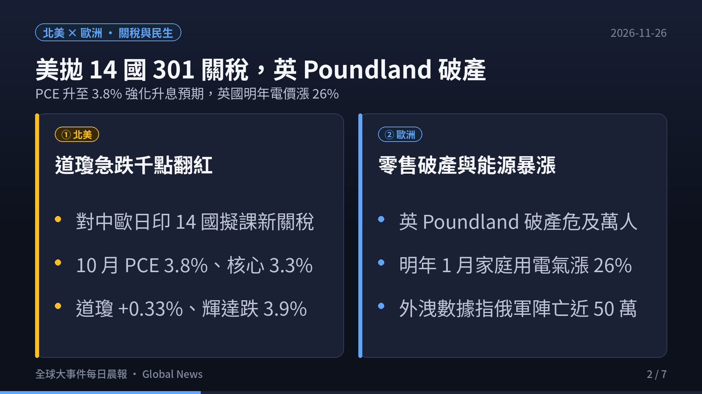
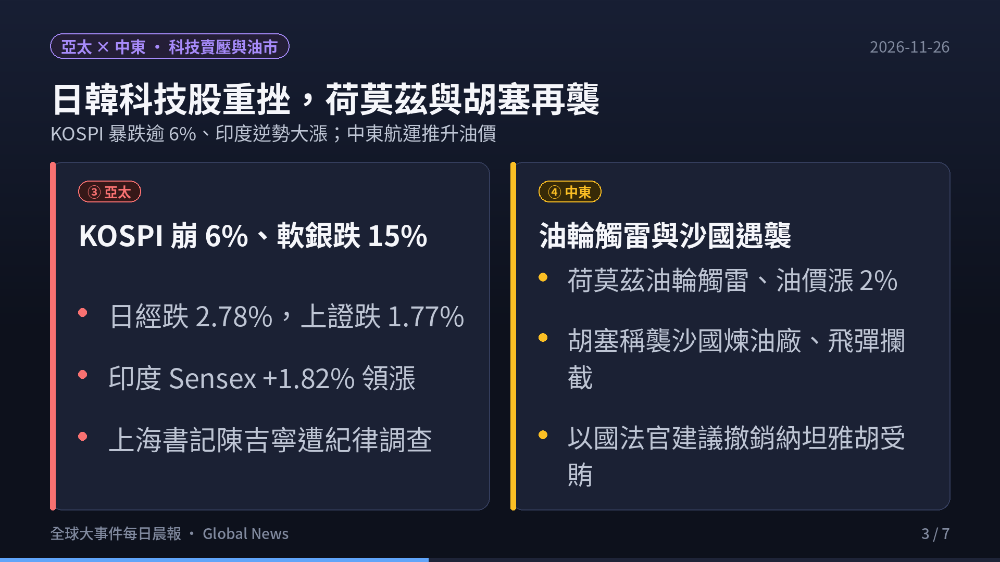
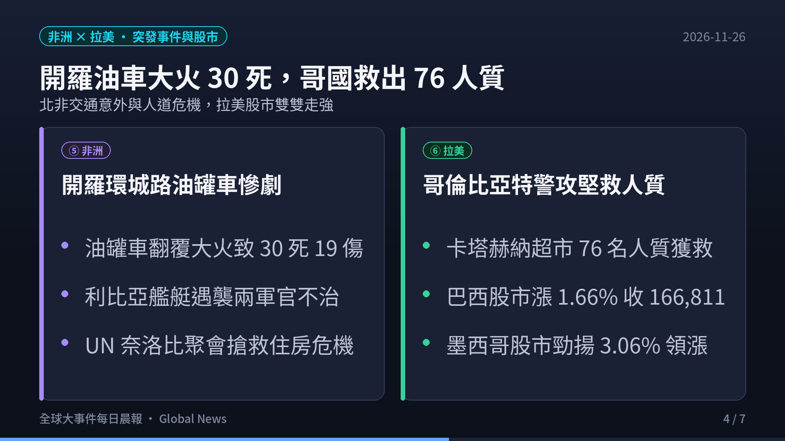
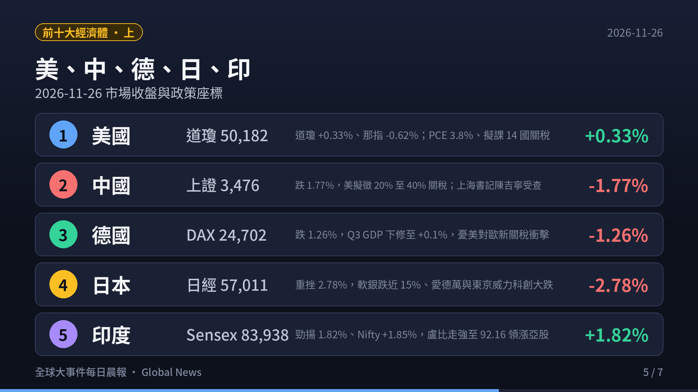
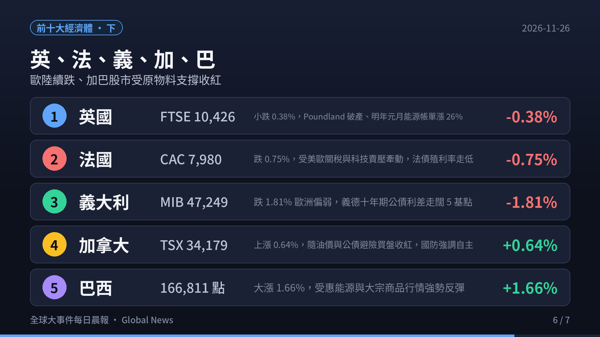
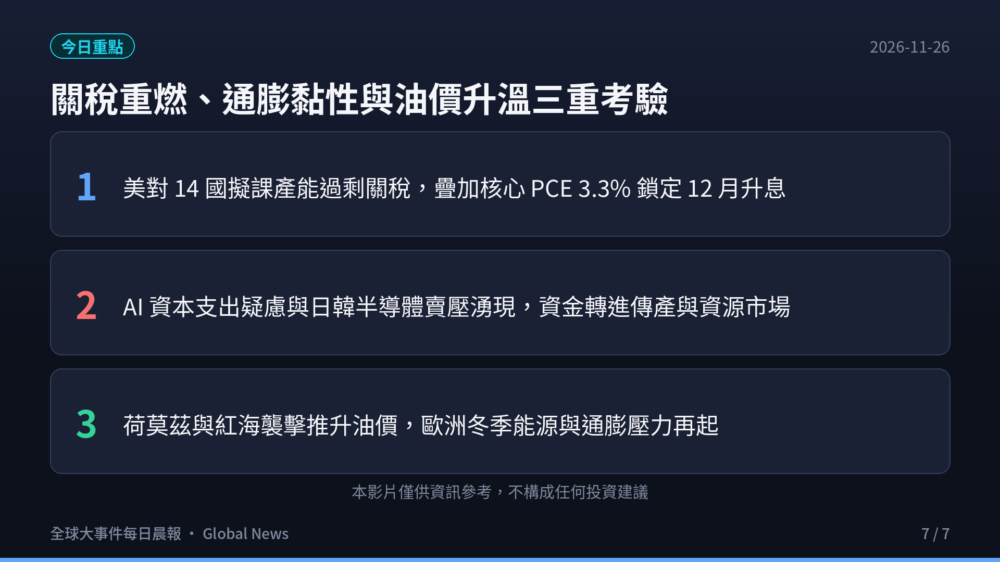

  

    <iframe src="https://www.youtube.com/embed/B7gLQEYBh5U" title="2026-11-26 全球大事件晨報" style="position: absolute; top:0; left: 0; width: 100%; height: 100%; border: 0;" allow="accelerometer; autoplay; clipboard-write; encrypted-media; gyroscope; picture-in-picture; web-share" allowfullscreen></iframe>
  

> **一句話看今天：** 美國貿易代表署（USTR）拋出針對 14 個經濟體的 301 產能過剩關稅提案，疊加 10 月 PCE 通膨升至 3.8%、核心 PCE 3.3% 幾乎鎖定 12 月升息，導致科技股與金價承壓；道瓊盤中急跌逾千點後驚險翻紅收漲 0.33%（50,182.95），亞太日韓半導體股則遭遇猛烈拋售（KOSPI 崩 6.16%、日經跌 2.78%），印度與拉美股市逆勢大漲。

## 今日六大焦點（各大洲）

### ① 北美｜美對 14 國擬課 301 新關稅；10 月 PCE 升至 3.8%、道瓊急跌翻紅
美國貿易代表署（USTR）宣布針對結構性產能過剩調查結果，擬對中國、歐盟、日本、印度、南韓、台灣等 **14 個貿易夥伴**加徵「目標式」301 關稅：其中對中國擬課 **20%**（若明年 1 月談判未果最高可升至 40%），歐盟、日本、南韓及瑞士等則依既定協議設有 15% 上限且多不疊加。宏觀數據方面，美國 10 月 PCE 年增率升至 **3.8%**、核心 PCE 年增 **3.3%**（高於預期的 3.2%），Q3 GDP 修正值年化成長 **4.3%**，初領失業金降至 18.9 萬人，強化聯準會 12 月升息預期；現貨金價一度跌破 3,500 美元關卡、創逾一年新低（約 3,534 美元/盎司）。美股週三大幅震盪後尾盤逢低買盤進駐，道瓊收漲 **0.33%** 報 **50,182.95 點**，標普 500 跌 **0.25%**（7,182.78），那斯達克跌 **0.62%**（23,585.80），輝達收跌 **3.91%**。

來源：[CNBC](https://www.cnbc.com/2026/11/25/us-tariffs-trump-section-301.html)、[CNBC PCE](https://www.cnbc.com/2026/11/25/pce-inflation-report-october-2026.html)、[BBC World](https://www.bbc.co.uk/news/articles/c893r9ke5p97o)、[MarketVeo](https://marketveo.com/indices/)、[Investing/Reuters](https://www.investing.com/news/economy-news/nasdaq-futures-slide-over-2-on-fresh-us-tariff-concerns-inflation-data-in-focus-5050138)

### ② 歐洲｜英國 Poundland 宣告破產危及 1.1 萬工作、能源帳單將大漲 26%
英國平價連鎖零售商 **Poundland** 因美國母公司 Gordon Brothers 未找到買家並停止融資支援，正式進入破產託管程序，約 600 家門市與 **11,000 名員工**工作面臨風險；同日英國能源監管機構 Ofgem 宣布，受伊朗戰事推升天然氣批發價影響，明年 1 月起一般家庭能源帳單上限將調漲 **26%**（年帳單基準由 £1,723 升至 £2,166）。歐股連兩日收黑，泛歐 Euro Stoxx 50 跌 **1.82%**（5,894.46）、德國 DAX 跌 **1.26%**（24,702.13；德國 Q3 GDP 下修至季增 0.1%）、法國 CAC 40 跌 **0.75%**（7,980.57）、義大利 FTSE MIB 跌 **1.81%**（47,249.14）、英國 FTSE 100 跌 **0.38%**（10,426.95）。此外，BBC Russian 結合外洩的俄羅斯聯邦統計局（Rosstat）死亡紀錄指出，2022 年開戰以來俄軍陣亡至少 **490,334 人**（專家推估實際達 52.7 萬至 64.4 萬人）。

來源：[BBC Poundland](https://www.bbc.co.uk/news/articles/cm3vgdn037z4o)、[BBC Energy](https://www.bbc.co.uk/news/articles/cm20qnq33e90o)、[BBC Russian](https://www.bbc.co.uk/news/articles/cmx27g533zwyo)、[InvestingLive](https://investinglive.com/stocks/european-stocks-close-lower-as-the-nasdaq-100-sheds-nearly-4/)、[Newsquawk](https://www.newsquawk.com/headlines/newsquawk-european-market-wrap---25th-november-2026)

### ③ 亞太與大洋洲｜AI 賣壓重創日韓科技股（KOSPI 崩 6.16%）；印度大漲、陳吉寧受查
亞太市場遭遇 AI 資本支出疑慮與美方關稅雙重衝擊：南韓 KOSPI 重挫 **6.16%** 收 **4,697.52 點**，三星電子暴跌 9.87%、SK 海力士大跌 11.05%；日本日經 225 大跌 **2.78%**（-1,633.01 點）收 **57,011.62 點**，軟銀集團狂瀉 14.83%，愛德萬測試與東京威力科創均跌逾 12%；中國上證指數收跌 **1.77%** 至 **3,476.47 點**、深證成指跌 **3.52%**、港股恆生指數收 **21,966.01 點**。相對地，印度 Nifty 50 勁揚 **1.85%** 收 **25,819.25 點**、Sensex 漲 **1.82%** 收 **83,938.28 點**，印度盧比走強至 92.16；澳洲 ASX 200 上漲 **1.42%** 收 **8,692.4 點**。政經與航太消息方面，中共官方通報政治局委員兼上海市委書記**陳吉寧**涉嚴重違紀違法受查（本屆第 4 位落馬政治局委員）；中國太空船成功發射並首次搭載巴基斯坦太空人升空；北韓則驅逐瑞士駐平壤外交官並要求關閉辦事處。

來源：[CNBC Asia Tech](https://www.cnbc.com/2026/11/25/tech-stocks-softbank-group-advantest-sk-hynix-samsung.html)、[TheCloseReport](https://www.theclosereport.com/)、[Times of India](https://timesofindia.indiatimes.com/business/india-business/rupee-recovers-fy26-losses-strengthens-to-92-16-against-dollar-on-equity-rally/articleshow/136166408.cms)、[BBC China](https://www.bbc.co.uk/news/articles/c6y80kk4zmdno)、[BBC Asia](https://www.bbc.co.uk/news/videos/cmz74l0yzzvyo)

### ④ 中東｜荷莫茲油輪再傳觸雷、胡塞襲沙國煉油廠；以國法官建議撤銷納坦雅胡重罪
波斯灣與紅海衝突再度推高能源風險溢價：伊朗伊斯蘭革命衛隊稱荷莫茲海峽再有油輪觸雷起火，葉門胡塞武裝則宣稱襲擊沙烏地阿拉伯拉斯塔努拉（Ras Tanura）煉油廠，聯軍於利雅德上空攔截飛彈，刺激布蘭特原油與 WTI 原油分別上漲 **2.32%** 與 **2.61%**。人道危機方面，冬季豪雨威脅加薩約 1,000 處流離失所者營地、逾 20 萬頂帳篷亟待更換。以色列政壇則出現重大變數：耶路撒冷地方法院法官通知檢方，總理納坦雅胡（Benjamin Netanyahu）在「4000 號案」中最嚴重的受賄指控定罪機率偏低，建議考慮撤銷相關罪名並對另案尋求認罪協商，納坦雅胡隨即公開要求「立即終止審判」。

來源：[Al Jazeera](https://www.aljazeera.com/news/2026/11/25/winter-rains-threaten-1000-gaza-shelter-sites-councils-warn)、[Just Security](https://www.justsecurity.org/165910/early-edition-november-25-2026/)、[Newsquawk](https://www.newsquawk.com/headlines/newsquawk-european-market-wrap---25th-november-2026)、[BBC Middle East](https://www.bbc.co.uk/news/articles/cxj05mv723r2o)

### ⑤ 非洲與聯合國｜開羅油罐車翻覆大火致 30 死 19 傷；利比亞軍艦遇襲後續兩人不治
埃及開羅北部 Warraq 區環城公路週三晚間發生重大事故，一輛油罐車疑因高壓電纜墜落失控翻覆並引燃多車，釀成至少 **30 人死亡、19 人受傷**，當局出動 39 輛救護車救援並進行遺體 DNA 比對。北非安全情勢方面，美聯社報導利比亞班加西港日前遭烏克蘭海軍無人艇襲擊俄國軍艦事件中，已有兩名利比亞海軍軍官傷重不治。南非方面，總統拉瑪佛沙（Cyril Ramaphosa）在法院贏得針對彈劾威脅的關鍵訴訟。聯合國人居署則在肯亞奈洛比召開全球住房危機會議，同時警告索馬利亞糧食安全仍極為嚴峻。

來源：[BBC World](https://www.bbc.co.uk/news/articles/cqy7rn30v314o)、[AP News](https://apnews.com/article/mideast-israel-gaza-ukraine-libya-israel-november-25-2026-6995de4ee91278459742a359eeb7439e)、[BBC Africa](https://www.bbc.co.uk/news/articles/cq4gn6gj3z37o)、[UN News](https://news.un.org/feed/view/en/story/2026/11/1168873)

### ⑥ 拉丁美洲｜哥倫比亞特警攻堅救出約 76 名人質；巴西、墨西哥股市強彈
哥倫比亞觀光大城卡塔赫納（Cartagena）Éxito 超市歷經約 17 小時挾持對峙後，哥國特種部隊與警方破門攻堅並動用震撼彈，成功救出約 **76 名顧客與員工**、逮捕 4 名嫌犯，行動中有 1 人遭擊斃（家屬與當地媒體追查死者疑為入店購物的無辜平民，當局正釐清案情）。金融市場上，拉美股市無視歐亞科技股賣壓強勢走揚：巴西聖保羅 Bovespa 指數大漲 **1.66%**（+2,722 點）收 **166,811.81 點**；墨西哥 S&P/BMV IPC 指數大漲 **3.06%** 收 **71,422.95 點**。

來源：[BBC Latin America](https://www.bbc.co.uk/news/articles/ckp80mjr9emyo)、[The Guardian](https://www.theguardian.com/world/2026/nov/25/hostages-freed-colombia-security-forces-storm-cartagena-supermarket)、[TheCloseReport](https://www.theclosereport.com/)、[MarketVeo](https://marketveo.com/indices/)

## 前十大經濟體總覽

| # | 經濟體 | 今日焦點 | 訊號 |
|---|---|---|---|
| 1 | 美國 | 道瓊翻紅漲 0.33% 收 50,182.95；標普 -0.25%（7,182.78）、那指 -0.62%（23,585.80）；10 月 PCE 3.8%、核心 3.3%，擬對 14 國課 301 關稅 | ▲ 盤中大逆轉 |
| 2 | 中國 | 上證跌 1.77% 收 3,476.47、深證 -3.52%；美擬課 20%–40% 關稅；政治局委員陳吉寧受查；首次載巴基斯坦太空人升空 | ▼ 承壓 |
| 3 | 德國 | DAX 跌 1.26% 收 24,702.13；Q3 GDP 修正降至季增 0.1%，10 年期德債殖利率跌近 6 bps 至 3.22%，憂美歐關稅衝擊 | ▼ 走弱 |
| 4 | 日本 | 日經 225 重挫 2.78%（-1,633 點）收 57,011.62；軟銀暴跌 14.83%、愛德萬與東京威力科創大跌逾 12%，日圓徘徊 159–159.5 | ▼ 科技重挫 |
| 5 | 印度 | Sensex 勁揚 1.82% 收 83,938.28、Nifty 50 漲 1.85% 收 25,819.25；盧比強升至 92.16，外資回流領漲亞股 | ▲ 領漲亞股 |
| 6 | 英國 | FTSE 100 小跌 0.38% 收 10,426.95 相對抗跌；但 Poundland 破產危及 1.1 萬人，明年 1 月家庭能源帳單上限調漲 26% | ▼ 民生承壓 |
| 7 | 法國 | CAC 40 收跌 0.75% 至 7,980.57；受美歐關稅提案與歐陸科技賣壓影響，10 年期法債殖利率走低約 4.8 bps | ▼ 小跌 |
| 8 | 義大利 | FTSE MIB 跌 1.81% 收 47,249.14 在歐股中跌幅較重；義德 10 年期公債利差走闊約 5.3 個基點 | ▼ 領跌歐陸 |
| 9 | 加拿大 | S&P/TSX 上漲 0.64% 收 34,179.99；公債殖利率隨美債回落約 5 bps，加國防長回應五角大廈強調國防自主 | ▲ 穩健收紅 |
| 10 | 巴西 | Bovespa 大漲 1.66%（+2,722 點）收 166,811.81；受惠原油與大宗商品價格走揚，與墨西哥股市雙雙強彈 | ▲ 大漲 |

來源：[MarketVeo](https://marketveo.com/indices/)、[TheCloseReport](https://www.theclosereport.com/)、[Newsquawk](https://www.newsquawk.com/headlines/newsquawk-european-market-wrap---25th-november-2026)、[InvestingLive](https://investinglive.com/stocks/european-stocks-close-lower-as-the-nasdaq-100-sheds-nearly-4/)、[CNBC](https://www.cnbc.com/2026/11/25/pce-inflation-report-october-2026.html)、[BBC](https://www.bbc.co.uk/news/articles/cm3vgdn037z4o)、[Times of India](https://timesofindia.indiatimes.com/business/india-business/rupee-recovers-fy26-losses-strengthens-to-92-16-against-dollar-on-equity-rally/articleshow/136166408.cms)、[AP News](https://apnews.com/article/canada-trump-mcguinty-hegseth-pentagon-188a8ce7b731241befc9376fe7d13595)

## 今日重點

1. **美國對 14 國擬課 301 新關稅，疊加核心 PCE 3.3% 幾乎鎖定 12 月升息**，壓抑黃金並強化高利率定價。
2. **AI 資本支出與評價疑慮引發日韓半導體劇烈回檔**，資金加速輪動至印度、拉美與能源防禦板塊。
3. **荷莫茲油輪觸雷與紅海襲擊推升油價**，搭配英國能源帳單明年調漲 26%，冬季通膨二次抬頭風險再起。

*本文僅供資訊參考，不構成任何投資建議。*

---

### 🔧 這份晨報是怎麼做出來的？
從多源新聞調研、AI 旁白配音、配樂混音到 YouTube 上架與部落格發布，全部由一套自動化工作流完成。想把同樣的工具用在你的工作上：

- 🛒 **[Slashman Tools 全套數位工具包（Everything Bundle）](https://slashmaster6.gumroad.com/l/everything-bundle)**
- 🛒 [Gumroad 數位商品專區](https://slashmaster6.gumroad.com/)（範本、提示詞、自動化教學）
- 🧰 [SlashmanTools 免費線上工具箱](https://slashmantools.us/)
- ☕ **Ko-fi 支持**：[ytstories0413](https://ko-fi.com/ytstories0413) ｜ [slashman413](https://ko-fi.com/slashman413)
- 📚 延伸閱讀：[《晶片戰爭》Chip War](https://www.amazon.com/dp/059371671X?tag=ytstories0413-20) ｜ [《原子習慣》](https://www.books.com.tw/products/0010792915) ｜ [《人生的智慧》](https://www.books.com.tw/products/0010613113)
