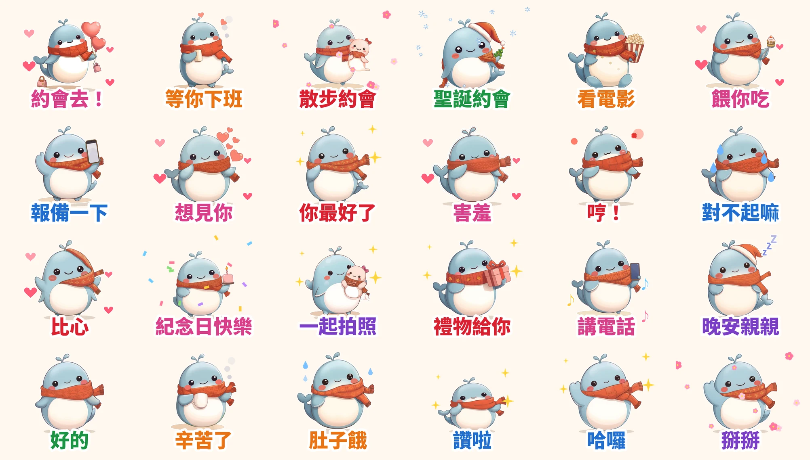

人氣角色「**小鯨魚泡泡**」戀愛日常系列第 3 集來了！這次泡泡和粉紅色小女友「啵啵」去約會：等下班、看電影、聖誕約會、一起拍照、紀念日，吵架時的「哼！」和「對不起嘛」也都有，**24 張會動的情侶動態貼圖**，再加 6 張日常萬用回覆。

> 🐳 **小鯨魚泡泡・戀愛日常3甜蜜約會**（動態貼圖 24 張，NT$60）👉 [Massor 的 LINE 貼圖小舖](https://line.me/S/shop/sticker/author/6564520?utm_source=ghpages&utm_medium=bridge&utm_campaign=paopao-love3&utm_content=author-6564520)（已送審並參加 LINE「我們的戀愛日常貼圖特輯」，審核通過後同一頁開賣）

## 這套貼圖的亮點

- **18 張戀愛日常主題**：約會去、等你下班、散步約會、聖誕約會、看電影、餵你吃、報備一下、想見你、你最好了、害羞、哼！、對不起嘛、比心、紀念日快樂、一起拍照、禮物給你、講電話、晚安親親。
- **6 張日常萬用回覆**：好的、辛苦了、肚子餓、讚啦、哈囉、掰掰。
- **粗白邊＋大字**：深色模式也清楚好讀。

## 🎬 24 張動態貼圖搶先看

  <figure class="ms-c">
    <video src="https://github.com/ckw19810413/ckw19810413.github.io/releases/download/media-line-animated-sticker-whale-paopao-love3-dates/paopao3-01.mp4" poster="posters/01.jpg" muted autoplay loop playsinline preload="metadata"></video>
    <figcaption>約會去！</figcaption>
  </figure>
  <figure class="ms-c">
    <video src="https://github.com/ckw19810413/ckw19810413.github.io/releases/download/media-line-animated-sticker-whale-paopao-love3-dates/paopao3-02.mp4" poster="posters/02.jpg" muted autoplay loop playsinline preload="metadata"></video>
    <figcaption>等你下班</figcaption>
  </figure>
  <figure class="ms-c">
    <video src="https://github.com/ckw19810413/ckw19810413.github.io/releases/download/media-line-animated-sticker-whale-paopao-love3-dates/paopao3-03.mp4" poster="posters/03.jpg" muted autoplay loop playsinline preload="metadata"></video>
    <figcaption>散步約會</figcaption>
  </figure>
  <figure class="ms-c">
    <video src="https://github.com/ckw19810413/ckw19810413.github.io/releases/download/media-line-animated-sticker-whale-paopao-love3-dates/paopao3-04.mp4" poster="posters/04.jpg" muted autoplay loop playsinline preload="metadata"></video>
    <figcaption>聖誕約會</figcaption>
  </figure>
  <figure class="ms-c">
    <video src="https://github.com/ckw19810413/ckw19810413.github.io/releases/download/media-line-animated-sticker-whale-paopao-love3-dates/paopao3-05.mp4" poster="posters/05.jpg" muted autoplay loop playsinline preload="metadata"></video>
    <figcaption>看電影</figcaption>
  </figure>
  <figure class="ms-c">
    <video src="https://github.com/ckw19810413/ckw19810413.github.io/releases/download/media-line-animated-sticker-whale-paopao-love3-dates/paopao3-06.mp4" poster="posters/06.jpg" muted autoplay loop playsinline preload="metadata"></video>
    <figcaption>餵你吃</figcaption>
  </figure>
  <figure class="ms-c">
    <video src="https://github.com/ckw19810413/ckw19810413.github.io/releases/download/media-line-animated-sticker-whale-paopao-love3-dates/paopao3-07.mp4" poster="posters/07.jpg" muted autoplay loop playsinline preload="metadata"></video>
    <figcaption>報備一下</figcaption>
  </figure>
  <figure class="ms-c">
    <video src="https://github.com/ckw19810413/ckw19810413.github.io/releases/download/media-line-animated-sticker-whale-paopao-love3-dates/paopao3-08.mp4" poster="posters/08.jpg" muted autoplay loop playsinline preload="metadata"></video>
    <figcaption>想見你</figcaption>
  </figure>
  <figure class="ms-c">
    <video src="https://github.com/ckw19810413/ckw19810413.github.io/releases/download/media-line-animated-sticker-whale-paopao-love3-dates/paopao3-09.mp4" poster="posters/09.jpg" muted autoplay loop playsinline preload="metadata"></video>
    <figcaption>你最好了</figcaption>
  </figure>
  <figure class="ms-c">
    <video src="https://github.com/ckw19810413/ckw19810413.github.io/releases/download/media-line-animated-sticker-whale-paopao-love3-dates/paopao3-10.mp4" poster="posters/10.jpg" muted autoplay loop playsinline preload="metadata"></video>
    <figcaption>害羞</figcaption>
  </figure>
  <figure class="ms-c">
    <video src="https://github.com/ckw19810413/ckw19810413.github.io/releases/download/media-line-animated-sticker-whale-paopao-love3-dates/paopao3-11.mp4" poster="posters/11.jpg" muted autoplay loop playsinline preload="metadata"></video>
    <figcaption>哼！</figcaption>
  </figure>
  <figure class="ms-c">
    <video src="https://github.com/ckw19810413/ckw19810413.github.io/releases/download/media-line-animated-sticker-whale-paopao-love3-dates/paopao3-12.mp4" poster="posters/12.jpg" muted autoplay loop playsinline preload="metadata"></video>
    <figcaption>對不起嘛</figcaption>
  </figure>
  <figure class="ms-c">
    <video src="https://github.com/ckw19810413/ckw19810413.github.io/releases/download/media-line-animated-sticker-whale-paopao-love3-dates/paopao3-13.mp4" poster="posters/13.jpg" muted autoplay loop playsinline preload="metadata"></video>
    <figcaption>比心</figcaption>
  </figure>
  <figure class="ms-c">
    <video src="https://github.com/ckw19810413/ckw19810413.github.io/releases/download/media-line-animated-sticker-whale-paopao-love3-dates/paopao3-14.mp4" poster="posters/14.jpg" muted autoplay loop playsinline preload="metadata"></video>
    <figcaption>紀念日快樂</figcaption>
  </figure>
  <figure class="ms-c">
    <video src="https://github.com/ckw19810413/ckw19810413.github.io/releases/download/media-line-animated-sticker-whale-paopao-love3-dates/paopao3-15.mp4" poster="posters/15.jpg" muted autoplay loop playsinline preload="metadata"></video>
    <figcaption>一起拍照</figcaption>
  </figure>
  <figure class="ms-c">
    <video src="https://github.com/ckw19810413/ckw19810413.github.io/releases/download/media-line-animated-sticker-whale-paopao-love3-dates/paopao3-16.mp4" poster="posters/16.jpg" muted autoplay loop playsinline preload="metadata"></video>
    <figcaption>禮物給你</figcaption>
  </figure>
  <figure class="ms-c">
    <video src="https://github.com/ckw19810413/ckw19810413.github.io/releases/download/media-line-animated-sticker-whale-paopao-love3-dates/paopao3-17.mp4" poster="posters/17.jpg" muted autoplay loop playsinline preload="metadata"></video>
    <figcaption>講電話</figcaption>
  </figure>
  <figure class="ms-c">
    <video src="https://github.com/ckw19810413/ckw19810413.github.io/releases/download/media-line-animated-sticker-whale-paopao-love3-dates/paopao3-18.mp4" poster="posters/18.jpg" muted autoplay loop playsinline preload="metadata"></video>
    <figcaption>晚安親親</figcaption>
  </figure>
  <figure class="ms-c">
    <video src="https://github.com/ckw19810413/ckw19810413.github.io/releases/download/media-line-animated-sticker-whale-paopao-love3-dates/paopao3-19.mp4" poster="posters/19.jpg" muted autoplay loop playsinline preload="metadata"></video>
    <figcaption>好的</figcaption>
  </figure>
  <figure class="ms-c">
    <video src="https://github.com/ckw19810413/ckw19810413.github.io/releases/download/media-line-animated-sticker-whale-paopao-love3-dates/paopao3-20.mp4" poster="posters/20.jpg" muted autoplay loop playsinline preload="metadata"></video>
    <figcaption>辛苦了</figcaption>
  </figure>
  <figure class="ms-c">
    <video src="https://github.com/ckw19810413/ckw19810413.github.io/releases/download/media-line-animated-sticker-whale-paopao-love3-dates/paopao3-21.mp4" poster="posters/21.jpg" muted autoplay loop playsinline preload="metadata"></video>
    <figcaption>肚子餓</figcaption>
  </figure>
  <figure class="ms-c">
    <video src="https://github.com/ckw19810413/ckw19810413.github.io/releases/download/media-line-animated-sticker-whale-paopao-love3-dates/paopao3-22.mp4" poster="posters/22.jpg" muted autoplay loop playsinline preload="metadata"></video>
    <figcaption>讚啦</figcaption>
  </figure>
  <figure class="ms-c">
    <video src="https://github.com/ckw19810413/ckw19810413.github.io/releases/download/media-line-animated-sticker-whale-paopao-love3-dates/paopao3-23.mp4" poster="posters/23.jpg" muted autoplay loop playsinline preload="metadata"></video>
    <figcaption>哈囉</figcaption>
  </figure>
  <figure class="ms-c">
    <video src="https://github.com/ckw19810413/ckw19810413.github.io/releases/download/media-line-animated-sticker-whale-paopao-love3-dates/paopao3-24.mp4" poster="posters/24.jpg" muted autoplay loop playsinline preload="metadata"></video>
    <figcaption>掰掰</figcaption>
  </figure>

## 24 款貼圖一覽表

| 編號 | 貼圖文字 | 主題分類 | 適用情境 |
|:---:|:---|:---:|:---|
| 01 | 約會去！ | 💕 戀愛日常 | 約會去！好期待～ |
| 02 | 等你下班 | 💕 戀愛日常 | 等你下班一起回家～ |
| 03 | 散步約會 | 💕 戀愛日常 | 一起散步最幸福 |
| 04 | 聖誕約會 | 💕 戀愛日常 | 聖誕節一起過吧！ |
| 05 | 看電影 | 💕 戀愛日常 | 一起看電影吧！ |
| 06 | 餵你吃 | 💕 戀愛日常 | 啊～張嘴，餵你吃 |
| 07 | 報備一下 | 💕 戀愛日常 | 跟你報備一下！ |
| 08 | 想見你 | 💕 戀愛日常 | 好想見你喔～ |
| 09 | 你最好了 | 💕 戀愛日常 | 你最好了！ |
| 10 | 害羞 | 💕 戀愛日常 | 人家會害羞啦～ |
| 11 | 哼！ | 💕 戀愛日常 | 哼！不理你了！ |
| 12 | 對不起嘛 | 💕 戀愛日常 | 對不起嘛～原諒我 |
| 13 | 比心 | 💕 戀愛日常 | 比心！愛你一百分 |
| 14 | 紀念日快樂 | 💕 戀愛日常 | 紀念日快樂！ |
| 15 | 一起拍照 | 💕 戀愛日常 | 來！一起拍照～ |
| 16 | 禮物給你 | 💕 戀愛日常 | 這是給你的禮物～ |
| 17 | 講電話 | 💕 戀愛日常 | 再講五分鐘就好～ |
| 18 | 晚安親親 | 💕 戀愛日常 | 晚安～親親 |
| 19 | 好的 | 日常 | 好的！沒問題 |
| 20 | 辛苦了 | 日常 | 今天辛苦了～ |
| 21 | 肚子餓 | 日常 | 肚子好餓喔～ |
| 22 | 讚啦 | 日常 | 讚啦！ |
| 23 | 哈囉 | 日常 | 哈囉～在幹嘛？ |
| 24 | 掰掰 | 日常 | 掰掰～明天見！ |

## 製作方式

角色圖在本機用 **FLUX schnell + 繪本風 LoRA** 生成，沿用前作的固定種子，讓泡泡的長相和前兩集一致；再用 Python 動畫管線做成 3 秒循環 APNG，自動加白邊和大字，並檢查尺寸（≤320×270）與檔案大小（≤300KB）。

- 同系列前作：[小鯨魚泡泡・黏黏戀愛日常2冬季抱抱](/blog/2026-11-23-line-animated-sticker-whale-paopao-winter-hugs/)
- 立即收藏 👉 [前往 Massor 的 LINE 貼圖小舖](https://line.me/S/shop/sticker/author/6564520?utm_source=ghpages&utm_medium=bridge&utm_campaign=paopao-love3&utm_content=author-6564520)
