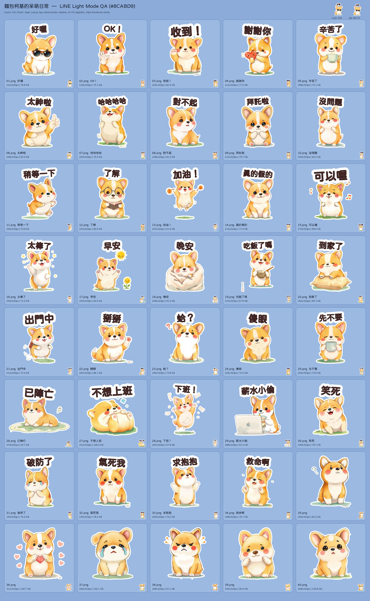

圓滾滾像一條剛出爐金黃鬆軟吐司麵包、有著大圓耳朵、紅潤臉頰與短小肉球的**「麵包柯基」（Bread Loaf Corgi）**登場！

這次帶來 **40 張柔和日式繪本風靜態貼圖**（34 張台灣日常高頻繁中對話＋6 張無文字百搭表情），溫柔暖褐色手繪線條搭配粉彩水彩暈染，從「早安 / 晚安 / 收到！ / 謝謝你」到「薪水小偷 / 不想上班 / 已陣亡 / 求抱抱」，把每天聊天室裡的情緒通通變成療癒系暴擊。

> 🍞🐶 **麵包柯基的呆萌日常**（40 張靜態貼圖）👉 [Massor 的 LINE 貼圖小舖](https://line.me/S/shop/sticker/author/6564520?utm_source=ghpages&utm_medium=bridge&utm_campaign=5s-hook&utm_content=author-6564520)  
> 本套已於 2026-11-26 送審（Creators Market ID `49481794`，[商店頁面](https://store.line.me/stickershop/product/49481794/zh-Hant?utm_source=ghpages&utm_medium=bridge&utm_campaign=5s-hook&utm_content=corgi-bread-daily-49481794)），已開啟自動上架，審核通過後立即開放下載。

## 這套貼圖的亮點

1. **高頻日常＋社畜心聲一次收齊**：涵蓋 16 句萬用回應（好喔、OK!、收到！、謝謝你、辛苦了、太神啦）、6 句日常問候（早安、晚安、吃飯了嗎、到家了、出門中、掰掰）、12 句台港熱門口語（蛤？、傻眼、先不要、已陣亡、不想上班、下班！、薪水小偷、笑死、破防了、氣死我、求抱抱、救命啊），外加 6 張無文字純表情，跨語系也能直接用。
2. **柔和繪本色鉛筆＋水彩質感**：使用 `soft_chibi_storybook` 風格與粉圓體字型，2 頭身圓滾滾麵包比例、閃亮大眼與一致的金黃白柯基毛色，每一張都像從插畫繪本剪下來的貼紙。
3. **深色模式也清晰好讀**：每張貼圖皆經過自動去背與 **5px 純白貼紙描邊**，並通過 LINE 官方規格檢查（`370×320` 以內偶數尺寸、`main.png 240×240`、`tab.png 96×74`）。

## 台灣 / 香港 / 日本 同步推廣中

- 🇹🇼🇭🇰 **台灣・香港**：不論是跟同事回「收到！」「薪水小偷」，還是跟朋友撒嬌「求抱抱」「吃飯了嗎」，軟萌麵包柯基一發出去瞬間降火氣。
- 🇯🇵 **日本のみなさまへ**：「もちもち食パンコーギーの日常（全40種）」— やさしい絵本タッチのもちもち食パンコーギー子犬スタンプ！文字なしの万能リアクションスタンプ6種も収録しているので、国境を問わずトークで使えます。

👉 [立即前往 LINE 貼圖小舖（Massor）](https://line.me/S/shop/sticker/author/6564520?utm_source=ghpages&utm_medium=bridge&utm_campaign=5s-hook&utm_content=author-6564520)

更多貼圖作品整理在 [LINE 貼圖合集](/blog/line-stickers/)，英文版製作紀錄可見 [slashmantools.us](https://slashmantools.us/blog/line-sticker-corgi-bread-daily/)。
