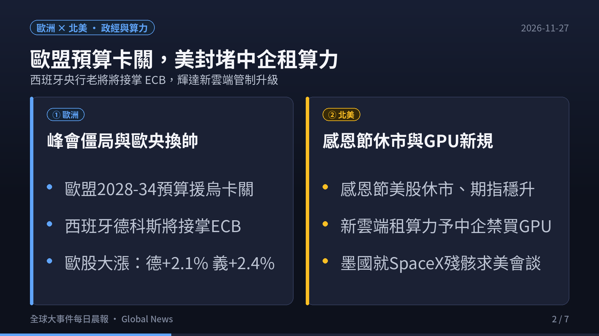
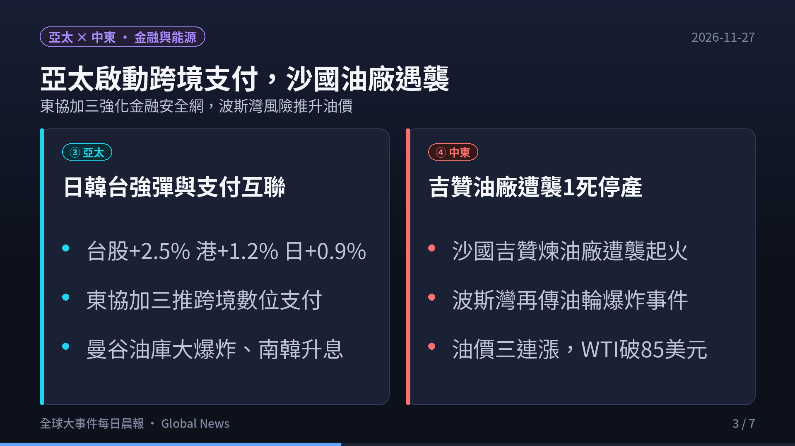
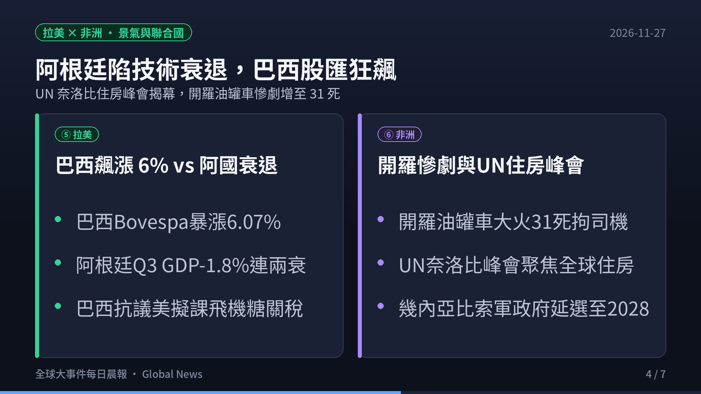
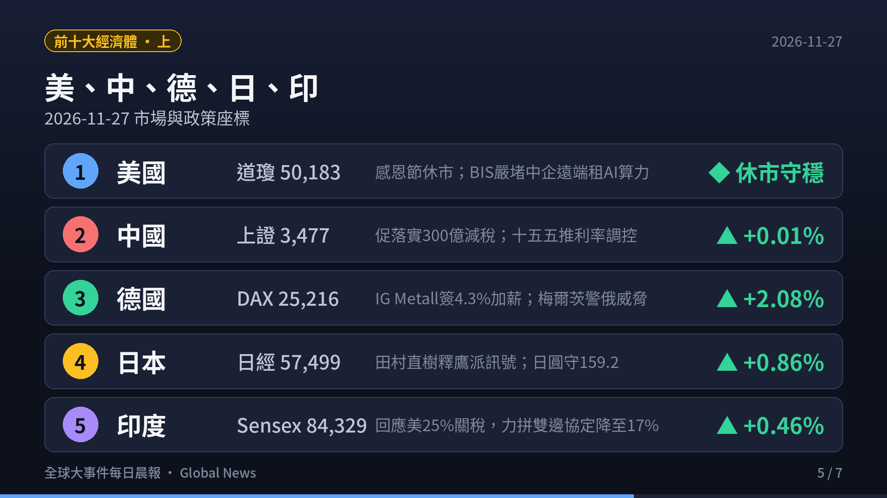
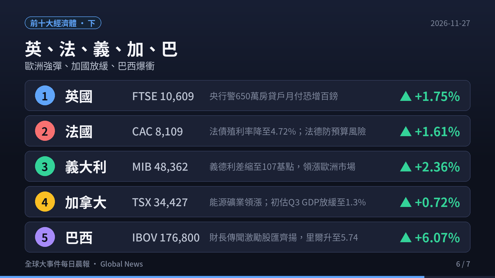
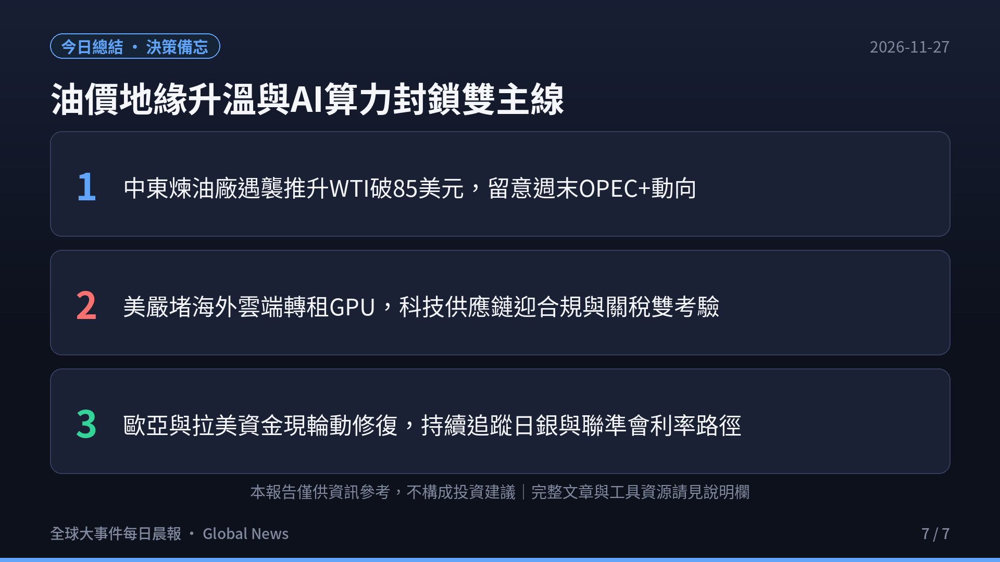

  

    <iframe src="https://www.youtube.com/embed/GC-THxNs570" title="2026-11-27 全球大事件晨報" style="position: absolute; top:0; left: 0; width: 100%; height: 100%; border: 0;" allow="accelerometer; autoplay; clipboard-write; encrypted-media; gyroscope; picture-in-picture; web-share" allowfullscreen></iframe>
  

> **一句話看今天：** 歐盟領袖於布魯塞爾緊急峰會為 2028–2034 預算與援烏貸款陷入僵局，同日歐元區確定由西班牙的德科斯（Pablo Hernández de Cos）明年接掌歐洲央行；美股感恩節休市之際，美國嚴堵海外「新雲端」轉租輝達算力予中企；沙烏地吉贊煉油廠遭襲致 1 死並推升油價連三漲，拉美則見阿根廷陷入技術性衰退而巴西股市單日狂飆 6.07%。

## 今日六大焦點（各大洲）

### ① 歐洲｜歐盟 2028–2034 預算與援烏峰會陷僵局；德科斯將接掌歐洲央行
歐盟領袖於布魯塞爾舉行特別峰會，圍繞 **2028–2034 年創紀錄長期預算**、國防與農業補貼及 **490 億美元援烏貸款**出現激烈分歧，德國威脅若未獲全體簽署將動用否決權，西班牙總理桑傑士因週末大選缺席並將投票權委託法國總統馬克宏，歐盟農民團體亦赴布魯塞爾抗議共同農業政策（CAP）預算刪減。央行人事方面，歐元區領袖達成共識，由西班牙前央行行長、現任國際清算銀行總經理**巴勃羅·埃爾南德斯·德科斯（Pablo Hernández de Cos）** 明年接替拉加德出任歐洲央行（ECB）總裁。戰事方面，俄軍飛彈與無人機襲擊烏克蘭五個州能源設施（克里維里赫供電與電動大眾運輸停擺），川普與北約秘書長呂特於海湖莊園發表聯合聲明警告俄方勿擴大戰事。受美方 301 關稅細節未較預期惡化帶動，歐股週四強勢反彈，Euro Stoxx 50 漲 **2.04%**（6,014.75）、德國 DAX 漲 **2.08%**（25,215.52）、義大利 FTSE MIB 漲 **2.36%**（48,362.35）。

來源：[Euronews](https://www.euronews.com/2026/11/26)、[CNBC ECB](https://www.cnbc.com/2026/11/26/pablo-hernandez-de-cos-ecb-president.html)、[CNBC Ukraine](https://www.cnbc.com/2026/11/26/trump-nato-rutte-russia-ukraine-war.html)、[MarketVeo](https://marketveo.com/indices/)、[Newsquawk](https://www.newsquawk.com/headlines/european-closes-euro-stoxx-50-211-at-6019-dax-40-214-at-25231-ftse-100-175-at-10609-cac-40-161-at-8109-ftse-mib-236-at-48362-ibex-35-235-at-19074-psi-133-at-9377-smi-120-at-14842-aex-186-at-1083)

### ② 北美｜美股感恩節休市、期指續穩；輝達海外「新雲端」禁租中國算力
美國金融市場週四因**感恩節休市**（週三道瓊收漲 **0.33%** 報 **50,182.95 點**、標普 500 跌 **0.25%** 報 **7,182.78**、那斯達克跌 **0.62%** 報 **23,585.80**），美股期指於清淡交投中走高。科技監管方面，CNBC 報導指出，因應美國商務部工業與安全局（BIS）於 11 月 19 日生效的新規，晶片賣方已通知「新雲端（Neocloud）」運算商，若將任何 GPU 算力出租給中國企業，將無法採購輝達（Nvidia）晶片，並傳出對東南亞四國伺服器出貨喊停。貿易與外交方面，USTR 針對 14 國拋出的 301 關稅持續施壓各國加快雙邊協議談判；墨西哥總統薛恩鮑姆（Claudia Sheinbaum）則要求與美國航空當局會談，釐清 SpaceX 星艦火箭殘骸落入墨國海岸與領空使用問題。

來源：[CNBC Nvidia](https://www.cnbc.com/2026/11/26/neoclouds-nvidia-china-ai.html)、[CNBC Tariffs](https://www.cnbc.com/2026/11/26/us-tariffs-hike-trade-agreement.html)、[Al Jazeera Mexico](https://www.aljazeera.com/news/2026/11/26/mexico-seeks-us-talks-about-suspected-spacex-debris)、[TheCloseReport](https://www.theclosereport.com/)

### ③ 亞太與大洋洲｜亞股集體反彈、東協加三推跨境數位支付；曼谷油庫大爆炸
亞太股市週四展開全面修復反彈：台灣加權指數勁揚 **2.50%**（39,152 點）領漲區域市場，香港恆生指數上漲 **1.19%**（22,226.88）終結連七跌，日本日經 225 上漲 **0.86%**（57,499.16），澳洲 ASX 200 上漲 **0.82%**（8,763.80），南韓 KOSPI 微升 **0.29%**（4,711.21），中國上證指數微漲 **0.01%**（3,476.88）。區域金融合作方面，**東協加三（ASEAN+3）** 財長與央行副手於日本京都達成協議，設立專責工作小組推動跨境數位支付系統互聯與數位資產監管協調，並啟用清邁倡議 2,400 億美元貨幣互換下的新版緊急融資機制。央行與突發事件方面，南韓央行如預期升息 1 碼至 **3.25%**；日本央行審議委員田村直樹釋出鷹派訊號，稱通膨若過熱須迅速升息；泰國曼谷東部 Bangchak 油庫發生劇烈爆炸並疏散周邊居民。

來源：[Reuters/Investing ASEAN+3](https://www.investing.com/news/economy-news/china-japan-south-korea-and-asean-launch-talks-on-digital-payments-across-borders-5052024)、[MarketBell](https://marketbell.io/intel/asia-pacific)、[SGX Indices](https://sgxsingapore.com/other-indices/)、[Newsquawk](https://www.newsquawk.com/headlines/newsquawk-daily-european-opening-news---26th-november-2026)、[Euronews](https://www.euronews.com/2026/11/26)

### ④ 中東｜沙國吉贊煉油廠遭襲致 1 死停產、波斯灣再傳油輪爆炸推升油價連三漲
中東能源基礎設施再遭打擊：沙烏地阿拉伯能源部證實，位於紅海沿岸、日處理量達 **40 萬桶** 的吉贊（Jazan）煉油廠週四遭空中投射物擊中起火並暫停部分運作，造成 **1 名尼泊爾籍工人喪生、多人受傷**（聯軍指為伊朗支持的胡塞武裝發動襲擊）；同日英國軍方海事監測機構通報杜拜西方波斯灣海域再有一艘油輪回報附近發生爆炸。受供應風險升溫及本週末 OPEC+ 會議前夕影響，國際油價連續第三個交易日上漲，WTI 原油升破 **85 美元/桶**（盤中報 84.91–85.23 美元）、布蘭特原油報約 **91.7–95+ 美元/桶**。政治與人道面向，卡達埃米爾與埃及總統塞西會晤推動加薩永續停火框架；以色列空襲加薩致 10 人死亡，伊朗無人機於科威特造成 2 名義大利人喪生。

來源：[Al Jazeera Jazan](https://www.aljazeera.com/news/2026/11/26/attack-on-saudi-aramcos-jazan-refinery-kills-worker-disrupts-operations)、[AP News](https://apnews.com/article/gaza-iran-israel-uae-hormuz-november-26-2026-522676f17532b878878ff7a4347d0e31)、[ING THINK](https://think.ing.com/articles/the-commodities-feed-gold-slumps-below-3500-oz/)、[GoldOilPrice](https://goldoilprice.com/)

### ⑤ 拉丁美洲｜阿根廷 Q3 萎縮 1.8% 陷入技術性衰退；巴西股市單日狂飆 6.07%
拉美兩大經濟體走勢呈現強烈對比。**阿根廷**最新公布的第三季 GDP 季減 **1.8%**，連續第二季萎縮並正式陷入**技術性衰退**，內需消費疲軟與購買力下滑為總統米雷伊（Javier Milei）的經濟整頓政策帶來新壓力。反觀**巴西**聖保羅 Ibovespa 指數週四單日狂飆 **6.07%**（+10,115.23 點）收 **176,799.84 點**，美元兌巴西里爾匯價跌至 **R$ 5.74**，主因市場盛傳前 Bradesco 執行長特拉布科（Luiz Carlos Trabuco）可能接掌財政部長提振財政信心；同時巴西政府也對美國 USTR 建議針對巴西飛機與糖類加徵新關稅表達嚴正抗議，稱不排除採取對等回應。

來源：[Euronews](https://www.euronews.com/2026/11/26)、[InfoMoney](https://www.infomoney.com.br/mercados/ibovespa-hoje-bolsa-de-valores-ao-vivo-26112026/)、[MarketVeo](https://marketveo.com/indices/)、[Newsquawk](https://www.newsquawk.com/headlines/newsquawk-daily-european-opening-news---26th-november-2026)

### ⑥ 非洲與聯合國｜開羅油罐車慘劇增至 31 死；UN 奈洛比全球住房危機峰會登場
埃及開羅北部 Warraq 區環城公路油罐車翻覆引燃連環大火事故，最新死亡人數攀升至 **31 人**，埃及檢方已正式拘押涉事駕駛並持續進行遺體 DNA 比對調查。在肯亞奈洛比，聯合國人居署（UN-Habitat）於 11 月 26–27 日召開**全球住房危機政府間會議**，警告全球目前仍有超過 **11 億人**居住於貧民窟與非正式聚落，呼籲各國落實安全土地權屬、可負擔租金及抗氣候住宅建設。西非政局方面，幾內亞比索軍政府正式宣布將原訂的總統大選延後至 **2028 年**，引發區域外交界密切關注。

來源：[Al Jazeera Egypt](https://www.aljazeera.com/news/2026/11/26/egypt-detains-driver-over-cairo-fuel-tanker-fire-that-killed-31)、[The Guardian](https://www.theguardian.com/world/2026/nov/25/people-killed-fuel-tanker-crash-ignites-large-fire-cairo-highway)、[UN-Habitat](https://unhabitat.org/media/news/housing-stakeholders-push-for-action-on-global-recommendations)、[Al Jazeera](https://www.aljazeera.com/)

## 前十大經濟體總覽

| # | 經濟體 | 今日焦點 | 訊號 |
|---|---|---|---|
| 1 | 美國 | 感恩節休市（前日道瓊 +0.33% 收 50,182.95、標普 -0.25% 收 7,182.78、那指 -0.62% 收 23,585.80）；BIS 嚴堵「新雲端」轉租輝達 GPU 予中企；川普與北約警告俄方 | ◆ 休市守穩 |
| 2 | 中國 | 上證微漲 0.01% 收 3,476.88、深證 -0.02%；商務部敦促美方落實 300 億美元減稅並回應 301 關稅；央行「十五五」深化利率導向調控；參與 ASEAN+3 跨境數位支付 | ▲ +0.01% |
| 3 | 德國 | DAX 勁揚 2.08% 收 25,215.52；10 年期德債殖利率升至 3.25%；金屬工會 IG Metall 達成 4.3% 加薪協議（允彈性工時換投資）；總理梅爾茨警告俄威脅 | ▲ +2.08% |
| 4 | 日本 | 日經 225 反彈 0.86% 收 57,499.16、日圓約 159.23；日銀田村直樹釋鷹派訊號稱通膨過熱須迅速升息；首相高市早苗會見馬紹爾總統強化印太海事合作 | ▲ +0.86% |
| 5 | 印度 | Sensex 漲 0.46% 收 84,328.59、Nifty 50 漲 0.25% 收 25,884.50；商工部回應美 25% 擬議關稅，力拼達成美印雙邊貿易協定降至 17%；比哈爾農勞抗議核電徵地 | ▲ +0.46% |
| 6 | 英國 | FTSE 100 漲 1.75% 收 10,609.29（Imperial Brands 獲收購傳聞飆漲）；英國央行金融穩定報告示警 650 萬房貸戶至 2029 年月付恐增 £100 | ▲ +1.75% |
| 7 | 法國 | CAC 40 漲 1.61% 收 8,108.74、10 年期法債殖利率降至 4.72%；法德聯手為歐盟下個七年預算設防；法院裁定德帕迪約仍須就 2018 年性侵案受審 | ▲ +1.61% |
| 8 | 義大利 | FTSE MIB 大漲 2.36% 收 48,362.35 領漲歐股；義德 10 年期公債利差收斂至 107 個基點（義債殖利率 4.32%）；兩名義籍人員在科威特遭無人機襲擊身亡 | ▲ +2.36% |
| 9 | 加拿大 | S&P/TSX 上漲 0.72% 收 34,426.88（能源與礦業領漲）；統計局初估 Q3 GDP 年化成長放緩至 1.3%（前值 3.3%），靜待下週六大銀行財報 | ▲ +0.72% |
| 10 | 巴西 | Ibovespa 暴漲 6.07%（+10,115 點）收 176,799.84、里爾升至 5.74（財長人選傳聞激勵）；抗議美國對巴西飛機與糖類擬課新關稅 | ▲ +6.07% |

來源：[MarketVeo](https://marketveo.com/indices/)、[Newsquawk](https://www.newsquawk.com/headlines/european-closes-euro-stoxx-50-211-at-6019-dax-40-214-at-25231-ftse-100-175-at-10609-cac-40-161-at-8109-ftse-mib-236-at-48362-ibex-35-235-at-19074-psi-133-at-9377-smi-120-at-14842-aex-186-at-1083)、[SGX Indices](https://sgxsingapore.com/other-indices/)、[SCIO China](http://english.scio.gov.cn/pressroom/2026-11/26/content_118790545_3.html)、[Deutschlandfunk](https://www.deutschlandfunk.de/nachrichten-index-40774.html)、[Kyodo News](https://english.kyodonews.net/articles/-/92639)、[Indian Express](https://indianexpress.com/article/india/today-india-breaking-news-live-updates-26-november-2026-cjp-save-democracy-protest-nagpur-25-percent-us-tariffs-cairo-crash-us-tariffs-congress-constitution-day-pm-narendra-modi-10978950/)、[BBC Mortgage](https://www.bbc.co.uk/news/articles/cwg5r02zel9qo)、[ANSA](https://www.ansa.it/sito/notizie/economia/2026/11/26/lo-spread-tra-btp-e-bund-tedeschi-chiude-in-ribasso-a-107-punti_65fc5c83-bcf7-4be0-a467-24ea616528f6.html)、[Globe and Mail](https://www.theglobeandmail.com/business/article-business-brief-dashing-through-the-lows/)、[InfoMoney](https://www.infomoney.com.br/mercados/ibovespa-hoje-bolsa-de-valores-ao-vivo-26112026/)

## 今日重點

1. **中東煉油廠遇襲推升 WTI 破 85 美元**，疊加波斯灣油輪再傳爆炸與週末 OPEC+ 會議登場，冬季能源通膨風險升溫。
2. **美國嚴堵海外「新雲端」轉租輝達 GPU 予中企**，結合 14 國 301 關稅施壓，全球 AI 算力與貿易供應鏈面臨合規重組。
3. **歐亞與拉美股市出現輪動修復**（巴西 +6.07%、台股 +2.50%、義大利 +2.36%），後續緊盯日銀 12 月升息動向與聯準會利率路徑。

*本文僅供資訊參考，不構成任何投資建議。*

---

### 🔧 這份晨報是怎麼做出來的？
從多源新聞調研、AI 旁白配音、配樂混音到 YouTube 上架與部落格發布，全部由一套自動化工作流完成。想把同樣的工具用在你的工作上：

- 🛒 **[Slashman Tools 全套數位工具包（Everything Bundle）](https://slashmaster6.gumroad.com/l/everything-bundle)**
- 🛒 [Gumroad 數位商品專區](https://slashmaster6.gumroad.com/)（範本、提示詞、自動化教學）
- 🧰 [SlashmanTools 免費線上工具箱](https://slashmantools.us/)
- ☕ **Ko-fi 支持**：[ytstories0413](https://ko-fi.com/ytstories0413) ｜ [slashman413](https://ko-fi.com/slashman413)
- 📚 延伸閱讀：[《晶片戰爭》Chip War](https://www.amazon.com/dp/059371671X?tag=ytstories0413-20) ｜ [《原子習慣》](https://www.books.com.tw/products/0010792915) ｜ [《人生的智慧》](https://www.books.com.tw/products/0010613113)
