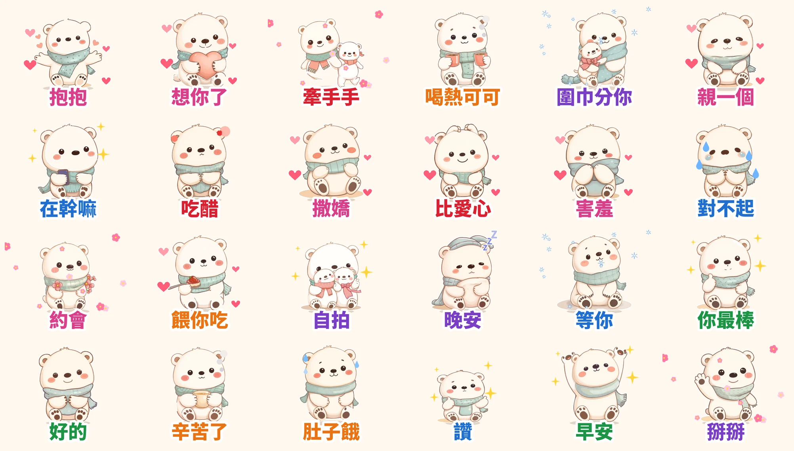

小舖最受歡迎的角色「**北極熊秀秀**」推出戀愛日常續集！這次秀秀和戴粉紅圍巾的「粉粉」一起過冬：抱抱、牽手手、圍巾分你一半、一起喝熱可可，吃醋撒嬌和「對不起～別生氣」也都有。**24 張會動的情侶動態貼圖**，包含 18 張戀愛日常和 6 張日常萬用回覆。

> 🐻‍❄️ **北極熊秀秀・戀愛日常冬日暖暖約會**（動態貼圖 24 張，NT$60）👉 [Massor 的 LINE 貼圖小舖](https://line.me/S/shop/sticker/author/6564520?utm_source=ghpages&utm_medium=bridge&utm_campaign=xiuxiu-love824&utm_content=author-6564520)（已送審並參加 LINE「我們的戀愛日常貼圖特輯」，審核通過後在同一頁開賣）

## 這套貼圖的亮點

- **18 張戀愛日常**：抱抱、想你了、牽手手、喝熱可可、圍巾分你、親一個、在幹嘛、吃醋、撒嬌、比愛心、害羞、對不起、約會、餵你吃、自拍、晚安、等你、你最棒。
- **6 張日常萬用**：好的、辛苦了、肚子餓、讚、早安、掰掰。
- **粗白邊加大字**：深色模式也看得清楚。

## 🎬 24 張動態貼圖搶先看

  <figure class="ms-c">
    <video src="https://github.com/ckw19810413/ckw19810413.github.io/releases/download/media-line-animated-sticker-polar-bear-xiuxiu-winter-love/xiuxiu824-01.mp4" poster="posters/01.jpg" muted autoplay loop playsinline preload="metadata"></video>
    <figcaption>抱抱</figcaption>
  </figure>
  <figure class="ms-c">
    <video src="https://github.com/ckw19810413/ckw19810413.github.io/releases/download/media-line-animated-sticker-polar-bear-xiuxiu-winter-love/xiuxiu824-02.mp4" poster="posters/02.jpg" muted autoplay loop playsinline preload="metadata"></video>
    <figcaption>想你了</figcaption>
  </figure>
  <figure class="ms-c">
    <video src="https://github.com/ckw19810413/ckw19810413.github.io/releases/download/media-line-animated-sticker-polar-bear-xiuxiu-winter-love/xiuxiu824-03.mp4" poster="posters/03.jpg" muted autoplay loop playsinline preload="metadata"></video>
    <figcaption>牽手手</figcaption>
  </figure>
  <figure class="ms-c">
    <video src="https://github.com/ckw19810413/ckw19810413.github.io/releases/download/media-line-animated-sticker-polar-bear-xiuxiu-winter-love/xiuxiu824-04.mp4" poster="posters/04.jpg" muted autoplay loop playsinline preload="metadata"></video>
    <figcaption>喝熱可可</figcaption>
  </figure>
  <figure class="ms-c">
    <video src="https://github.com/ckw19810413/ckw19810413.github.io/releases/download/media-line-animated-sticker-polar-bear-xiuxiu-winter-love/xiuxiu824-05.mp4" poster="posters/05.jpg" muted autoplay loop playsinline preload="metadata"></video>
    <figcaption>圍巾分你</figcaption>
  </figure>
  <figure class="ms-c">
    <video src="https://github.com/ckw19810413/ckw19810413.github.io/releases/download/media-line-animated-sticker-polar-bear-xiuxiu-winter-love/xiuxiu824-06.mp4" poster="posters/06.jpg" muted autoplay loop playsinline preload="metadata"></video>
    <figcaption>親一個</figcaption>
  </figure>
  <figure class="ms-c">
    <video src="https://github.com/ckw19810413/ckw19810413.github.io/releases/download/media-line-animated-sticker-polar-bear-xiuxiu-winter-love/xiuxiu824-07.mp4" poster="posters/07.jpg" muted autoplay loop playsinline preload="metadata"></video>
    <figcaption>在幹嘛</figcaption>
  </figure>
  <figure class="ms-c">
    <video src="https://github.com/ckw19810413/ckw19810413.github.io/releases/download/media-line-animated-sticker-polar-bear-xiuxiu-winter-love/xiuxiu824-08.mp4" poster="posters/08.jpg" muted autoplay loop playsinline preload="metadata"></video>
    <figcaption>吃醋</figcaption>
  </figure>
  <figure class="ms-c">
    <video src="https://github.com/ckw19810413/ckw19810413.github.io/releases/download/media-line-animated-sticker-polar-bear-xiuxiu-winter-love/xiuxiu824-09.mp4" poster="posters/09.jpg" muted autoplay loop playsinline preload="metadata"></video>
    <figcaption>撒嬌</figcaption>
  </figure>
  <figure class="ms-c">
    <video src="https://github.com/ckw19810413/ckw19810413.github.io/releases/download/media-line-animated-sticker-polar-bear-xiuxiu-winter-love/xiuxiu824-10.mp4" poster="posters/10.jpg" muted autoplay loop playsinline preload="metadata"></video>
    <figcaption>比愛心</figcaption>
  </figure>
  <figure class="ms-c">
    <video src="https://github.com/ckw19810413/ckw19810413.github.io/releases/download/media-line-animated-sticker-polar-bear-xiuxiu-winter-love/xiuxiu824-11.mp4" poster="posters/11.jpg" muted autoplay loop playsinline preload="metadata"></video>
    <figcaption>害羞</figcaption>
  </figure>
  <figure class="ms-c">
    <video src="https://github.com/ckw19810413/ckw19810413.github.io/releases/download/media-line-animated-sticker-polar-bear-xiuxiu-winter-love/xiuxiu824-12.mp4" poster="posters/12.jpg" muted autoplay loop playsinline preload="metadata"></video>
    <figcaption>對不起</figcaption>
  </figure>
  <figure class="ms-c">
    <video src="https://github.com/ckw19810413/ckw19810413.github.io/releases/download/media-line-animated-sticker-polar-bear-xiuxiu-winter-love/xiuxiu824-13.mp4" poster="posters/13.jpg" muted autoplay loop playsinline preload="metadata"></video>
    <figcaption>約會</figcaption>
  </figure>
  <figure class="ms-c">
    <video src="https://github.com/ckw19810413/ckw19810413.github.io/releases/download/media-line-animated-sticker-polar-bear-xiuxiu-winter-love/xiuxiu824-14.mp4" poster="posters/14.jpg" muted autoplay loop playsinline preload="metadata"></video>
    <figcaption>餵你吃</figcaption>
  </figure>
  <figure class="ms-c">
    <video src="https://github.com/ckw19810413/ckw19810413.github.io/releases/download/media-line-animated-sticker-polar-bear-xiuxiu-winter-love/xiuxiu824-15.mp4" poster="posters/15.jpg" muted autoplay loop playsinline preload="metadata"></video>
    <figcaption>自拍</figcaption>
  </figure>
  <figure class="ms-c">
    <video src="https://github.com/ckw19810413/ckw19810413.github.io/releases/download/media-line-animated-sticker-polar-bear-xiuxiu-winter-love/xiuxiu824-16.mp4" poster="posters/16.jpg" muted autoplay loop playsinline preload="metadata"></video>
    <figcaption>晚安</figcaption>
  </figure>
  <figure class="ms-c">
    <video src="https://github.com/ckw19810413/ckw19810413.github.io/releases/download/media-line-animated-sticker-polar-bear-xiuxiu-winter-love/xiuxiu824-17.mp4" poster="posters/17.jpg" muted autoplay loop playsinline preload="metadata"></video>
    <figcaption>等你</figcaption>
  </figure>
  <figure class="ms-c">
    <video src="https://github.com/ckw19810413/ckw19810413.github.io/releases/download/media-line-animated-sticker-polar-bear-xiuxiu-winter-love/xiuxiu824-18.mp4" poster="posters/18.jpg" muted autoplay loop playsinline preload="metadata"></video>
    <figcaption>你最棒</figcaption>
  </figure>
  <figure class="ms-c">
    <video src="https://github.com/ckw19810413/ckw19810413.github.io/releases/download/media-line-animated-sticker-polar-bear-xiuxiu-winter-love/xiuxiu824-19.mp4" poster="posters/19.jpg" muted autoplay loop playsinline preload="metadata"></video>
    <figcaption>好的</figcaption>
  </figure>
  <figure class="ms-c">
    <video src="https://github.com/ckw19810413/ckw19810413.github.io/releases/download/media-line-animated-sticker-polar-bear-xiuxiu-winter-love/xiuxiu824-20.mp4" poster="posters/20.jpg" muted autoplay loop playsinline preload="metadata"></video>
    <figcaption>辛苦了</figcaption>
  </figure>
  <figure class="ms-c">
    <video src="https://github.com/ckw19810413/ckw19810413.github.io/releases/download/media-line-animated-sticker-polar-bear-xiuxiu-winter-love/xiuxiu824-21.mp4" poster="posters/21.jpg" muted autoplay loop playsinline preload="metadata"></video>
    <figcaption>肚子餓</figcaption>
  </figure>
  <figure class="ms-c">
    <video src="https://github.com/ckw19810413/ckw19810413.github.io/releases/download/media-line-animated-sticker-polar-bear-xiuxiu-winter-love/xiuxiu824-22.mp4" poster="posters/22.jpg" muted autoplay loop playsinline preload="metadata"></video>
    <figcaption>讚</figcaption>
  </figure>
  <figure class="ms-c">
    <video src="https://github.com/ckw19810413/ckw19810413.github.io/releases/download/media-line-animated-sticker-polar-bear-xiuxiu-winter-love/xiuxiu824-23.mp4" poster="posters/23.jpg" muted autoplay loop playsinline preload="metadata"></video>
    <figcaption>早安</figcaption>
  </figure>
  <figure class="ms-c">
    <video src="https://github.com/ckw19810413/ckw19810413.github.io/releases/download/media-line-animated-sticker-polar-bear-xiuxiu-winter-love/xiuxiu824-24.mp4" poster="posters/24.jpg" muted autoplay loop playsinline preload="metadata"></video>
    <figcaption>掰掰</figcaption>
  </figure>

## 24 款貼圖一覽表

| 編號 | 貼圖文字 | 主題分類 | 適用情境 |
|:---:|:---|:---:|:---|
| 01 | 抱抱 | 💕 戀愛日常 | 抱抱～好想你 |
| 02 | 想你了 | 💕 戀愛日常 | 想你了啦～ |
| 03 | 牽手手 | 💕 戀愛日常 | 牽手手一起走 |
| 04 | 喝熱可可 | 💕 戀愛日常 | 一起喝熱可可吧 |
| 05 | 圍巾分你 | 💕 戀愛日常 | 圍巾分你一半 |
| 06 | 親一個 | 💕 戀愛日常 | 啾～親一個 |
| 07 | 在幹嘛 | 💕 戀愛日常 | 在幹嘛？想你喔 |
| 08 | 吃醋 | 💕 戀愛日常 | 哼！我吃醋了 |
| 09 | 撒嬌 | 💕 戀愛日常 | 人家要抱抱嘛～ |
| 10 | 比愛心 | 💕 戀愛日常 | 比心！最愛你 |
| 11 | 害羞 | 💕 戀愛日常 | 不要看啦～害羞 |
| 12 | 對不起 | 💕 戀愛日常 | 對不起～別生氣 |
| 13 | 約會 | 💕 戀愛日常 | 今天約會好期待 |
| 14 | 餵你吃 | 💕 戀愛日常 | 啊～張嘴 |
| 15 | 自拍 | 💕 戀愛日常 | 一起拍一張～ |
| 16 | 晚安 | 💕 戀愛日常 | 晚安～夢裡見 |
| 17 | 等你 | 💕 戀愛日常 | 我等你喔～ |
| 18 | 你最棒 | 💕 戀愛日常 | 你最棒了！ |
| 19 | 好的 | 日常 | 好的！沒問題 |
| 20 | 辛苦了 | 日常 | 今天辛苦了～ |
| 21 | 肚子餓 | 日常 | 肚子好餓喔～ |
| 22 | 讚 | 日常 | 讚啦！ |
| 23 | 早安 | 日常 | 早安～ |
| 24 | 掰掰 | 日常 | 掰掰～明天見！ |

## 製作方式

角色圖在本機用 **FLUX schnell 加繪本風 LoRA** 生成，沿用秀秀前作的種子，讓角色長相保持一致。接著用 Python 動畫管線做成 3 秒循環的 APNG，自動加白邊和大字，並檢查尺寸（≤320×270）和檔案大小（≤300KB）。

- 立即收藏 👉 [前往 Massor 的 LINE 貼圖小舖](https://line.me/S/shop/sticker/author/6564520?utm_source=ghpages&utm_medium=bridge&utm_campaign=xiuxiu-love824&utm_content=author-6564520)
- 更多貼圖：[LINE 貼圖總覽](/line-stickers/)
