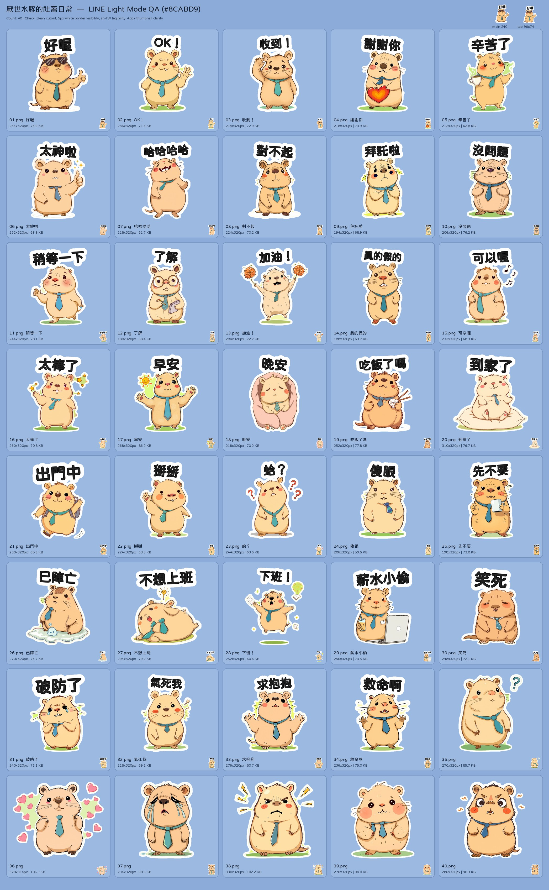

戴著歪斜藍色小領帶、有著豆豆眼與圓滾滾糯米糰比例的**「厭世水豚」（Deadpan Office Capybara）**第二彈登場！

這次帶來 **40 張手繪麥克筆塗鴉風靜態貼圖**（34 張台灣日常高頻繁中對話＋6 張無文字百搭表情），低飽和溫暖手繪線條搭配超寫實社畜內心戲，從「收到！ / 好喔 / 了解 / 辛苦了」到「不想上班 / 薪水小偷 / 已陣亡 / 破防了」，把每天辦公室與群組裡最想說的話一次收齊。第一彈《厭世水豚的社畜日常》（2026-11-22 送審）推出後，這彈帶來全新 40 張不重複姿勢與表情，繼續陪大家敷衍老闆、安慰同事、跟朋友吐槽。

> 🦫💼 **厭世水豚的社畜日常 第二彈**（40 張靜態貼圖）👉 [Massor 的 LINE 貼圖小舖](https://line.me/S/shop/sticker/author/6564520?utm_source=ghpages&utm_medium=bridge&utm_campaign=office-capybara-deadpan-vol2&utm_content=author-6564520)  
> 本套已於 2026-11-27 送審（Creators Market ID `49513803`，[商店頁面](https://store.line.me/stickershop/product/49513803/zh-Hant?utm_source=ghpages&utm_medium=bridge&utm_campaign=office-capybara-deadpan-vol2&utm_content=capybara-vol2-49513803)），已開啟自動上架，審核通過後立即開放下載。

## 這套貼圖的亮點

1. **上班敷衍＋台港社畜心聲一次收齊**：涵蓋 16 句萬用回應（好喔、OK!、收到！、謝謝你、辛苦了、太神啦、哈哈哈哈、對不起、拜託啦、沒問題、稍等一下、了解、加油！、真的假的、可以喔、太棒了）、6 句日常問候（早安、晚安、吃飯了嗎、到家了、出門中、掰掰）、12 句台港熱門情緒口語（蛤？、傻眼、先不要、已陣亡、不想上班、下班！、薪水小偷、笑死、破防了、氣死我、求抱抱、救命啊），外加 6 張無文字純表情，跨語系也能直接用。
2. **醜萌手繪塗鴉質感**：使用 `ugly_cute_office` 風格與粉圓體字型，2 頭身圓滾滾水豚比例、歪斜小藍領帶與生無可戀的豆豆眼，每一張都自帶反差萌笑點。
3. **深色模式也清晰好讀**：每張貼圖皆經過自動去背與 **5px 純白貼紙描邊**，並通過 LINE 官方規格檢查（`370×320` 以內偶數尺寸、`main.png 240×240`、`tab.png 96×74`），暗色模式白邊清晰不糊。

## 台灣 / 香港 / 日本 同步推廣中

- 🇹🇼🇭🇰 **台灣・香港**：不論是在工作群組回「收到！」「薪水小偷」，還是下班前吶喊「不想上班」「下班！」，一臉淡定的厭世水豚幫你把心聲穩穩送出。
- 🇯🇵 **日本のみなさまへ**：「虚無顔カピバラの社畜ライフ Vol.2（全40種）」— 曲がった青いネクタイがチャームポイントのゆるかわカピバラスタンプ！文字なしの万能リアクションスタンプ6種も収録しているので、国境を問わずトークで使えます。

👉 [立即前往 LINE 貼圖小舖（Massor）](https://line.me/S/shop/sticker/author/6564520?utm_source=ghpages&utm_medium=bridge&utm_campaign=office-capybara-deadpan-vol2&utm_content=author-6564520)

更多貼圖作品整理在 [LINE 貼圖合集](/blog/line-stickers/)，英文版製作紀錄可見 [slashmantools.us](https://slashmantools.us/blog/line-sticker-office-capybara-deadpan/)。
