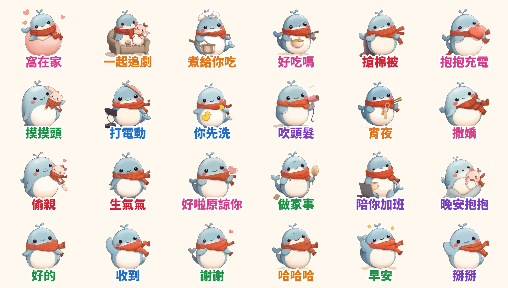

「**小鯨魚泡泡**」戀愛日常系列第 4 彈！天氣一冷就不想出門，這次泡泡和粉紅色的「啵啵」決定**窩在家約會**：一起追劇、煮飯給你吃、搶棉被、幫你吹頭髮、半夜一起吃宵夜，吵架了也會「好啦～原諒你」。**24 張會動的情侶動態貼圖**，包含 18 張戀愛日常和 6 張日常萬用回覆。

> 🐋 **小鯨魚泡泡・戀愛日常4窩在家**（動態貼圖 24 張，NT$60）👉 [Massor 的 LINE 貼圖小舖](https://line.me/S/shop/sticker/author/6564520?utm_source=ghpages&utm_medium=bridge&utm_campaign=paopao-love824-vol4&utm_content=author-6564520)（已送審並參加 LINE「我們的戀愛日常貼圖特輯」，審核通過後在同一頁開賣）

## 這套貼圖的亮點

- **18 張居家戀愛日常**：窩在家、一起追劇、煮給你吃、好吃嗎、搶棉被、抱抱充電、摸摸頭、打電動、你先洗、吹頭髮、宵夜、撒嬌、偷親、生氣氣、好啦原諒你、做家事、陪你加班、晚安抱抱。
- **6 張日常萬用**：好的、收到、謝謝、哈哈哈、早安、掰掰。
- **真的在動**：這次每張都用 MiniMax H3 影片模型讓泡泡「演」出動作（攪鍋子、搶棉被、吹頭髮），不只是左右晃。
- **粗白邊加大字**：深色模式也看得清楚。

## 🎬 24 張動態貼圖搶先看

  <figure class="ms-c">
    <video src="https://github.com/ckw19810413/ckw19810413.github.io/releases/download/media-line-animated-sticker-whale-paopao-cozy-home-love/paopao4-01.mp4" poster="posters/01.jpg" muted autoplay loop playsinline preload="metadata"></video>
    <figcaption>窩在家</figcaption>
  </figure>
  <figure class="ms-c">
    <video src="https://github.com/ckw19810413/ckw19810413.github.io/releases/download/media-line-animated-sticker-whale-paopao-cozy-home-love/paopao4-02.mp4" poster="posters/02.jpg" muted autoplay loop playsinline preload="metadata"></video>
    <figcaption>一起追劇</figcaption>
  </figure>
  <figure class="ms-c">
    <video src="https://github.com/ckw19810413/ckw19810413.github.io/releases/download/media-line-animated-sticker-whale-paopao-cozy-home-love/paopao4-03.mp4" poster="posters/03.jpg" muted autoplay loop playsinline preload="metadata"></video>
    <figcaption>煮給你吃</figcaption>
  </figure>
  <figure class="ms-c">
    <video src="https://github.com/ckw19810413/ckw19810413.github.io/releases/download/media-line-animated-sticker-whale-paopao-cozy-home-love/paopao4-04.mp4" poster="posters/04.jpg" muted autoplay loop playsinline preload="metadata"></video>
    <figcaption>好吃嗎</figcaption>
  </figure>
  <figure class="ms-c">
    <video src="https://github.com/ckw19810413/ckw19810413.github.io/releases/download/media-line-animated-sticker-whale-paopao-cozy-home-love/paopao4-05.mp4" poster="posters/05.jpg" muted autoplay loop playsinline preload="metadata"></video>
    <figcaption>搶棉被</figcaption>
  </figure>
  <figure class="ms-c">
    <video src="https://github.com/ckw19810413/ckw19810413.github.io/releases/download/media-line-animated-sticker-whale-paopao-cozy-home-love/paopao4-06.mp4" poster="posters/06.jpg" muted autoplay loop playsinline preload="metadata"></video>
    <figcaption>抱抱充電</figcaption>
  </figure>
  <figure class="ms-c">
    <video src="https://github.com/ckw19810413/ckw19810413.github.io/releases/download/media-line-animated-sticker-whale-paopao-cozy-home-love/paopao4-07.mp4" poster="posters/07.jpg" muted autoplay loop playsinline preload="metadata"></video>
    <figcaption>摸摸頭</figcaption>
  </figure>
  <figure class="ms-c">
    <video src="https://github.com/ckw19810413/ckw19810413.github.io/releases/download/media-line-animated-sticker-whale-paopao-cozy-home-love/paopao4-08.mp4" poster="posters/08.jpg" muted autoplay loop playsinline preload="metadata"></video>
    <figcaption>打電動</figcaption>
  </figure>
  <figure class="ms-c">
    <video src="https://github.com/ckw19810413/ckw19810413.github.io/releases/download/media-line-animated-sticker-whale-paopao-cozy-home-love/paopao4-09.mp4" poster="posters/09.jpg" muted autoplay loop playsinline preload="metadata"></video>
    <figcaption>你先洗</figcaption>
  </figure>
  <figure class="ms-c">
    <video src="https://github.com/ckw19810413/ckw19810413.github.io/releases/download/media-line-animated-sticker-whale-paopao-cozy-home-love/paopao4-10.mp4" poster="posters/10.jpg" muted autoplay loop playsinline preload="metadata"></video>
    <figcaption>吹頭髮</figcaption>
  </figure>
  <figure class="ms-c">
    <video src="https://github.com/ckw19810413/ckw19810413.github.io/releases/download/media-line-animated-sticker-whale-paopao-cozy-home-love/paopao4-11.mp4" poster="posters/11.jpg" muted autoplay loop playsinline preload="metadata"></video>
    <figcaption>宵夜</figcaption>
  </figure>
  <figure class="ms-c">
    <video src="https://github.com/ckw19810413/ckw19810413.github.io/releases/download/media-line-animated-sticker-whale-paopao-cozy-home-love/paopao4-12.mp4" poster="posters/12.jpg" muted autoplay loop playsinline preload="metadata"></video>
    <figcaption>撒嬌</figcaption>
  </figure>
  <figure class="ms-c">
    <video src="https://github.com/ckw19810413/ckw19810413.github.io/releases/download/media-line-animated-sticker-whale-paopao-cozy-home-love/paopao4-13.mp4" poster="posters/13.jpg" muted autoplay loop playsinline preload="metadata"></video>
    <figcaption>偷親</figcaption>
  </figure>
  <figure class="ms-c">
    <video src="https://github.com/ckw19810413/ckw19810413.github.io/releases/download/media-line-animated-sticker-whale-paopao-cozy-home-love/paopao4-14.mp4" poster="posters/14.jpg" muted autoplay loop playsinline preload="metadata"></video>
    <figcaption>生氣氣</figcaption>
  </figure>
  <figure class="ms-c">
    <video src="https://github.com/ckw19810413/ckw19810413.github.io/releases/download/media-line-animated-sticker-whale-paopao-cozy-home-love/paopao4-15.mp4" poster="posters/15.jpg" muted autoplay loop playsinline preload="metadata"></video>
    <figcaption>好啦原諒你</figcaption>
  </figure>
  <figure class="ms-c">
    <video src="https://github.com/ckw19810413/ckw19810413.github.io/releases/download/media-line-animated-sticker-whale-paopao-cozy-home-love/paopao4-16.mp4" poster="posters/16.jpg" muted autoplay loop playsinline preload="metadata"></video>
    <figcaption>做家事</figcaption>
  </figure>
  <figure class="ms-c">
    <video src="https://github.com/ckw19810413/ckw19810413.github.io/releases/download/media-line-animated-sticker-whale-paopao-cozy-home-love/paopao4-17.mp4" poster="posters/17.jpg" muted autoplay loop playsinline preload="metadata"></video>
    <figcaption>陪你加班</figcaption>
  </figure>
  <figure class="ms-c">
    <video src="https://github.com/ckw19810413/ckw19810413.github.io/releases/download/media-line-animated-sticker-whale-paopao-cozy-home-love/paopao4-18.mp4" poster="posters/18.jpg" muted autoplay loop playsinline preload="metadata"></video>
    <figcaption>晚安抱抱</figcaption>
  </figure>
  <figure class="ms-c">
    <video src="https://github.com/ckw19810413/ckw19810413.github.io/releases/download/media-line-animated-sticker-whale-paopao-cozy-home-love/paopao4-19.mp4" poster="posters/19.jpg" muted autoplay loop playsinline preload="metadata"></video>
    <figcaption>好的</figcaption>
  </figure>
  <figure class="ms-c">
    <video src="https://github.com/ckw19810413/ckw19810413.github.io/releases/download/media-line-animated-sticker-whale-paopao-cozy-home-love/paopao4-20.mp4" poster="posters/20.jpg" muted autoplay loop playsinline preload="metadata"></video>
    <figcaption>收到</figcaption>
  </figure>
  <figure class="ms-c">
    <video src="https://github.com/ckw19810413/ckw19810413.github.io/releases/download/media-line-animated-sticker-whale-paopao-cozy-home-love/paopao4-21.mp4" poster="posters/21.jpg" muted autoplay loop playsinline preload="metadata"></video>
    <figcaption>謝謝</figcaption>
  </figure>
  <figure class="ms-c">
    <video src="https://github.com/ckw19810413/ckw19810413.github.io/releases/download/media-line-animated-sticker-whale-paopao-cozy-home-love/paopao4-22.mp4" poster="posters/22.jpg" muted autoplay loop playsinline preload="metadata"></video>
    <figcaption>哈哈哈</figcaption>
  </figure>
  <figure class="ms-c">
    <video src="https://github.com/ckw19810413/ckw19810413.github.io/releases/download/media-line-animated-sticker-whale-paopao-cozy-home-love/paopao4-23.mp4" poster="posters/23.jpg" muted autoplay loop playsinline preload="metadata"></video>
    <figcaption>早安</figcaption>
  </figure>
  <figure class="ms-c">
    <video src="https://github.com/ckw19810413/ckw19810413.github.io/releases/download/media-line-animated-sticker-whale-paopao-cozy-home-love/paopao4-24.mp4" poster="posters/24.jpg" muted autoplay loop playsinline preload="metadata"></video>
    <figcaption>掰掰</figcaption>
  </figure>

## 24 款貼圖一覽表

| 編號 | 貼圖文字 | 主題分類 | 適用情境 |
|:---:|:---|:---:|:---|
| 01 | 窩在家 | 💕 戀愛日常 | 今天窩在家陪你 |
| 02 | 一起追劇 | 💕 戀愛日常 | 一起追劇吧！ |
| 03 | 煮給你吃 | 💕 戀愛日常 | 我煮飯給你吃～ |
| 04 | 好吃嗎 | 💕 戀愛日常 | 好吃嗎？好吃嗎？ |
| 05 | 搶棉被 | 💕 戀愛日常 | 棉被是我的！ |
| 06 | 抱抱充電 | 💕 戀愛日常 | 抱抱充電中… |
| 07 | 摸摸頭 | 💕 戀愛日常 | 乖～摸摸頭 |
| 08 | 打電動 | 💕 戀愛日常 | 陪你打一場！ |
| 09 | 你先洗 | 💕 戀愛日常 | 你先洗澡喔～ |
| 10 | 吹頭髮 | 💕 戀愛日常 | 我幫你吹頭髮 |
| 11 | 宵夜 | 💕 戀愛日常 | 要不要吃宵夜？ |
| 12 | 撒嬌 | 💕 戀愛日常 | 人家要抱抱嘛～ |
| 13 | 偷親 | 💕 戀愛日常 | 偷親一下～啾 |
| 14 | 生氣氣 | 💕 戀愛日常 | 哼！生氣氣了 |
| 15 | 好啦原諒你 | 💕 戀愛日常 | 好啦～原諒你 |
| 16 | 做家事 | 💕 戀愛日常 | 家事我來做！ |
| 17 | 陪你加班 | 💕 戀愛日常 | 我陪你加班 |
| 18 | 晚安抱抱 | 💕 戀愛日常 | 晚安～抱著睡 |
| 19 | 好的 | 日常 | 好的！沒問題 |
| 20 | 收到 | 日常 | 收到！ |
| 21 | 謝謝 | 日常 | 謝謝你～ |
| 22 | 哈哈哈 | 日常 | 哈哈哈笑死 |
| 23 | 早安 | 日常 | 早安～ |
| 24 | 掰掰 | 日常 | 掰掰～明天見！ |

## 製作方式

角色圖在本機用 **FLUX schnell 加繪本風 LoRA** 生成，沿用泡泡前 3 集的種子，讓角色長相保持一致。每張姿勢再交給 **MiniMax H3** 做首尾同一格的循環動畫，最後用 Python 去背、加白邊和大字，壓成 3 秒的 APNG（≤320×270、≤300KB）。

- 前作：[小鯨魚泡泡・戀愛日常3甜蜜約會](/blog/2026-11-26-line-animated-sticker-whale-paopao-love3-dates/)、[戀愛日常2冬季抱抱](/blog/2026-11-23-line-animated-sticker-whale-paopao-winter-hugs/)
- 立即收藏 👉 [前往 Massor 的 LINE 貼圖小舖](https://line.me/S/shop/sticker/author/6564520?utm_source=ghpages&utm_medium=bridge&utm_campaign=paopao-love824-vol4&utm_content=author-6564520)
- 更多貼圖：[LINE 貼圖總覽](/line-stickers/)
