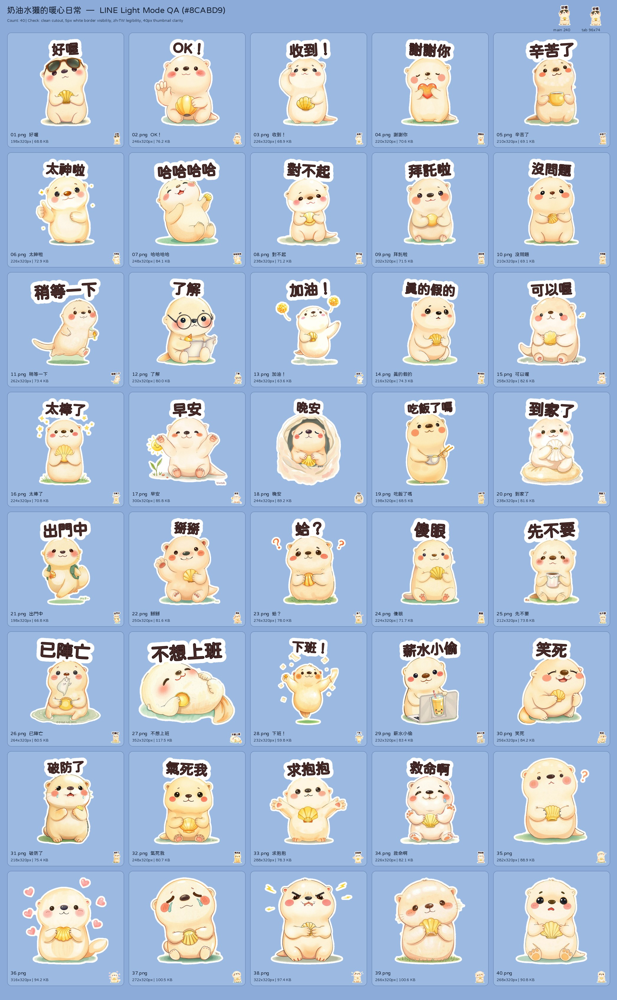

抱著粉黃小貝殼、圓耳紅臉頰的軟萌奶油小水獺來報到！全新 40 張 **《奶油水獺抱貝殼的暖心日常》（Cream Otter Shell Cozy Daily）** LINE 靜態貼圖已正式送審！

這次採用溫暖治癒的 **日系繪本色鉛筆水彩風格（`soft_chibi_storybook`）**，溫潤的深棕色手繪線條搭配柔和奶油粉彩上色，結合 **34 張台灣與香港高頻日常＆社畜對話＋6 張無文字百搭表情**。從「好喔 / OK！ / 收到！ / 辛苦了」到「不想上班 / 薪水小偷 / 破防了 / 求抱抱」，不管在工作群組、朋友聊天還是情侶日常都超療癒。

> 🐚🦦 **奶油水獺抱貝殼的暖心日常**（40 張靜態貼圖）👉 [Massor 的 LINE 貼圖小舖](https://line.me/S/shop/sticker/author/6564520?utm_source=ghpages&utm_medium=bridge&utm_campaign=cream-otter-cozy&utm_content=author-6564520)  
> 本套已於 2026-11-28 送審（Creators Market ID `49544326`，[商店頁面](https://store.line.me/stickershop/product/49544326/zh-Hant?utm_source=ghpages&utm_medium=bridge&utm_campaign=cream-otter-cozy&utm_content=cream-otter-cozy-49544326)），已開啟自動上架，審核通過後立即開放下載。

## 這套貼圖的亮點

1. **日系繪本水彩筆觸**：柔和色鉛筆與淡彩水彩質感，兩頭身Ｑ版比例加上懷裡緊抱的小貝殼，傳訊息就像送出一張手繪暖心卡片。
2. **台港日常＋社畜必備 40 張全收齊**：涵蓋 16 句萬用回應（好喔、OK！、收到！、謝謝你、辛苦了、太神啦、哈哈哈哈、對不起、拜託啦、沒問題、稍等一下、了解、加油！、真的假的、可以喔、太棒了）、6 句日常問候（早安、晚安、吃飯了嗎、到家了、出門中、掰掰）、12 句台港熱門情緒口語（蛤？、傻眼、先不要、已陣亡、不想上班、下班！、薪水小偷、笑死、破防了、氣死我、求抱抱、救命啊），外加 6 張無文字純表情，跨語系也能直接用。
3. **深色模式也清晰好讀**：每張貼圖皆經過自動去背與 **5px 純白貼紙描邊**，並通過 LINE 官方規格檢查（`370×320` 以內偶數尺寸、`main.png 240×240`、`tab.png 96×74`），暗色模式白邊清晰不糊。

## 台灣 / 香港 / 日本 同步推廣中

- 🇹🇼🇭🇰 **台灣・香港**：把不好意思直接說出口的「不想上班」「薪水小偷」「求抱抱」，交給抱著小貝殼的奶油小水獺幫你暖心傳達！
- 🇯🇵 **日本のみなさまへ**：パステル黄色のホタテ貝を抱えた、やさしい水彩絵本タッチのクリームラッコスタンプ「Cream Otter Shell Cozy Daily（全40種）」！文字なしの万能リアクション6種も収録しており、日本語のトークでもそのまま使えます。

👉 [立即前往 LINE 貼圖小舖（Massor）](https://line.me/S/shop/sticker/author/6564520?utm_source=ghpages&utm_medium=bridge&utm_campaign=cream-otter-cozy&utm_content=author-6564520)

更多貼圖作品整理在 [LINE 貼圖合集](/blog/line-stickers/)，英文版製作紀錄可見 [slashmantools.us](https://slashmantools.us/blog/line-sticker-cream-otter-cozy/)。
