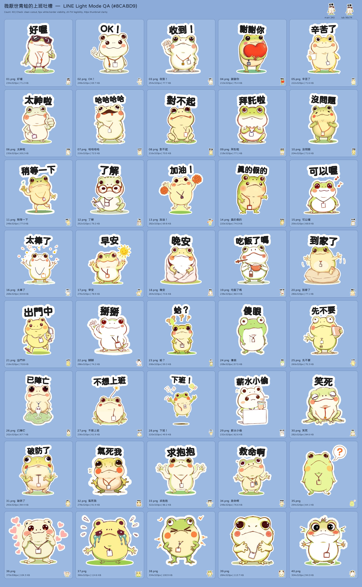

掛著員工識別證、頂著豆豆眼的圓滾滾微厭世小青蛙來替你說出上班心裡話！全新 40 張 **《微厭世青蛙的上班吐槽 第二彈》（Grumpy Little Frog Office Chat Vol. 2）** LINE 靜態貼圖已正式送審！

這次採用樸實魔性的 **醜萌手繪塗鴉風格（`ugly_cute_office`）**，歪斜可愛的深棕色麥克筆線條搭配低飽和粉彩綠上色，結合 **34 張台灣與香港高頻日常＆社畜對話＋6 張無文字百搭表情**。從「好喔 / OK！ / 收到！ / 辛苦了」到「不想上班 / 薪水小偷 / 下班！ / 破防了」，不管在公司群組還是朋友聊天都超實用。

> 🐸💼 **微厭世青蛙的上班吐槽 第二彈**（40 張靜態貼圖）👉 [Massor 的 LINE 貼圖小舖](https://line.me/S/shop/sticker/author/6564520?utm_source=ghpages&utm_medium=bridge&utm_campaign=grumpy-frog-worker-vol2&utm_content=author-6564520)  
> 本套已於 2026-11-28 送審（Creators Market ID `49558286`，[商店頁面](https://store.line.me/stickershop/product/49558286/zh-Hant?utm_source=ghpages&utm_medium=bridge&utm_campaign=grumpy-frog-worker-vol2&utm_content=grumpy-frog-worker-49558286)），已開啟自動上架，審核通過後立即開放下載。

## 這套貼圖的亮點

1. **醜萌社畜塗鴉筆觸**：兩頭身圓胖糰子比例＋掛在胸前的小識別證＋豆豆眼厭世表情，自帶魔性笑點，傳一張就能精準表達職場情緒。
2. **台港日常＋社畜必備 40 張全收齊**：涵蓋 16 句萬用回應（好喔、OK！、收到！、謝謝你、辛苦了、太神啦、哈哈哈哈、對不起、拜託啦、沒問題、稍等一下、了解、加油！、真的假的、可以喔、太棒了）、6 句日常問候（早安、晚安、吃飯了嗎、到家了、出門中、掰掰）、12 句台港熱門情緒口語（蛤？、傻眼、先不要、已陣亡、不想上班、下班！、薪水小偷、笑死、破防了、氣死我、求抱抱、救命啊），外加 6 張無文字純表情，跨語系也能直接用。
3. **深色模式也清晰好讀**：每張貼圖皆經過自動去背與 **5px 純白貼紙描邊**，並通過 LINE 官方規格檢查（`370×320` 以內偶數尺寸、`main.png 240×240`、`tab.png 96×74`），暗色模式白邊清晰不糊。

## 台灣 / 香港 / 日本 同步推廣中

- 🇹🇼🇭🇰 **台灣・香港**：把不好意思直接說出口的「不想上班」「薪水小偷」「已陣亡」，交給掛著識別證的小青蛙幫你傳達！
- 🇯🇵 **日本のみなさまへ**：社員証を首から下げた、まんまるおめめのゆるかわカエル社員スタンプ「Grumpy Little Frog Office Chat Vol. 2（全40種）」！文字なしの万能リアクション6種も収録しており、日本語のトークでもそのまま使えます。

👉 [立即前往 LINE 貼圖小舖（Massor）](https://line.me/S/shop/sticker/author/6564520?utm_source=ghpages&utm_medium=bridge&utm_campaign=grumpy-frog-worker-vol2&utm_content=author-6564520)

更多貼圖作品整理在 [LINE 貼圖合集](/blog/line-stickers/)，英文版製作紀錄可見 [slashmantools.us](https://slashmantools.us/blog/line-sticker-grumpy-frog-worker/)。
