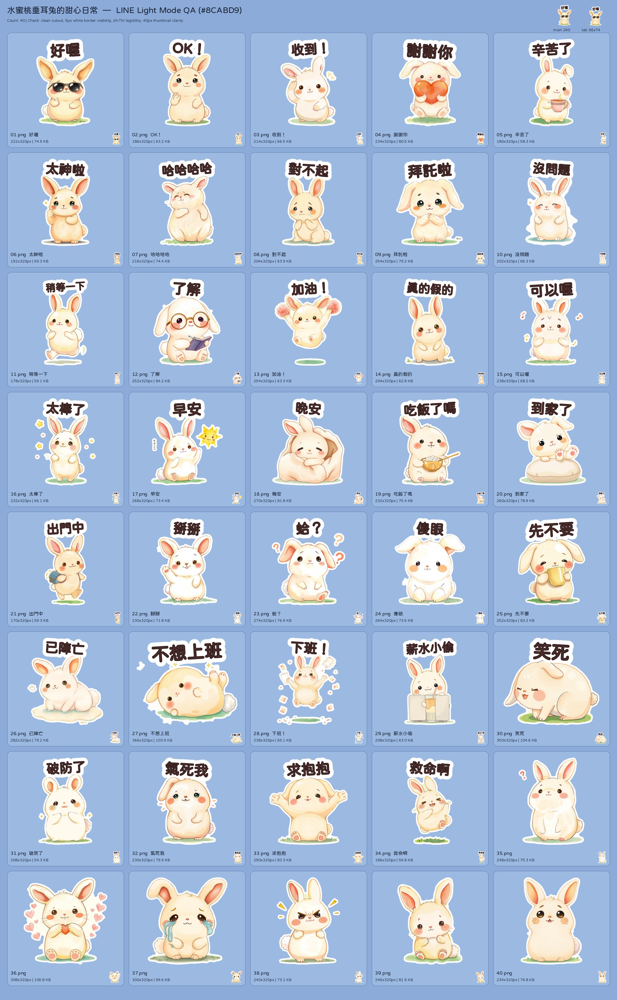

軟綿綿、圓滾滾又自帶腮紅的水蜜桃垂耳兔來療癒你的每一天！全新 40 張 **《水蜜桃垂耳兔的甜心日常 第二彈》（Peach Lop Bunny Sweet Daily Vol. 2）** LINE 靜態貼圖已正式送審！

這次採用溫柔治癒的 **日系繪本水彩與色鉛筆手繪風（`soft_chibi_storybook`）**，暖深棕色手繪線條搭配粉嫩蜜桃奶油色系，結合 **34 張台灣與香港高頻日常＆社畜對話＋6 張無文字百搭表情**。從「好喔 / OK！ / 收到！ / 辛苦了」到「不想上班 / 薪水小偷 / 下班！ / 求抱抱」，無論傳給朋友、情侶還是同事都可愛又實用。

> 🐰🍑 **水蜜桃垂耳兔的甜心日常 第二彈**（40 張靜態貼圖）👉 [Massor 的 LINE 貼圖小舖](https://line.me/S/shop/sticker/author/6564520?utm_source=ghpages&utm_medium=bridge&utm_campaign=peach-lop-bunny-vol2&utm_content=author-6564520)  
> 本套已於 2026-11-29 送審（Creators Market ID `49575847`，[商店頁面](https://store.line.me/stickershop/product/49575847/zh-Hant?utm_source=ghpages&utm_medium=bridge&utm_campaign=peach-lop-bunny-vol2&utm_content=peach-lop-bunny-49575847)），已開啟自動上架，審核通過後立即開放下載。

## 這套貼圖的亮點

1. **療癒系日系繪本筆觸**：二頭身 Q 版圓胖比例、軟垂長耳朵、棉花糖小尾巴與閃亮大眼睛，搭配手繪色鉛筆與淡彩水彩質感，治癒度滿分。
2. **台港日常＋職場情緒＋跨語系純表情一次收齊**：涵蓋 16 句萬用回應（好喔、OK！、收到！、謝謝你、辛苦了、太神啦、哈哈哈哈、對不起、拜託啦、沒問題、稍等一下、了解、加油！、真的假的、可以喔、太棒了）、6 句日常問候（早安、晚安、吃飯了嗎、到家了、出門中、掰掰）、12 句台港熱門情緒口語（蛤？、傻眼、先不要、已陣亡、不想上班、下班！、薪水小偷、笑死、破防了、氣死我、求抱抱、救命啊），外加 6 張無文字純表情，日本與海外聊天室也能直接使用。
3. **深色模式也清晰好讀**：每張貼圖皆經過自動去背與 **5px 純白貼紙描邊**，並通過 LINE 官方規格檢查（`370×320` 以內偶數尺寸、`main.png 240×240`、`tab.png 96×74`），暗色模式白邊清晰不糊。

## 台灣 / 香港 / 日本 同步推廣中

- 🇹🇼🇭🇰 **台灣・香港**：用軟萌水蜜桃垂耳兔替你說「不想上班」「求抱抱」「辛苦了」，讓聊天室瞬間充滿療癒感！
- 🇯🇵 **日本のみなさまへ**：ふんわりパステルピーチ色のたれ耳うさぎ「Peach Lop Bunny Sweet Daily Vol. 2（全40種）」がLINEスタンプ申請中！文字なしのリアクション6種も含まれており、日本語のトークでもそのまま使えます。

👉 [立即前往 LINE 貼圖小舖（Massor）](https://line.me/S/shop/sticker/author/6564520?utm_source=ghpages&utm_medium=bridge&utm_campaign=peach-lop-bunny-vol2&utm_content=author-6564520)

更多貼圖作品整理在 [LINE 貼圖合集](/blog/line-stickers/)，英文版製作紀錄可見 [slashmantools.us](https://slashmantools.us/blog/line-sticker-peach-lop-bunny-vol2/)。
