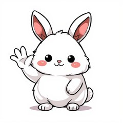
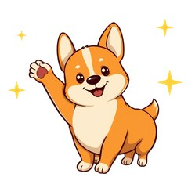
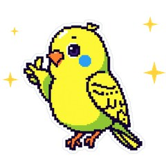
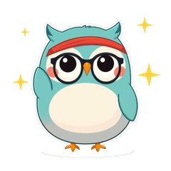
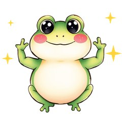
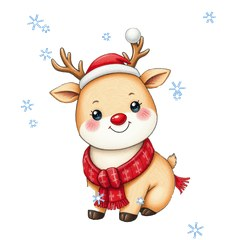
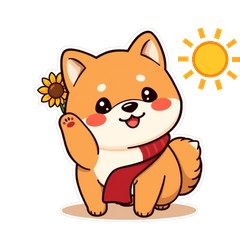

這裡是我（Massor）所有**正在 LINE 貼圖小舖販售**的原創貼圖，共 **28 組**：23 組會動的動態貼圖（NT$60）和 5 組靜態貼圖（NT$42）。
依照「什麼時候會傳」分成四區：療癒安慰、情侶撒嬌、上班族日常、節日季節。點圖片或「在 LINE 商店購買」會直接開 LINE 商店頁，手機上會跳進 LINE App。

👉 想一次看全部：[LINE 貼圖作者頁](https://line.me/S/shop/sticker/author/6564520)

## 🌿 療癒動物系：累了、想哭、想躺平

朋友說「好累」的時候，一張會拍拍、會抱抱的貼圖比打一大段話更有溫度。這一區是安慰、晚安、放鬆用的療癒系角色。

<strong>無尾熊可可・療癒拍拍動起來</strong> 朋友說好累、想哭時傳一張「拍拍」：療癒系安慰貼圖，取代詞窮的「辛苦了」 <small>動態貼圖・NT$60</small> <a class="lh-b" href="https://line.me/S/sticker/37302939" target="_blank" rel="noopener">在 LINE 商店購買</a> <a href="/blog/line-animated-sticker-koala-comfort/">看介紹文</a>

<strong>柚柚水豚・情緒穩定中</strong> 情緒穩定中的頭頂柚子水豚：工作爆炸、已讀不回也能「沒事沒事」 <small>靜態貼圖・NT$42</small> <a class="lh-b" href="https://line.me/S/sticker/37291887" target="_blank" rel="noopener">在 LINE 商店購買</a> <a href="/blog/line-sticker-capybara-calm/">看介紹文</a>

<strong>麻糬海豹噗嚕・想躺平日常</strong> 軟Q麻糬海豹，想躺平、沒咖啡會融化：療癒系上班族厭世日常 <small>靜態貼圖・NT$42</small> <a class="lh-b" href="https://line.me/S/sticker/37215265" target="_blank" rel="noopener">在 LINE 商店購買</a> <a href="/blog/line-sticker-pulu-seal-lazy/">看介紹文</a>

<strong>黏土垂耳兔睏睏・晚安熬夜中</strong> 晚安、再 5 分鐘、熬夜中：黏土垂耳兔的睡前療癒貼圖 <small>動態貼圖・NT$60</small> <a class="lh-b" href="https://line.me/S/sticker/37390703" target="_blank" rel="noopener">在 LINE 商店購買</a> <a href="/blog/line-animated-sticker-bunny-goodnight/">看介紹文</a>

<strong>樹懶懶懶・週末耍廢</strong> 週末耍廢不想動：慢吞吞小樹懶的放鬆系動態貼圖 <small>動態貼圖・NT$60</small> <a class="lh-b" href="https://line.me/S/sticker/37360149" target="_blank" rel="noopener">在 LINE 商店購買</a> <a href="/blog/line-animated-sticker-sloth-lazy/">看介紹文</a>

<strong>肉毛兔</strong> 白白軟軟的肉毛兔：打招呼、撒嬌、哭哭、吃餅乾，日常療癒一組搞定 <small>靜態貼圖・NT$42</small> <a class="lh-b" href="https://line.me/S/sticker/36099823" target="_blank" rel="noopener">在 LINE 商店購買</a> <a href="/blog/line-sticker-roumao-rabbit/">看介紹文</a>

<strong>糰糰倉鼠・會動的超有反應</strong> 超有反應的倉鼠：驚嚇、點頭、轉圈圈，聊天回覆不冷場 <small>動態貼圖・NT$60</small> <a class="lh-b" href="https://line.me/S/sticker/37292039" target="_blank" rel="noopener">在 LINE 商店購買</a> <a href="/blog/line-animated-sticker-hamster/">看介紹文</a>

<strong>蠟筆虎斑貓喵吉・萌寵日常</strong> 蠟筆虎斑貓喵吉：貓奴日常、撒嬌討摸，萌寵系動態貼圖 <small>動態貼圖・NT$60</small> <a class="lh-b" href="https://line.me/S/sticker/37327389" target="_blank" rel="noopener">在 LINE 商店購買</a> <a href="/blog/line-animated-sticker-kitten-voice/">看介紹文</a>

## 💞 情侶・曖昧系：想你、抱抱、吵架求原諒

情侶、曖昧對象、另一半之間最常傳的話：想你、抱抱、已讀不回、對不起。適合送給另一半當小禮物。

<strong>芋圓貓・黏TT戀愛日常</strong> 黏TT芋圓貓：想你、抱抱、你不愛我了嗎、啾一個，情侶聊天必備 <small>靜態貼圖・NT$42</small> <a class="lh-b" href="https://line.me/S/sticker/37220496" target="_blank" rel="noopener">在 LINE 商店購買</a> <a href="/blog/line-sticker-yuyuan-cat-couple/">看介紹文</a>

<strong>黏人水獺拉拉・戀愛情勒動起來</strong> 已讀不回就哭給你看：黏人水獺的戀愛情勒，情侶撒嬌專用 <small>動態貼圖・NT$60</small> <a class="lh-b" href="https://line.me/S/sticker/37304821" target="_blank" rel="noopener">在 LINE 商店購買</a> <a href="/blog/line-animated-sticker-otter-love/">看介紹文</a>

<strong>小狐狸橙橙・謝謝對不起拜託</strong> 謝謝、對不起、拜託拜託：吵架後道歉、求原諒的小狐狸 <small>動態貼圖・NT$60</small> <a class="lh-b" href="https://line.me/S/sticker/37375782" target="_blank" rel="noopener">在 LINE 商店購買</a> <a href="/blog/line-animated-sticker-fox-thanks/">看介紹文</a>

<strong>復古柯基短短・約出門</strong> 約出門、等你喔、出發囉：復古柯基的約會揪團貼圖 <small>動態貼圖・NT$60</small> <a class="lh-b" href="https://line.me/S/sticker/37327480" target="_blank" rel="noopener">在 LINE 商店購買</a> <a href="/blog/line-animated-sticker-corgi-retro/">看介紹文</a>

## 💼 上班族・學生系：收到、已讀、月底吃土

工作群組、同學群組、下班後的耍廢日常。敷衍回覆、應援打氣、月光族自嘲，一組搞定。

<strong>暴走狂暴大白鵝・老子嘎嘎叫你奈我何</strong> 隨便啦、啊啊啊原地發瘋、小的知錯了、我就爛、老子掀桌不幹了：社畜聊天互嗆宣洩情緒神物 <small>動態貼圖・NT$60</small> <a class="lh-b" href="/blog/line-animated-sticker-savage-goose/">在 LINE 商店預覽</a> <a href="/blog/line-animated-sticker-savage-goose/">看介紹文</a>

<strong>社畜企鵝啵啵・上班日常動起來</strong> 收到、好的老闆、下班了沒：社畜企鵝的上班族日常 <small>動態貼圖・NT$60</small> <a class="lh-b" href="https://line.me/S/sticker/37292394" target="_blank" rel="noopener">在 LINE 商店購買</a> <a href="/blog/line-animated-sticker-penguin-office/">看介紹文</a>

<strong>像素松鼠存存・月光族日常</strong> 發薪啦、窮、月底吃土：像素松鼠的月光族理財日常 <small>動態貼圖・NT$60</small> <a class="lh-b" href="https://line.me/S/sticker/37390747" target="_blank" rel="noopener">在 LINE 商店購買</a> <a href="/blog/line-animated-sticker-squirrel-payday/">看介紹文</a>

<strong>像素鸚鵡啾比・敷衍回覆</strong> 嗯嗯、喔、好喔：已讀不想打字時的像素鸚鵡敷衍回覆 <small>動態貼圖・NT$60</small> <a class="lh-b" href="https://line.me/S/sticker/37327360" target="_blank" rel="noopener">在 LINE 商店購買</a> <a href="/blog/line-animated-sticker-budgie-pixel/">看介紹文</a>

<strong>貓頭鷹咕咕・考試週求生中</strong> 考試週求生、熬夜讀書、救命：學生族的貓頭鷹動態貼圖 <small>動態貼圖・NT$60</small> <a class="lh-b" href="https://line.me/S/sticker/37303917" target="_blank" rel="noopener">在 LINE 商店購買</a> <a href="/blog/line-animated-sticker-owl-exam/">看介紹文</a>

<strong>小黃鴨嘎嘎・衝鴨應援</strong> 衝鴨、加油、你可以的：小黃鴨諧音梗應援，給同事朋友打氣 <small>動態貼圖・NT$60</small> <a class="lh-b" href="https://line.me/S/sticker/37350499" target="_blank" rel="noopener">在 LINE 商店購買</a> <a href="/blog/line-animated-sticker-duck-cheer/">看介紹文</a>

<strong>水彩青蛙呱寶・減肥明天再說</strong> 減肥明天再說：水彩青蛙的吃貨與運動藉口日常 <small>動態貼圖・NT$60</small> <a class="lh-b" href="https://line.me/S/sticker/37374736" target="_blank" rel="noopener">在 LINE 商店購買</a> <a href="/blog/line-animated-sticker-frog-diet/">看介紹文</a>

<strong>黏土豬豬嘟嘟・吃貨日常</strong> 吃貨日常、揪吃飯、宵夜時間：黏土小豬嘟嘟 <small>動態貼圖・NT$60</small> <a class="lh-b" href="https://line.me/S/sticker/37327325" target="_blank" rel="noopener">在 LINE 商店購買</a> <a href="/blog/line-animated-sticker-piglet-foodie/">看介紹文</a>

<strong>浣熊嚕嚕・追劇追星日常</strong> 再一集就好：追劇追星的浣熊嚕嚕，下班後的耍廢娛樂 <small>動態貼圖・NT$60</small> <a class="lh-b" href="https://line.me/S/sticker/37431569" target="_blank" rel="noopener">在 LINE 商店購買</a> <a href="/blog/line-animated-sticker-raccoon-binge/">看介紹文</a>

## 🎄 節日・季節系：聖誕、新年、天冷、生日

聖誕節、跨年、2027 羊年春節、萬聖節、生日、颱風天：季節一到就用得到，也適合當聖誕交換禮物。

<strong>馴鹿叮噹・聖誕新年動起來</strong> 聖誕快樂、新年快樂一次搞定：鉛筆手繪小馴鹿叮噹 <small>動態貼圖・NT$60</small> <a class="lh-b" href="https://line.me/S/sticker/37302946" target="_blank" rel="noopener">在 LINE 商店購買</a> <a href="/blog/line-animated-sticker-reindeer-xmas/">看介紹文</a>

<strong>綿綿羊・喜氣羊羊過好年</strong> 2027 羊年新年貼圖：恭喜發財、紅包拿來，家族群組拜年必備 <small>靜態貼圖・NT$42</small> <a class="lh-b" href="https://line.me/S/sticker/37266378" target="_blank" rel="noopener">在 LINE 商店購買</a> <a href="/blog/line-sticker-goat-year-2027/">看介紹文</a>

<strong>水彩刺蝟栗栗・天冷保暖</strong> 天冷抱抱取暖的水彩小刺蝟：冬天問候、關心對方多穿一點 <small>動態貼圖・NT$60</small> <a class="lh-b" href="https://line.me/S/sticker/37336572" target="_blank" rel="noopener">在 LINE 商店購買</a> <a href="/blog/line-animated-sticker-hedgehog-warm/">看介紹文</a>

<strong>復古小熊貓糖糖・萬聖節</strong> 不給糖就搗蛋：復古小熊貓糖糖的萬聖節貼圖 <small>動態貼圖・NT$60</small> <a class="lh-b" href="https://line.me/S/sticker/37350480" target="_blank" rel="noopener">在 LINE 商店購買</a> <a href="/blog/line-animated-sticker-redpanda-halloween/">看介紹文</a>

<strong>黏土熊貓滾滾・生日恭喜</strong> 生日快樂、恭喜恭喜：黏土熊貓滾滾的祝賀貼圖 <small>動態貼圖・NT$60</small> <a class="lh-b" href="https://line.me/S/sticker/37360223" target="_blank" rel="noopener">在 LINE 商店購買</a> <a href="/blog/line-animated-sticker-panda-birthday/">看介紹文</a>

<strong>水彩河馬胖胖・颱風天氣篇</strong> 颱風假、好冷、好熱：水彩河馬胖胖的天氣問候 <small>動態貼圖・NT$60</small> <a class="lh-b" href="https://line.me/S/sticker/37431495" target="_blank" rel="noopener">在 LINE 商店購買</a> <a href="/blog/line-animated-sticker-hippo-weather/">看介紹文</a>

<strong>柴犬福福・長輩早安問候動起來</strong> 長輩早安圖動起來：柴犬福福的早安午安、平安健康問候 <small>動態貼圖・NT$60</small> <a class="lh-b" href="https://line.me/S/sticker/37292442" target="_blank" rel="noopener">在 LINE 商店購買</a> <a href="/blog/line-animated-sticker-shiba-greetings/">看介紹文</a>

## 怎麼挑？

- **想安慰朋友**：[無尾熊可可](https://line.me/S/sticker/37302939)、[柚柚水豚](https://line.me/S/sticker/37291887)
- **送另一半**：[芋圓貓](https://line.me/S/sticker/37220496)、[黏人水獺拉拉](https://line.me/S/sticker/37304821)（延伸閱讀：[情侶＋療癒貼圖推薦](/blog/line-sticker-couple-healing-picks/)）
- **上班族群組**：[社畜企鵝啵啵](https://line.me/S/sticker/37292394)、[像素鸚鵡啾比](https://line.me/S/sticker/37327360)
- **聖誕交換禮物、跨年拜年**：[馴鹿叮噹](https://line.me/S/sticker/37302946)、[綿綿羊](https://line.me/S/sticker/37266378)（延伸閱讀：[聖誕節冬天 LINE 貼圖禮物清單](/blog/line-sticker-christmas-winter-gift/)）

LINE 貼圖可以直接在商店頁按「贈送禮物」送給朋友，不用知道對方的帳號以外的任何資料。

## 誠實筆記

角色是 AI 輔助生成的，動畫是程式做的，LINE 商店頁會標示「使用AI」。這一頁會在新貼圖開賣時更新。

<small>English: All 27 original LINE sticker sets by Massor — healing animals, couple, office worker and seasonal (Christmas / Lunar New Year) themes. 日本語：Massor のオリジナル LINE スタンプ全27種。癒し系・カップル・会社員・季節イベント。</small>
