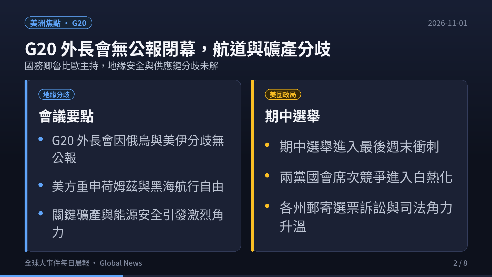
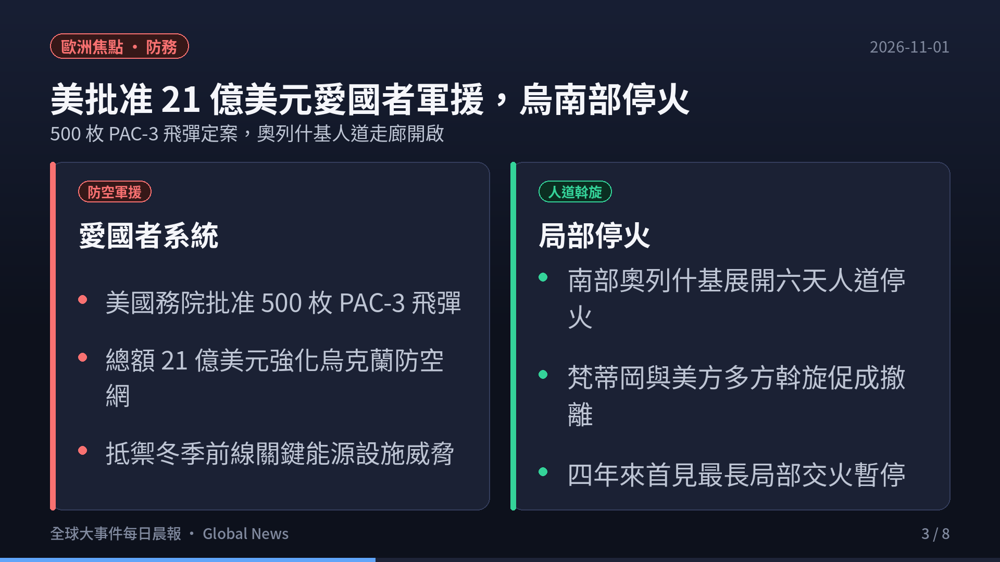
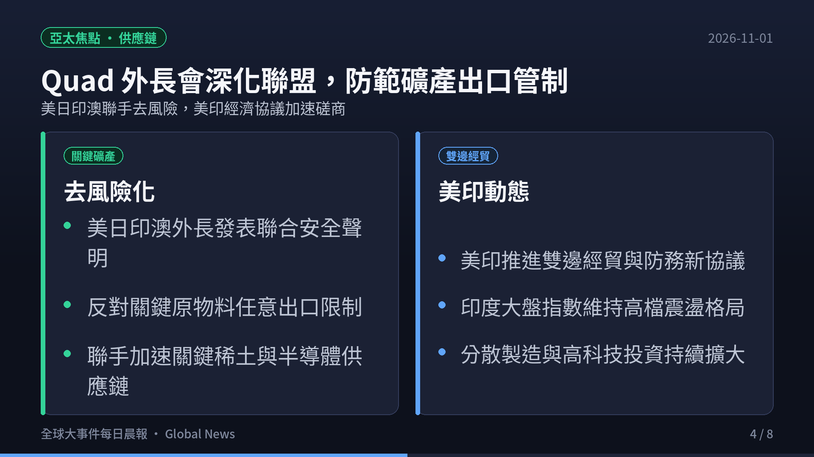
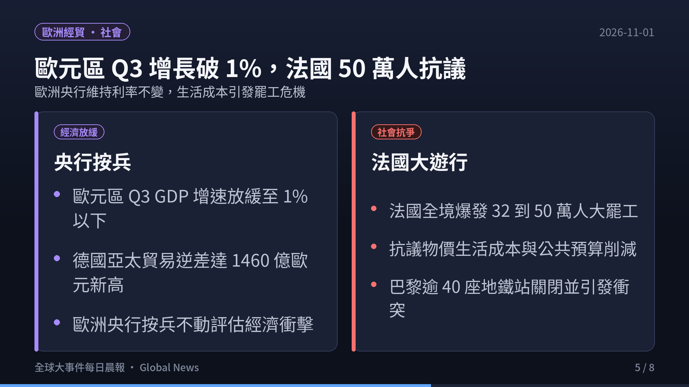
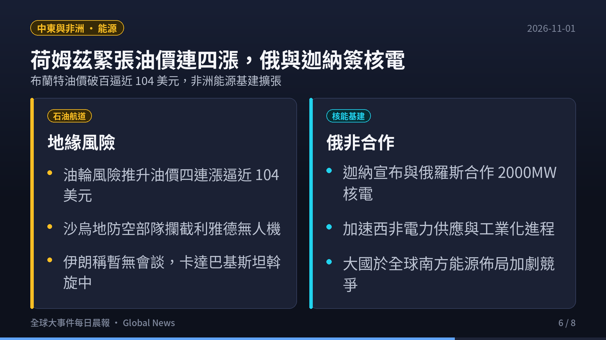
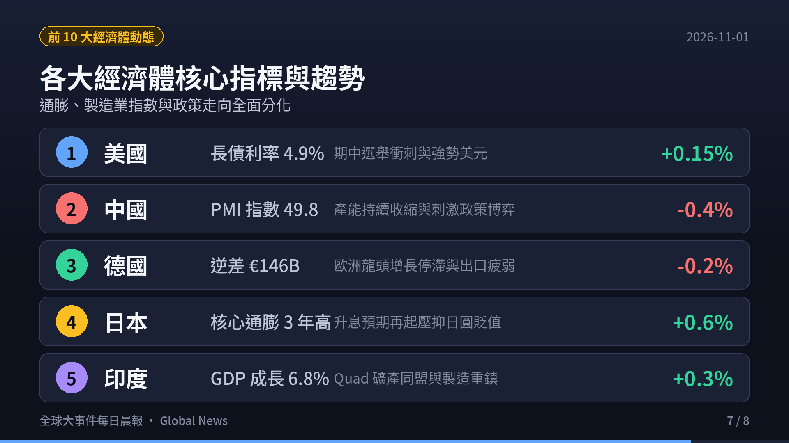
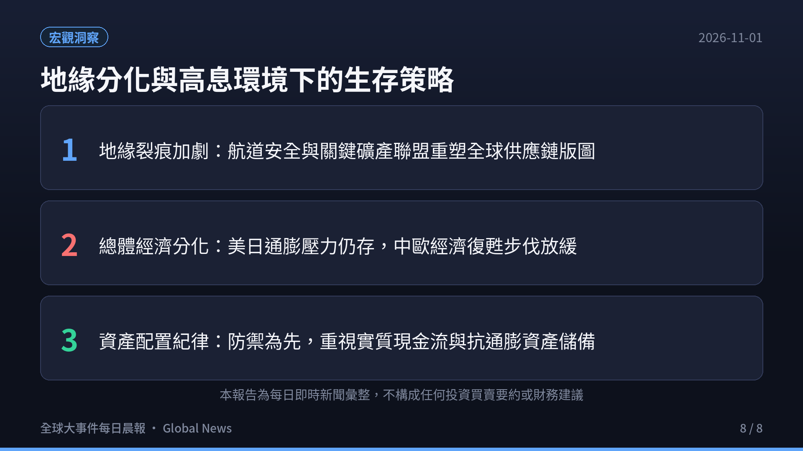

> **觀測週期**：2026-11-01 晨間即時彙整  
> **情報涵蓋**：全球六大洲（北美、南美、歐洲、亞洲、中東、非洲、大洋洲）與全球前 10 大經濟體  
> **核心來源**：G20 外長峰會閉幕聲明、各國央行利率決議、路透社（Reuters）、新華社（Xinhua）、Business Recorder、ApeWisdom 即時金融情報庫  
> **定位宗旨**：以客觀數據、第一手官方公報與產業鏈結構為準繩，剔除短期情緒噪音，提煉出真正驅動全球資金流向與地緣版圖重構的核心脈絡。

  

    <iframe src="https://www.youtube.com/embed/npqcZFLGcnc" title="2026.11.01 全球大事件每日晨報" style="position: absolute; top:0; left: 0; width: 100%; height: 100%; border: 0;" allow="accelerometer; autoplay; clipboard-write; encrypted-media; gyroscope; picture-in-picture; web-share" allowfullscreen></iframe>
  

  

    🎬 <strong>120 秒晨間快報影音動態版</strong>（含 AI 自然神經語音朗讀與背景配樂）
  

---

## 🎯 今日全球前 6 大核心事件深度拆解

### 1. 美洲與全球治理：G20 外長會無公報閉幕，航道自由與礦產分歧加深
- **事件脈絡**：為期兩天的二十國集團（G20）外長會議在美國國務卿馬可·魯比歐（Marco Rubio）主持下閉幕。由於各成員國在烏克蘭戰事與美伊軍事緊張局勢上存在無法彌合的深層分歧，本次會議最終未能發表聯合公報（Joint Communique）。
- **關鍵爭端**：
  - **關鍵海運水道安全**：美方及其盟友在閉幕記者會上強烈強調荷姆茲海峽（Strait of Hormuz）與黑海（Black Sea）的航行自由與商業船舶通行權，指責伊朗與非國家行為體威脅全球能源命脈。
  - **關鍵礦產與供應鏈**：大宗商品與關鍵礦產（稀土、鋰、鎳）供應鏈的安全保障成為多空角力中心，新興市場國家普遍對已開發國家的出口限制防衛性條款抱持高度戒心。
- **美國內政聯動**：美國期中選舉（Midterm Elections）正式進入最後倒數週末，加州海外與郵寄選票認定、阿拉斯加參院席次之司法調查全面白熱化，政治不確定性導致美股高檔避險情緒升溫。

---

### 2. 歐洲防務與地緣：美批准 21 億美元愛國者 PAC-3 軍援，烏南部奧列什基停火
- **重大軍售案落定**：美國國務院於 10 月 31 日正式批准向烏克蘭出售 **500 枚愛國者三型（PAC-3）防空飛彈**，合約估計總值高達 **21 億美元**。此舉被視為川普第二任政府啟動以來對基輔最大規模的防禦性武器補給，旨在協助烏克蘭抵禦入冬後針對能源電網的飽和打擊。
- **罕見局部人道停火**：
  - 在梵蒂岡教宗以及多方國際斡旋之下，俄軍控制的赫爾松州南部城鎮奧列什基（Oleshky）實施為期 **6 天的局部人道停火**。
  - 受困平民在缺水、斷電數年後首度獲准跨越前線撤離回烏克蘭控制區，這是俄烏爆發全面衝突以來持續時間最長的一次局部人道走廊。

---

### 4. 亞洲與印太同盟：印太 Quad 外長深化聯盟，聯手反對關鍵礦產出口管制
- **四方安全對話（Quad）聯合聲明**：美國、澳洲、印度與日本外長於 10 月 31 日在亞特蘭大發表聯合聲明，承諾共同構建具備高度韌性、去風險化的全球高科技供應鏈。
- **反經濟脅迫與出口限制**：
  - 聲明強烈譴責任何以非市場手段、任意管制出口為手段的「經濟脅迫（Economic Coercion）」，針對關鍵礦產與先進材料供應展開多邊協調機制。
  - 日本對特定稀缺金屬出口禁令表達強烈關切；美國則加緊推動籌組 G20 礦產安全聯盟。
- **美印雙邊協議推進**：美國與印度官方證實，兩國正針對雙邊先進防務合作、半導體投資與能源技術轉移協議加緊展開具體磋商，印度作為供應鏈替代樞紐的戰略地位持續鞏固。

---

### 4. 歐洲經貿與社會衝擊：歐元區 Q3 增長破 1% 央行按兵，法國 50 萬人上街抗議
- **歐元區 GDP 顯著失速**：歐元區第三季經濟成長率（GDP）終值公布，年增率放緩至 **0.8% ~ 1.1%**，正式跌破象徵穩健復甦的 1% 門檻。歐洲央行（ECB）於 10 月 30 日利率會議上宣布維持基準利率不變，政策立場在通膨黏性與經濟衰退風險之間維持艱難平衡。
- **德國亞太貿易逆差創歷史紀錄**：德國統計部門公布最新測算，2026 年德國對亞太地區貿易逆差預計將達到創紀錄的 **1,460 億歐元（約 1,630 億美元）**，德國傳統汽車與工業機械出口動能面臨結構性萎縮。
- **法國全國大罷工**：
  - 法國全境於週末爆發多達 **32 萬至 50 萬人**的大規模街頭抗議與罷工（巴黎示威人數達 7 萬至 20 萬）。
  - 群眾抗議物價生活成本飛漲、公共服務預算大幅削減，巴黎公共交通營運商 RATP 緊急關閉逾 40 座地鐵站，部分街區爆發警民催淚瓦斯衝突。

---

### 5. 中東能源危機與非洲基建：荷姆茲航道緊張油價四連漲，俄非簽署 2000MW 核電協議
- **國際油價逼近 104 美元**：
  - 荷姆茲海峽再度傳出油輪遭受襲擾警訊，引發全球原油海運供應鏈高度緊繃。
  - 布蘭特原油期貨價格創下連續第四個月上漲，目前站穩每桶 **104 美元** 高檔，對全球抗通膨進程帶來嚴峻考驗。
  - 沙烏地阿拉伯防空部隊在利雅德周邊攔截敵對無人機；伊朗外長阿拉格齊（Araghchi）公開表示「德黑蘭目前無意與美官員會面」，並由卡達與巴基斯坦擔任關鍵斡旋角色。
- **俄羅斯在非擴張核能基建**：迦納外交部長在俄羅斯-非洲峰會後正式宣布，迦納已與俄羅斯達成合作開發 **2,000 MW（兆瓦）核能發電廠** 之協議，旨在根本解決西非電力短缺並推動本土工業化進程，凸顯全球南方國家在地緣博弈中的多元能源結盟取向。

---

### 6. 全球前十大經濟體核心指標與趨勢橫向比較

| 排名 | 國家 / 經濟體 | 核心總體經濟數據 / 最新指標 | 2026-11-01 即時動態與政策取向 | 全球產業鏈與市場意涵 |
|:---:|:---|:---|:---|:---|
| **1** | **美國 (USA)** | 10年期美債殖利率 **4.92%** | G20 外長會航道交鋒；期中選舉最後衝刺；國務院批准 21 億美元軍援 | 無風險利率維持高檔，股權風險溢價（ERP）壓縮，長線資金重視現金流。 |
| **2** | **中國 (China)** | 10月官方製造業 PMI **49.8** | 官方製造業近 4 個月第 3 度陷入萎縮；房市與內需政策持續發力 | 工業復甦動能偏弱，市場聚焦進一步財政刺激力道與貨幣寬鬆節奏。 |
| **3** | **德國 (Germany)** | Q3 GDP 年增 **1.0%** · 逆差 **€146B** | 對亞太貿易逆差創 1,460 億歐元歷史新高；能源轉型與工業成本高企 | 傳統製造業出口優勢受侵蝕，企業利潤率受到原物料與匯率雙重夾擊。 |
| **4** | **日本 (Japan)** | 9月核心通膨指數 **3年新高** | 扣除一次性因素後核心物價飆升；日銀 (BOJ) 後續升息壓力骤增 | 日圓匯率防守戰持續，日債殖利率曲線面臨調整，牽動全球套息交易平倉。 |
| **5** | **印度 (India)** | GDP 年增率維持 **6.8%** 高速 | 印太 Quad 關鍵礦產聯盟核心夥伴；美印經貿及安全協議加速談判 | 全球供應鏈南移之最大直接受惠者，孟買 Sensex 指數維持相對強勢。 |
| **6** | **英國 (UK)** | 10月房價年增率創 **2024年1月來新低** | 央行高利率政策壓抑房貸需求；生活成本攀升導致消費者支出謹慎 | 內需零售與地產市場降溫，市場預期英國央行後續降息步伐可能加快。 |
| **7** | **法國 (France)** | 示威人數達 **32~50 萬** · 評級維持 | 國際評級機構暫未降級，但 50 萬人全境大罷工凸顯公共財政赤字深層矛盾 | 政治與財政治理兩難，限制政府財政刺激空間，歐元匯價震盪。 |
| **8** | **義大利 (Italy)** | 國債利差 (BTP-Bund) 保持穩定 | 歐元區經濟增速跌破 1%，依賴歐盟復甦基金支持基礎建設投資 | 南歐外圍國對高利率耐受度受考驗，財政緊縮限制實質經濟成長空間。 |
| **9** | **加拿大 (Canada)** | 央行降息預期升溫 · 能源出口強勁 | 受益於國際油價逼近 104 美元，但受美加雙邊貿易壁壘議題牽動 | 能源商品出口支撐經常帳，但房地產貸款再融資壓力持續釋放。 |
| **10** | **澳洲 (Australia)** | Q3 CPI 核心通膨 **超預期升溫** | 燃油與民生物資價格反彈；澳洲央行 (RBA) 降息預期破滅、升息風險再起 | 原物料出口獲利改善，但國內高通膨限制降息空間，家計債務負擔沉重。 |

---

## 💡 總結與投資者生存指南

1. **地緣裂痕加劇與供應鏈版圖重構**：
   - G20 外長會的「無公報閉幕」清楚表明，全球多邊協商框架正在退化，取而代之的是以 **Quad（美日印澳）**、**美烏雙邊軍援**、**俄非核能能源結盟** 為代表的區域排他性同盟。
   - 關鍵礦產（稀土、鋰）與戰略航道（荷姆茲、黑海）的安全保障成為最核心的國家安全籌碼。
2. **油價破百與「黏性通膨」捲土重來**：
   - 布蘭特原油連續 4 個月上揚並逼近每桶 104 美元，加上日本、澳洲通膨指標超預期，正在粉碎全球央行「迅速全面降息」的樂觀幻想。
   - 能源輸入型通膨可能使得成熟市場的高利率環境維持比預期更長的時間（Higher for Longer）。
3. **宏觀分化環境下的資產配置紀律**：
   - 在 10 年期美債殖利率維持在 4.9% 附近的背景下，現金與超短天期國庫券依然提供堅實的無風險收益屏障。
   - 投資組合應降低對高負債、無實質現金流成長企業的敞口，優先布局具備**強大供應鏈定價權、不可替代真實數據與專利護城河**的全球領先企業。

---

### ☕ 支持與精選推薦

如果你覺得這份每日晨報對你的宏觀視野與決策有實質幫助，歡迎透過以下方式支持我們持續產出深度內容：

- ☕ **請我喝杯咖啡**：[Ko-fi 小費贊助 (ytstories0413)](https://ko-fi.com/ytstories0413) 或 [Ko-fi 贊助 (slashman413)](https://ko-fi.com/slashman413)（支持每日自動化爬蟲、語音合成與雲端運算）
- 📚 **數位產品與高人效生產力工具**：
  - [Gumroad 數位商品專區](https://slashmaster6.gumroad.com/)：收錄精選 AI Prompt 庫、生產力自動化工作流與實戰腳本
  - [飛書精選高人效商業模板庫](https://slashmaster6.gumroad.com/l/xohjh)：助你一人公司高效運營，打通專案管理與自動化數據流
  - [SlashmanTools 免費 Web 工具集](https://slashmantools.us/)：Token 成本計算器、顯存預估、開源 AI 工具導航
- 📖 **精選經典閱讀推薦**：
  - [《晶片戰爭》（Chip War）](https://www.amazon.com/dp/059371671X?tag=ytstories0413-20)：理解全球晶片霸權與印太供應鏈重組的必讀經典
  - [《原子習慣》— 細微改變帶來巨大成就](https://www.books.com.tw/products/0010792915)
  - [《人生的智慧》— 叔本華處世哲學經典](https://www.books.com.tw/products/0010613113)
