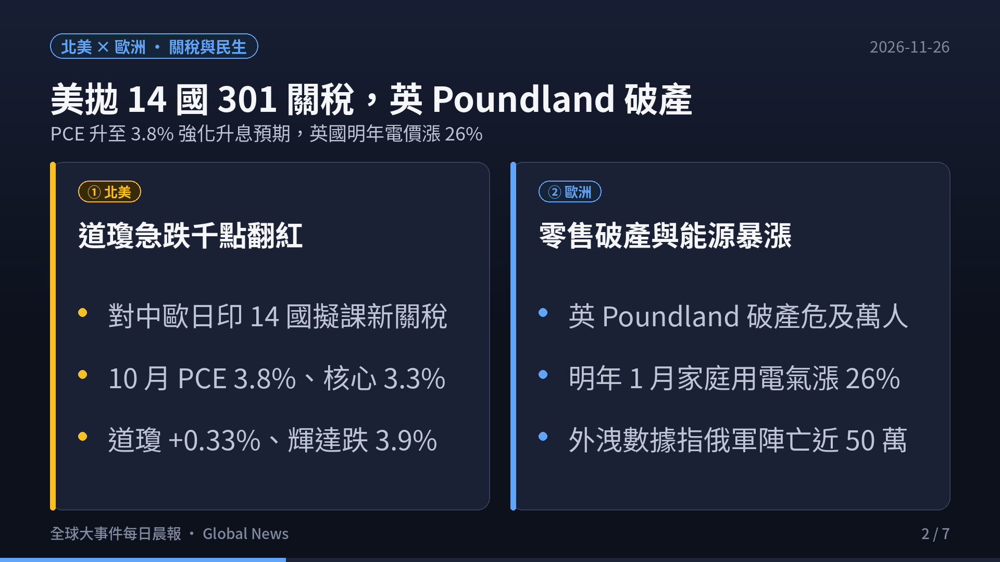
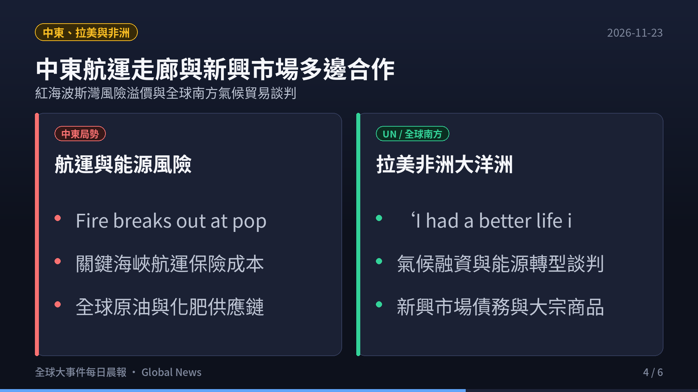
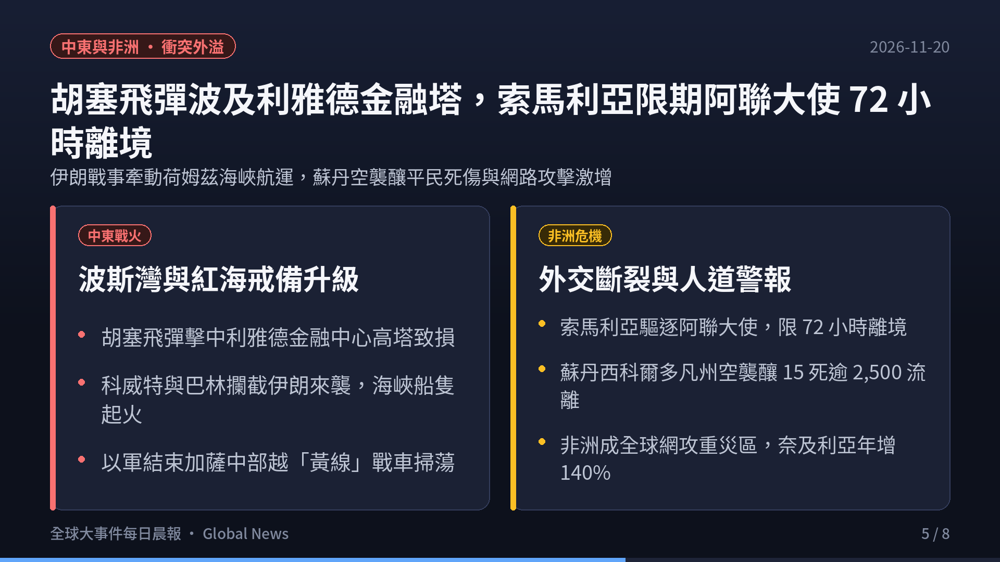
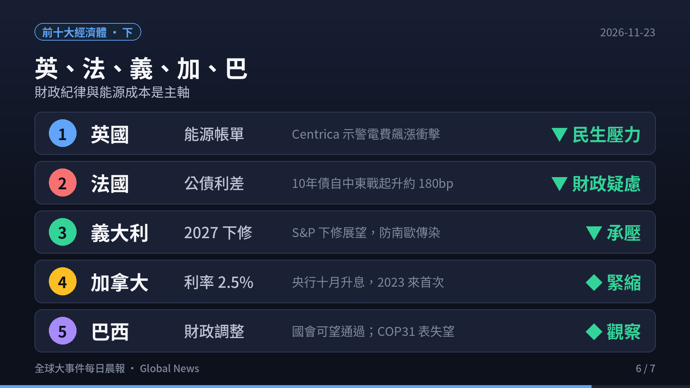

  

    <iframe src="https://www.youtube.com/embed/jMlyXLZtvqo" title="2026-11-23 全球大事件晨報" style="position: absolute; top:0; left: 0; width: 100%; height: 100%; border: 0;" allow="accelerometer; autoplay; clipboard-write; encrypted-media; gyroscope; picture-in-picture; web-share" allowfullscreen></iframe>
  

> **一句話看今天：** AI 交易退潮讓全球股市走完六年來最慘的一週，荷莫茲海峽又傳油輪觸雷——風險資產退潮、能源風險溢價居高不下。

## 今日六大焦點（各大洲）

### ① 北美｜AI 交易退潮，華爾街進入修正
週五標普 500 下跌 3.7%、那斯達克重挫 5.3%、道瓊 -1.9%；標普單週跌 8.6%，較十月高點回落近 12%，正式進入「修正」區間，是六年多來最差的一週。MSCI 全球股票指數單週跌 8.1%，VIX 升至七個月高點。輝達單週股價重挫約 23%，新華財經報導美國 SEC 正調查其潛在會計問題。
來源：[ABC News 市場快報](https://www.abc.net.au/news/2026-11-23/asx-markets-business-live-news-november-23/107414602)、[Westpac IQ Morning Report](https://www.westpaciq.com.au/economics/2026/11/Morning-report-23-Nov-2026)、[新華財經早報](https://www.cnfin.com/hb-lb/detail/20261122/4498614_1.html)

### ② 亞洲｜中國證監會推出穩市場政策包
11 月 22 日，在證監會統籌下，上交所、深交所、北交所與中國結算聯合推出一系列政策，目標穩定市場預期；國家發改委同時要求各地加快政府投資項目建設與資金撥付。澳洲 ASX 期貨則預示第七個連跌交易日。
來源：[CGTN](https://news.cgtn.com/news/2026-11-22/China-rolls-out-policy-package-to-stabilize-market-and-expectations-1ShDFzCbgqc/p.html)、[澎湃新聞／經濟日報財經早餐](https://www.thepaper.cn/newsDetail_forward_34532043)

### ③ 中東｜伊朗稱兩艘超級油輪在荷莫茲觸雷
伊朗革命衛隊（IRGC）海軍週日宣稱，兩艘超級油輪在荷莫茲海峽附近觸雷後「發生爆炸並停航」；IRGC 也稱攻擊了巴林的美軍愛國者防空雷達，葉門胡塞武裝則對沙烏地重啟攻擊。英國 UKMTO 證實美軍封鎖線附近發生「涉及軍事力量」的油輪事件。布蘭特原油約 92.6 美元。（伊方說法，尚待獨立證實）
來源：[Anadolu](https://www.aa.com.tr/en/middle-east/iran-says-2-supertankers-struck-naval-mines-near-strait-of-hormuz/4133736)、[Euronews](https://www.euronews.com/2026/11/22/tanker-incident-involving-military-forces-reported-in-strait-of-hormuz)、[Investing.com](https://www.investing.com/news/economy-news/iran-asserts-control-over-hormuz-as-strikes-on-bahrain-and-saudi-arabia-escalate-5043802)

### ④ 歐洲｜俄國船隻接連遇襲，俄軍續攻烏克蘭電網
利比亞班加西港一艘俄國船發生爆炸，利比亞官員稱疑為烏克蘭無人機攻擊；芬蘭灣另有一艘赴俄貨輪遇襲後被拖離。俄軍則持續打擊烏克蘭電廠與敖德薩港口設施。
來源：[The Guardian](https://www.theguardian.com/world)、[BBC World](https://www.bbc.com/news/world)

### ⑤ 全球｜COP31 氣候峰會破局
在土耳其舉行、史上最長的聯合國氣候大會經兩週談判仍未通過最終宣言；德國政府指責沙烏地、俄羅斯等產油國阻撓，巴西代表團批評結果「缺乏雄心」，聯合國秘書長強調「科學毫無模糊空間」。
來源：[UN News](https://news.un.org/)、[Deutschlandfunk](https://www.deutschlandfunk.de/nachrichten-index-40734.html)、[G1](https://g1.globo.com/meio-ambiente/noticia/2026/11/22/cop31-fracasso-brasil-turquia.ghtml)

### ⑥ 非洲｜蘇丹 RSF 無人機襲擊喀土穆
蘇丹快速支援部隊（RSF）的無人機週日清晨襲擊首都喀土穆及周邊，造成 4 人死亡，聯合國一棟建築受損，政府機關與機場被列為目標。
來源：[Al Jazeera](https://www.aljazeera.com/news/2026/11/22/rsf-drones-kill-four-in-khartoum)

## 前十大經濟體總覽

| # | 經濟體 | 今日焦點 | 訊號 |
|---|---|---|---|
| 1 | 美國 | 10 年債約 4.95%；通膨偏熱，12 月升息預期搖擺；標普進入修正 | ▼ 股市修正 |
| 2 | 中國 | 證監會＋交易所穩市政策包、發改委催投資撥款 | ◆ 托底 |
| 3 | 德國 | DAX 週五 -2.6%；總理梅爾茨反對歐盟長期預算妥協方案（增幅逾 40% 過高） | ▼ 承壓 |
| 4 | 日本 | 日銀多數委員傾向 12 月升息，但終點利率分歧恐引發日圓賣壓 | ◆ 偏鷹 |
| 5 | 印度 | 11 月外資淨流入創紀錄（約 1.22 兆盧比），被視為「反 AI 交易」；考慮限制非巴斯馬蒂米出口；印歐 FTA 預計 12/16 簽署 | ▲ 受惠 |
| 6 | 英國 | Centrica 執行長警告電費飆漲衝擊；英歐降成本協議未必帶來降價 | ▼ 民生壓力 |
| 7 | 法國 | 10 年債殖利率自中東衝突以來淨升約 180bp，2027 春季選舉前政治財政不確定 | ▼ 財政疑慮 |
| 8 | 義大利 | S&P Global 下修 2027 展望，南歐高負債國恐受法國傳染 | ▼ 承壓 |
| 9 | 加拿大 | 央行 10/28 升息 1 碼至 2.50%，為 2023 年 7 月以來首次 | ◆ 緊縮 |
| 10 | 巴西 | 中間派政黨配合，國會可望通過財政調整案；對 COP31 結果表失望 | ◆ 觀察 |

來源：[S&P Global 地緣風險簡報 11 月](https://www.spglobal.com/market-intelligence/en/news-insights/research/2026/11/geopolitical-risk-brief-november-2026)、[Reuters／Investing.com](https://www.investing.com/news/economy-news/analysisbojs-ambiguity-on-rate-hike-path-could-tempt-yen-bears-5040426)、[Times of India](https://timesofindia.indiatimes.com/business/india-business/record-rs-1-22-lakh-crore-foreign-inflows-is-india-becoming-the-worlds-anti-ai-trade/articleshow/136075365.cms)、[The Hindu](https://www.thehindu.com/news/top-news-of-the-day-november-22-2026/article71731458.ece)、[Deutschlandfunk](https://www.deutschlandfunk.de/merz-gegen-kompromissvorschlag-von-ratspraesident-costa-102.html)、[BBC Business](https://www.bbc.com/business)、[Bank of Canada](https://www.bankofcanada.ca/2026/10/fad-press-release-2026-10-28/)、[Estadão](https://digital.estadao.com.br/o-estado-de-s-paulo/20261122)

## 今日重點

1. **AI 估值修正已擴散**到全球股市與銅、金等大宗商品。
2. **荷莫茲與俄烏雙線**推升能源風險溢價。
3. **日本、加拿大偏鷹**，歐洲南翼（法、義）財政利差值得持續觀察。

*本文僅供資訊參考，不構成任何投資建議。*

---

### 🔧 這份晨報是怎麼做出來的？
從新聞調研、旁白配音、配樂到 YouTube 上架，全部由一套 AI 自動化工作流完成。想把同樣的工具用在你的工作上：

- 🛒 **[Slashman Tools 全套數位工具包（Everything Bundle）](https://slashmaster6.gumroad.com/l/everything-bundle)**
- 🛒 [Gumroad 數位商品專區](https://slashmaster6.gumroad.com/)（範本、提示詞、自動化教學）
- 🧰 [SlashmanTools 免費線上工具箱](https://slashmantools.us/)
- ☕ **Ko-fi 支持**：[ytstories0413](https://ko-fi.com/ytstories0413) ｜ [slashman413](https://ko-fi.com/slashman413)
- 📚 延伸閱讀：[《晶片戰爭》Chip War](https://www.amazon.com/dp/059371671X?tag=ytstories0413-20)
