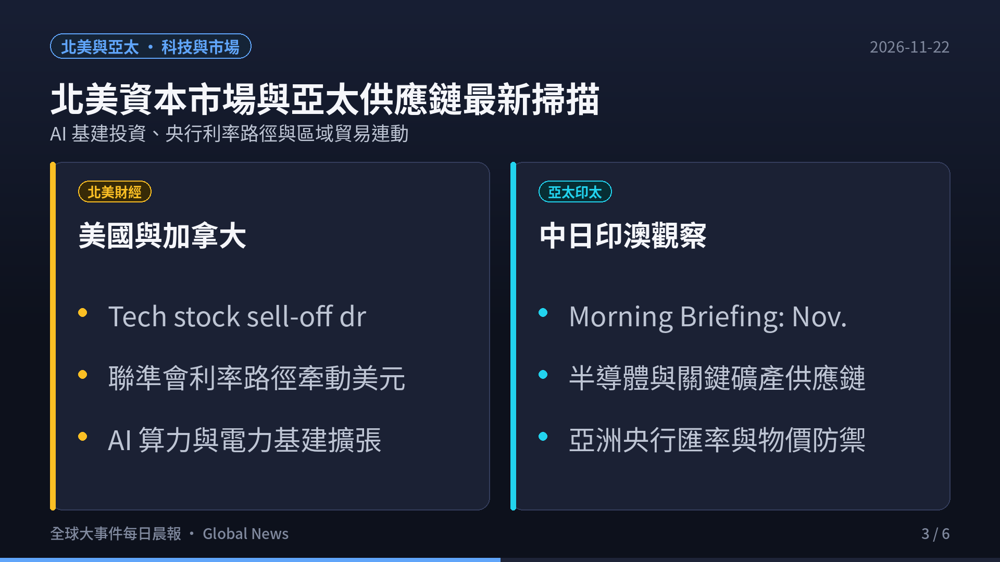
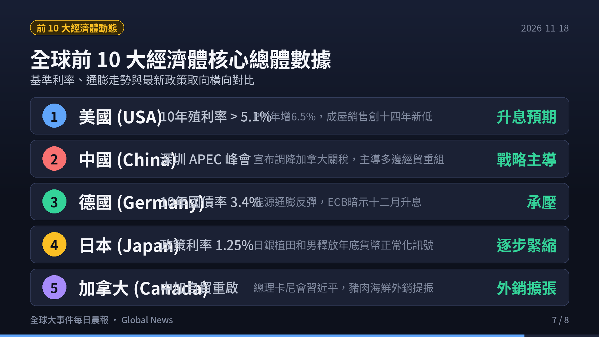

  

    <iframe src="https://www.youtube.com/embed/X4gx4qY2pKw" title="2026-11-24 全球大事件晨報" style="position: absolute; top:0; left: 0; width: 100%; height: 100%; border: 0;" allow="accelerometer; autoplay; clipboard-write; encrypted-media; gyroscope; picture-in-picture; web-share" allowfullscreen></iframe>
  

> **一句話看今天：** 黃仁勳火速重掌輝達 CEO 引爆美股創 2025 年 4 月以來最強單日反彈，那斯達克飆漲 6.51%；同時烏克蘭無人艇在利比亞外海擊中兩艘俄國軍艦，油價則因供應增加與利比亞油管重啟跌破 90 美元。

## 今日六大焦點（各大洲）

### ① 北美｜黃仁勳重掌輝達 CEO，美股創 2025 年 4 月以來最強單日反彈
輝達（Nvidia）董事會週一（11/23）宣布立即恢復黃仁勳（Jensen Huang）執行長職務，帶動輝達股價單日暴漲 31%（市值暴增近 1 兆美元）。美股三大指數全面強彈，收復上週重挫逾半失地：那斯達克暴漲 6.51% 收 24,089.56 點、標普 500 跳漲 4.73% 收 7,237.17 點、道瓊工業指數大漲 1,447.98 點（+3.01%）收 49,595.31 點；美光（Micron）大漲 19%，CoreWeave 飆升 22%，Alphabet 與 Meta 亦上漲約 6%。
來源：[CNBC 盤後整理](https://www.cnbc.com/2026/11/22/stock-market-today-live-updates.html)、[AP News](https://apnews.com/article/stocks-markets-rates-technology-ai-anthropic-49ba1beba78fa4ed2bd5898029f79c91)、[Investopedia](https://www.investopedia.com/stock-market-today-dow-jones-s-and-p-500-nasdaq-11232026-12274147)

### ② 亞太｜中國下調融資最低保證金至 80%，澳洲聯儲示警通膨風險
中國證監會週日（11/22）核准滬、深、北三大交易所將融資買入最低保證金比例由 100% 下調至 80%（11 月 30 日起生效），同時國有資金創紀錄規模買入 ETF 護盤；週一（11/23）上證指數收漲 0.15%，創業板指勁揚 3.08%。日本東京股市 11/23 因勤勞感謝日休市，今日（11/24）復市將正面迎接美股強彈與 12 月日銀升息預期。大洋洲方面，澳洲聯儲（RBA）最新模型警告工黨政府擬議調整資本利得稅優惠恐推升通膨，ASX 盤中隨美股期指反彈。
來源：[新華社英文網](https://english.news.cn/20261123/4e3ca972a01a47a687ccdc205e285d2f/c.html)、[CNBC TV18](https://www.cnbctv18.com/market/chinas-government-backed-funds-ramp-up-etf-buying-to-record-as-rout-deepens-20039572.htm)、[JAPAN.co.jp](https://japan.co.jp/e/japan-market-desk/)、[Sharecafe](https://www.sharecafe.com.au/2026/11/23/rba-flags-inflation-risk-as-asx-rebounds/)

### ③ 中東｜伊朗再襲波斯灣據點，布蘭特原油回落跌破 90 美元
伊朗在短暫停火間隙後再度對波斯灣美軍基地與民用目標發動襲擊；美國總統川普表示目前無需恢復大規模軍事行動，但要求伊朗停止企圖封鎖或控制荷莫茲海峽，卡達代表團亦在德黑蘭進行外交斡旋。受中東出口供給回升與利比亞 Sharara 油管重啟影響，週一國際油價走低：布蘭特原油期貨收跌 3.20 美元（-3.5%）至每桶 89.37 美元，WTI 原油收跌 3.24 美元至每桶 80.17 美元。
來源：[Al Jazeera](https://www.aljazeera.com/video/inside-story/2026/11/23/iran-hits-us-bases-and-civilian-sites-in-the-gulf-after-a-lull)、[AP News](https://apnews.com/article/mideast-iran-gaza-israel-houthis-libya-november-23-2026-c2cb6de3515f887a5786c1147e918489)、[Newsquawk](https://www.newsquawk.com/headlines/crude-wrap-wti-f7-settles-usd-324-lower-at-8017bbl-brent-f7-settles-usd-320-lower-at-8937bbl)

### ④ 歐非｜烏軍無人艇擊中利比亞外海兩艘俄艦，歐盟拍板 2027 預算與 ECB 新人選
烏克蘭總統澤倫斯基證實，烏軍海軍無人艇在利比亞東部班加西（Benghazi）外海擊中兩艘俄國艦艇，其中一艘護衛艦沉沒，將俄烏戰線推進至北非地中海海域。歐洲財金方面，歐盟理事會 11/23 正式通過 2027 年歐盟預算（承諾總額 1,997 億歐元、支付總額 2,115 億歐元）；法德也完成歐洲央行（ECB）執委提名政治協議，法國提名 Laurence Boone、德國提名 Markus Brunnermeier。
來源：[AP News](https://apnews.com/article/libya-russia-ukriane-war-benghazi-ship-drone-cbd82b965a111dcf4605b8b2d0493780)、[The Guardian](https://www.theguardian.com/world/2026/nov/23/ukraine-naval-drones-strike-russian-warship-libya)、[Consilium](https://www.consilium.europa.eu/en/press/press-releases/2026/11/23/eu-budget-for-2027-council-gives-final-green-light/)、[RTÉ](https://www.rte.ie/news/business/2026/1123/1600251-france-and-germany-to-take-key-ecb-roles/)

### ⑤ 全球與南美｜COP31 氣候峰會無協議破局，巴西瞄準 2% 基本財政盈餘
在土耳其舉行的史上最長聯合國氣候大會（COP31）延長談判兩天後正式破局，主席國澳洲與土耳其提出的最終草案因未提及化石燃料退場而遭多國否決。南美最大經濟體巴西財長 Dario Durigan 週一宣布，政府目標在總統魯拉下一任期末達成占 GDP 1.5% 至 2% 的基本財政盈餘，力拚重返失去十餘年的投資級主權信評。
來源：[ABC News](https://www.abc.net.au/news/2026-11-23/cop31-talks-break-down-in-longest-ever-un-climate-debate/107414772)、[BBC World](https://www.bbc.co.uk/news/articles/cky970n83rvjo)、[Reuters／Investing.com](https://www.investing.com/news/economy-news/brazil-targets-primary-surplus-of-up-to-2-of-gdp-by-end-of-lulas-next-term-5046231)

### ⑥ 非洲與英國市場｜蘇丹無人機襲喀土穆；英國 Capita 暴跌 70%
非洲方面，蘇丹快速支援部隊（RSF）無人機襲擊首都喀土穆造成 4 人死亡並波及聯合國設施；利比亞武裝團體一度關閉兩條油管造成全國約四分之一產量短暫中斷（Sharara 油管隨後恢復）。歐洲市場方面，英國大型外包商 Capita 因公務員退休金系統失靈且執行長辭職，股價單日崩跌 70%；但受美股強彈激勵，倫敦 FTSE 100 指數仍收漲 1.3% 至 10,480.82 點。
來源：[Al Jazeera](https://www.aljazeera.com/news/2026/11/22/rsf-drones-kill-four-in-khartoum)、[BBC Business](https://www.bbc.co.uk/news/articles/c65y1qqw3kjxo)、[AJ Bell](https://www.ajbell.co.uk/news/latest/lunchtime-roundup)

## 前十大經濟體總覽

| # | 經濟體 | 今日焦點 | 訊號 |
|---|---|---|---|
| 1 | 美國 | 輝達復職黃仁勳暴漲 31%；那指 +6.51%、標普 +4.73%、道瓊 +3.01%，創 2025/4 來最強單日反彈 | ▲ 強彈 |
| 2 | 中國 | 證監會降融資保證金比例（100%→80%，11/30 生效）+ 國家隊護盤；創業板指 +3.08%、上證 +0.15% | ◆ 穩市 |
| 3 | 德國 | DAX 指數收漲 2.15% 至 25,337.27 點重返兩萬五千點；提名 Markus Brunnermeier 出任 ECB 執委 | ▲ 反彈 |
| 4 | 日本 | 11/23 勤勞感謝日休市，今日復市迎美股強彈；通膨逼近 3%，市場押注日銀 12 月再度升息 | ◆ 觀望 |
| 5 | 印度 | 獲利了結與衍生品結算壓低 Nifty 50 跌 1.75%（25,349 點）、盧比收 92.91；但外資連 16 日淨買超（單日 +567.3 億盧比） | ▼ 回檔 |
| 6 | 英國 | FTSE 100 收漲 1.3% 至 10,480.82 點；外包商 Capita 因退休金系統失靈與換帥單日暴跌 70% | ▲ 分化 |
| 7 | 法國 | CAC 40 跟漲約 1.5%；提名 Laurence Boone 掌 ECB 市場操作執委，在歐盟長期預算談判推進農業補貼 | ▲ 穩健 |
| 8 | 義大利 | 受多家銀行除息拖累約 1.4%，FTSE MIB 小漲 0.65% 收 49,021.93 點，科技股撐盤；2027 預算法案審議中 | ◆ 震盪 |
| 9 | 加拿大 | 油價走低疊加美元轉強，加幣連 10 個交易日走貶至 1.4380（19 個月新低、2016 年以來最長連跌紀錄） | ▼ 匯壓 |
| 10 | 巴西 | 財長 Durigan 宣布下任期末力拚 GDP 1.5%–2% 基本財政盈餘以重返投資級信評；批 COP31 缺乏雄心 | ◆ 整頓 |

來源：[CNBC](https://www.cnbc.com/2026/11/22/stock-market-today-live-updates.html)、[Xinhua](https://english.news.cn/20261123/4e3ca972a01a47a687ccdc205e285d2f/c.html)、[Finanzen.net](https://www.finanzen.net/nachricht/aktien/heute-im-fokus-23-11-2026-16079765)、[TradingView／MaceNews](https://www.tradingview.com/news/macenews:b459fd8cd094b:0-japan-week-ahead-rising-costs-weak-yen-hurting-households-but-boj-board-seen-leaning-toward-another-rate-hike-in-december/)、[Indian Express](https://indianexpress.com/article/business/sensex-nifty-fall-profit-booking-fno-expiry-india-markets-10975373/)、[CNBC TV18](https://www.cnbctv18.com/market/fiis-pump-in-rs-5673-crore-despite-market-rout-extend-buying-streak-to-16-sessions-20040215.htm)、[MilanoFinanza](https://www.milanofinanza.it/news/borse-oggi-diretta-23-novembre-2026-chiusura-apertura-europee-borsa-milano-ftse-mib-piazza-affari-202611230748404021)、[Kitco／Reuters](https://www.kitco.com/news/off-the-wire/2026-11-23/canadian-dollar-falls-10th-straight-session-oil-slides)、[Reuters／Investing.com](https://www.investing.com/news/economy-news/brazil-targets-primary-surplus-of-up-to-2-of-gdp-by-end-of-lulas-next-term-5046231)

## 今日重點

1. **AI 權值股出現劇烈報復性反彈**，但單一事件驅動代表市場波動率仍處於高檔。
2. **布蘭特原油跌破 90 美元**，但荷莫茲海峽談判與俄烏地中海新戰線仍具高度變數。
3. **日銀 12 月升息預期與歐盟新財金高層換血**將持續牽動未來數週匯市與債市定價。

*本文僅供資訊參考，不構成任何投資建議。*

---

### 🔧 這份晨報是怎麼做出來的？
從新聞調研、旁白配音、配樂到 YouTube 上架，全部由一套 AI 自動化工作流完成。想把同樣的工具用在你的工作上：

- 🛒 **[Slashman Tools 全套數位工具包（Everything Bundle）](https://slashmaster6.gumroad.com/l/everything-bundle)**
- 🛒 [Gumroad 數位商品專區](https://slashmaster6.gumroad.com/)（範本、提示詞、自動化教學）
- 🧰 [SlashmanTools 免費線上工具箱](https://slashmantools.us/)
- ☕ **Ko-fi 支持**：[ytstories0413](https://ko-fi.com/ytstories0413) ｜ [slashman413](https://ko-fi.com/slashman413)
- 📚 延伸閱讀：[《晶片戰爭》Chip War](https://www.amazon.com/dp/059371671X?tag=ytstories0413-20)
