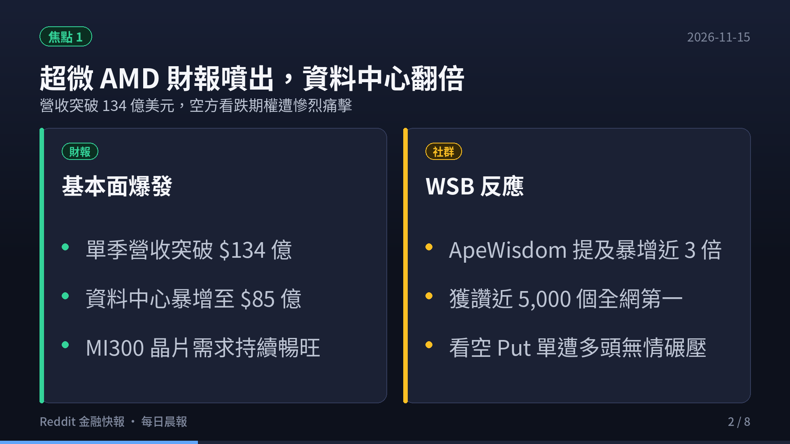
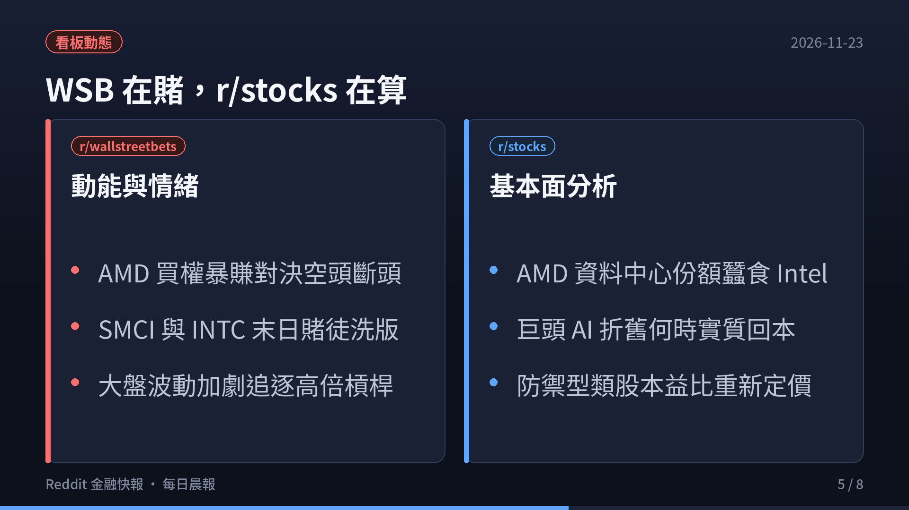
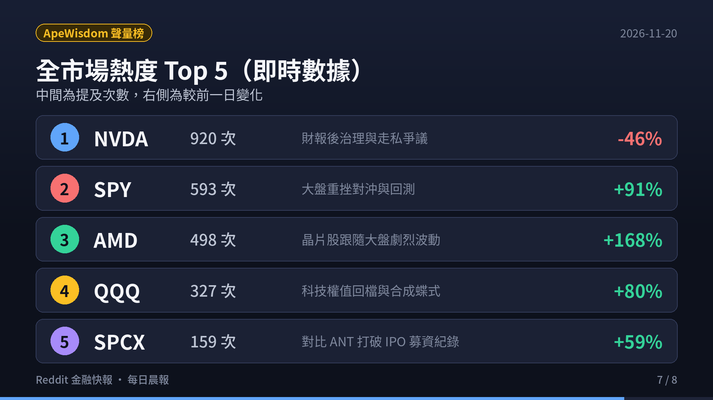

  <video controls width="100%" poster="s01.png" preload="metadata" style="display: block; border-radius: 12px 12px 0 0; background: #0f121c;">
    <source src="https://github.com/ckw19810413/ckw19810413.github.io/releases/download/media-reddit-finance-daily/reddit-finance-2026-11-27.mp4" type="video/mp4">
    您的瀏覽器不支援直接播放 MP4 影片。
  </video>
  

    🎬 <strong>60 秒晨間快報影音動態版</strong>（含 AI 摘要朗讀語音與專屬背景音樂 · YouTube 同步觀看：<a href="https://youtu.be/kGo-5eN5jsc" target="_blank" rel="noopener">點此前往 @kwc1933</a>）
  

> **資料區間**：2026-11-24 00:00 → 2026-11-27 06:00（台北時間，近 3 日）
> **資料來源**：Arctic Shift Reddit 貼文封存 API（`r/wallstreetbets` 1,382 篇、`r/stocks` 240 篇、`r/investing` 106 篇、`r/options` 38 篇、`r/StockMarket` 67 篇）＋ ApeWisdom 全市場即時聲量統計（2026-11-27 06:00 快照）
> **篩選方式**：依近 3 日貼文互動熱度（讚數＋留言數）排序，排除每日例行討論串並彙整同事件主題。
> **免責聲明**：本報告彙整公開社群討論與數據，**不構成任何投資建議**。Reddit 反映的是市場「注意力與情緒溫度」，非買賣依據。

---

## 🧭 今日一句話

**輝達（NVDA）風暴從「復職肥皂劇」升級成實質基本面與信評危機。** 繼週一道瓊暴跌約 1,000 點、那斯達克重挫 4% 吐回復職漲幅後，近 24 小時再爆三記重拳：**S&P 將輝達列入信評降評觀察**（質疑董事會遭架空）、FT 報導 **輝達配合美國出口管制暫停對東南亞（新加坡、馬來西亞、泰國、印尼）出貨**（新加坡子公司 2025 年營收達 $1,040 億）、以及 **Google 創 52 週新低 $262.73、Anthropic 跌破發行價**。與此同時，美國 10 月 **PCE 通膨年增 3.8%（核心 3.3%）** 搭配 **最高 20% 新關稅** 與 **Q3 GDP 4.3%**，讓「再升息」預期升溫；受感恩節（11/26）美股休市影響，WSB 總聲量驟降，但 `r/investing` 被動防禦型 ETF（`VT`、`SCHD`、`VTI`）討論度逆勢飆升。**美東 11/27（週五）13:00 提早收盤。**

---

## 🔥 一、r/wallstreetbets（規模 1,800 萬+ · 情緒／動能 · 雜訊 🔴 極高）

> 每日討論串熱度：11/25 Daily Discussion **21,783 則留言**、11/24 **15,909 則**；11/26 感恩節休市討論串 **5,026 則**。

### 1. 黃仁勳復職肥皂劇延燒：自曝「每日心理諮商 90 分鐘」與治理嘲諷
- [JENSEN HUANG TELLS NVIDIA EMPLOYEES: "I'M GOING TO BE A BETTER CEO THE SECOND TIME AROUND"](https://www.reddit.com/r/wallstreetbets/comments/1y3qi6t/jensen_huang_tells_nvidia_employees_im_going_to/)（**61,281↑ / 6,470💬** · 11-24）與 [literally no fucking comment](https://www.reddit.com/r/wallstreetbets/comments/1y3n3u9/literally_no_fucking_comment/)（**63,319↑ / 3,173💬** · 11-24）霸榜近三日最高互動。
- [Kevin O’Leary 直播剛說「零機會回來」就收到復職新聞](https://www.reddit.com/r/wallstreetbets/comments/1y4bir8/kevin_oleary_says_jensen_huang_has_zero_chance_of/)（**36,772↑ / 1,982💬**）、[WSJ 爆復職前坦承更多婚外情](https://www.reddit.com/r/wallstreetbets/comments/1y425wd/just_in_jensen_huang_admitted_to_having_more/)（**32,840↑ / 2,915💬**），以及 11/26 最新熱議 [每天 90 分鐘心理諮商](https://www.reddit.com/r/wallstreetbets/comments/1y5x3ba/jensen_said_he_spends_90_minutes_a_day_in_therapy/)（**11,322↑ / 326💬**）與 [川普表態不排除特赦](https://www.reddit.com/r/wallstreetbets/comments/1y4rrfk/trump_leaves_door_open_to_jensen_huang_pardon_and/)（8,690↑ / 1,039💬）。
- **要點**：情緒熱度爆表但高度八卦化，反映市場把兆元權值股當成政治與名人迷因交易，基本面訊噪比極低。

### 2. 「$500 兩週滾成 $100 萬美元」NVDA 多空雙向期權神單
- [I MADE GENERATIONAL MONEY. $1 million in 2 weeks.](https://www.reddit.com/r/wallstreetbets/comments/1y5anxn/i_made_generational_money_1_million_in_2_weeks/)（**35,922↑ / 4,268💬** · 11-25）。
- 發文者記錄操作路徑：先用 $500 買 NVDA put 碰上辭職翻成 $80k（回撤至 $40k）→ 週五壓 $20k 買 $145 call 碰上復職賺 $370k（帳戶到 $660k）→ 再押 $360k 買 5,000 口 $135 put，週二一度帳面虧 $180k、週三回跌後獲利出場累計達 **$100 萬美元**，宣布收手不再重押。
- **要點**：劇烈跳空提供極端期權槓桿報酬，但屬高度「倖存者偏差」，板內同期仍充斥高位套牢與歸零貼文。

### 3. AI 賣壓捲土重來：S&P 降評警告與韓國「西學螞蟻」主播淚灑直播
- [Here we go again](https://www.reddit.com/r/wallstreetbets/comments/1y55ptb/here_we_go_again/)（**21,056↑ / 720💬** · 11-25）與 [Buy the dip](https://www.reddit.com/r/wallstreetbets/comments/1y4iqkv/buy_the_dip/)（20,381↑ / 719💬）呈現多空情緒撕裂。
- 11/26 兩篇新爆款：[韓國新聞主播因那斯達克重挫在直播中哽咽](https://www.reddit.com/r/wallstreetbets/comments/1y5ld21/korean_news_anchor_tears_up_over_nasdaq_losses_on/)（**13,873↑ / 1,390💬**，點名重押輝達、特斯拉的韓國散戶慘賠）與 [S&P 警告輝達董事會恐遭架空，將信評列入降評觀察](https://www.reddit.com/r/wallstreetbets/comments/1y5kdvf/sp_warns_nvidias_board_may_be_compromised_puts/)（**12,487↑ / 886💬**）。
- **要點**：週一 V 轉失效後，散戶情緒從狂喜快速切回疲憊與恐慌，全球散戶去槓桿壓力成為新焦點。

---

## 📊 二、r/stocks（規模約 900 萬 · 綜合討論 · 雜訊 🟡 中）

### 1. 微軟（$MSFT）因歷史級全球大當機宣布最高警戒「Code Red」
- [BREAKING: Microsoft ($MSFT) declares 'Code Red,' its most severe alert, following its historic global outage.](https://www.reddit.com/r/stocks/comments/1y4kt7q/breaking_microsoft_msft_declares_code_red_its/)（**7,114↑ / 634💬** · 11-25）。
- Reuters 揭露內部備忘錄：11/12–13 由 7 月潛伏的 Windows 缺陷引發大當機，造成 Exchange Online、Outlook、Teams 與 Copilot 中斷最長 24 小時（波及企業與英國公衛系統）；因診斷分散，工程師在 11 個 Teams 聊天室發了逾 1.1 萬則訊息。微軟已設下「全球服務 1 小時內恢復」的新死線。
- **要點**：AI 雲端業務快速擴張下，核心基礎設施的韌性與單點故障風險成為機構檢視微軟的新關鍵。

### 2. 輝達多重壓力匯聚：S&P 降評觀察、暫停東南亞出貨、國會與接班爭議
- [WSJ 更正：Alice Huang 並非間諜](https://www.reddit.com/r/stocks/comments/1y4c5nd/wsj_now_says_alice_huang_was_not_a_spy_and/)（**1,759↑ / 650💬**）雖暫緩情報案直接衝擊，但基本面與治理利空接連爆發：
  - [S&P 警告輝達董事會恐受損，90 天內可能調降「AA」信評一級](https://www.reddit.com/r/stocks/comments/1y5op88/sp_warns_nvidias_board_may_be_compromised_puts/)（**1,166↑ / 217💬** · 11-26）。
  - [輝達暫停對東南亞晶片與伺服器出貨](https://www.reddit.com/r/stocks/comments/1y5u6tn/breaking_nvidia_halts_chip_shipments_to_southeast/)（**351↑ / 99💬** · 11-26）：FT 報導配合美國防堵中企繞道雲端取得算力，已通知 Dell、Supermicro 停運馬來西亞、新加坡、泰國、印尼；新加坡子公司 2025 年佔 $1,040 億營收（年增 72%），當地約 $5 億資料中心融資傳出暫停。
  - [黃仁勳告訴員工輝達「不需要接班計畫」](https://www.reddit.com/r/stocks/comments/1y4n5jf/jensen_huang_tells_staff_that_nvidia_doesnt_need/)（1,163↑ / 415💬）與 [國會跨黨派調查升溫](https://www.reddit.com/r/stocks/comments/1y438ty/congress_is_going_to_war_with_nvidia/)（196↑ / 538💬）。
- **要點**：出口管制封鎖轉口雲端＋信評觀察＋關鍵人物風險，意味著輝達短期估值折價難以僅靠「CEO 復職」消除。

### 3. 最高 20% 新關稅、Anthropic 破兆 IPO 破發與 Michael Burry 翻多
- [US announces new tariffs of up to 20% on China, the EU, and 12 other nations](https://www.reddit.com/r/stocks/comments/1y59jnm/us_announces_new_tariffs_of_up_to_20_on_china_the/)（**964↑ / 453💬** · 11-25）：對中國多項商品新稅率 20% 疊加既有關稅後將破 40%，最快明年 1 月生效，中美貿易休戰將於 **1/10 到期**。
- [Anthropic IPO 折價吐槽串](https://www.reddit.com/r/stocks/comments/1y4gfuh/did_you_miss_the_anthropic_ipo_worry_not_its_now/)（**1,110↑ / 271💬**）與 [WSJ：史上最大 IPO 交易正在瓦解](https://www.reddit.com/r/stocks/comments/1y563ql/anthropic_had_the_biggest_ipo_in_history_the/)（313↑ / 237💬）：綠鞋穩定機制已提早用盡，引發估值過高（$1.5 兆）檢討。
- [Michael Burry 自稱「幾乎全面做多」](https://www.reddit.com/r/stocks/comments/1y643tl/michael_burry_says_hes_now_almost_entirely_long/)（**424↑ / 182💬** · 11-26 深夜）：已清光剩餘 Nasdaq-100 put，僅保留 PLTR、最後 1/4 NVDA 與 MET put，並將 MELI、TPW、JD 列為最大持股，港股（比亞迪、騰訊、美團等）佔比升破 20%、現金維持約 25%。
- **要點**：AI 一級/次級市場高估值正經歷去泡沫，資金與大空頭轉向具估值安全邊際與非美市場標的。

---

## 🧘 三、r/investing（規模約 300 萬 · 中長期／配置 · 雜訊 🟢 低）

### 1. Michael Burry 對沖操作解讀與輝達治理風險定價
- [Michael Burry cut 75% of his Nvidia puts and bought calls right before Monday's +31.48% jump](https://www.reddit.com/r/investing/comments/1y47ick/michael_burry_cut_75_of_his_nvidia_puts_and/)（**2,446↑ / 260💬** · 11-24）。
- 搭配 [The cloud over Nvidia isn’t gone just because Jensen is back](https://www.reddit.com/r/investing/comments/1y4b2l7/the_cloud_over_nvidia_isnt_gone_just_because/)（204↑ / 162💬）與 [Nvidia at Risk of Rating Cut by S&P Over Governance Concerns](https://www.reddit.com/r/investing/comments/1y5gjjx/nvidia_at_risk_of_rating_cut_by_sp_over/)（191↑ / 39💬 · 11-26）。
- **要點**：理性派認為 Burry 只是提前收割空單並做雙向保護，而非重壓 AI 成長股；總統介入復職導致國會調查擴大與 S&P 降評警告，使長線投資人要求更高的治理風險溢價。

### 2. 10 月 PCE 通膨意外升至 3.8%，總經與升息壓力回籠
- [Inflation in October comes in above expectations...](https://www.reddit.com/r/investing/comments/1y585p9/inflation_in_october_comes_in_above_expectations/)（**184↑ / 85💬** · 11-25）：10 月 PCE 年增率達 **3.8%**（逼近聯準會目標兩倍），核心 PCE **3.3%** 高於市場預期 0.1 個百分點。
- 加上 [Nasdaq-100 期貨抹去復職反彈](https://www.reddit.com/r/investing/comments/1y55zm3/nasdaq100_has_in_the_premarket_now_erased_the/)（**520↑ / 148💬**）與 [對中歐新關稅計畫](https://www.reddit.com/r/investing/comments/1y4dvqc/new_sweeping_tariffs_on_china_to_be_announced/)（127↑ / 83💬）。
- **要點**：在核心通膨回溫＋關稅推升輸入性物價的雙重夾擊下，市場開始重新定價聯準會再度升息的尾部風險。

### 3. 百年股市復甦週期變短了嗎？震盪中的退休與指數配置反思
- [Looking at 120 years of market history, why have recovery times gotten so much shorter?](https://www.reddit.com/r/investing/comments/1y5n2kx/looking_at_120_years_of_market_history_why_have/)（**70↑ / 100💬** · 11-26）：對比 1929 大蕭條（25 年回本）、1970s 停滯（16 年）與 2000 網泡（6 年），討論現代央行干預、ETF 分散化與全球資金池如何縮短熊市修復期。
- [退休族在近期動盪中的心態](https://www.reddit.com/r/investing/comments/1y59hkb/what_are_retirees_who_have_most_of_their_nw_in/)（32↑ / 194💬）與 [這算正常市場波動嗎？](https://www.reddit.com/r/investing/comments/1y5a9yn/is_this_normal_market_fluctuations/)（0↑ / 121💬）。
- **要點**：ApeWisdom 同步顯示 `r/investing` 過去 24 小時 `VT`（4→15）、`SCHD`（1→10）、`VTI`（1→6）、`VXUS`（1→5）提及量逆勢跳升，長線資金正往全市場與高股息分散避險。

---

## 🎯 四、r/options（規模約 100 萬+ · 衍生品／策略 · 雜訊 🟡 中）

> 本期受假期影響發文量僅 38 篇，但實戰風控與機構流向討論含金量極高。

### 1. Cash-Secured Put 真正的殺手不是被指派，而是「隔夜跳空缺口」
- [Getting assigned isn’t the bad outcome on a cash secured put. The gap is.](https://www.reddit.com/r/options/comments/1y5ahk5/getting_assigned_isnt_the_bad_outcome_on_a_cash/)（**33↑ / 97💬** · 11-25）。
- 實例拆解：賣出 QQQ $657 put 收 $436 權利金，週四收盤 $645 看似可控，週五卻**跳空重挫收 $608**，履約接貨單口帳面即虧損 **~$4,900**（扣除權利金淨虧 ~$4,400），遠超原本 $436 的最大收益目標。
- **要點**：高波動時期不能只以「願意接股」作為賣 put 理由，必須把履約價設於預期波動（expected move）外並嚴控單筆部位。

### 2. 指數撐在平盤上方，大戶卻砸 4 倍資金買 QQQ 賣權保險
- [Put buying is dwarfing call buying today while SPY sits green near 716 — hedge or warning?](https://www.reddit.com/r/options/comments/1y4nyrx/put_buying_is_dwarfing_call_buying_today_while/)（**57↑ / 36💬** · 11-25）。
- 盤中統計：SPY 賣權權利金約 **$9.36 億** vs 買權 $4.25 億；QQQ 賣權約 **$12.0 億** vs 買權 $3.23 億（約 **4 倍**）。更出現單分鐘掃進 2027 年到期之 SPX 6900P（$2.1 億）、6500P（$1.92 億）、7000P（$1.01 億）遠月深價外大單。
- **要點**：機構資金趁指數尚未徹底破底前鎖定長期尾部保險，下檔防護需求顯著高於追價意願。

### 3. 18 種 Cboe 期權策略回測 vs 直接持有 SPY（與新手 0DTE 警世文）
- [18 Cboe options strategies vs holding SPY: some cut losses, but was the lower return worth it?](https://www.reddit.com/r/options/comments/1y4e275/18_cboe_options_strategies_vs_holding_spy_some/)（**18↑ / 36💬** · 11-24）：回測 2007–2026 年 Cboe 基準指數顯示，SPY 年化 10.8%（Sharpe 0.75），高於 PUT（7.2% / 0.70）、30-delta Covered Call BXMD（8.4% / 0.69）與 BXM（5.9% / 0.58）。
- 同時，一篇 [準備用 $1,000 本金玩 0DTE SPXW 期權的計畫](https://www.reddit.com/r/options/comments/1y5zxls/i_am_about_to_deposit_1000usd_and_try_0dte_spxw/)（0↑ / 26💬 · 11-26）引來老手集體勸退。
- **要點**：長期統計證實「賣權利金換到的是降波動而非超額報酬」；高波動盤勢下以微額本金投入 0DTE 指數選擇權極易因單日掃損出局。

---

## 📰 五、r/StockMarket（規模約 300 萬+ · 市場新聞／圖表 · 雜訊 🟡 中）

### 1. 「市場壞掉了」：兆元企業單日震盪 32% 與 Polymarket $34 萬可疑押注
- [God bless america](https://www.reddit.com/r/StockMarket/comments/1y3nn5l/god_bless_america/)（**4,775↑ / 681💬**）、[The markets are Broken and you should be worried](https://www.reddit.com/r/StockMarket/comments/1y3mxrf/the_markets_are_broken_and_you_should_be_worried/)（**2,982↑ / 614💬**）與 [美股儼然由國家信用背書](https://www.reddit.com/r/StockMarket/comments/1y3wxhq/the_truth_is_the_us_stock_market_is_backed_by_the/)（1,293↑ / 174💬）。
- 配合 [可疑帳戶在 Polymarket 精準押注黃仁勳復職狂賺 $34 萬](https://www.reddit.com/r/StockMarket/comments/1y4angm/suspicious_accounts_make_340000_with/)（**1,641↑ / 113💬**）與 [川普政府被批轉向「國家指導資本主義」](https://www.reddit.com/r/StockMarket/comments/1y568k2/america_has_turned_to_statedirected_capitalism_as/)（425↑ / 67💬）。
- **要點**：4 兆美元權值股出現迷因幣般的 32% 單日振幅與預測市場內線疑雲，嚴重考驗機構對美股定價機制的信心。

### 2. 道瓊暴跌 1,000 點、Google 創 52 週新低 $262.73 與 AI 明星基金重傷
- [Dow craters 1,000 points, Nasdaq loses 4% as Nvidia leads resumption of AI sell-off](https://www.reddit.com/r/StockMarket/comments/1y59ayd/dow_craters_1000_points_nasdaq_loses_4_as_nvidia/)（**898↑ / 199💬** · 11-25）。
- 11/26 補跌消息接力：[Google 股價觸及 52 週新低 $262.73（搜尋放緩＋AI 成本飆升）](https://www.reddit.com/r/StockMarket/comments/1y5th6n/google_stock_hits_52week_low_at_26273_as_search/)（**632↑ / 106💬**）、[Leopold 的 Situational Awareness 基金 Q3 大虧 65%](https://www.reddit.com/r/StockMarket/comments/1y5rg36/leopolds_situational_awareness_lost_65_in_q3/)（**166↑ / 62💬**）與 [Anthropic 跌破 IPO 發行價](https://www.reddit.com/r/StockMarket/comments/1y5jqt4/anthropic_fell_below_ipo_price/)（157↑ / 46💬）。
- **要點**：AI 算力與基礎模型敘事全面受檢驗，從軟體巨頭搜尋廣告變現到專注 AI 的避險基金皆出現顯著回撤。

### 3. Q3 GDP 4.3% 撞上 3.8% 通膨「鎖定升息預期」＋ 賣壓外溢亞太科技鏈
- [U.S. economy grew at rapid 4.3% pace in third quarter](https://www.reddit.com/r/StockMarket/comments/1y59vda/us_economy_grew_at_rapid_43_pace_in_third_quarter/)（**327↑ / 131💬** · 11-25）與 [Fed’s preferred inflation gauge accelerated to 3.8% in October, likely sealing rate hike](https://www.reddit.com/r/StockMarket/comments/1y57qmg/feds_preferred_inflation_gauge_accelerated_to_38/)（**319↑ / 90💬** · 11-25）。
- [BlackRock 持倉市值較 Q3 申報蒸發約 $1.82 兆（$6.79T → $4.97T）](https://www.reddit.com/r/StockMarket/comments/1y4nx93/blackrock_has_lost_almost_2t_since_their_last/)（446↑ / 19💬）與 [軟銀（SoftBank）暴跌 15%，AI 拋售潮席捲日本與亞洲半導體股](https://www.reddit.com/r/StockMarket/comments/1y4ydyd/softbank_drops_15_as_wall_street_ai_selloff/)（160↑ / 10💬）。
- **要點**：強勁經濟數據搭配黏性通膨強化聯準會鷹派立場，美股科技拋售已迅速傳導至全球風險資產與亞太半導體供應鏈。

---

## 📈 ApeWisdom 全市場即時聲量排行（2026-11-27 06:00 快照）

> 受 11/26 美國感恩節休市影響，整體個股 24h 提及次數大幅降溫，但長線指數 ETF（`VTI`、`VT`）與 `r/investing` 領漲標的（`VT` 4→15、`SCHD` 1→10）逆勢走強。

| 排名 | 代號 | 名稱 | 24h 提及 | 前一日 | 變化 | 總讚數 |
|---|---|---|---|---|---|---|
| 1 | **NVDA** | NVIDIA | 215 | 578 | **−63%** | 21,745 |
| 2 | **SPY** | SPDR S&P 500 ETF | 110 | 508 | **−78%** | 471 |
| 3 | **QQQ** | Invesco QQQ ETF | 70 | 287 | **−76%** | 449 |
| 4 | **AMD** | AMD | 49 | 138 | −64% | 262 |
| 5 | **MU** | Micron Technology | 44 | 196 | −78% | 173 |
| 6 | **VOO** | Vanguard S&P 500 ETF | 43 | 81 | −47% | 153 |
| 7 | **SNDK** | Sandisk | 40 | 116 | −66% | 134 |
| 8 | **DTE** | DTE Energy | 35 | 84 | −58% | 315 |
| 9 | **SOXL** | 3x 半導體做多 ETF | 25 | 118 | −79% | 85 |
| 10 | **VTI** | Vanguard Total Stock Market ETF | 21 | 14 | **+50%** | 124 |
| 11 | **VT** | Vanguard Total World Stock ETF | 20 | 15 | **+33%** | 23 |

---

## 💡 綜合觀察與風險提示

1. **出口管制與信評雙壓**：輝達暫停東南亞出貨（牽動新加坡 $1,040 億營收鏈）疊加 S&P 降評觀察，AI 硬體龍頭正面臨政治、合規與治理三重定價重估。
2. **通膨＋關稅的再緊縮風險**：10 月 PCE 升至 3.8% 且 Q3 GDP 維持 4.3%，加上擬議最高 20% 新關稅，市場焦點已從「降息想像」轉向「再升息防護」。
3. **衍生品警訊與假日低流動性**：機構大舉買進 2027 年遠月 SPX/QQQ 賣權避險；今日（11/27 週五）美股美東 13:00 提早收盤，假期前後流動性偏低，慎防跳空與滑價風險。
4. **從單壓 AI 轉向全球分散**：從 Google 創 52 週低點、Anthropic 破發，到 Burry 增持海外標的與 `VT`/`SCHD`/`VTI` 聲量逆勢上升，資金正重新重視估值安全邊際與跨區分散。

---

### ☕ 支持與精選工具推薦

如果你覺得這份每日晨報對你的投資視野與市場觀察有實質幫助，歡迎透過以下方式支持我們持續產出客觀數據報告：

- ☕ **請我喝杯咖啡**：[Ko-fi 小費贊助 (ytstories0413)](https://ko-fi.com/ytstories0413) 或 [Ko-fi 贊助 (slashman413)](https://ko-fi.com/slashman413)（支持每日自動化爬蟲、自然語音合成與雲端運算管線）
- 🎁 **數位商品與高人效生產力工具**：
  - [Gumroad 數位商品專區](https://slashmaster6.gumroad.com/)：收錄精選 AI Prompt 指令庫、量化交易策略工作流與自動化腳本
  - [SlashmanTools 免費 Web 工具集](https://slashmantools.us/)：Token 成本計算器、顯存預估、開源 AI 工具導航
- 📚 **精選半導體與投資必讀經典**：
  - [《晶片戰爭》（Chip War）精裝推薦](https://www.amazon.com/dp/059371671X?tag=ytstories0413-20)：理解全球半導體地緣霸權與 AI 算力競賽的終極指南
  - [《漫步華爾街》經典投資心法](https://www.books.com.tw/products/0010850028)
  - [《原子習慣》細微改變帶來巨大成就](https://www.books.com.tw/products/0010792915)
