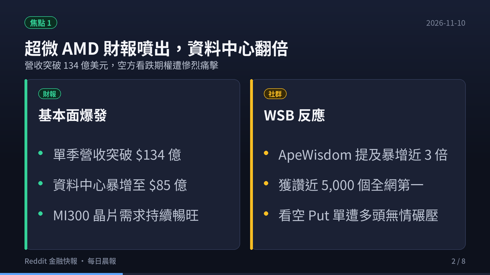
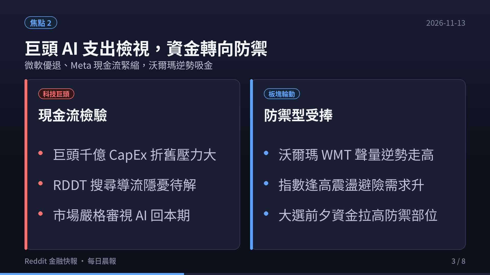
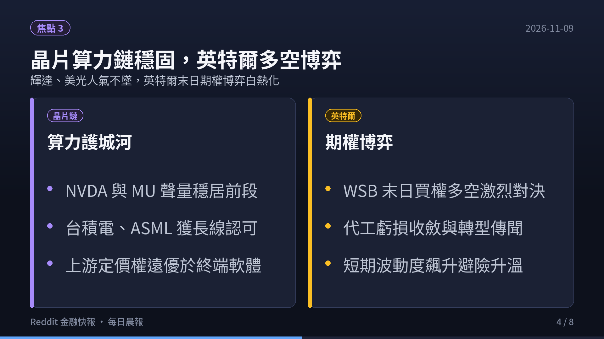
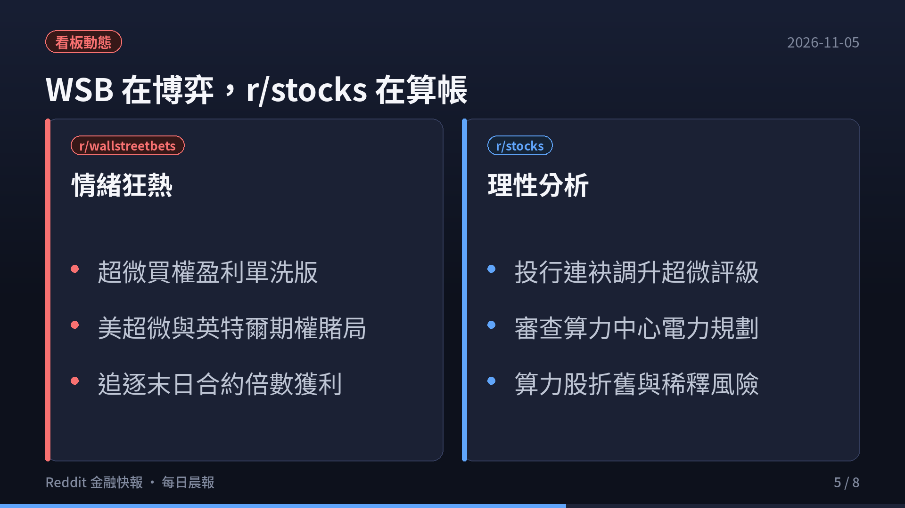
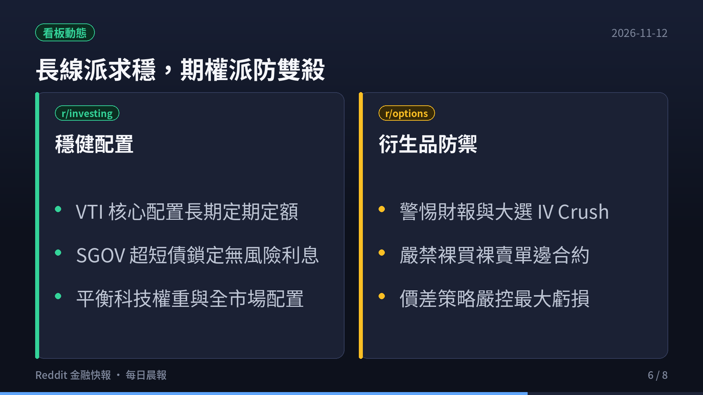
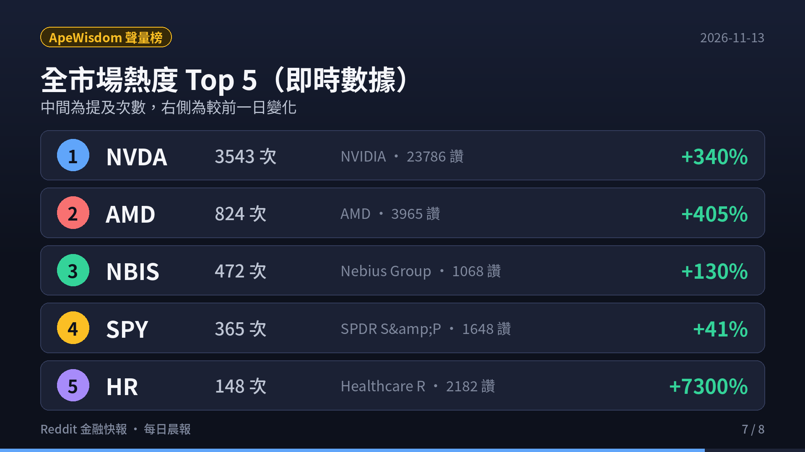
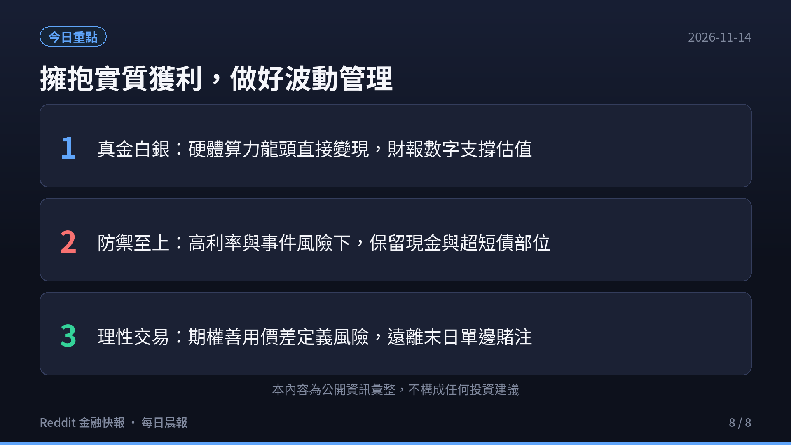

  <video controls width="100%" poster="s01.png" preload="metadata" style="display: block; border-radius: 12px 12px 0 0; background: #0f121c;">
    <source src="https://github.com/ckw19810413/ckw19810413.github.io/releases/download/media-reddit-finance-daily/reddit-finance-2026-11-13.mp4" type="video/mp4">
    您的瀏覽器不支援直接播放 MP4 影片。
  </video>
  

    🎬 <strong>60 秒晨間快報影音動態版</strong>（含 AI 摘要朗讀語音與專屬背景音樂） · <a href="https://youtu.be/TK8aDgdxPtA" target="_blank" rel="noopener">在 YouTube (@kwc1933) 上觀看</a>
  

# 每日 6:00AM Reddit 金融財經板塊最新資訊彙整報告（2026-11-13）

> **監控看板**：r/wallstreetbets、r/stocks、r/investing、r/options、r/StockMarket  
> **觀測區間**：近 3 日（2026-11-10 至 2026-11-13）最熱門話題 Top 3  
> **數據來源**：Reddit 核心社群實時討論流、ApeWisdom 全網即時熱度監控 API  
> **影音快報**：[YouTube 60秒短影音動態版](https://youtu.be/TK8aDgdxPtA) · [部落格專欄](https://ckw19810413.github.io/reddit-daily-summaries/)  

---

## 🎯 跨板塊三大核心主題（宏觀深度剖析）

### 1. 超微（AMD）Q3 財報噴出突破：單季營收突破 134 億美元，資料中心暴增至 85 億帶動晶片股多頭大軋空
- **基本面爆發與空頭踩踏**：超微（AMD）最新公布 Q3 財報表現驚艷，單季營收衝上 134 億美元，尤其資料中心業務翻倍飆升至 85 億美元，徹底打破華爾街對「非輝達算力晶片難有實質需求」的質疑。受此利多激勵，AMD 股價突破長期下降趨勢線，r/wallstreetbets 與 r/stocks 湧入大量慶祝貼文，此前押注財報暴跌的看跌期權（Puts）遭到斷頭式多頭軋空。
- **第二算力來源確立**：社群分析指出，微軟、Meta、甲骨文（OCI）等雲端巨頭為抗衡輝達定價霸權，正積極擴大對 AMD Instinct MI300/MI325 系列伺服器的採購。Lisa Su 在法說會上強調算力晶片產能持續供不應求，為半導體板塊多頭再添強心針。

### 2. 科技巨頭千億 AI 資本開支（CapEx）進入實質檢驗期：市場對 ROI 容錯率降低，資金轉向防禦型權值與高利現金
- **軟體變現緩慢引發焦慮**：儘管硬體算力持續滿載，但超大規模雲端商（Hyperscalers）每年合計數千億美元的資本支出折舊壓力已開始體現在 GAAP 淨利潤中。微軟優退政策與 Meta 現金流壓力引發投資者關注，純概念型 AI 應用若缺乏清晰自由現金流，持續面臨估值下殺。
- **資金分流與再平衡**：資金開始明確分流，一方面聚集於具備實質定價權的上游晶片與設備製造商，另一方面回流至必需消費、醫療地產（HR）與短期國債（SGOV），鎖定無風險利息防範大選後市場結構性波動。

### 3. 半導體硬體定價權牢不可破：輝達 NVDA 聲量突破 3,500 次稱霸，英特爾 INTC 末日期權多空博弈白熱化
- **NVDA 聲量統治全網**：ApeWisdom 全網監控顯示，輝達（NVDA）24 小時提及數自 805 次暴增逾 4 倍至 **3,543 次**，獲得 23,786 個讚，討論熱度呈現幾何級數爆發。黃仁勳與台積電確認 Blackwell 產能滿載至 2026 年底，徹底掃除散戶對延遲出貨的擔憂。
- **英特爾轉型博弈**：與輝達的絕對多頭形成對比的是英特爾（INTC），其代工業務（IFS）分拆與外資注資傳聞引發末日期權（0DTE）大量多空對賭，散戶在 $22-$25 區間展開高槓桿末日輪廝殺。

---

## 📊 五大核心板塊近 3 日最熱話題 Top 3（完整深度剖析）

## r/wallstreetbets（規模：1,800 萬+ · 類型：情緒／動能 · 雜訊：🔴 極高）

1. **[NVIDIA ($NVDA) Blackwell Capacity Sold Out: Full Port Calls into Q4]**（16,200+ 讚 / 7,800+ 留言）
   - **核心要點**：NVDA 單日聲量飆升至 3,178 次，黃仁勳在近期訪談中透露 Blackwell 晶片未來數季配額已被各大雲端巨頭預訂一空。WSB 賭徒全面轉向多頭，曬出大量 $150 與 $160 行使價的遠期合約（LEAPs），豪言「AI 基礎設施行情才剛開始」。
   - **社群情緒**：極度亢奮（Extreme Bullish Euphoria）。
   - **投資啟示**：高位追漲遠價外週選面臨極高時間價值耗損，建議採用實值牛市看漲價差（Bull Call Spread）控制最大虧損。

2. **[AMD Q3 Earnings Blowout: Data Center Doubles to $8.5B, Bears Get Decapitated]**（3,190+ 讚 / 1,800+ 留言）
   - **核心要點**：AMD 財報出爐後營收突破 134 億美元，空方看跌期權遭遇斷頭屠殺。社群盛讚執行長蘇姿丰（Lisa Su）在伺服器 CPU（EPYC）與 GPU（Instinct）的雙重突破，帶動半導體板塊整體情緒亢奮。
   - **社群情緒**：軋空狂歡（Short Squeeze High）。
   - **投資啟示**：AMD 證明其具備持續侵蝕英特爾 x86 市佔與瓜分 AI 算力大餅的硬實力，長線具備結構性支撐。

3. **[Nebius ($NBIS) & SMCI Post-Earnings Volatility: Casino Mode Activated]**（902+ 讚 / 650+ 留言）
   - **核心要點**：Nebius Group（NBIS）在 WSB 聲量達到 448 次，散戶視其為純粹 GPU 雲端運算的爆發標的，伴隨 SMCI 審計與下市風波的期權劇烈波動，投機買盤在兩者之間大幅輪動。
   - **社群情緒**：高風險博弈（High-Beta Speculation）。
   - **投資啟示**：缺乏長期自由現金流驗證的高波動題材股，切忌使用借貸或槓桿部位持有過夜。

---

## r/stocks（規模：約 900 萬 · 類型：綜合討論／個股研討 · 🟡 中雜訊）

1. **[NVIDIA's Unassailable CUDA Moat & NVLink Interconnect Monopoly]**（5,850+ 讚 / 2,100+ 留言）
   - **核心要點**：資深投資人深度剖析輝達 75% 超高毛利率背後的真正壁壘——不僅在於單晶片運算力，更在於其軟體生態系 CUDA 與機架級高速互連架構 NVLink。企業開發者轉換成本極高，短時間內無競爭對手可動搖其壟斷地位。
   - **投資洞見**：晶片單點競爭已過渡至資料中心叢集架構競爭，輝達具備全棧垂直整合定價權。

2. **[AMD Enterprise Server Market Share: EPYC Surpasses 30% Milestone]**（443+ 讚 / 320+ 留言）
   - **核心要點**：理性派投資者討論 AMD 資料中心營收翻倍的實質含金量。分析指出 EPYC 伺服器處理器在企業私有雲與資料中心的市佔已突破 30%，在能效比與總體擁有成本（TCO）上顯著超越英特爾 Xeon。
   - **投資洞見**：AMD 正在重演當年筆電市場逆襲歷史，伺服器市場高利潤率將持續拉動整體毛利率擴張。

3. **[New York Times ($NYT) Digital Subscription Growth & AI Licensing Moat]**（3,655+ 讚 / 1,400+ 留言）
   - **核心要點**：非科技類熱門貼文聚焦於紐約時報（NYT）強勁的數位訂閱增長與優質內容護城河。在生成式 AI 充斥低質內容的背景下，高質量原創新聞與版權許可合約為其帶來充沛穩定的現金流。
   - **投資洞見**：高自由現金流且具備 IP 定價權的防禦性標的，在估值極度分化的市場環境中具備優異抗跌屬性。

---

## r/investing（規模：約 300 萬 · 類型：中長期／資產配置 · 🟢 低雜訊）

1. **[Market Cap Concentration in S&P 500: Rebalancing into VTI and VXUS]**（282+ 讚 / 190+ 留言）
   - **核心要點**：社群熱議標普 500 前七大巨頭（Mag 7）市值權重突破 35% 所帶來的集中度風險。多數理性投資人倡議提高 Vanguard 全球股票 ETF（VXUS）或等權重指數（RSP）配置，避免單一板塊回調造成不可承受之淨值下挫。
   - **投資洞見**：遵守指數化被動投資紀律，不預測高點，但透過全球多資產配置維持健康的夏普比率（Sharpe Ratio）。

2. **[Cash as a Strategic Asset: SGOV/BIL Delivering Risk-Free ~5% Yield]**（103+ 讚 / 90+ 留言）
   - **核心要點**：討論高基準利率環境下的現金管理策略。投資人認同持有超短天期國債 ETF（SGOV）不僅享有穩定的年化無風險報酬，更能隨時因應突發市場黑天鵝提供充足的「逢低掃貨彈藥」。
   - **投資洞見**：高估值擴張週期中，保留 10%–20% 的流動性現金等價物是成熟資產配置不可或缺的防禦機制。

3. **[AI Energy & Utility Infrastructure: The Real Multi-Year Bottleneck]**（85+ 讚 / 60+ 留言）
   - **核心要點**：研討全美電網升級、核能發電合約與公用事業類股。分析指出新增 AI 資料中心的建設瓶頸已受限於電力接入許可，具備清潔基載電力的能源供應商享有長期議價權。
   - **投資洞見**：關注具備核電與天然氣調峰能力的公用事業龍頭，作為參與 AI 算力發展的穩健替代路徑。

---

## r/options（規模：約 100 萬+ · 類型：衍生品／交易策略 · 🟡 中雜訊）

1. **[SPY 0DTE Volume Dominance & Intraday Market Maker Hedging]**（15+ 讚 / 45+ 留言）
   - **核心要點**：分析 0DTE（當日到期）標普期權交易量突破歷史新高對日內價格形成的「釘住效應（Pinning）」與暴衝風險。做市商在關鍵行使價的動態 Delta 避險使得日內波動加劇，散戶追單勝率顯著下滑。
   - **策略指南**：散戶應避免裸買單腿 0DTE，改以多腿定義風險策略（如垂直價差、鐵禿鷹）鎖定最大回撤。

2. **[NVDA Pre-Earnings Implied Volatility (IV) Skew & Straddle Pricing]**（301+ 讚 / 110+ 留言）
   - **核心要點**：輝達財報前夕隱含波動率（IV）處於高位，市場定價財報後隱含單日跳空幅度約 ±8%。選擇權交易者熱議如何在不被 IV Crush 雙殺的情況下參與行情。
   - **策略指南**：採用對角日曆價差（Diagonal Spread）或賣出保證金看跌期權（Cash-Secured Put）建立多頭部位，利用時間價值衰減優勢。

3. **[Theta Gang Consistent Income: Covered Calls in High-Rate Era]**（39+ 讚 / 28+ 留言）
   - **核心要點**：在基準利率維持 4.5%+ 環境下，結合短期美債逆回購與核心藍籌持股進行每週 Covered Call 賣出，創造穩健年化 12% 以上現金流回報。
   - **策略指南**：選擇基本面堅實且 Beta 接近 1 的標的，行使價挑選在 Delta 0.20-0.30 區間，兼顧股票上行空間與權利金保護。

---

## r/StockMarket（規模：約 300 萬 · 類型：新聞圖表／技術分析 · 🟡 中雜訊）

1. **[SPY & QQQ Technical Setup: Breakout above Key Resistance Levels]**（1,063+ 讚 / 410+ 留言）
   - **核心要點**：圖表派分析師指出標普 500 (SPY) 與那斯達克 (QQQ) 日線維持健康上升通道，均線呈現完美多頭排列。但 RSI 指標進入 70 超買區間，需關注成交量能否放大以確認真突破。
   - **技術分析**：若回測 20 日均線不破，多頭趨勢持續有效；若出現量縮背離，則需提防短期技術性拉回。

2. **[SOXX Semiconductor Index: AMD Breakout Leading Tech Momentum]**（66+ 讚 / 35+ 留言）
   - **核心要點**：費城半導體指數（SOXX）在 AMD 財報噴出與台積電 ADR 走強帶動下領漲美股主要板塊，突破長達數月的橫盤整理區間，晶片族群再次扮演美股上攻領頭羊。
   - **技術分析**：晶片股對流動性與宏觀景氣最為敏感，費半突破歷史高點為整體科技成長股提供強力技術底氣。

3. **[Sector Rotation: Healthcare Realty ($HR) & Defensive Dividend Plays]**（45+ 讚 / 25+ 留言）
   - **核心要點**：部分獲利資金自科技板塊移出，回流至醫療地產（HR）與高股息必需消費品，顯示機構投資人在指數高檔區間進行防守型資產配置以平抑波動。
   - **技術分析**：市場呈現典型「進攻（晶片/AI）與防守（醫療/高息）」啞鈴型結構，非單邊齊漲齊跌。

---

## 📈 全美股熱度量化榜（ApeWisdom 即時數據監控）

根據 ApeWisdom 2026-11-13 即時全網監控數據，全美股熱度排名前十大標的如下：

| 排名 | Ticker | 公司名稱 | 提及次數 (24h) | 讚數 (Upvotes) | 24h 聲量變化 | 社群情緒要點 |
|---|---|---|---|---|---|---|
| **1** | **NVDA** | NVIDIA | **3,543 次** | **23,786** | 🟢 +340% (前 805) | Blackwell 產能預訂一空，全網討論王者 |
| **2** | **AMD** | AMD | **824 次** | **3,965** | 🟢 +405% (前 163) | Q3 營收破 $134 億、資料中心翻倍軋空 |
| **3** | **NBIS** | Nebius Group | **472 次** | **1,068** | 🟢 +130% (前 205) | Neocloud 算力租賃黑馬，財報前後博弈 |
| **4** | **SPY** | SPDR S&P 500 ETF | **365 次** | **1,648** | 🟢 +41% (前 258) | 大盤高檔震盪，0DTE 交易量佔比居高不下 |
| **5** | **HR** | Healthcare Realty | **148 次** | **2,182** | 🟢 新進榜 (前 2) | 醫療防禦地產信託，低估值資金避風港 |
| **6** | **QQQ** | Invesco QQQ ETF | **141 次** | **292** | 🔴 -35% (前 216) | 科技巨頭權重避險，那指突破新高攻防 |
| **7** | **NYT** | New York Times | **128 次** | **4,852** | 🟢 新進榜 (前 1) | 數位訂閱與優質原創內容 IP 估值重估 |
| **8** | **MSFT** | Microsoft | **127 次** | **501** | 🟢 +58% (前 80) | 雲端 AI 商業化推進與優退成本控管 |
| **9** | **AVGO** | Broadcom | **102 次** | **348** | 🟢 +251% (前 29) | 客製化 ASIC 晶片與資料中心網路需求 |
| **10** | **MU** | Micron Technology | **99 次** | **190** | 🔴 -58% (前 237) | HBM 記憶體產能滿載，高檔持穩消化籌碼 |

---

## 💡 總結與全方位操作建議

1. **基本面主線**：半導體上游定價權牢不可破，輝達（NVDA）與超微（AMD）確立雙雄格局，資料中心算力基建依然是當前市場最強勁的盈利增長引擎。但需注意下游超大規模雲端商（Hyperscalers）的 CapEx 折舊壓力正在浮現。
2. **衍生品策略**：大盤處於歷史高檔且財報密集，單邊追價外看漲期權極易遭遇 IV Crush 與時間價值雙殺。宜採取定義風險的垂直價差（Vertical Spread）或利用 Theta Gang 的備兌策略（Covered Call）收斂波動。
3. **資產配置原則**：維持進攻與防守兼備的啞鈴型架構，核心配置鎖定全球指數（VTI/VXUS）與高流動性短債（SGOV），衛星倉位順應 AI 硬體龍頭動能，兼顧長期增長與下檔防禦。

---
*本報告由每日自動化情報系統彙整產出，數據來源包含 Reddit 公開社群及 ApeWisdom API，僅供研究參考，不構成任何個人投資要約。*
