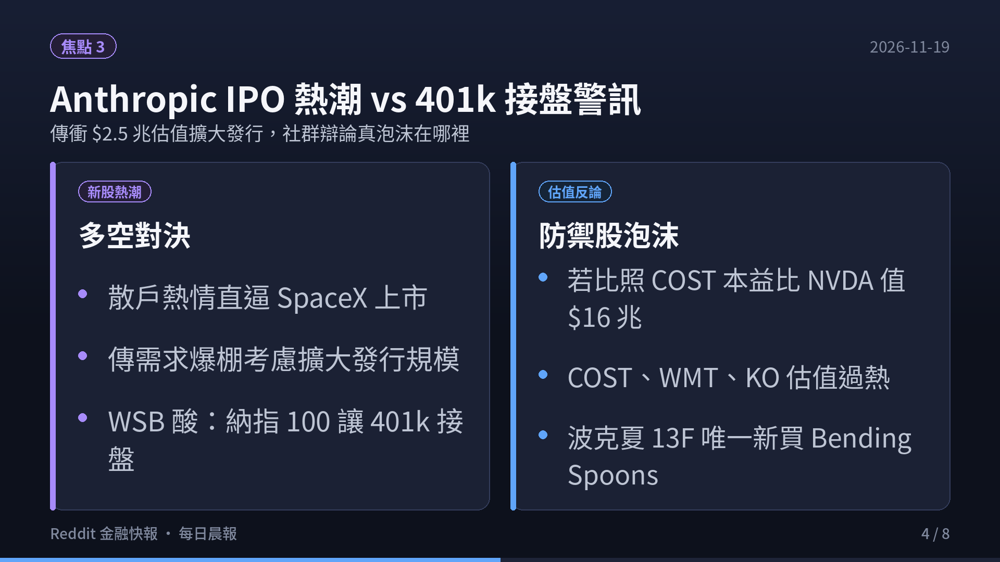
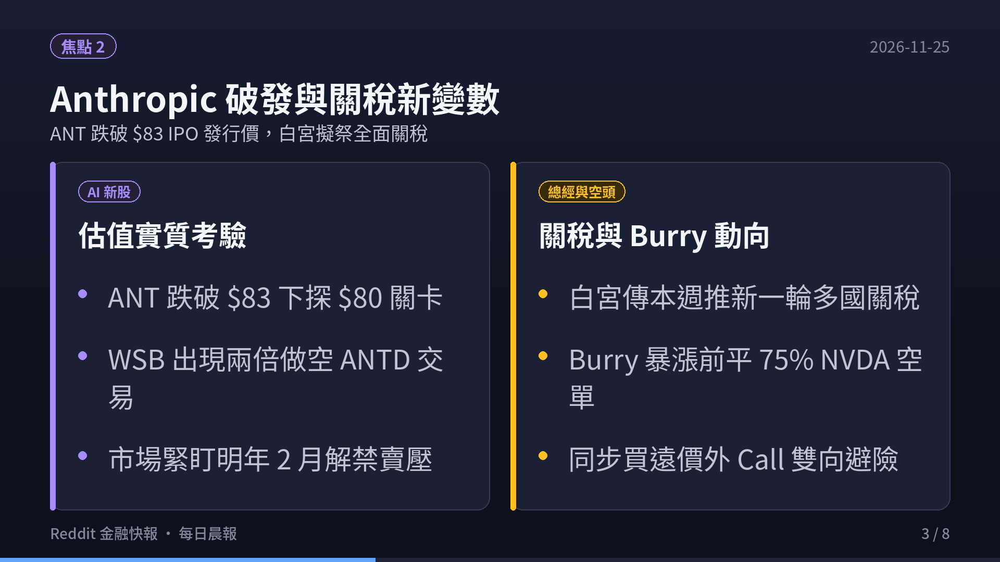
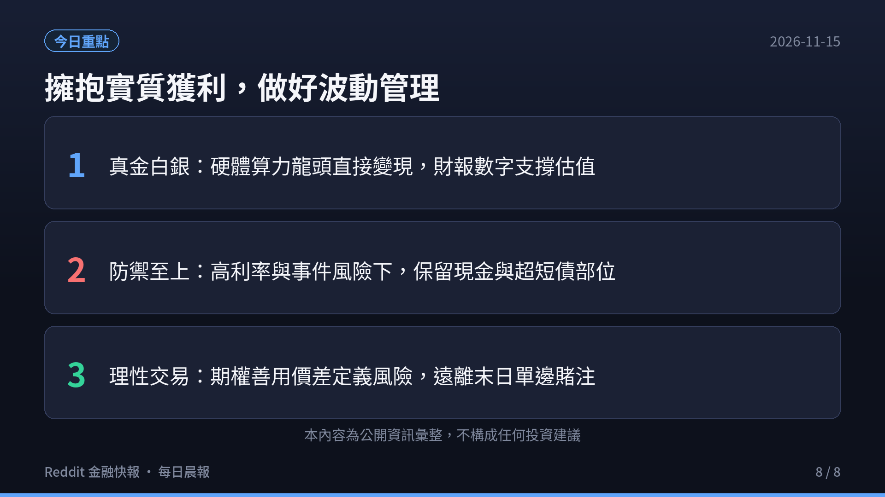

  <video controls width="100%" poster="s01.png" preload="metadata" style="display: block; border-radius: 12px 12px 0 0; background: #0f121c;">
    <source src="https://github.com/ckw19810413/ckw19810413.github.io/releases/download/media-reddit-finance-daily/reddit-finance-2026-11-26.mp4" type="video/mp4">
    您的瀏覽器不支援直接播放 MP4 影片。
  </video>
  

    🎬 <strong>60 秒晨間快報影音動態版</strong>（含 AI 摘要朗讀語音與專屬背景音樂 · YouTube 同步觀看：<a href="https://youtu.be/Wv0PTJpuw8g" target="_blank" rel="noopener">點此前往 @kwc1933</a>）
  

> **資料區間**：2026-11-23 11:00 → 2026-11-26 11:00（台北時間，近 72 小時）
> **資料來源**：Arctic Shift Reddit 貼文封存 API（r/wallstreetbets 1,701 篇、r/stocks 253 篇、r/investing 103 篇、r/options 34 篇、r/StockMarket 91 篇）＋ ApeWisdom 即時提及量（2026-11-26 11:00 快照）
> **排序方式**：依貼文讚數（score）排序，排除每日例行討論串，同一事件的多篇貼文合併成一個話題。
> **免責聲明**：本文整理公開社群討論，**不構成任何投資建議**。Reddit 反映的是「大家在關注什麼」，不是「該買什麼」。

---

## 🧭 今日一句話

**輝達（NVDA）黃仁勳復職帶來的 +31% 反彈只撐了一天。** 週三（11/25）美股重啟 AI 賣壓：據 r/StockMarket 轉貼的 CNBC 盤中報導，**道瓊重挫約 1,000 點、那斯達克跌約 4%**；同日白宮提議對中國、歐盟等 14 個經濟體課 **最高 20% 新關稅**（最快明年 1 月生效）。WSB 一邊在慶祝 $500 變 $100 萬的期權神單，一邊有人宣布「明年見」退場。**美股今天（11/26 感恩節）休市，週五美東 13:00 提早收盤。**

---

## 🔥 一、r/wallstreetbets（雜訊 🔴 極高）

> 每日討論串熱度：11/25 Daily Discussion **21,759 則留言**、11/24 **15,911 則**，近期最高。

### 1. 黃仁勳復職迷因大洗版（11/23–11/24）
- 前 5 名貼文全部是這件事：[「literally no fucking comment」](https://www.reddit.com/r/wallstreetbets/comments/1y3n3u9/)（**63,319↑**）、[黃仁勳對員工說「第二次當 CEO 會更好」](https://www.reddit.com/r/wallstreetbets/comments/1y3qi6t/)（**61,281↑ / 6,470 則留言**）、[董事會宣布復職](https://www.reddit.com/r/wallstreetbets/comments/1y3iw1i/)（37,584↑）。
- [Kevin O'Leary 在直播上說「黃仁勳零機會回來」，話剛講完就收到復職新聞](https://www.reddit.com/r/wallstreetbets/comments/1y4bir8/)（36,772↑），是本週轉發最多的片段。
- WSJ 報導黃仁勳在復職前向董事會坦承[更多婚外情](https://www.reddit.com/r/wallstreetbets/comments/1y425wd/)（32,840↑）；11/26 又傳出[「至少第四段」](https://www.reddit.com/r/wallstreetbets/comments/1y5mcq3/)（1,546↑）。
- **要點**：情緒溫度爆表，但討論重點是八卦和迷因，不是基本面，「消息市」特徵非常明顯。

### 2. 「兩週賺到 100 萬美元」期權神單（11/25）
- [I MADE GENERATIONAL MONEY. $1 million in 2 weeks.](https://www.reddit.com/r/wallstreetbets/comments/1y5anxn/)（**21,330↑ / 2,854 則留言**，Gain 標籤）。
- 發文者自述的路徑：$500 買 NVDA put（剛好碰上黃仁勳辭職）→ $20k → $80k → 回落 $40k → 押 $20k 買 $145 call（碰上復職）賺 $370k → 再押 $360k 買 5,000 口 $135 put，週二一度帳面虧 $180k，週三 NVDA 再跌後出場，賺 $381k，**累計約 $100 萬**，宣布「不再重押」。
- **要點**：這是典型的「倖存者偏差」貼文。同一天另一篇熱門貼文[「Acceleration to poverty」](https://www.reddit.com/r/wallstreetbets/comments/1y5an01/)的作者自述從高點虧了 $56 萬。

### 3. 週三 AI 賣壓重啟：「又來了」（11/25–11/26）
- [Here we go again](https://www.reddit.com/r/wallstreetbets/comments/1y55ptb/)（19,711↑）、[Christmas is canceled 😞](https://www.reddit.com/r/wallstreetbets/comments/1y566fq/)（2,981↑）、[I'm tired boss](https://www.reddit.com/r/wallstreetbets/comments/1y5h90g/)（1,703↑）。
- 據一篇貼文標題，**S&P 警告輝達董事會「可能已遭架空」，將其信用評等列入降評觀察**（[6,400↑](https://www.reddit.com/r/wallstreetbets/comments/1y5kdvf/)；注意：貼文附的連結是 Reuters 的 WSJ 間諜案後續報導，降評觀察請以 S&P 官方公告為準）。
- [韓國主播在直播中為那斯達克虧損哽咽](https://www.reddit.com/r/wallstreetbets/comments/1y5ld21/)（5,362↑）：「西學螞蟻」（韓國散戶）重押輝達、特斯拉。
- [Burry 平掉剩下的 Nasdaq-100 賣權，考慮在 $200 附近重新放空輝達](https://www.reddit.com/r/wallstreetbets/comments/1y56h1a/)（562↑）；CNBC 報導美國限制中國遠端租用 AI 晶片後，[二手市場出現「異常大量」的輝達 GPU 求售](https://www.reddit.com/r/wallstreetbets/comments/1y5gv45/)（481↑）。
- **要點**：週一的 V 型反彈被市場當成「死貓跳」，情緒從狂歡轉為疲憊和投降，例如[「Bye bye, see you next year」](https://www.reddit.com/r/wallstreetbets/comments/1y56p4r/)這篇退場宣言。

---

## 📊 二、r/stocks（雜訊 🟡 中）

### 1. 輝達復職事件的事實面（11/23–11/25）
- [NVIDIA Board Reinstates Jensen Huang as President, CEO and Board Director](https://www.reddit.com/r/stocks/comments/1y3ix82/)（**9,431↑ / 2,560 則留言**）：官方新聞稿說董事會一致通過，認為黃仁勳「坦誠、具領導能力」。
- [WSJ 更正：Alice Huang 並非間諜](https://www.reddit.com/r/stocks/comments/1y4c5nd/)（1,759↑）：與中國情報單位只有間接關聯，沒有確證她在蒐集情報。
- [黃仁勳告訴員工：輝達「不需要接班計畫」](https://www.reddit.com/r/stocks/comments/1y4n5jf/)（1,151↑，CNBC）。留言多半質疑治理風險。
- **要點**：理性派關注的不是股價，而是**「關鍵人物風險」沒有被處理**。

### 2. 微軟宣布「Code Red」最高警戒（11/25）
- [BREAKING: Microsoft ($MSFT) declares 'Code Red'](https://www.reddit.com/r/stocks/comments/1y4kt7q/)（**7,024↑**）。
- 11/12–11/13 全球大當機，Exchange Online、Outlook、Teams、Copilot 中斷，部分企業與政府客戶**最長 24 小時收不到信**。據 Reuters 看到的內部備忘錄，新目標是全球服務在 **1 小時內恢復**。
- **要點**：AI 雲端的可靠性成為新議題，Copilot 的企業信任度受到考驗。

### 3. 「政策製造危機、再解決危機」與新關稅（11/23–11/25）
- [Admin insiders get Jensen fired. POTUS rehires Jensen.](https://www.reddit.com/r/stocks/comments/1y3l7sg/)（2,179↑）：批評這是「自己製造危機再收割」的模式，舉 2025 年關稅風暴為例。
- [Can someone explain to me what is going on?](https://www.reddit.com/r/stocks/comments/1y4i023/)（1,272↑）：今年兩檔估值破兆的 IPO 幾乎沒有盈餘、兆元市值的股票走勢像生技小型股、Alphabet 創上市以來最差單日表現。
- [US announces new tariffs of up to 20% on China, the EU, and 12 other nations](https://www.reddit.com/r/stocks/comments/1y59jnm/)（833↑ / 406 則留言）：對中國的 20% 被稱為「deal rate」，與既有關稅疊加後部分商品**超過 40%**；最快 1 月生效，中美貿易休戰 **1/10 到期**。
- **要點**：總經面（關稅、殖利率、升息預期）重新成為主角，[「All that pump and for what?」](https://www.reddit.com/r/stocks/comments/1y5crah/)（503↑）就是這種情緒。

---

## 🧘 三、r/investing（雜訊 🟢 低）

### 1. 「史上最混亂的超大型股董事會？」
- [Nvidia just reinstated Jensen Huang 12 days after he "resigned."](https://www.reddit.com/r/investing/comments/1y3j30o/)（**4,534↑ / 1,194 則留言**）
- 時間線：11/12 黃仁勳「自願辭職」，由 Colette Kress 代理 CEO → 財報電話會議上董事會表示「無意讓他復職」 → 6 天後一致投票通過復職。
- **要點**：長線投資人認為治理可信度受損，估值應該加上風險折價。

### 2. Burry 是轉多，還是雙向避險？
- [Michael Burry cut 75% of his Nvidia puts and bought calls right before Monday's +31.48% jump](https://www.reddit.com/r/investing/comments/1y47ick/)（2,446↑）
- 他平掉 75% 的 NVDA 賣權、全部的半導體 ETF 賣權、一半的 Nasdaq-100 賣權，週五買進遠價外 NVDA 買權作為避險，之後又因 SEC 會計調查新聞平掉剩下 25% 的賣權。
- **要點**：主流解讀是**「兩邊都留避險」，不是轉多**；WSB 後續的消息也顯示他還想在高位重新放空。

### 3. 反彈被吃回，退休族怎麼辦？
- [Nasdaq-100 has in the premarket now erased the bounce](https://www.reddit.com/r/investing/comments/1y55zm3/)（485↑，引用 WSJ）：「沒有人擋得住雪崩」。
- [The cloud over Nvidia isn't gone just because Jensen is back](https://www.reddit.com/r/investing/comments/1y4b2l7/)（203↑）：總統介入復職一事，讓國會的調查範圍擴大（Washington Post）。
- [What are retirees who have most of their NW in the market feeling?](https://www.reddit.com/r/investing/comments/1y59hkb/)（134 則留言）：討論集中在資產配置、現金緩衝和不要恐慌賣出。
- **要點**：理性派的焦點從「要不要抄底」轉到「部位要怎麼配才睡得著」。

---

## 🎯 四、r/options（雜訊 🟡 中；本期發文量低，僅 34 篇）

### 1. 大盤收紅，賣權卻是買權的 4 倍
- [Put buying is dwarfing call buying today while SPY sits green near 716](https://www.reddit.com/r/options/comments/1y4nyrx/)（53↑ / 34 則留言）
- SPY：賣權權利金約 **$9.36 億**，買權約 $4.25 億；QQQ：賣權 **$12 億**，買權 $3.23 億（約 **4 倍**）。
- 美東 11:12 一分鐘內出現大筆 SPX 遠月深價外賣權：**2027/4 到期的 6900P 約 $2.1 億、6500P 約 $1.92 億**，2027/1 到期的 7000P 約 $1.01 億。
- **要點**：大戶趁指數還在高檔時買保險。是避險還是警訊，留言兩派都有。

### 2. 賣 cash-secured put 真正的風險是跳空，不是被指派
- [Getting assigned isn't the bad outcome on a CSP. The gap is.](https://www.reddit.com/r/options/comments/1y5ahk5/)（42 則留言）
- 實例：賣 QQQ $657 put 收 $436，週四收在 645，週五**跳空收 608**，以 657 接貨，**一口帳面虧約 $4,900**。
- 同時有討論 [VIX 百分位接近一年高點](https://www.reddit.com/r/options/comments/1y3f2x5/)：SPY 隱含波動預期本週波動 4%，高於 2.9% 的週 ATR。

### 3. 18 種 Cboe 期權策略指數 vs 直接持有 SPY
- [18 Cboe options strategies vs holding SPY](https://www.reddit.com/r/options/comments/1y4e275/)（36 則留言）
- 2007/2–2026/10 收權利金類：SPY 年化 10.8%、Sharpe 0.75；PUT 7.2%/0.70、BXMD 8.4%/0.69、BXM 5.9%/0.58、iron condor CNDR 0.9%/0.16。**沒有一種策略在統計上可靠地勝過 SPY 的風險調整報酬。**
- 2016/1–2026/10 買保護類：10% buffer SPRO 最大回撤 −14.5%（SPY 為 −23.9%），但每年少賺約 4 個百分點。
- **要點**：期權策略換到的是「少跌」，不是「多賺」。

---

## 📰 五、r/StockMarket（雜訊 🟡 中）

### 1. 「美國政府為股市背書」的反諷迷因
- [God bless america](https://www.reddit.com/r/StockMarket/comments/1y3nn5l/)（**4,775↑**）、[The US stock market is backed by the full faith and credit of the US government](https://www.reddit.com/r/StockMarket/comments/1y3wxhq/)（1,293↑）。
- **要點**：用反諷表達「大到不能倒」，市場在消化政府直接介入個股的現象。

### 2. 利益衝突與「完美押注」疑雲
- [Just a reminder Jensen Huang donated over 25 million to the White House Ballroom](https://www.reddit.com/r/StockMarket/comments/1y3kyxh/)（4,015↑）：列出捐款、餐會，以及「新處理器營收分給政府 15%」等爭議。
- [「可疑」帳戶在 Polymarket 準確押注黃仁勳復職，賺進 $34 萬](https://www.reddit.com/r/StockMarket/comments/1y4angm/)（1,641↑）。
- **要點**：內線交易與預測市場監管成為新的討論焦點。

### 3. 「市場壞掉了」→ 週三道瓊重挫 1,000 點
- [The markets are Broken and you should be worried](https://www.reddit.com/r/StockMarket/comments/1y3mxrf/)（2,982↑）：4 兆美元市值的公司單日波動 32%，「這是迷因幣嗎？」
- [Nvidia Accounts for 34% of S&P 500 Rally as Index Weight Climbs to 6.4%](https://www.reddit.com/r/StockMarket/comments/1y43kz4/)（732↑）：集中度風險。
- [Dow craters 1,000 points, Nasdaq loses 4% as Nvidia leads resumption of AI sell-off](https://www.reddit.com/r/StockMarket/comments/1y59ayd/)（764↑，CNBC 盤中報導；收盤數字請以官方資料為準）。
- **要點**：單一個股牽動整體指數，被動投資人也躲不過這次的波動。

---

## 📈 ApeWisdom 全市場即時聲量排行（2026-11-26 11:00 快照）

| 排名 | 代號 | 24h 提及 | 前一日 | 變化 | 觀察 |
|---|---|---|---|---|---|
| 1 | NVDA | 570 | 800 | **−29%** | 仍居第一，熱度開始退燒 |
| 2 | SPY | 519 | 312 | **+66%** | 大盤避險與放空討論大增 |
| 3 | QQQ | 280 | 134 | **+109%** | 科技指數重挫，聲量翻倍 |
| 4 | MU | 168 | 111 | +51% | 記憶體族群逆勢受關注 |
| 5 | AMD | 119 | 136 | −13% | 跟隨 AI 晶片賣壓 |
| 6 | SNDK | 115 | 71 | +62% | 記憶體/儲存題材 |
| 7 | SOXL | 101 | 77 | +31% | 3 倍槓桿半導體 ETF 抄底與停損 |
| 8 | VOO | 93 | 36 | **+158%** | 長線派「逢低定投」討論激增 |
| 10 | AAPL | 82 | 90 | −9% | — |
| 11 | DELL | 79 | 144 | −45% | 財報熱度消退 |

> 讀法：**SPY、QQQ、VOO 這類指數 ETF 的聲量同步暴增**，代表恐慌已經從個股擴散到整體市場的配置討論。

---

## 💡 綜合觀察與風險提示

1. **消息市反覆來回**：復職利多 +31% 隔天就被吃回。治理、國會調查、SEC 會計審查、評等觀察這些疑慮都還在，不要追單日暴漲或暴跌。
2. **關稅回到主舞台**：最高 20% 的新關稅最快 1 月生效，中美休戰 1/10 到期，接下來的公聽與談判消息會帶來波動。
3. **期權流顯示大戶在買保險**：QQQ 賣權約為買權的 4 倍，遠月深價外 SPX 賣權大量成交。賣 put 的人要準備好面對跳空的風險。
4. **感恩節短週**：11/26（四）美股休市，11/27（五）美東 13:00 提早收盤，流動性偏低，建議用限價單。
5. **倖存者偏差**：一篇 $100 萬神單旁邊有十篇虧損退場文，Reddit 只能當「情緒溫度計」。

*本報告由自動化流程彙整 Reddit 公開貼文，數據可能與官方收盤資料有出入；內容僅供參考，不構成投資建議。*

---

### ☕ 支持與精選工具推薦

如果你覺得這份每日晨報對你的投資視野與市場觀察有實質幫助，歡迎透過以下方式支持我們持續產出客觀數據報告：

- ☕ **請我喝杯咖啡**：[Ko-fi 小費贊助 (ytstories0413)](https://ko-fi.com/ytstories0413) 或 [Ko-fi 贊助 (slashman413)](https://ko-fi.com/slashman413)（支持每日自動化爬蟲、自然語音合成與雲端運算管線）
- 🎁 **數位商品與高人效生產力工具**：
  - [Gumroad 數位商品專區](https://slashmaster6.gumroad.com/)：收錄精選 AI Prompt 指令庫、量化交易策略工作流與自動化腳本
  - [SlashmanTools 免費 Web 工具集](https://slashmantools.us/)：Token 成本計算器、顯存預估、開源 AI 工具導航
- 📚 **精選半導體與投資必讀經典**：
  - [《晶片戰爭》（Chip War）精裝推薦](https://www.amazon.com/dp/059371671X?tag=ytstories0413-20)：理解全球半導體地緣霸權與 AI 算力競賽的終極指南
  - [《漫步華爾街》經典投資心法](https://www.books.com.tw/products/0010850028)
  - [《原子習慣》細微改變帶來巨大成就](https://www.books.com.tw/products/0010792915)
