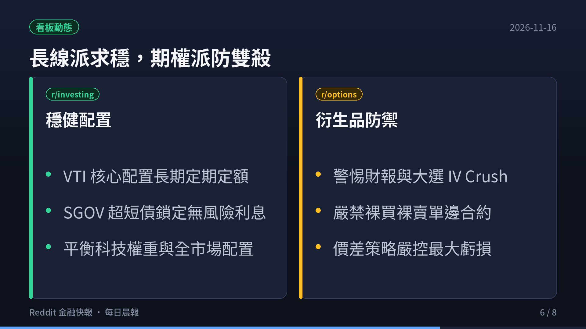

  <video controls width="100%" poster="s01.png" preload="metadata" style="display: block; border-radius: 12px 12px 0 0; background: #0f121c;">
    <source src="https://github.com/ckw19810413/ckw19810413.github.io/releases/download/media-reddit-finance-daily/reddit-finance-2026-11-24.mp4" type="video/mp4">
    您的瀏覽器不支援直接播放 MP4 影片。
  </video>
  

    🎬 <strong>60 秒晨間快報影音動態版</strong>（含 AI 摘要朗讀語音與專屬背景音樂 · YouTube 同步觀看：<a href="https://youtu.be/rmCh1ftAklM" target="_blank" rel="noopener">點此前往 @kwc1933</a>）
  

> **監控頻道**：`r/wallstreetbets`、`r/stocks`、`r/investing`、`r/options`、`r/StockMarket`  
> **觀測區間**：近 3 日（2026-11-21 至 2026-11-24 06:00 UTC+8）  
> **資料來源**：Arctic Shift Reddit 72 小時公開貼文串、ApeWisdom 即時聲量監控 API  
> **判讀原則**：Reddit 反映的是市場「注意力、資金流向與情緒溫度」，而非買賣依據；所有投資論點仍須回到公司財報、監管文件與客觀現金流驗證。

---

## 🎯 跨板塊三大核心主線

1. **黃仁勳（Jensen Huang）辭職 12 天後獲一致請回，輝達（NVDA）單日暴彈逾 30% 引爆公司治理辯論**
   - 繼 11 月中旬辭職引發科技股連續回檔後，NVIDIA 董事會於美東時間 11/23 宣布在徵詢美國政府高層意見、確認不構成國安風險後，全票通過即刻恢復黃仁勳總裁、執行長暨董事職務。NVDA 盤前大漲 25%–31%，並帶動那斯達克觸發 Limit-Up 交易暫停，ApeWisdom 全網聲量單日暴增 **+524%**（1,685 次提及、27,071 讚）。
   - 然而，董事會 6 天前才公開表示無意請回，如今卻 180 度大轉彎（且獨立調查與 SEC 會計審查仍在進行），加上 4 兆美元市值企業單日震盪逾 30%，讓理性派與技術派同時對「關鍵人物風險（Key Person Risk）」與市場「迷因幣化」提出嚴正警訊。

2. **45 天蒸發 8.9 兆美元後的 AI 估值再定價：大空頭減碼、承銷商撤盤與政治變數**
   - 在本輪劇烈回彈前，美股剛經歷 45 天市值蒸發 8.9 兆美元（單日蒸發 2.5 兆）的急殺。知名空頭 Michael Burry 於上週五（11/20）在 AI 殺盤中獲利了結半數 NVDA 與半導體 ETF 賣權，但維持對 Nasdaq 100 的長期空單；另一方面，Anthropic（ANT）IPO 承銷銀行結束穩定護盤部位、加上川普揚言禁止美企海外興建 AI 資料中心，凸顯 AI 資本鏈的政策與資金脆弱性。

3. **結構性分散與假期流動性管理：從《GTA 6》現金流到感恩節短週期權風控**
   - 話題焦點亦擴散至剛發售、傳首日零售達 37.9 億美元的《GTA 6》與母公司 Take-Two（TTWO）；衍生品市場迎來 Anthropic（ANT）期權於全美 20 家交易所同步掛牌，同時交易員高度關注本週感恩節（11/26 休市、11/27 提前於美東 13:00 收盤）清淡量能下的滑價與點差擴大風險。

---

## 📊 五大核心訂閱頻道：近 3 日最火熱 Top 3 話題

### 1. r/wallstreetbets（規模：1,800 萬+ · 類型：情緒／動能 · 雜訊：🔴 極高）

1. **黃仁勳閃電復職 NVIDIA 執行長，全站「Gain Porn」暴賺與反串迷因洗版**
   - **來源貼文**：
     - [NVIDIA Board Reinstates Jensen Huang as President, CEO and Board Director](https://www.reddit.com/r/wallstreetbets/comments/1y3iw1i/nvidia_board_reinstates_jensen_huang_as_president/)（33,114 讚 / 3,387 留言 · 2026-11-23）
     - [JENSEN HUANG TELLS NVIDIA EMPLOYEES: "I'M GOING TO BE A BETTER CEO THE SECOND TIME AROUND"](https://www.reddit.com/r/wallstreetbets/comments/1y3qi6t/jensen_huang_tells_nvidia_employees_im_going_to/)（29,223 讚 / 4,051 留言 · 2026-11-24）
     - [Made 10x my yearly salary in one trade.](https://www.reddit.com/r/wallstreetbets/comments/1y3jxye/made_10x_my_yearly_salary_in_one_trade/)（7,744 讚 / 715 留言 · 2026-11-23）
   - **內容要點**：黃仁勳回歸並向員工喊話「第二次當 CEO 會做得更好」，激勵 NVDA 暴力反彈；版面湧現單筆賺進 10 倍年薪的炫耀文，也有「Bought NVDA $225, Sold NVDA $125」的 WSB 名人堂自嘲迷因，完美呈現散戶追高殺低的極端情緒。

2. **「木頭姐」Cathie Wood 低賣高買操作成全網反指標熱議**
   - **來源貼文**：[Cathie Wood sold Nvidia under $130 she bought over $220 this year. Bought Anthropic around $97 and lose 10% next day.](https://www.reddit.com/r/wallstreetbets/comments/1y2blzm/cathie_wood_sold_nvidia_under_130_she_bought_over/)（7,194 讚 / 537 留言 · 2026-11-22）
   - **內容要點**：貼文整理 ARK 在今年 $220 以上買進 NVDA、卻在 $130 以下停損賣出，隨即轉手約 $97 接盤剛上市的 Anthropic 並於隔日再跌 10%，引發社群大量嘲諷機構追漲殺跌與「反向指標」效應。

3. **《GTA 6》首日零售傳破 37.9 億美元，熱議「真正的元宇宙」與 Take-Two（TTWO）**
   - **來源貼文**：[GTA the real metaverse.](https://www.reddit.com/r/wallstreetbets/comments/1y2aen6/gta_the_real_metaverse/)（4,976 讚 / 310 留言 · 2026-11-22）
   - **內容要點**：對比 Meta 耗資數百億卻無人問津的元宇宙與 Rockstar 耗時 13 年打造的《GTA 6》，討論其首日傳創 37.9 億美元銷售及未來結合 AI NPC 的變現潛力，並比較其長期獲利能力與母公司 TTWO 市值表現。

---

### 2. r/stocks（規模：約 900 萬 · 類型：綜合討論／個股研討 · 🟡 中雜訊）

1. **NVIDIA 復職聲明與「人造危機—政治救市」模式辯論**
   - **來源貼文**：
     - [NVIDIA Board Reinstates Jensen Huang as President, CEO and Board Director](https://www.reddit.com/r/stocks/comments/1y3ix82/nvidia_board_reinstates_jensen_huang_as_president/)（7,527 讚 / 2,161 留言 · 2026-11-23）
     - [Admin insiders get Jensen fired. POTUS rehires Jensen. Resolved a self-initiated crisis. Market down big, then up. Starting to be a pattern.](https://www.reddit.com/r/stocks/comments/1y3l7sg/admin_insiders_get_jensen_fired_potus_rehires/)（1,285 讚 / 163 留言 · 2026-11-23）
   - **內容要點**：NVDA 官方聲明表示董事會聽取美國政府高層意見後確認黃仁勳無國安風險；但社群高度質疑先放消息引發暴跌、再由白宮介入喊話復職推升大漲的模式，正逐漸成為繼 2025 年關稅震盪後的政策套利常態。

2. **NVDA 關鍵人物風險與《紐約時報》內部文化調查引發的估值反思**
   - **來源貼文**：
     - [Is NVIDIA a legitimate red flag now?](https://www.reddit.com/r/stocks/comments/1y1lvsy/is_nvidia_a_legitimate_red_flag_now/)（3,338 讚 / 1,875 留言 · 2026-11-21）
     - [NYT: Ex-Nvidia CEO Jensen Huang relied on public insults, graphic threats, and humiliation tactics to manage employees](https://www.reddit.com/r/stocks/comments/1y1ki7l/nyt_exnvidia_ceo_jensen_huang_relied_on_public/)（482 讚 / 467 留言 · 2026-11-21）
   - **內容要點**：在復職前股價跌破 $150 並逼近 $120 期間，基本面投資人熱議《紐約時報》揭露的管理爭議是否動搖長期護城河，多頭主張 GPU 技術與 CUDA 生態未受損、急跌反而是折扣買點，空方則警示單一領導人依賴度過高。

3. **Michael Burry 獲利了結半數 NVDA 空單，多頭喊進回檔後的 Alphabet（GOOGL）**
   - **來源貼文**：
     - [Michael Burry Locks In Gains on Nvidia, Chipmaker ETF Puts As AI Rout Deepens](https://www.reddit.com/r/stocks/comments/1y1i2ql/michael_burry_locks_in_gains_on_nvidia_chipmaker/)（802 讚 / 171 留言 · 2026-11-21）
     - [Why This Market Pullback Is a Gift for Buying Google Alphabet (GOOGL)](https://www.reddit.com/r/stocks/comments/1y2zi1u/why_this_market_pullback_is_a_gift_for_buying/)（445 讚 / 232 留言 · 2026-11-23）
   - **內容要點**：《大賣空》原型 Michael Burry 在 AI 殺盤中平倉一半的 NVDA 與半導體 ETF 看跌期權鎖定獲利，但保留對 Nasdaq 100 的長線空頭部位；同時多頭分析師認為本波回檔只是修正而非熊市，並點名 Alphabet（GOOGL）為具低估值與 AI 全棧優勢的首選標的。

---

### 3. r/investing（規模：約 300 萬 · 類型：中長期／資產配置 · 🟢 低雜訊）

1. **「巨型股史上最混亂董事會？」——公司治理公信力與 SEC 審查隱憂**
   - **來源貼文**：[Nvidia just reinstated Jensen Huang 12 days after he "resigned." Is this the most chaotic board in mega-cap history?](https://www.reddit.com/r/investing/comments/1y3j30o/nvidia_just_reinstated_jensen_huang_12_days_after/)（3,133 讚 / 916 留言 · 2026-11-23）
   - **內容要點**：長線投資人指出董事會在 6 天前財報電話會議上還堅稱不會請回黃仁勳，隨後卻全票同意復職，且獨立調查與 SEC 會計審查尚未落幕。這證明 3 兆美元市值的公司命運高度繫於一人身上，公司治理透明度備受質疑。

2. **AI 泡沫警報未除：Ed Zitron 警告 OpenAI 算力佔比過高與資金鏈壓力**
   - **來源貼文**：[Ed Zitron, who called the bubble very vocally with detailed analysis, is now speaking on CNBC with further concerns after hours](https://www.reddit.com/r/investing/comments/1y1jvyc/ed_zitron_who_called_the_bubble_very_vocally_with/)（556 讚 / 533 留言 · 2026-11-21）
   - **內容要點**：長期質疑 AI 商業變現的評論員 Ed Zitron 於 CNBC 警告，佔整體算力需求近半的 OpenAI 面臨 IPO 難度與資金吃緊壓力；相較之下，已搶先上市的 Anthropic 雖股價受挫，但已籌得 2,000 億美元級別戰備資金。

3. **30 年老手的修正心法 vs 退休父母 90% 押注 AI 單押股的警鐘**
   - **來源貼文**：
     - [This is healthy as a long term investor](https://www.reddit.com/r/investing/comments/1y1su5g/this_is_healthy_as_a_long_term_investor/)（985 讚 / 249 留言 · 2026-11-21）
     - [Looking for advice... Newly retired parents have ~90% of their brokerage in a few AI & tech yolo bets](https://www.reddit.com/r/investing/comments/1y36utf/looking_for_advice_newly_retired_parents_have_90/)（34 讚 / 199 留言 · 2026-11-23）
   - **內容要點**：資深投資人以 30 年經歷回顧 14 次逾 10% 回檔，指出標普前瞻本益比降至約 17 倍反而是健康去泡沫；另一則真實求助案例則反映剛退休父母將 90% 帳戶押注 PLTR、NVDA、CRWD 導致兩週蒸發 20–25 萬美元，凸顯退休階段資產分散的迫切性。

---

### 4. r/options（規模：約 100 萬+ · 類型：衍生品／交易策略 · 🟡 中雜訊）

1. **Anthropic（ANT）期權本週一於全美 20 家期權交易所正式開通交易**
   - **來源貼文**：[Anthropic (ANT) options to begin trading Monday](https://www.reddit.com/r/options/comments/1y1xh28/anthropic_ant_options_to_begin_trading_monday/)（125 讚 / 35 留言 · 2026-11-21）
   - **內容要點**：全美 20 家期權交易所同步上線 ANT 期權合約。在 IPO 承銷商剛撤除穩定價格護盤的背景下，交易員密切關注 ANT 上市初期的隱含波動率（IV）結構與做市商報價深度。

2. **NVDA 恐慌期權賣方實戰與「91.7% 勝率全職交易」風險警告**
   - **來源貼文**：
     - [NVDA Jan 100 put filled at 4.65 - good risk/reward](https://www.reddit.com/r/options/comments/1y1h33s/nvda_jan_100_put_filled_at_465_good_riskreward/)（54 讚 / 47 留言 · 2026-11-21）
     - [Left my startup and want to trade full time](https://www.reddit.com/r/options/comments/1y22m6t/left_my_startup_and_want_to_trade_full_time/)（0 讚 / 85 留言 · 2026-11-22）
   - **內容要點**：有交易員趁 NVDA 恐慌時 IV 遠高於實質波動率，賣出 1 月 $100 Put（權利金 $4.65）收取高溢價，同時反思先前賣 NBIS 的虧損經驗；另一則離開新創想全職交易的貼文（單週 25 筆勝率 91.7%），則被資深賣方集體警告切勿將短線高勝率誤認為無風險，單次黑天鵝即可吞噬數月獲利。

3. **深價內 LEAPS 回撤風控與感恩節短週流動性提醒**
   - **來源貼文**：
     - [Managing 0.70+ Delta LEAPS in a pullback: Cut at -40% or let 400+ DTE play out?](https://www.reddit.com/r/options/comments/1y308yq/managing_070_delta_leaps_in_a_pullback_cut_at_40/)（28 讚 / 31 留言 · 2026-11-23）
     - [Thanksgiving week heads up: Thursday is closed and Friday ends at 1 PM](https://www.reddit.com/r/options/comments/1y36w36/thanksgiving_week_heads_up_thursday_is_closed_and/)（13 讚 / 5 留言 · 2026-11-23）
   - **內容要點**：社群討論 400+ DTE、0.70+ Delta 替代正股型 LEAPS 遭遇 -40% 帳面回撤時，應依賴事前倉位控管扛過波動而非情緒砍倉；另提醒本週四（11/26）感恩節休市、週五（11/27）股市提前於美東 13:00（部分期權 13:15）收盤，低量能環境須改用限價單防滑價。

---

### 5. r/StockMarket（規模：約 300 萬+ · 類型：新聞彙整／市場結構 · 🟡 中雜訊）

1. **45 天蒸發 8.9 兆美元後的暴衝熔斷：白宮捐款爭議與「市場已壞」警告**
   - **來源貼文**：
     - [$8.9T Erased from US stock market in last 45 days and today alone was $2.5T.](https://www.reddit.com/r/StockMarket/comments/1y1jspj/89t_erased_from_us_stock_market_in_last_45_days/)（3,731 讚 / 322 留言 · 2026-11-21）
     - [Just a reminder Jensen Huang donated over 25 million to the White House Ballroom. Trumps calling for him to be reinstated is insider trading at its finest.](https://www.reddit.com/r/StockMarket/comments/1y3kyxh/just_a_reminder_jensen_huang_donated_over_25/)（2,064 讚 / 294 留言 · 2026-11-23）
     - [The markets are Broken and you should be worried](https://www.reddit.com/r/StockMarket/comments/1y3mxrf/the_markets_are_broken_and_you_should_be_worried/)（724 讚 / 222 留言 · 2026-11-24）
   - **內容要點**：美股在 11/21 前 45 天內一度蒸發 8.9 兆美元，週一卻因消息面反轉觸發那斯達克 Limit-Up 暫停交易；貼文質疑 4 兆美元級別企業單日波動 32% 形同迷因幣，並引述白宮宴會廳逾 2,500 萬美元捐款與 15% 新處理器營收抽成爭議，引發對制度公平性的強烈質疑。

2. **Anthropic 承銷銀行結束穩定護盤、川普威脅禁止美企海外建 AI 資料中心**
   - **來源貼文**：
     - [Anthropic's IPO bank closed position meant to stabilize stock, removing source of support](https://www.reddit.com/r/StockMarket/comments/1y1nuzc/anthropics_ipo_bank_closed_position_meant_to/)（550 讚 / 45 留言 · 2026-11-21）
     - [‘Trump threatens ban on US firms building AI data centres overseas’ - is he now shorting US tech?](https://www.reddit.com/r/StockMarket/comments/1y1r5ds/trump_threatens_ban_on_us_firms_building_ai_data/)（479 讚 / 100 留言 · 2026-11-21）
   - **內容要點**：路透指出 Anthropic 上市承銷銀行已結束穩價操作，短線籌碼承壓；同時 BBC 報導川普威脅禁止美企在海外建置 AI 資料中心，成為推升科技股政治不確定性的關鍵新聞。

3. **每日郵報揭露黃仁勳先前下台原因爭議與歷史級 V 轉行情**
   - **來源貼文**：[Jensen Huang reinstated as Nvidia CEO just days after he was ousted over affairs with at least three women including suspected Chinese spy](https://www.reddit.com/r/StockMarket/comments/1y3j845/jensen_huang_reinstated_as_nvidia_ceo_just_days/)（874 讚 / 317 留言 · 2026-11-23）
   - **內容要點**：新聞指出其先前遭撤換與至少三名女性及疑似中國間諜的調查傳聞有關；雖董事會表示已獲得美方高層確認無國安風險而予復職，但媒體與社群對後續調查進展與股價二次衝擊仍保持高度警戒。

---

## 📈 ApeWisdom 全市場即時聲量排行（2026-11-24 06:00 快照）

> 註：ApeWisdom 原始榜單第 5 名 `NYT`（120 次）與第 6 名 `HR`（105 次）實為《紐約時報》（New York Times）新聞引用及人資（HR）詞彙誤判；第 8 名 `DTE`（74 次）多源自 `0DTE` 期權討論。以下列出實質美股與 ETF 焦點標的：

| 實質排名 | 原始名次 | 代號 | 標的名稱 | 當前提及數 | 24h 前提及 | 24h 變化 | 累計獲讚 | 核心驅動因素 |
|:---:|:---:|:---:|:---|:---:|:---:|:---:|:---:|:---|
| **1** | #1 | **NVDA** | NVIDIA | **1,685** | 270 | **+524%** | 27,071 | 黃仁勳閃電復職、盤前暴漲逾 30% |
| **2** | #2 | **SPY** | SPDR S&P 500 ETF | **402** | 122 | **+230%** | 1,141 | 8.9 兆修正後的極端 V 轉與避險對沖 |
| **3** | #3 | **QQQ** | Invesco QQQ ETF | **226** | 70 | **+223%** | 794 | 科技權值股劇烈反彈與那指漲停熔斷 |
| **4** | #4 | **AMD** | AMD | **128** | 50 | **+156%** | 282 | 半導體算力鏈同步反彈與替代估值討論 |
| **5** | #7 | **MU** | Micron Technology | **85** | 35 | **+143%** | 474 | 低前瞻本益比（2.82x）科技股清單熱議 |
| **6** | #9 | **VOO** | Vanguard S&P 500 ETF | **68** | 52 | **+31%** | 119 | 長線定期定額與修正期間加碼配置 |
| **7** | #10 | **SOXL** | 3x 半導體做多 ETF | **66** | 22 | **+200%** | 137 | 槓桿半導體 ETF 劇烈洗盤與抄底博弈 |

---

## 💡 綜合觀察與風險提示

1. **極端事件下的槓桿陷阱**：單一巨頭單日震盪逾 30% 顯示事件與政策風險已遠超傳統技術面支撐，短線追高槓桿 ETF（如 `SOXL`）或單邊期權極易遭遇雙向掃損。
2. **分散配置優於預測新聞**：`r/investing` 退休族 90% 單押少數 AI 股兩週虧損逾 20 萬美元的案例，再次驗證「核心寬基指數（VOO/VTI）+ 風險上限控管」才是穿越高波動週期的關鍵。
3. **本週交易時段提醒**：週四（11/26）美國股市因感恩節休市，週五（11/27）提早收盤，低流動性期間下單務必使用限價單並縮減倉位。

---

⚠️ **免責聲明**：本報告為公開社群貼文與第三方聲量統計之客觀整理，僅供市場注意力與情緒觀察參考，**不構成任何證券、期權或金融商品之買賣建議**。投資前請自行核實一手財報與官方公告。
---

### ☕ 支持與精選工具推薦

如果你覺得這份每日晨報對你的投資視野與市場觀察有實質幫助，歡迎透過以下方式支持我們持續產出客觀數據報告：

- ☕ **請我喝杯咖啡**：[Ko-fi 小費贊助 (ytstories0413)](https://ko-fi.com/ytstories0413) 或 [Ko-fi 贊助 (slashman413)](https://ko-fi.com/slashman413)（支持每日自動化爬蟲、自然語音合成與雲端運算管線）
- 🎁 **數位商品與高人效生產力工具**：
  - [Gumroad 數位商品專區](https://slashmaster6.gumroad.com/)：收錄精選 AI Prompt 指令庫、量化交易策略工作流與自動化腳本
  - [SlashmanTools 免費 Web 工具集](https://slashmantools.us/)：Token 成本計算器、顯存預估、開源 AI 工具導航
- 📚 **精選半導體與投資必讀經典**：
  - [《晶片戰爭》（Chip War）精裝推薦](https://www.amazon.com/dp/059371671X?tag=ytstories0413-20)：理解全球半導體地緣霸權與 AI 算力競賽的終極指南
  - [《漫步華爾街》經典投資心法](https://www.books.com.tw/products/0010850028)
  - [《原子習慣》細微改變帶來巨大成就](https://www.books.com.tw/products/0010792915)
