如果你問一個週末只想放鬆耍廢的台北市民：「走！今天帶你去爬山，順便站在山脊上遠眺台北盆地、尋訪隱沒於密林中的戒嚴軍事崗哨，再去最新的純白景觀平台俯瞰當代世界級建築！」  
對方的第一反應大概會反問你：「這路線聽起來很硬，是不是要跋山涉水、全副武裝自虐一整天？」

先等等！把你的登山大背包放下。今天我們要介紹的這條路線，堪稱是台北市「交通最親民、視野最壯觀、人文層次最豐富」的經典步道——**台灣小百岳編號第009號：劍潭山親山步道 ＆ 圓山風景區稜線慢旅**！

這裡海拔只有短短的一百五十幾公尺，但步道裡隱藏的歷史痕跡與視覺震撼，卻足足橫跨了數百年的時空交錯：
- 你腳下踩的山腳，流傳著明鄭時期神劍鎮壓潭中水怪的「劍潭」傳奇；
- 綠蔭蓊鬱的山脊稜線，曾是戒嚴時期拱衛士林官邸與衡山要塞、生人勿近的軍事管制禁區；
- 登上名聞遐邇的「老地方觀景平台」，刻有台灣圖案的經典大石矗立崖邊，極目遠眺大台北盆地與群山連峰；
- 近年全新落成的「微風平台」與純白流線造型的「北眼平台」，更能以居高臨下的獨家視角，將台北表演藝術中心（北藝中心）著名的巨型球體建築「貢丸」盡收眼底；
- 沿途更有溫馨的童趣卡通彩繪牆、充滿在地活力的早起會露天健身房，以及在步道旁曬太陽的親人山貓！

今天就讓我們循著實地探訪的時間軸，一起走入這趟兼具自然生態、歷史滄桑、當代景觀與人文野趣的台北親山慢旅吧！

---

## 🎬 實境影片全紀錄（1080p 16:9 長輩友善大字幕全彩導覽版）

本次遊記同步製作了高規格 Full HD 16:9 雙語導覽影片，特別為中高齡長輩與家庭觀眾進行工效學視聽優化：配置 **5秒醒目景點標題圖卡**、**平緩向上捲動的歷史文化背景圖卡**、**edge-TTS 語音即時同步朗誦**，以及無標點干擾的高辨識度中英雙語大字幕，並混搭清爽柔和的免版權旅遊木吉他旋律。



*▲ 點擊播放即可全螢幕欣賞 1080p 高畫質導覽影片，影片支援完整章節快轉與精準時間戳記。*

---

## 🌸 第一章 綠意啟程：劍潭山步道口與九重葛花廊

搭乘台北捷運淡水信義線來到劍潭站，從2號出口步行不到五分鐘，中山北路旁的圓山風景區登山口便迎面而來。

剛踏上步道，最吸睛的莫過於木棧道上方盛開的九重葛花廊。一簇簇艷麗飽滿的紫紅色花朵在枝頭迎風招展，與蒼翠的林蔭交織成一條充滿生機的迎賓隧道。

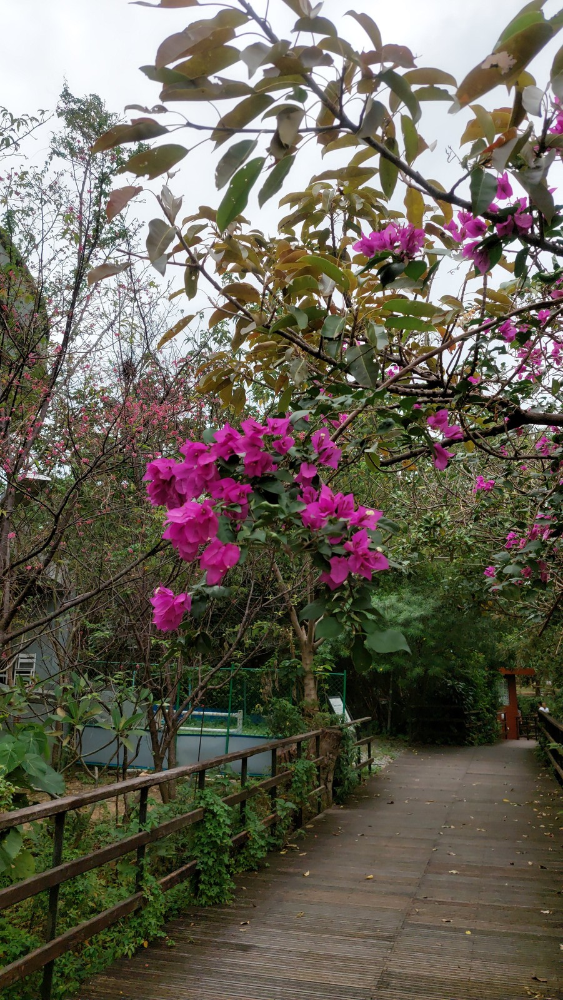
*▲ 劍潭山步道起點附近的木棧道，上方盛開著鮮艷的紫紅色九重葛花廊，伴隨著斑駁陽光，開啟舒心的山林慢旅。*

清晨與上午的陽光穿透花葉縫隙，在木棧踏板上灑落斑駁的光影。這裡不僅是附近居民散步晨運的起點，也是旅人洗去都市喧囂的第一道清新風景。

---

## 🏞️ 第二章 登高遠眺：劍潭山稜線步道與台北盆地全景

穿過起點的花廊後，步道順著山勢緩緩攀升。劍潭山作為五指山山脈向西南延伸的前哨山頭，雖然海拔僅有約 153 公尺，但因前方地勢開闊，稜線上的視野展望極其遼闊。

步道兩側林相茂密，相思樹、構樹與竹林隨風搖曳。行至稜線高處的視野開口，整座大台北盆地的壯麗風光瞬間在眼底豁然展開！

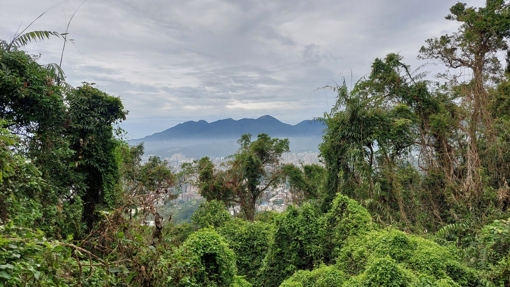
*▲ 登上劍潭山稜線高處展望點，視野極度遼闊，大台北盆地、基隆河、淡水河與遠方連綿的山巒在藍天白雲下展開壯闊畫卷。*

從稜線向西與向北俯瞰，基隆河與淡水河在社子島尖端交會，後方聳立著輪廓優美的觀音山與大屯山系群峰。蜿蜒的河道在晨光下波光粼粼，都會樓宇與綠意水岸相互輝映，讓人頓時心曠神怡，深深驚嘆於台北這座依山傍水的盆地之美。

---

## 🪨 第三章 經典地標：老地方觀景平台與「老地方」台灣石碑

順著山脊稜線繼續前行，微風漸漸變得清勁，眼前出現熱鬧的遊客人潮，這裡便是整條步道人氣最旺的超級焦點——**「老地方觀景平台」**。

*▲ 老地方觀景平台旁最著名的標誌性巨石，上頭雕刻著台灣地圖輪廓與「老地方 2008.11.1」，是所有到訪山友必拍的經典打卡點。*

「老地方」這個親切的名字由來十分接地氣。據傳在早年步道尚未經過市府大規模整建前，這裡就是幾位熱心山友每天清晨爬山相約喝茶、泡咖啡、聊天聊八卦的固定落腳處。「明天早上老地方見！」這句話傳著傳著，久而久之就成了這處平台的正式代稱。

在突出懸崖的木棧觀景平台旁，最著名的打卡標誌就是這塊刻有台灣地圖圖案與「老地方 2008.11.1」的天然巨石。凡是造訪劍潭山的旅人，必定會在此駐足拍照留念。

*▲ 許多健行愛好者在此駐足留影，背後即是突出的木棧平台與一望無際的城市遠景，迎著山頂清爽的涼風格外愜意。*

站在老地方突出於懸崖峭壁之上的鋼構木棧平台上，極目遠眺台北天際線，大直橋橫跨基隆河，遠方的大直與內湖商圈歷歷在目。吹著山頂的陣陣涼風，所有的疲累瞬間煙消雲散。

---

## 🛡️ 第四章 冷戰記憶：隱身林間的軍事要塞崗哨與輸電鐵塔

欣賞完老地方的遼闊景致，沿著步道深處漫行，周圍的氛圍悄悄轉化為帶著神秘感的歷史走廊。

老一輩的台北人都知道，在戒嚴時期，劍潭山是台北市戒備最森嚴的軍事要塞之一。由於後方緊鄰蔣中正總統居住的士林官邸，地下深處更坐落著國防最高作戰指揮樞紐——衡山指揮所與圓山指揮所。在長達數十年的戒嚴年代裡，這裡被列為絕對軍事管制禁區，一般平民百姓嚴禁擅入。

如今軍事管制早已解除，昔日荷槍實彈的防衛陣地卸下了沉重防線，斑駁的衛兵崗哨靜靜佇立在綠竹與灌木林間，化作見證歷史變遷的珍貴活教材。

*▲ 昔日拱衛要塞的8號崗哨，厚實的水泥牆體與斑駁迷彩鐵皮頂蓋，忠實記錄著戒嚴時期的歷史痕跡。*

步道旁的**「8號崗哨」**保存相當完整，厚實的水泥掩體外覆蓋著遮蔽風雨的迷彩鐵皮頂蓋；再往前行，綠竹林深處則矗立著**「7號崗哨」**，水泥牆面以白漆清晰標記著大大的數字「7」，讓人依稀能感受到當年衛兵肅穆站崗的森嚴氣氛。

*▲ 掩映在翠綠竹林間的7號衛兵崗哨，牆上漆著醒目的白字「7」，如今硝煙散盡，已化為山林間的尋幽亮點。*

除了歷史崗哨，山脊步道旁還能仰望巍峨挺立的高壓輸電鐵塔。巨大的鋼構桁架穿越林梢直入藍天，在陽光照耀下展現出剛勁強烈的人工幾何美感，與周圍柔軟的竹林枝葉形成鮮明對比。

*▲ 步道旁的高壓輸電鐵塔基座，巨大的鋼構桁架穿越林梢直入雲霄，是劍潭山稜線步道上極具視覺張力的地景。*

行至主要岔路口，立有一座指示清晰的木質導覽標牌，清楚指引著通往「劍潭山稜線步道（約0.2km，10分鐘）」與「中山北路五段282巷／復興電台（約0.5km，15分鐘）」的步行距離，為來往山友提供明確的路徑指引。

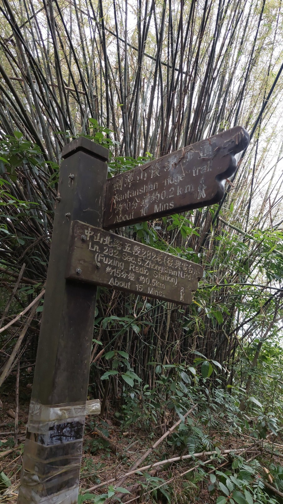
*▲ 步道交叉口的木質指標，清楚標示通往「劍潭山稜線步道」與「中山北路五段282巷（復興電台）」的方向與步行時間。*

---

## 🌿 第五章 自然野趣：沙包麻布泥土山徑與虯曲九芎老樹

暫別主線的水泥石階，步道進入一段保留原始泥土風貌的山林小徑。為了防止下雨泥濘濕滑與土壤流失，路面特別以沙包與粗麻布袋整齊鋪設，踩踏感柔軟吸震，極具自然野趣。

*▲ 保留泥土山徑原貌的步道路段，鋪設著防滑吸震的沙包與麻布，走在林間踏實舒適，充滿走入大自然的質樸野趣。*

在質樸的林道旁，最令人駐足讚嘆的植物當屬這棵樹形優美的**「九芎樹」**。九芎是台灣原生落葉喬木，樹幹質地堅硬，樹皮會年年剝落而呈現出紅褐色且極為光滑細膩的觸感，滑溜到連善於爬樹的猴子都抓不住，因此在民間又被戲稱為「猴不爬」。

*▲ 步道旁引人注目的九芎老樹（俗稱猴不爬），紅褐色的光滑樹皮與分叉虯曲的枝幹，展現出亞熱帶森林強韌的生命力。*

這株九芎老樹的分枝虯曲如蒼龍探海，在周圍茂密綠葉的簇擁下顯得格外挺拔遒勁，是整座山林生態多樣性中極富生命力的自然焦點。

---

## 🏙️ 第六章 現代新地標：微風平台、北眼平台與俯瞰台北表演藝術中心

沿著稜線步道往西側前進，景致迎來近年圓山風景區最受矚目的全新地標——**「微風平台」**與**「北眼平台」**！

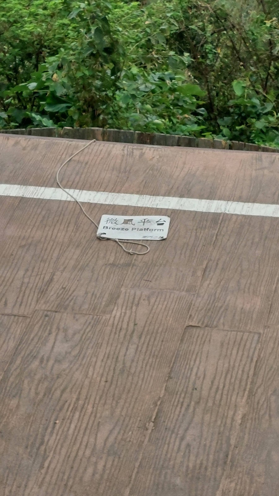
*▲ 觀景木棧道上的白色銘牌「微風平台 Breeze Platform」，是近年圓山風景區極受歡迎的全新休憩據點。*

台北市政府工務局大地工程處在此處規劃修築了平整舒適的高架木棧平台。順著木棧階梯登上微風平台，迎面而來的是一場現代都市建築與自然山林的視覺盛宴！

居高臨下俯瞰正下方，士林最震撼的世界級地標——由國際普立茲克建築獎得主雷姆·庫哈斯（Rem Koolhaas / OMA）操刀設計的**「台北表演藝術中心（北藝中心）」**巨型建築群就在眼前！

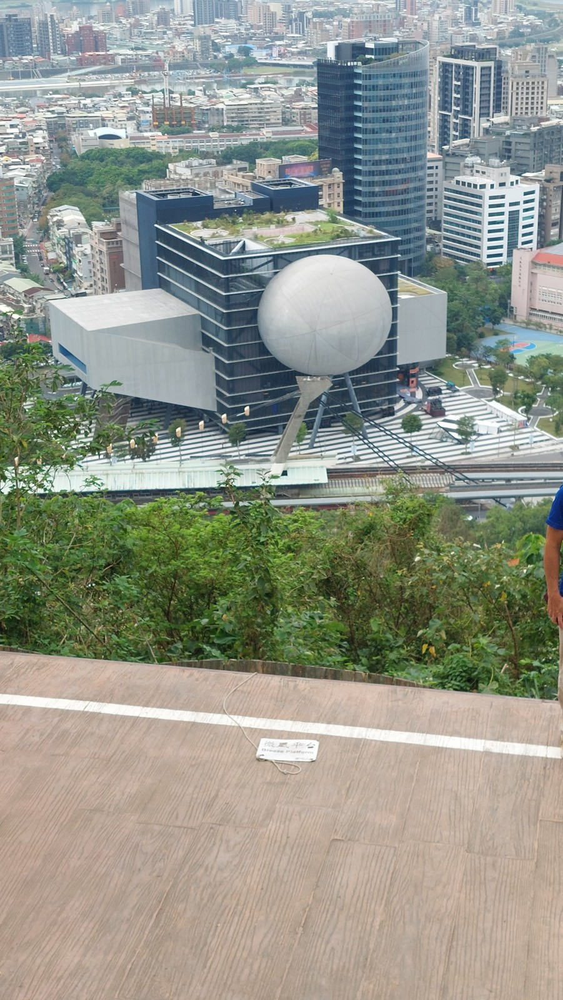
*▲ 從微風平台居高臨下俯瞰，台北表演藝術中心標誌性的巨型球體建築「貢丸」清晰可見，後方連接著捷運劍潭站與繁華的士林市街。*

最吸睛的莫過於那顆懸浮在半空中、被台北市民親切戲稱為「巨型貢丸」或「皮蛋」的大劇院球體建築，銀灰色的流線造型在綠意襯托下極具未來科幻感。視線向後延伸，捷運淡水信義線的高架軌道如長龍橫貫，劍潭站獨特的龍舟造型站體與士林車水馬龍的繁華街景一覽無遺。

而在微風平台旁，更有造型獨具一格的**「北眼平台」**。一座純白流線造型的半圓拱門觀景座向前延伸，猶如一只凝視台北都會的巨大眼睛。

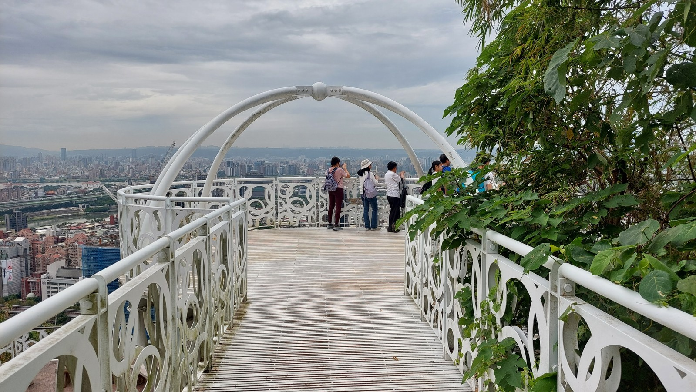
*▲ 北眼平台別具巧思的白色流線造型拱門，猶如一只望向都會的眼睛，在此遠眺夕陽與城市天際線，視野極度遼闊壯觀。*

站在北眼平台的白色拱門前，遠眺淡水河與社子島方向，清爽的山風拂面而過，純白極簡的現代線條與藍天都會相映成趣，難怪一開幕便迅速成為社群網路上爆紅的拍照打卡聖地！

---

## 🎨 第七章 在地人文情懷：童趣卡通彩繪、早起會健身房與偶遇山貓

劍潭山不僅是一座富含自然景觀與歷史底蘊的名山，更是幾十年來台北市民生活文化密不可分的一部分。沿途隨處可見山友們共同營造的溫馨角落，散發著濃厚的人情味。

在一段石階下坡路旁，擋土牆上驚喜出現了一整面手繪童趣彩繪牆！小熊維尼、小豬皮傑、布魯托與米老鼠在翠綠的森林背景中開心微笑，色彩明亮生動。

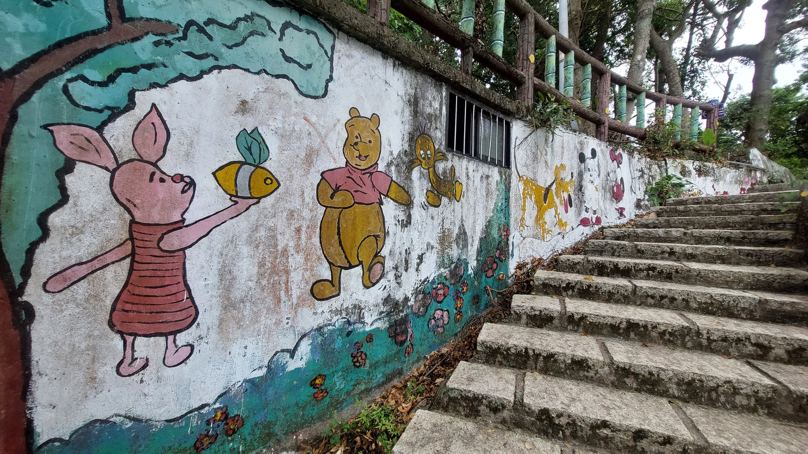
*▲ 步道石階旁的擋土牆上，手繪著生動可愛的小熊維尼、小豬皮傑與米老鼠等卡通角色，為幽靜山徑帶來溫暖歡樂的童趣色彩。*

這面彩繪是由在地的熱心山友利用閒暇時間精心手繪維護，讓原本單調冰冷的水泥牆面化作童話森林，無論是大朋友還是小朋友走過，嘴角都會忍不住泛起一抹會心的微笑。

繼續前行，耳邊傳來陣陣金屬碰撞聲與山友間爽朗的笑聲。轉個彎，眼前赫然出現一座隱身於樹蔭下的**「早起會露天健身房」**！

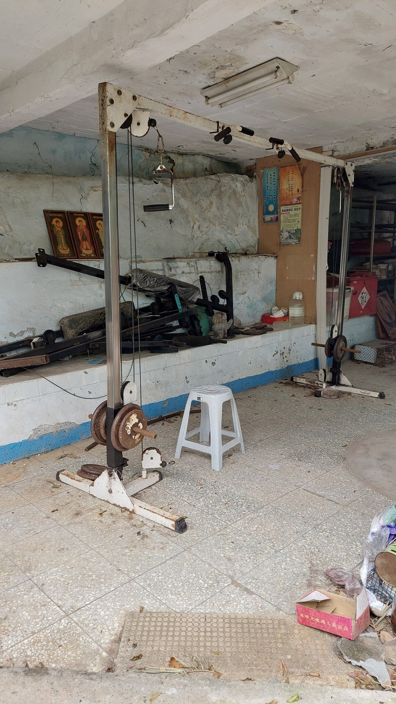
*▲ 步道旁的早起會露天體能運動場，槓鈴、滑輪拉力器材與舉重設備一應俱全，展現台北市民風雨無阻的晨運活力。*

這是老台北人獨特的「山林健身文化」。早起會山友們發揮巧思，在茂密樹下自建了滑輪下拉機、舉重槓鈴、啞鈴與單槓等全套健身器材。數十年如一日，許多長輩每天清晨五點便準時報到鍛鍊體魄，精神抖擻的活力絲毫不輸給年輕人！

露天健身場旁立有一根紅磚立柱，上頭以楷書端正題著**「喜樂早樂會」**五個大字，見證著山友們數十年來自發修築步道、維護環境、互道早安的深厚情誼。

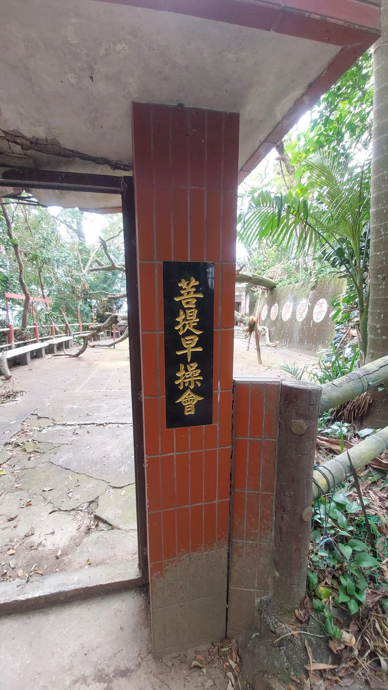
*▲ 佇立在步道旁的「喜樂早樂會」紅磚立柱，記錄著山友們數十年來自發維護步道環境、互道早安的深厚情誼。*

除了熱情友善的山友，劍潭山也是許多可愛毛小孩的樂園。在步道旁的石階駁坎上，一隻毛色斑斕的親人小山貓正悠閒地趴著曬太陽。

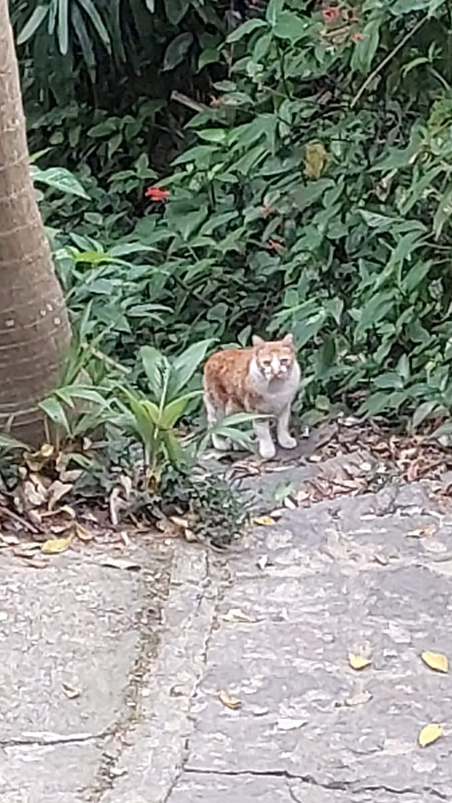
*▲ 趴在步道石階駁坎上愜意曬太陽的山林小貓，性情溫馴不怕生，眼神靈動地望著往來山友，成為健行途中的療癒驚喜。*

這隻小貓咪性情溫和安詳，面對路過遊客的拍照與注視完全不害怕，靜靜地微瞇著雙眼享受微風吹拂，為這趟健行巡禮增添了一抹暖心而治癒的小確幸。

---

## 🚶‍♂️ 第八章 賦歸：順著仿竹石階下山，重返城市節奏

造訪完早起會聚落，步道進入最後的下山路段。順著綠色仿竹節造型欄杆的石階步道拾級而下，山勢陡降，穿過交錯的樹冠枝葉，前方隱約可見士林繁華的街景樓宇。

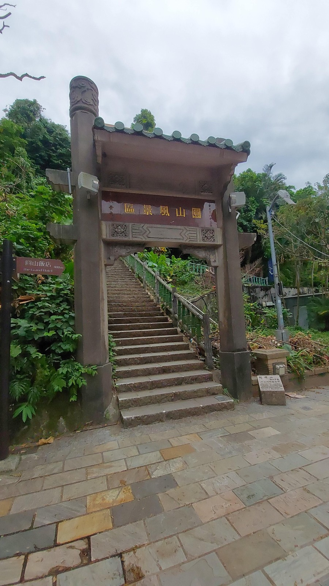
*▲ 沿著綠色仿竹節欄杆石階步道拾級而下，林蔭外隱約可見士林繁華街景，輕鬆步行即可重返捷運劍潭站。*

這段下山步道階梯鋪設平整穩固，兩側綠竹造型扶手提供了安全的支撐。緩步下行約十分鐘，山林的綠意漸漸融入都市的車流聲，我們順利接回中山北路，重返熱鬧的捷運劍潭站商圈。

這趟劍潭山親山慢旅，從浪漫的九重葛花廊、開闊的盆地群山稜線、熱門的老地方巨石地標，到深具歷史厚度與神秘感的戒嚴軍事崗哨；再從前衛摩登的北眼與微風平台俯瞰北藝中心建築巨球，到洋溢著人情溫度的童趣彩繪牆與早起會健身聚落——短短半天的步行旅程，竟濃縮了台北這座城市跨越數十載時空的多元魅力！

---

## 💡 劍潭山親山健行實用資訊指南 (Traveler Tips)

1. **交通方式**：搭乘台北捷運淡水信義線（紅線）至「劍潭站」2號出口，出站後沿中山北路往南步行約 3~5 分鐘即可抵達圓山風景區登山口。
2. **步道難易度**：★★☆☆☆（新手與家庭長輩友善），全長約 3.5 ~ 4 公里環線，大部分路段為鋪設完善的洗石子石階與高架木棧道，緩步漫遊含拍照休息約需 2 ~ 2.5 小時。
3. **最佳拍照時刻**：
   - **上午 09:30 至 11:30**：順光拍攝劍潭山稜線步道與大台北盆地全景，老地方觀景平台視線清新通透。
   - **下午 15:30 至 17:00**：造訪微風平台與北眼平台，夕陽斜照淡水河口與社子島水岸，金色餘暉灑落北藝中心球體建築，畫面極為迷人。
4. **裝備建議**：穿著防滑輕便運動鞋或健行鞋，攜帶 500~800ml 飲用水與防蚊液。部分階梯稍有坡度，長輩同行可隨身攜帶輕便登山杖輔助。
