如果你問一個週末只想躺平耍廢的台北社畜：「走！今天帶你去爬山，順便站在山壁上看飛機從你頭頂呼嘯而過、再去廢棄軍事碉堡尋幽探秘兼拍美照！」  
對方的第一反應大概是眼神死並反問你：「你是不是嫌平日在辦公室被主管電得不夠慘，假日還要自虐去爬百岳揮汗如雨？」

先等等！把你的登山杖和防風雨大背包放下。今天我們要介紹的這條路線，堪稱是全台灣「投資報酬率最高、交通最親民、風景最震撼」的都市隱藏版神級步道——**台灣小百岳編號第009號：劍潭山親山步道 ＆ 老地方觀機平台**！

這裡海拔只有短短的一百五十幾公尺，但步道裡隱藏的故事與視覺震撼，卻足足橫跨了三百多年的時空隧道：
- 你腳下踩的，曾是傳說中鄭成功拔寶劍降伏水怪的「神劍之潭」；
- 濃密綠蔭下的古樸石階，曾是日治時期全台灣最崇高的「台灣神社」表參道；
- 密林深處隱現的斑駁碉堡與衛兵崗哨，曾是戒嚴時期拱衛士林官邸與中樞要塞的神秘禁區；
- 登上稜線突出山壁的木棧平台，正對著松山機場跑道，一架架民航客機就在你眼前劃破天際低空降落，後方更襯著基隆河大直橋與台北101！

今天就讓我們拋開工作的繁雜瑣事，循著實地探訪的時間軸，一起走入這趟充滿歷史人文、軍事神秘感與飛機震撼視野的台北慢活輕旅行吧！

---

## 🎬 實境影片全紀錄（1080p 16:9 長輩友善大字幕全彩導覽版）

本次遊記同步製作了高規格 Full HD 16:9 雙語導覽影片，特別為中高齡長輩與家庭觀眾進行工效學視聽優化：配置 **5秒醒目景點標題圖卡**、**超大字體平緩向上捲動的歷史文化背景圖卡**、**edge-TTS 語音即時同步朗誦**，以及無標點干擾的高辨識度中英雙語大字幕，並混搭清爽柔和的免版權旅遊木吉他旋律。



*▲ 點擊播放即可全螢幕欣賞 1080p 高畫質導覽影片，影片支援完整章節快轉與精準時間戳記。*

---

## 🌲 第一章 綠意神道啟程：圓山風景區登山口與劍潭公園

### 1. 水怪傳說與日治神社的神聖參道

步道的起點座落於台北市士林區中山北路四段的劍潭公園旁。一走出捷運劍潭站，只要步行不到五分鐘，這片鬱鬱蔥蔥的蒼翠山林就迎面而來。

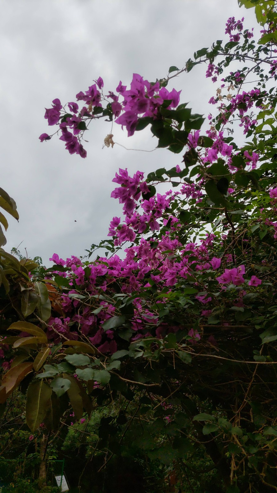
*▲ 位於中山北路旁的劍潭公園登山口，寬敞平緩的洗石子階梯兩側綠意盎然，是台北市民晨運散步的最愛。*

「劍潭」這個地名其實大有來頭。相傳在明鄭時期（西元1662年），延平王鄭成功親自領兵北征，部隊渡過淡水河來到此處時，潭中突然有水怪掀起滔天巨浪企圖阻礙行軍。鄭成功當機立斷拔出隨身佩戴的寶劍，猛力拋擲入水中直刺水怪心臟，水怪瞬間被降伏，潭水回復平靜，而那把沉入潭底的寶劍在月圓之夜還會隱隱發光，「劍潭」之名自此傳頌數百年。

到了日治時代，日本台灣總督府在劍潭山南麓興建了全島規格最高的神社——「台灣神社」（即現今圓山大飯店所在地）。現在我們所行走的這段林蔭步道，早年正是神職人員與信眾參拜神社的重要表參道之一。

*▲ 沿著昔日參道階梯緩步拾級而上，古樹參天、鳥語花香，完全感受不到山腳下中山北路川流不息的車水馬龍。*

---

## ✈️ 第二章 凌空咆哮的震撼：老地方觀機平台與劍潭山稜線

### 1. 山友的秘密茶席與270度超廣角台北盆地

順著山脊稜線一路向上前行，微風漸漸變得清涼，眼前突然豁然開朗，映入眼簾的正是整座步道人氣最旺的超級焦點——**「老地方觀機平台」**！

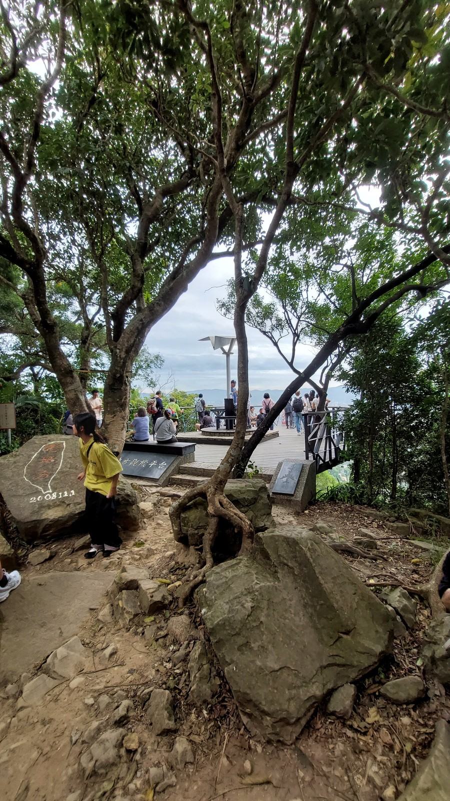
*▲ 突出於懸崖峭壁之上的老地方觀機平台，擁有無死角的270度環景展望，台北盆地的壯麗天際線在此一覽無遺。*

「老地方」這個名字非常接地氣。據說早年劍潭山步道尚未經過市府大規模整建前，這裡就是幾位熱心山友每天清晨爬山相約喝茶、泡咖啡、聊天聊八卦的固定落腳處。「明天早上六點老地方見！」這句話說著說著，久而久之就成了這處平台的正式代名詞。

後來台北市政府工務局大地工程處在此修建了突出的鋼構木棧觀景台，前端更別出心裁地設計了一座銀白色的飛機螺旋槳造型地標雕塑，象徵著這座平台與飛機起降的深厚羈絆！

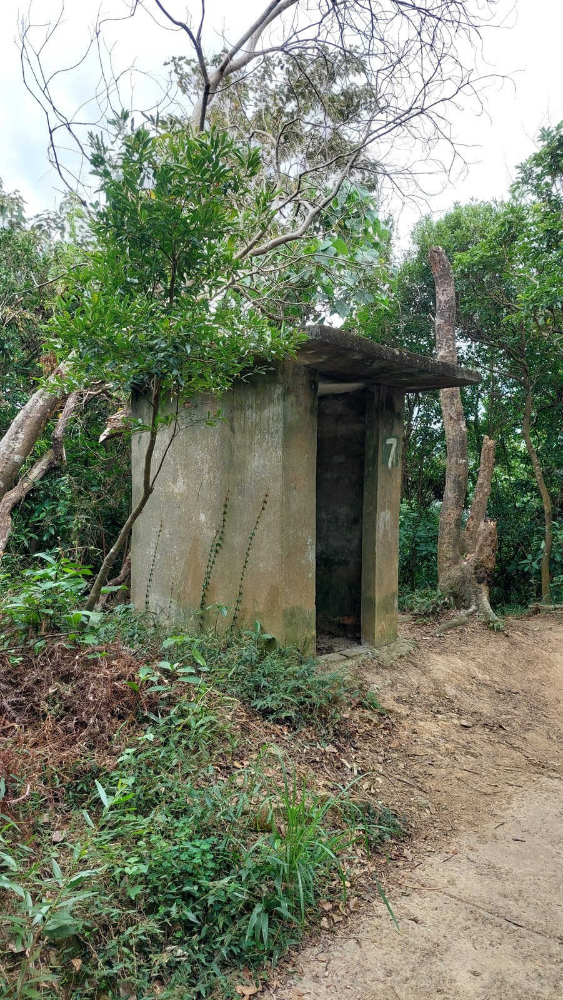
*▲ 平台前端醒目的飛機螺旋槳造景，是每位到訪遊客必拍打卡的招牌亮點。*

### 2. 松山機場跑道直球對決！低空掠過的感官震撼

站在老地方觀機平台前端，你的正前方就是**台北松山機場（RCSS / TSA）**的跑道與基隆河！

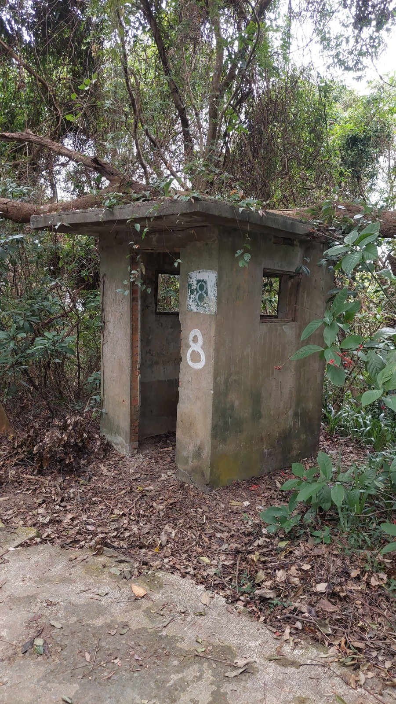
*▲ 居高臨下俯瞰松山機場跑道，可以清晰看見滑行道上的引導地勤車輛與等待起飛的客機。*

每當有國內線或國際航班準備降落松山機場時，巨大機身會順著基隆河谷的進場航道緩緩降低高度，以極近的距離從觀機平台前方滑翔而過！發動機低沈渾厚的渦輪轟鳴聲在山谷間激盪迴響，視覺與聽覺的雙重衝擊讓人忍不住熱血沸騰！

而在跑道後方，紅色斜張橋身的大直橋優雅橫跨河面，遠方信義區的**台北101摩天大樓**與象山山脈更宛如畫卷般矗立在藍天白雲之下。

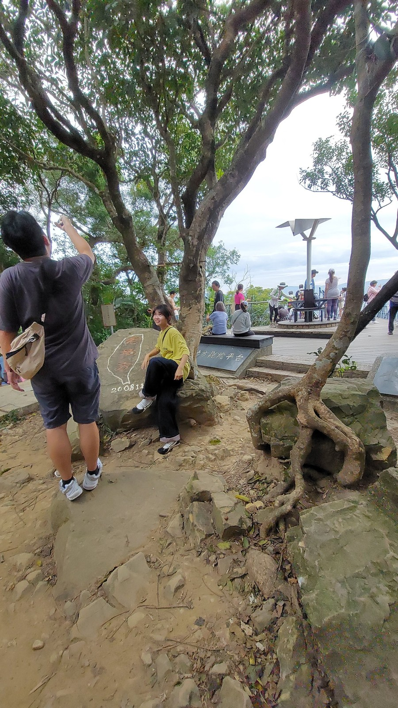
*▲ 基隆河蜿蜒如帶，大直橋與遠方的台北101地標相互輝映，視野壯麗非凡。*

---

## 🛡️ 第三章 走進冷戰時空隧道：毋忘在莒步道與戰地碉堡巡禮

### 1. 戒嚴要塞核心：神秘的軍事禁區與圓形哨所

欣賞完精彩的客機降落表演，順著步道往西側深處探尋，周圍的景致悄悄轉變為充滿歷史滄桑感的軍事歷史走廊——**「毋忘在莒步道」**。

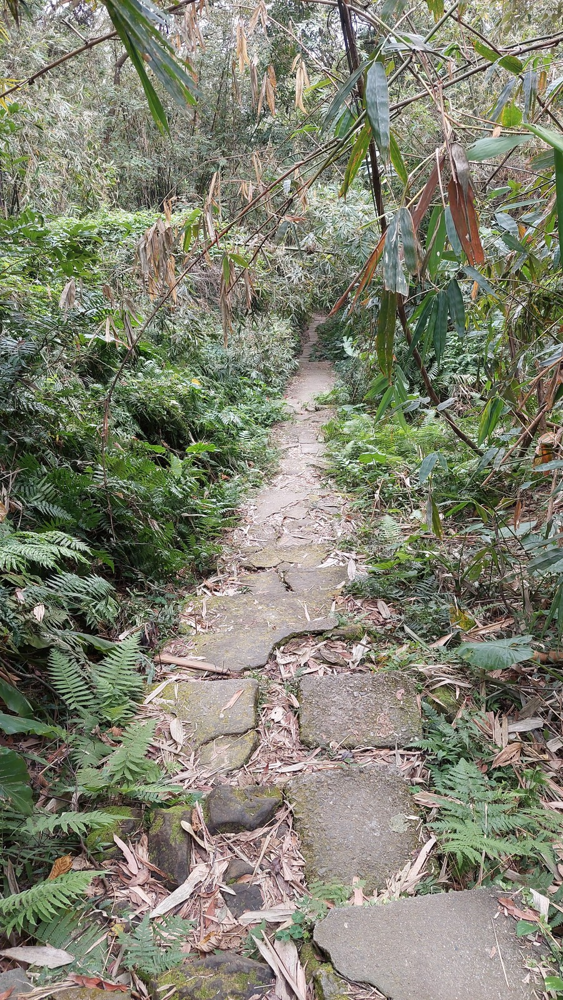
*▲ 隱身於翠綠山林間的天然巨石，鐫刻著剛勁有力的「毋忘在莒」紅色大字，記錄著那個動盪年代的精神象徵。*

老一輩的台北人都知道，在民國四十年代至七十年代的戒嚴時期，劍潭山是全台灣戒備最森嚴的軍事重地之一。因為它的後方緊鄰蔣中正總統居住的**士林官邸**，地下深處更貫穿著國家級作戰指揮樞紐——**衡山指揮所**與**圓山指揮所**。

在長達數十年的歲月裡，一般老百姓如果膽敢隨意闖入這座山頭，可是會被荷槍實彈的衛兵立刻鳴槍警告的！山脊上密密麻麻地配置了防空火砲陣地、機槍掩體、地下通道與衛兵排哨。

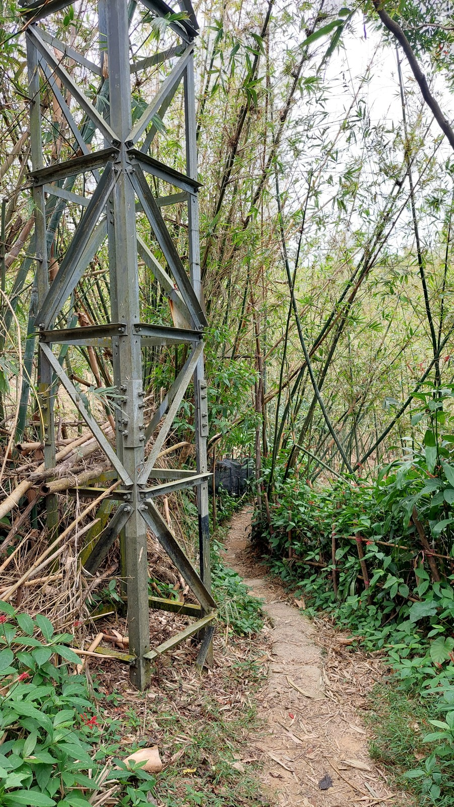
*▲ 矗立在步道旁的圓形石造衛兵哨所，厚實的水泥牆體與射擊槍眼依然保存完整。*

沿途隨處可見以粗獷石塊砌築的圓形崗哨與鋼筋混凝土掩體。如今軍事管制早已全面解除，昔日肅穆緊繃的戰備巡邏道，已經成為市民假日健行、孩童觀察昆蟲的歡樂綠色步道，斑駁的水泥牆面上爬滿了青苔，讓人深刻體會到和平歲月的珍貴。

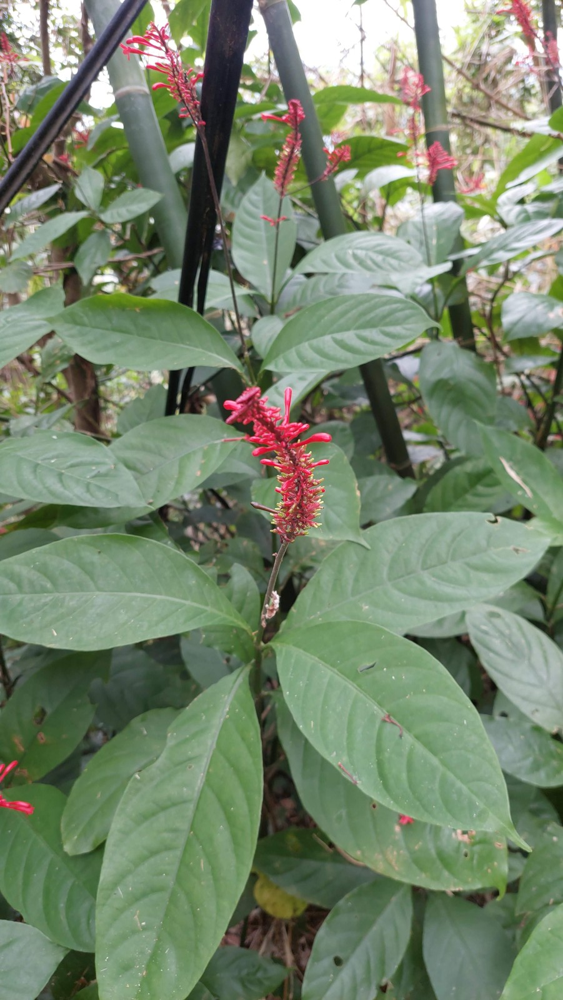
*▲ 昔日戒備森嚴的軍事掩體，如今靜靜隱身在山林綠意之中，成為見證歷史的活教材。*

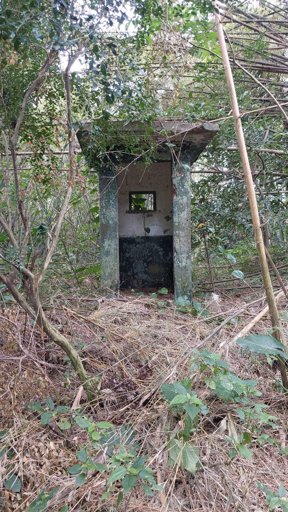
*▲ 過去憲兵荷槍實彈巡邏的戰備走廊，現在鋪設成平坦舒適的親山步道。*

---

## 🌅 第四章 登高望遠天地寬：圓山觀景木棧道與高處觀景台

### 1. 台灣小百岳第009號：圓山十美的自然生態巡禮

繼續沿著主線步道漫遊，劍潭山名列「台灣小百岳編號第009號」，雖然海拔不高，但動植物生態卻極為豐富多樣。台北市政府在此特別規劃了著名的**「圓山十美」**，將沿途自然林相與景觀平台串連成一條景致多變的風景線。

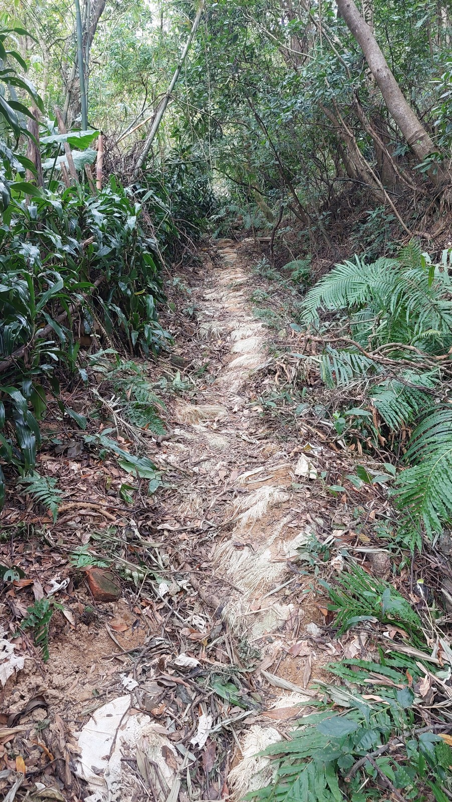
*▲ 依山勢修築的景觀木棧步道，走起來舒適不傷膝蓋，非常適合帶長輩與全家同樂。*

穿過中央廣播電台高聳矗立的白色鋼構廣播發射鐵塔，步道來到視野極佳的高處觀景平台。

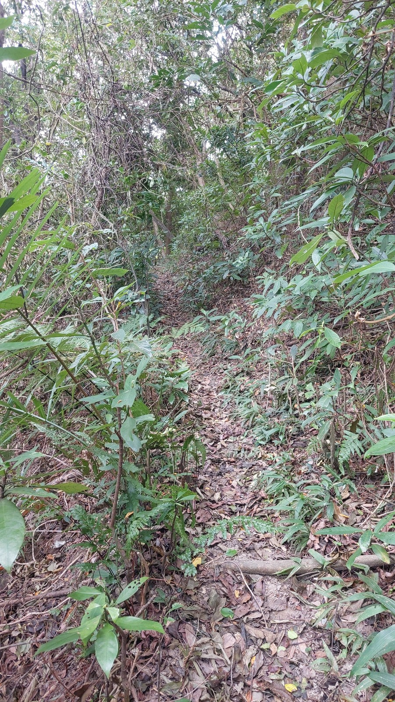
*▲ 高聳入雲的廣播發射鐵塔，在湛藍晴空下格外壯觀。*

### 2. 向西遠眺觀音山秀麗山容與社子島夕陽水岸

站在向西面的觀景平台上，台北都會的水系風貌展現了截然不同的柔美面貌：

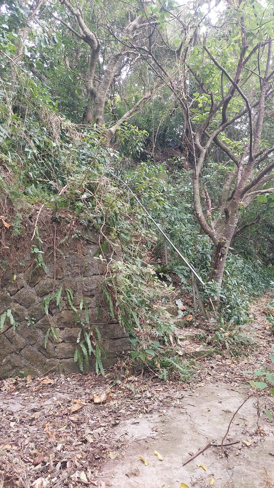
*▲ 隔著淡水河向西遠眺，挺拔的觀音山輪廓如同一尊安詳仰臥的天然菩薩。*

往西北方向望去，淡水河與基隆河在社子島尖端交會，寬廣的河道在陽光照耀下波光粼粼。紅色的重陽大橋如長虹臥波般跨越河面，連接著台北市士林區與新北市三重區。

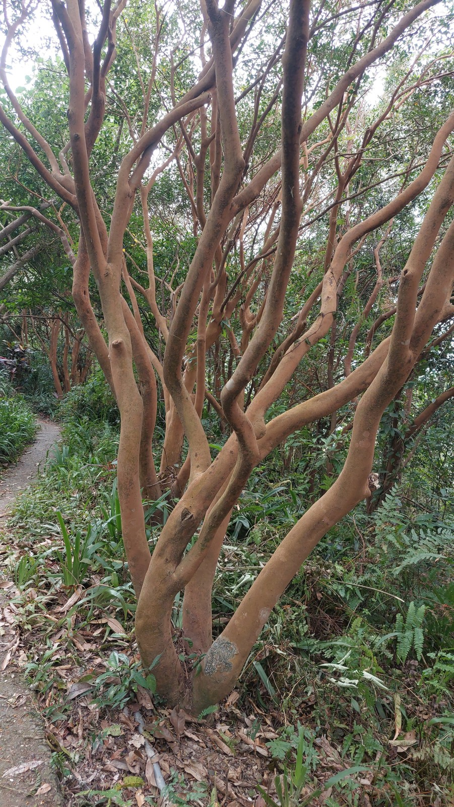
*▲ 社子島綠意盎然的田園濕地與重陽大橋的優美鋼纜相互交織，水岸風光開闊舒暢。*

*▲ 陽光灑落林蔭步道，微風吹拂下滿滿都是森林芬多精的清新香氣。*

---

## 🏛️ 第五章 宮殿神話的現代轉折：圓山大飯店後山步道與捷運出口

### 1. 近距離仰望14層宮殿式建築的巍峨風華

當步道逐漸進入尾聲、開始沿著石階緩緩下山時，整趟旅程的壓軸文化地標——**「台北圓山大飯店」**便近在眼前！

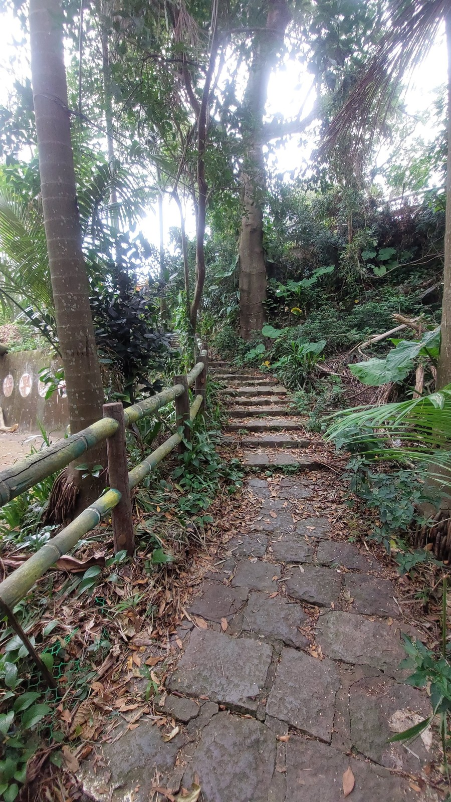
*▲ 穿過後山林蔭小徑，宏偉的圓山大飯店十四層宮殿式主樓近在眼前，紅柱金瓦氣勢磅礴。*

圓山大飯店創立於民國四十一年（西元1952年），是由前第一夫人蔣宋美齡女士親自拍板興建，是全台灣第一座十四層樓高的特級國際飯店。整座建築融合了北方宮殿式屋頂、重簷歇山頂、七彩繪樑、飛簷斗拱與數以萬計的精緻金龍雕刻，過去曾接待過美國前總統艾森豪、泰國國王蒲美蓬等無數國際元首政要。

從後山林蔭步道下山，能以一般遊客罕能體驗的近距離視角，由下而上仰望這座氣派非凡的東方建築瑰寶。

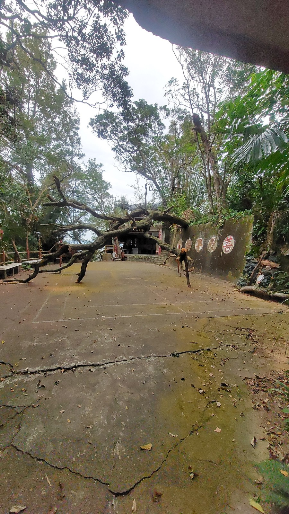
*▲ 幽靜的後山石階步道兩旁樹木扶疏，空氣中瀰漫著古樸典雅的歷史氛圍。*

順著階梯漫步而下，短短十幾分鐘就重新接回捷運劍潭站的繁華市街，為這趟兼具歷史文化底蘊、戰地要塞探秘與無敵景觀展望的台北親山漫旅，劃下了最充實而愜意的句點！

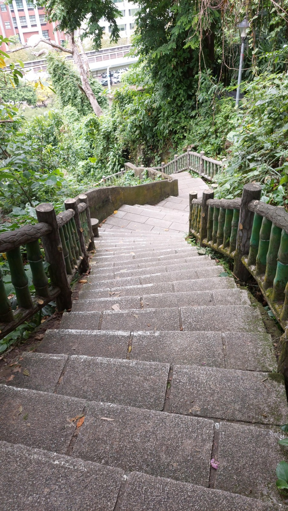
*▲ 走出登山步道口隨即回到熱鬧的捷運劍潭商圈，輕鬆無負擔地完成這趟健行巡禮。*

---

## 💡 劍潭山親山健行實用資訊指南 (Traveler Tips)

1. **交通方式**：搭乘台北捷運淡水信義線（紅線）至「劍潭站」2號出口，步行約 3~5 分鐘即可抵達中山北路四段劍潭公園登山口。
2. **步道難易度**：★★☆☆☆（新手與長輩友善），全長約 3.5 公里，全程均為鋪設完善的洗石子石階與木棧道，緩步漫遊約需 2 ~ 2.5 小時。
3. **最佳拍照時刻**：推薦上午 10:00 至 12:00（順光拍攝松山機場客機起降與大直橋），或傍晚 16:30 至 17:30（登上觀景台欣賞觀音夕照與重陽橋水岸落日）。
4. **裝備建議**：輕便球鞋或健行鞋、防蚊液、防曬帽、500ml 飲用水。老地方觀機平台風勢較大，建議攜帶薄風衣。
