如果你跟身邊的朋友說：「走，這個週末我們去污水處理廠散步約會、看夕陽兼拍美照！」  
十個朋友裡大概有十一個會皺起眉頭問你：「你是不是被生活毒打到神智不清，還是程式寫太多邏輯死掉了？」

但事實上，在台北市內湖區舊宗路二段與南京東路六段交會的水岸地帶，藏著兩處堪稱「空間時間管理大師」的驚艷景點：
第一處是**巧妙建在內湖污水處理廠屋頂平台上方、佔地廣達 3.8 公頃的「內湖空中運動公園」**；
第二處則是**原為三陽工業舊廠區、如今蛻變為萬坪景觀生態湖畔與落羽松綠帶的「T-CBD 台北企業總部園區 ＆ 明美公園」**！

這裡不僅沒有半點傳統污水廠的異味，反而處處是青草香、極限滑板少年的帥氣迴轉、攀岩好手的肌肉線條，以及松山機場客機低空掠過頭頂的巨大震撼！今天就跟著這趟圖文影音雙語全彩漫步指南，一起走進這處台北都會人專屬的私房慢旅天地吧！

---

## 🎬 實境影片全紀錄（1080p 16:9 長輩友善大字幕全彩導覽版）

本次遊記同步製作了 Full HD 寬螢幕雙語影片，特別加入 **5秒醒目景點圖卡**、**超大字體平緩向上捲動的歷史文化背景解說**，以及 **TTS 語音即時朗誦**，搭配 NoCopyrightSounds (NCS) 輕快免版權旅遊背景音樂，長輩在手機或客廳電視大螢幕上都能輕鬆觀看！

  <iframe src="https://www.youtube.com/embed/ZLREH3fK8cg" style="position: absolute; top: 0; left: 0; width: 100%; height: 100%; border:0;" allow="accelerometer; autoplay; clipboard-write; encrypted-media; gyroscope; picture-in-picture; web-share" allowfullscreen title="台北內湖隱藏版水岸空中秘境遊記"></iframe>

*▲ 點擊播放即可全螢幕欣賞高畫質 1080p 導覽影片，影片右下角或說明欄支援完整景點章節快轉。*

---

## 🛹 第一章 空中萬坪綠意奇蹟：內湖運動公園與基隆河跨堤景觀

### 1. 空間魔法大師：污水處理廠頂樓的空中綠洲

位於台北市內湖區舊宗路二段2號的**「內湖污水處理廠」**，是全台灣首座採用半地下化大型二級生物處理的現代化污水廠。每天默默在地下處理大台北地區幾十萬噸生活污水，而在它堅實的鋼筋混凝土頂樓，台北市政府工務局衛工處展現了極致的空間再利用巧思——直接把頂樓 3.8 公頃的空地鋪滿綠草、跑道與球場，打造出這座宛如漂浮於半空中的大型運動休閒樂園！

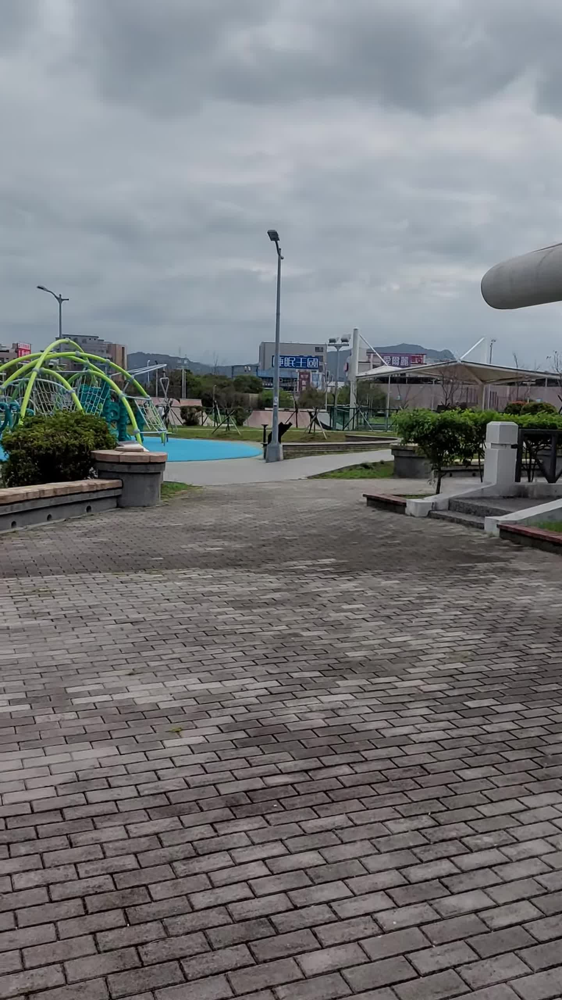
*▲ 沿著舊宗路入口處平緩的步道與充滿活力的彩繪階梯拾級而上，完全感受不到底下是座龐大的污水處理重鎮。*

當你沿著階梯或無障礙斜坡登上二樓，眼前的豁然開朗會讓你忍不住揉揉眼睛：藍天白雲底下是一整片平整如地毯般的綠茵大草坪，周圍點綴著熱帶棕櫚與整齊修剪的灌木叢，微風吹拂下滿滿都是陽光曬在草地上的清新香氣。

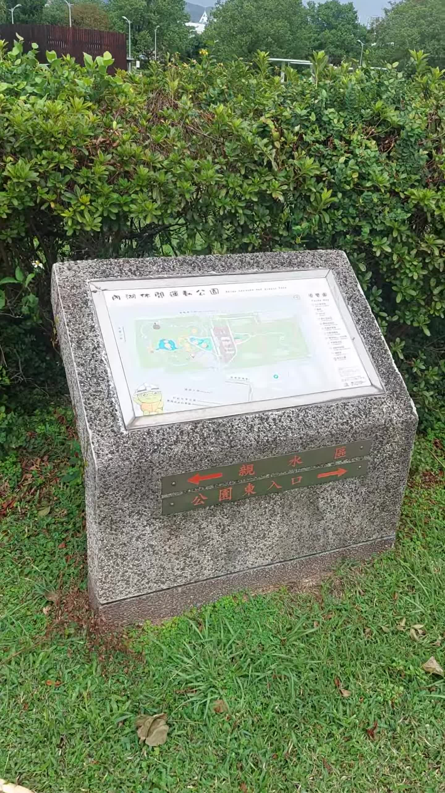
*▲ 宛如綠色地毯般的空中大草坪，是假日親子野餐、毛小孩奔跑與放空曬太陽的絕佳勝地。*

---

### 2. 台北101與松山機場低空賞機「搖滾區」

內湖運動公園之所以被許多內行航空迷列為不可告人的「私房打卡點」，原因在於它剛好正對著松山機場（TSA）的 10/28 跑道進場航路！每隔十幾分鐘，就能看見波音 737、空中巴士 A321 或 ATR72 雙螺旋槳客機自遠方天空低空進場，伴隨著低沉而澎湃的噴射引擎聲浪，以極其震撼的近距離掠過你的頭頂！

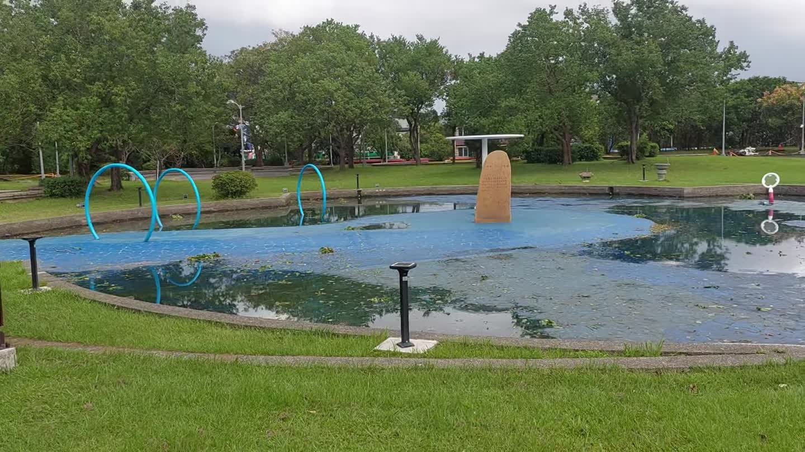
*▲ 站在觀景平台上向西南方遠眺，台北 101 與信義區都會摩天大樓在開闊天空下昂然挺立。*

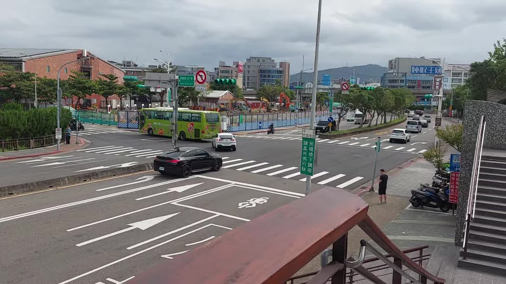
*▲ 躺在草坪上仰望藍天白雲，看著客機從頭頂轟隆呼嘯降落，是內湖專屬的療癒系日常。*

---

### 3. 跨越車流的跨堤景觀天橋：直通彩虹河濱公園

公園東南側設有一座現代感十足的弧形跨堤景觀陸橋。站在這座人行天橋頂部，腳下是台北車流動脈——環東大道快速道路與堤頂大道一段，看著底下密密麻麻如火柴盒般的汽車奔馳，再抬頭望向眼前寬闊靜謐的基隆河，形成極具張力的動靜對比。

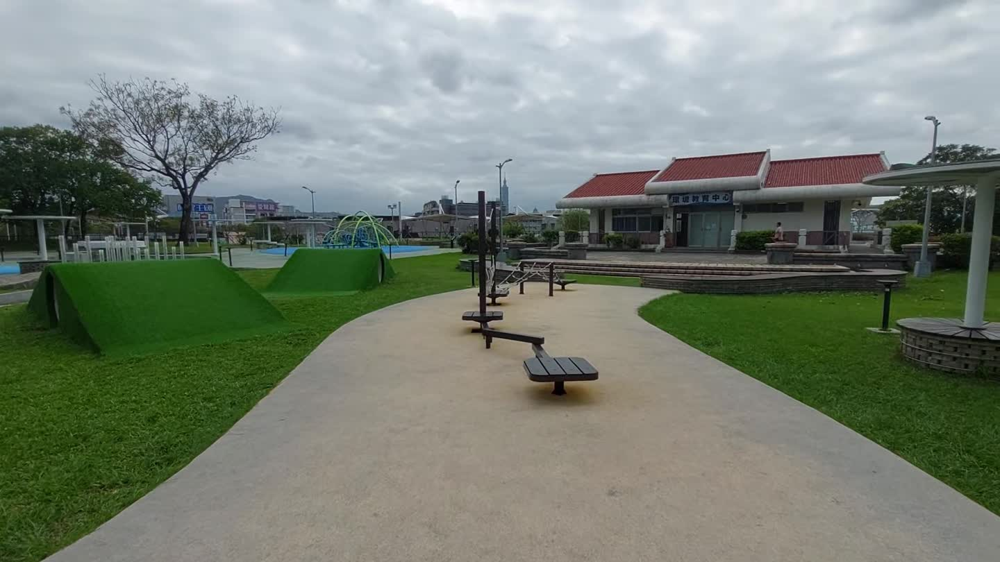
*▲ 壯觀的跨堤景觀陸橋，優雅跨越環東大道高架橋，無縫串聯基隆河右岸自行車道。*

跨堤天橋更直接連接至基隆河水岸。向遠方望去，黃色單拱造型的「麥帥一橋」與藍色雙層雙拱的「麥帥二橋」如長虹臥波般橫亙於碧綠水面上。午後時分，水波粼粼的河面在陽光照射下泛著金光，偶有水鳥在灘地悠閒覓食，讓人忘卻自己其實正置身於繁華喧囂的台北核心都會圈。

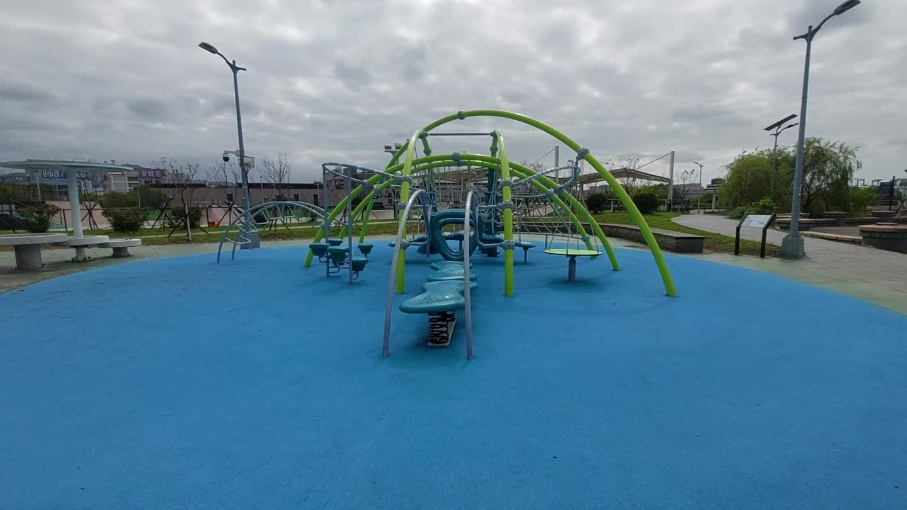
*▲ 水波粼粼的基隆河畔與麥帥一橋麥帥二橋，午後微風拂面令人心曠神怡。*

---

### 4. 極限運動場與天然攀岩壁：燃燒熱血的運動天堂

除了悠閒散步，內湖運動公園更是台北極限運動愛好者的聖地之一。這裡建有專業規格的水泥碗池（Bowl）與街式滑板道（Street Course），從初學者練習平衡到專業滑手的高難度跳躍，一應俱全。

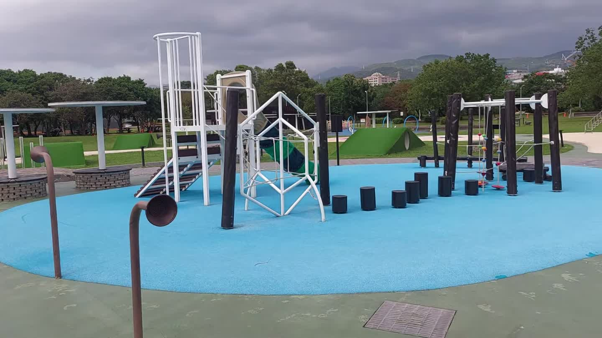
*▲ 設施完善的極限滑板場與環形彈性 PU 健走跑道，兼顧極限競技與全民健康健身。*

一旁更設有一座高達十幾米的戶外立體攀岩場，紅、黃、藍、綠各色岩塊在岩壁上規劃出不同難度的攀爬路線。不管是大小朋友挑戰自我，或是坐在遮蔭涼亭長椅上當個稱職的「吃瓜群眾」替攀岩好手鼓掌加油，都別有一番樂趣！

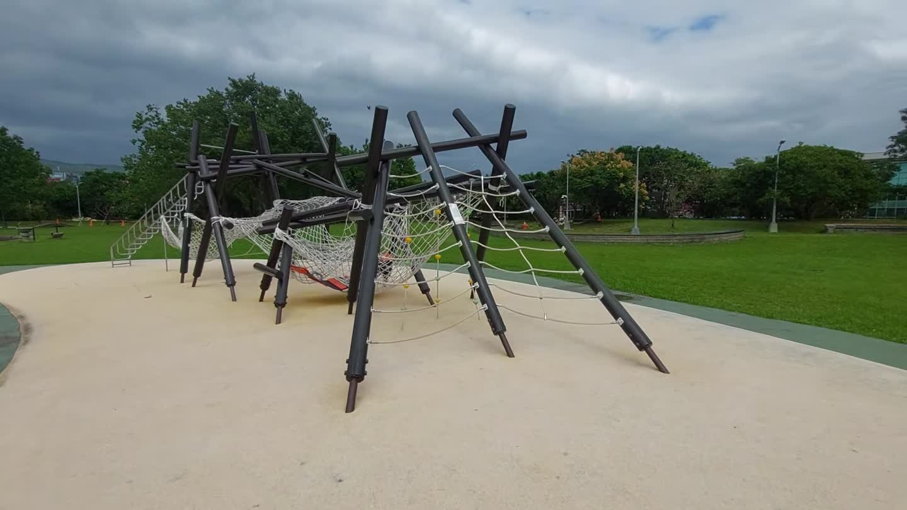
*▲ 色彩繽紛的戶外攀岩場岩壁，在藍天綠樹映襯下充滿了活力與挑戰氣息。*

---

## 🏢 第二章 當代都會綠能詩意：T-CBD 企業總部園區與明美公園

### 1. 工業歷史重生：從三陽機車舊廠到頂級企業總部

沿著舊宗路往南漫步約莫十分鐘，來到南京東路六段與石潭路口，映入眼簾的是氣勢恢弘的 **T-CBD 台北企業總部園區**（Taipei Corporate Business Development Park）。

老一輩的台北人對這裡的記憶，多半是早年轟隆作響、打造出全台灣無數「野狼125」名駒的三陽工業內湖老廠房。隨著時空推移與內湖五期重劃區的轉型升級，這片佔地萬坪的工業基地完成了脫胎換骨的華麗轉身，如今已成為台塑集團、星宇航空等台灣指標性企業入駐的頂級綠建築智慧商辦核心！

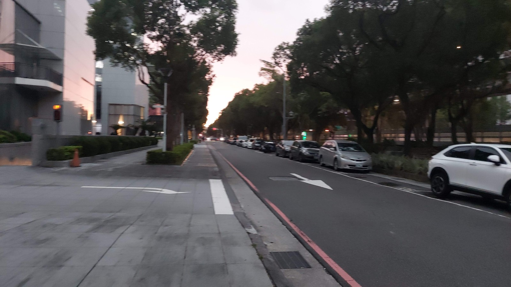
*▲ 幾何線條俐落的現代化大樓外觀，高規格節能玻璃在夕陽餘暉下映射出璀璨的天光雲影。*

---

### 2. 水岸落羽松與開闊生態景觀湖

走進 T-CBD 園區內部，最令人驚豔的莫過於中央佔地逾千坪的人工景觀生態湖。這座景觀池不僅具有雨水貯留與微氣候調節功能，四周更精心環植了成排的落羽松與常綠水生植物。

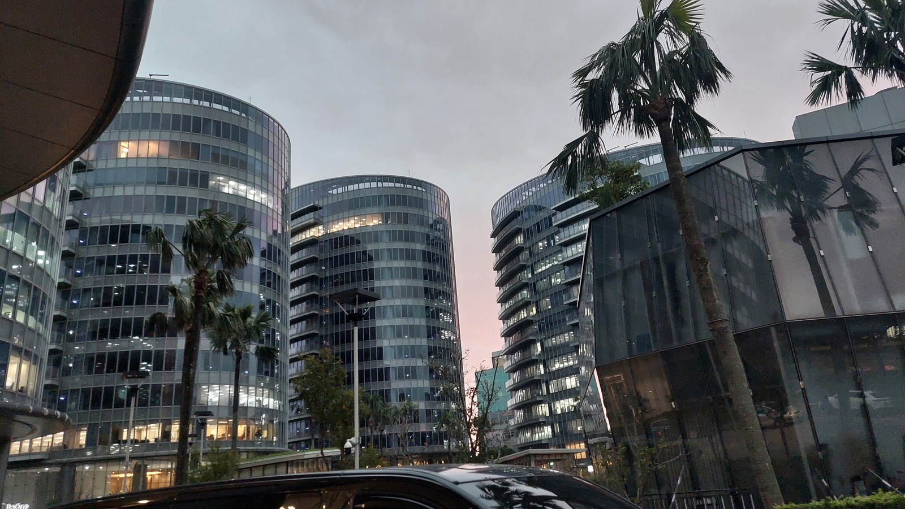
*▲ 清澈無波的生態景觀湖如同一面巨大明鏡，完美倒映著現代化大樓與微風吹拂的水波。*

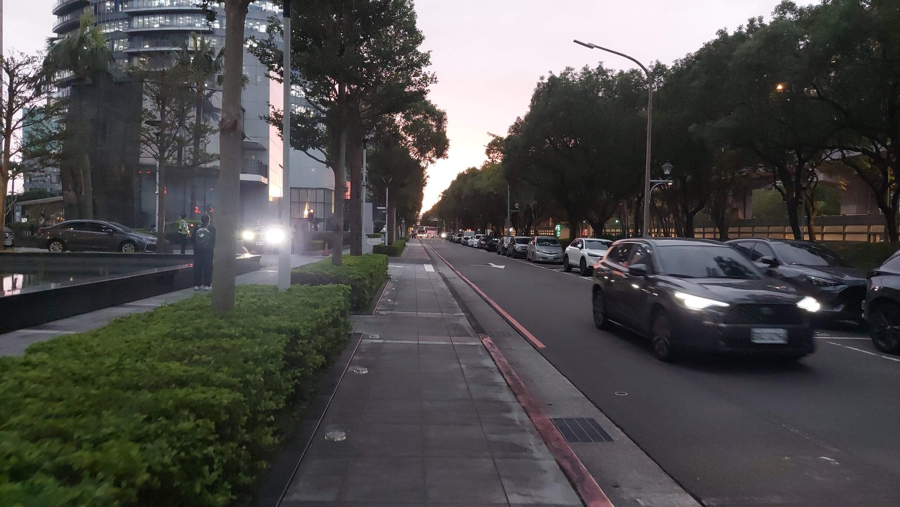
*▲ 木棧道兩旁的落羽松隨著深秋時節漸次轉紅，在都會叢林中營造出寧靜如北歐風情的林道景致。*

平整寬敞的環湖木棧步道、貼心的景觀座椅，讓在附近辦公室奮鬥一整天的上班族，或是特地前來散步的旅人，都能在此停下匆忙腳步，深深呼吸一口帶著水氣的清新空氣。

---

### 3. 星球共融探險：大小朋友歡笑不斷的明美公園

緊鄰 T-CBD 園區北側的**「明美公園」**，則是內湖五期綠帶中的一顆耀眼明珠。這座公園以「星球探險」為設計主題，設有引人注目的圓形滑梯塔、共融式磨石子溜滑梯、寬敞沙坑與彈跳床，是內湖居民口耳相傳的親子「放電神地」。

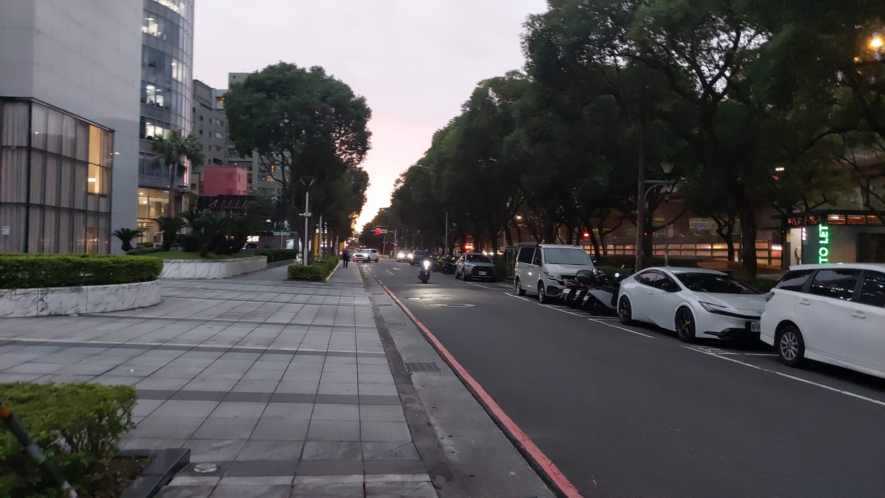
*▲ 結合地景藝術與共融遊具的明美公園，吸引無數親子家庭在傍晚前來享受歡樂時光。*

---

### 4. 暮色金黃：水岸棧道與落日天際線

當時間來到傍晚五點多，夕陽緩緩沉入台北盆地西側的山巒地平線。金黃中帶著粉橘色的暖光如水彩般潑灑在整座園區的玻璃帷幕上，將冰冷的水泥鋼構瞬間染上一層溫暖柔和的蜜金色。

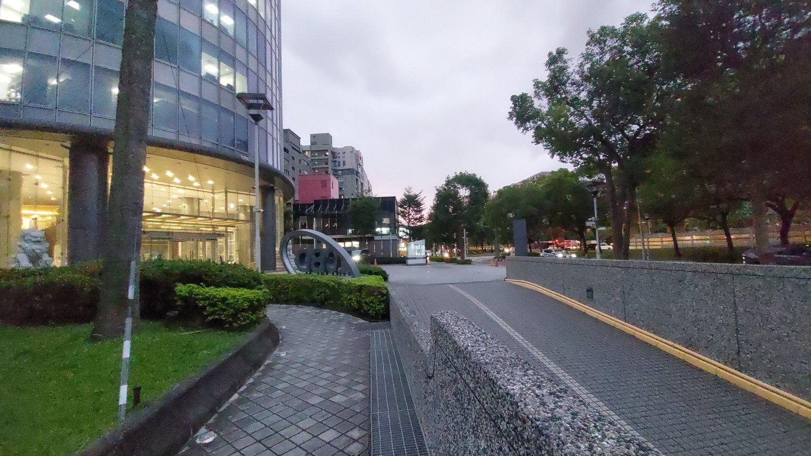
*▲ 傍晚微風徐徐，夕陽餘暉灑滿水岸木棧平台，散發出優雅沉靜的慢活詩意。*

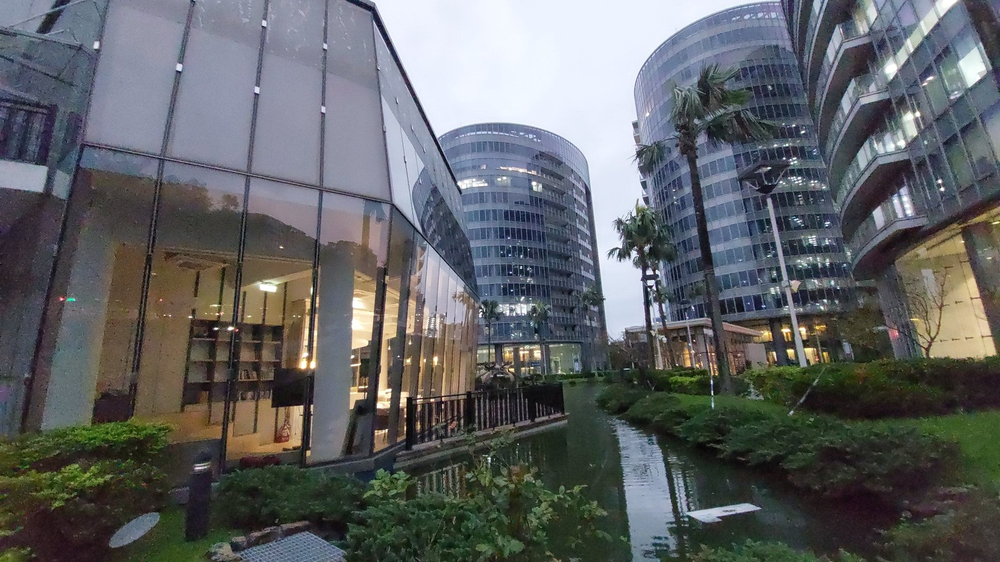
*▲ 暮色深沉、遠山黛青，都會水岸漫旅在此寫下最難忘的美好篇章。*

---

## 📍 交通與行前建議小撇步

1. **大眾運輸推薦**：
   - 搭乘台北捷運至**「松山站」**或**「南京三民站」**，轉乘公車（如 204、民生幹線、綠16、棕1）至「新明路口」或「內湖運動公園」站下車即達。
   - 自行開車者，內湖運動公園設有地下停車場，舊宗路二段沿線亦有充足之路邊收費停車格。
2. **最佳拜訪時間**：
   - 建議於**下午 15:30 ~ 17:45** 造訪。前半段可在內湖運動公園迎風健走、看飛機起降；後半段漫步至 T-CBD 園區生態湖畔欣賞夕陽倒影，一氣呵成！
3. **穿著與配備建議**：
   - 戶外平台無大面積高樓遮陽，晴天時建議攜帶防曬遮陽帽與飲用水；若想在草坪野餐可自備輕量野餐墊。

---

*喜歡這篇圖文遊記嗎？歡迎把文章分享給熱愛生活與漫旅的朋友，也別忘了訂閱我們的 [YouTube 頻道 @slashman413](https://www.youtube.com/@slashman413)，一起探索更多在地深度旅程！*
