如果你問台北人週末要去哪裡搭火車散步，十個人裡面有八個會說「平溪、九份、猴硐看貓」。但如果你跟我一樣，一想到連假景點那種「人擠人到連白鷺鷥都找不到地方降落」的場面就頭皮發麻，那麼今天這條**新北隱藏版百年鐵道秘境——「山佳」**，絕對是你的心靈解藥！

從台北車站跳上一班往南的區間車，屁股都還沒坐熱（大約才過了二十分鐘），窗外的摩天大樓就瞬間切換成翠綠山巒與老榕樹。一下車，迎接你的不是滿街搖著小旗子的旅行團，而是悠哉曬太陽的米克斯貓貓和濃郁的黑金歷史氣息。

今天就跟著我的腳步，依照時間順序，來一場結合百年古蹟、吃煤炭的黑金火車、親水綠意步道、清涼天然岩窟湧泉，以及直通地底礦業帝國的「山佳詼諧慢活半日遊」！

---

## 🕒 10:08 - 10:14 第一站：山佳車站巡禮與站前風光
### 「山仔腳」的日式木造時光機：阿公級售票亭與洗石子廊柱

來到山佳的第一件事，當然不是急著衝出站，而是轉身走進這座全台灣少數保存無比完整的**「市定百年古蹟站房」**！

*▲ 這座建於日治明治34年（1901年）的老站房，原本叫「山仔腳停車場」。走進去就像一秒跌入阿公阿嬤年輕時約會的平行宇宙。*

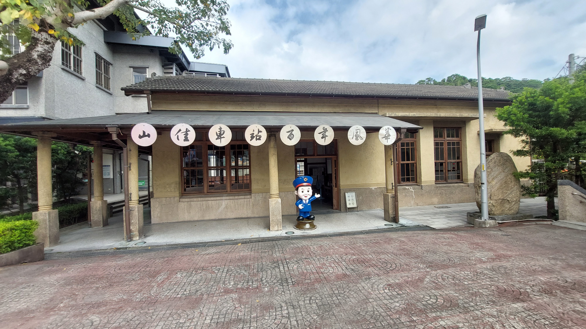
*▲ 抬頭看看那精細的切角頂日式黑瓦與洗石子廊柱，依然挺拔站了一百多年！*

站前廣場鋪滿紅磚，視野開闊，少了都市車站的倉促腳步，多了一份寧靜的山城慢活節奏。

---

## 🕒 10:17 - 10:24 第二站：山佳老街復古彩繪巷弄
### 穿越時空的立體畫卷：柑仔店、推煤礦車與童年記憶

沿著站旁小巷漫步，這裡就是令人會心一笑的**「山佳彩繪老街」**！

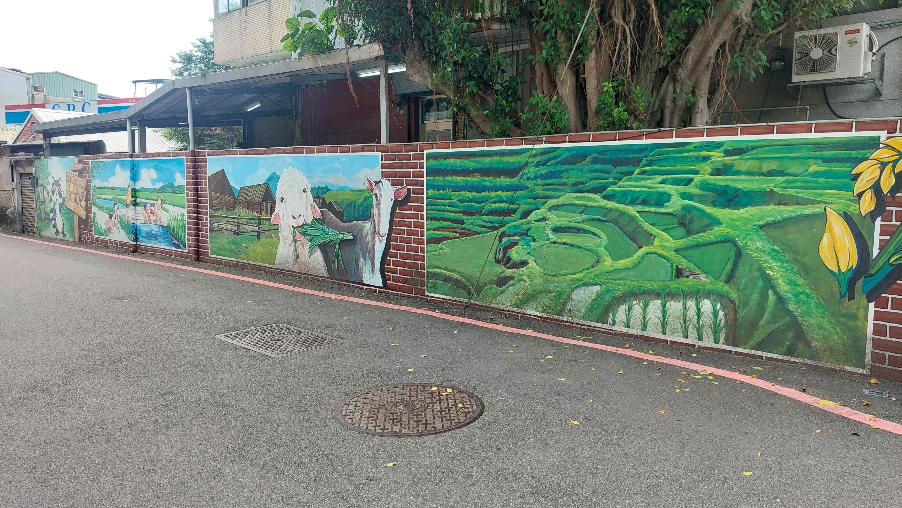
*▲ 巷弄磚牆上繪製了一幅幅極具立體感的懷舊壁畫：推著滿載煤車的辛勞礦工、古早手搖汲水器，還有在巷口跳繩玩耍的孩子。*

走在老街巷弄間，轉個彎就像翻開一本生動的五、六零年代生活漫畫。隨手一靠就能跟壁畫裡的阿伯「合力推煤車」，既幽默又充滿濃濃的人情味！

---

## 🕒 10:24 - 10:30 第三站：山佳鐵道地景公園
### 吃煤炭的鋼鐵巨獸！DL-1000調度機車與黑色運煤斗車

走出彩繪巷，不到幾步路，就是鐵道迷會瞬間心跳加速的**「山佳鐵道地景公園」**！

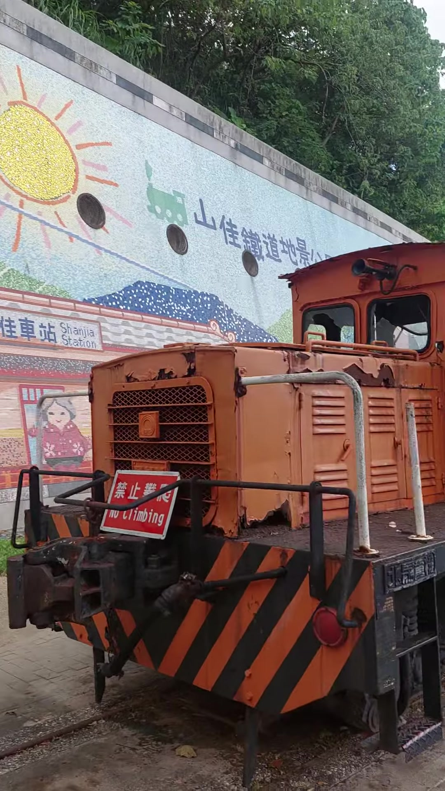
*▲ 這台橘得發亮的 DL-1000 型調度機關車，當年可是推著幾十公噸煤炭奔馳的幕後大功臣，車頭前方還保留著黑黃相間的防撞警示斑馬紋。*

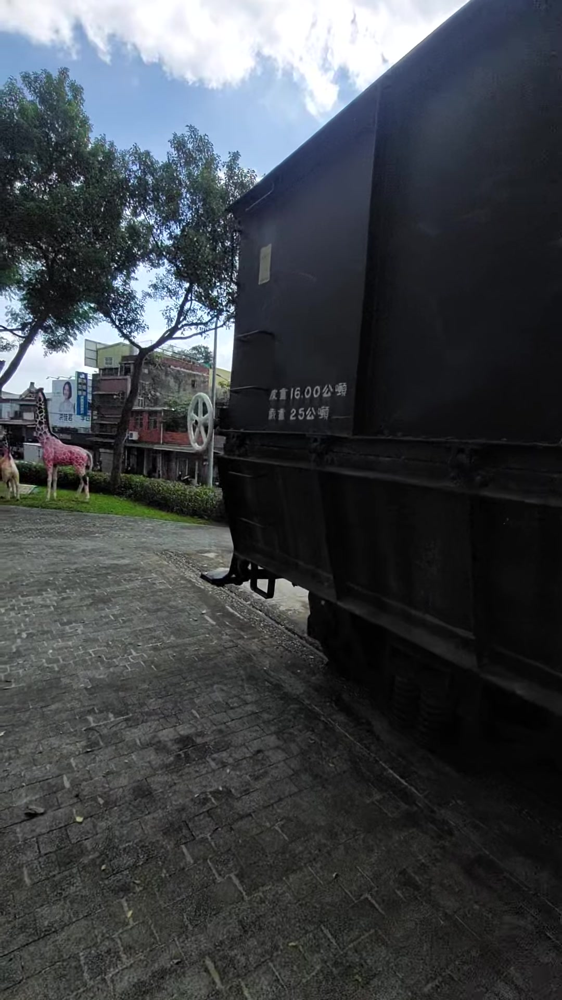
*▲ 園區內陳列著經典的黑色運煤斗車（標示載重25公噸），沿著鋪滿碎石與枕木的鐵軌靜靜陳列，彷彿重回北台灣黑金歲月。*

---

## 🕒 10:33 - 10:46 第四站：鹿角溪親水生態綠廊
### 昔日洗煤黑水溝，今日魚群與白鷺鷥度假村！

穿過鐵道下方的涵洞往南走，流水聲伴隨著微風迎面撲來——我們來到了**「鹿角溪生態步道公園」**！

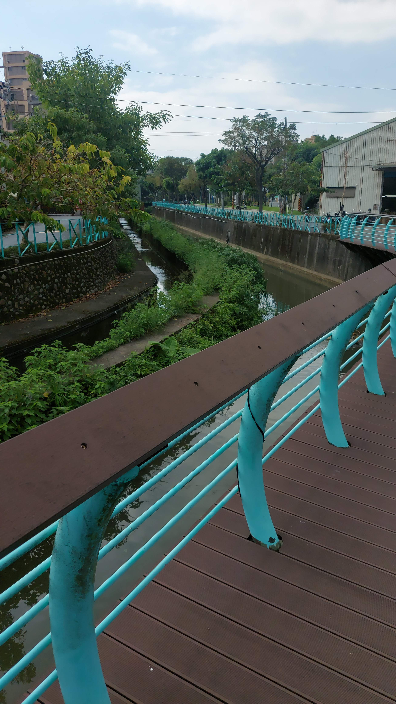
*▲ 沿著鐵道下方涵洞走進鹿角溪親水綠廊，木棧步道搭配流線造型的藍綠色護欄，散步起來格外舒暢。*

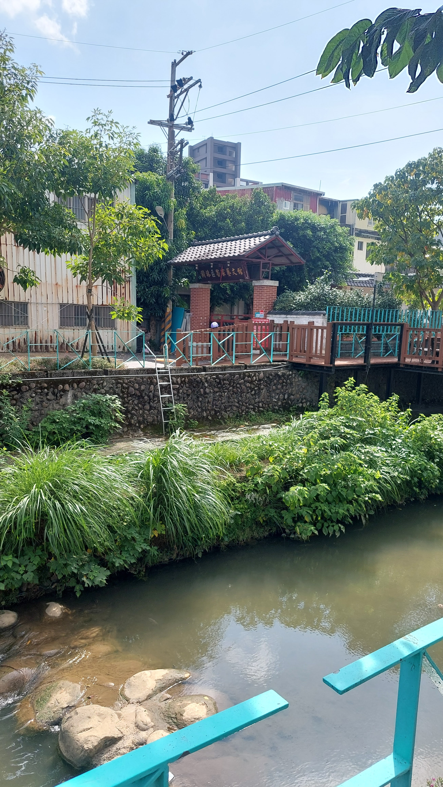
*▲ 昔日的洗煤黑水溝如今溪水潺潺、清澈見底，映照著兩岸綠蔭與山仔腳老厝。*

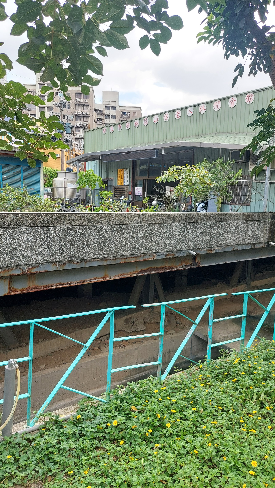
*▲ 綠樹成蔭、溪水清澈，步道兩側滿是生機盎然的自然植被。*

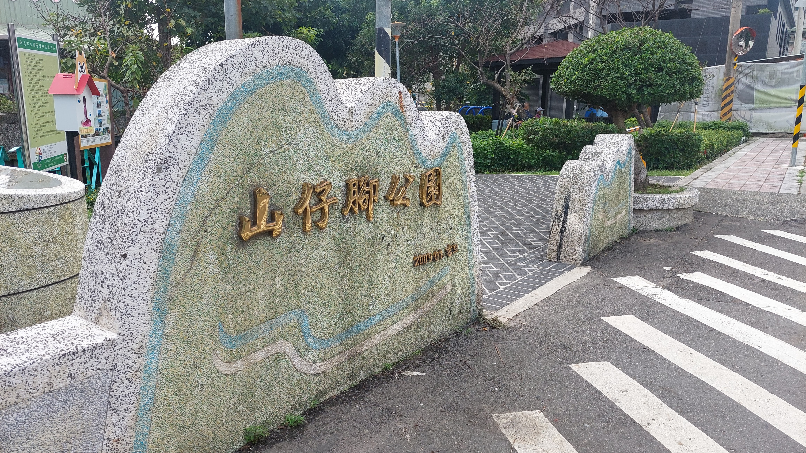
*▲ 走在木棧道與景觀拱橋上，低頭就能看見成群的大魚在清澈溪水中優游，步道旁還豎立著「山仔腳公園」巨石紀念碑。*

---

## 🕒 10:49 - 10:51 第五站：山佳古蹟站房深度探訪
### 木造候車長椅、老式售票窗與鐵道記憶

回到車站內部細細品味，這座建於1901年的古蹟站房，內部候車大廳依然保留了溫潤典雅的木造長條木椅。

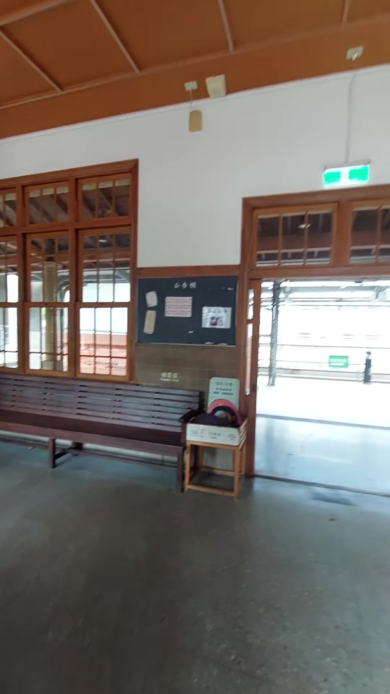
*▲ 走進古蹟候車大廳，陽光透過日式木格窗灑在長條木椅上，穿過木門便能望見現役車站的月台軌道，新舊時空在此交會。*

站在古老的售票窗口前，木質格柵與泛黃的時刻表展示，彷彿下一秒戴著大盤帽的站長就會推開木門，道一聲早安。

---

## 🕒 10:57 - 11:05 第六站：山仔腳老聚落與天然岩窟冷泉
### 隱藏在山壁的先民天然洗衣坑！

順著吉祥街與中和街往半山腰漫步，穿過寧靜的紅磚老厝聚落，我們意外發現了這處極具地方特色的文化秘境——**「天然岩窟冷泉洗衣坑」**！

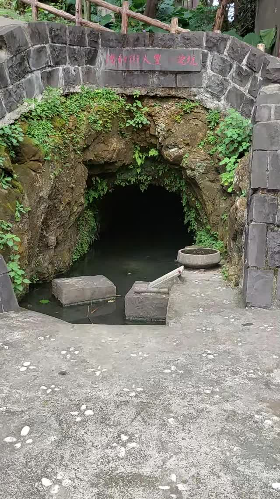
*▲ 天然山壁石窟深處終年湧出清涼透徹的山泉水，石坑旁擺設著早期婦女洗衣服的石踏板，充滿先民的生活智慧。*

摸一摸那沁涼的山泉水，瞬間趕走了一路散步的暑氣！

---

## 🕒 11:08 - 11:21 第七站：蓋淡坑煤礦遺址與紅磚古橋
### 新北最狂地下帝國！親眼見證黑金歷史的坑口

旅程的壓軸終點，我們來到了隱藏在信和街49巷最深處的重磅景點——**「蓋淡坑煤礦遺址」**！

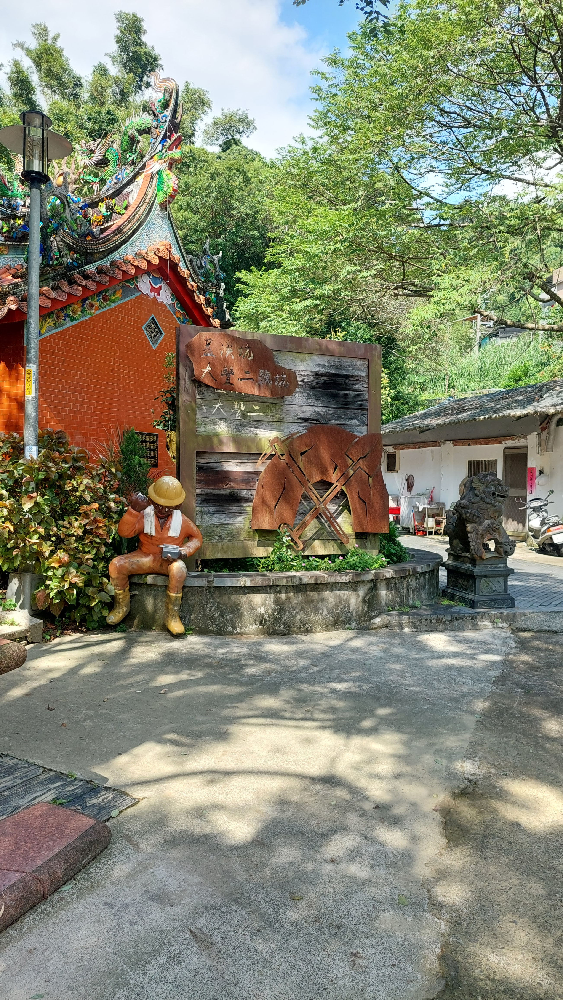
*▲ 順著信和街緩步上山，步道入口旁坐落著保佑礦工出入平安的百年福德宮，拾級而上便是通往礦區的綠蔭小徑。*

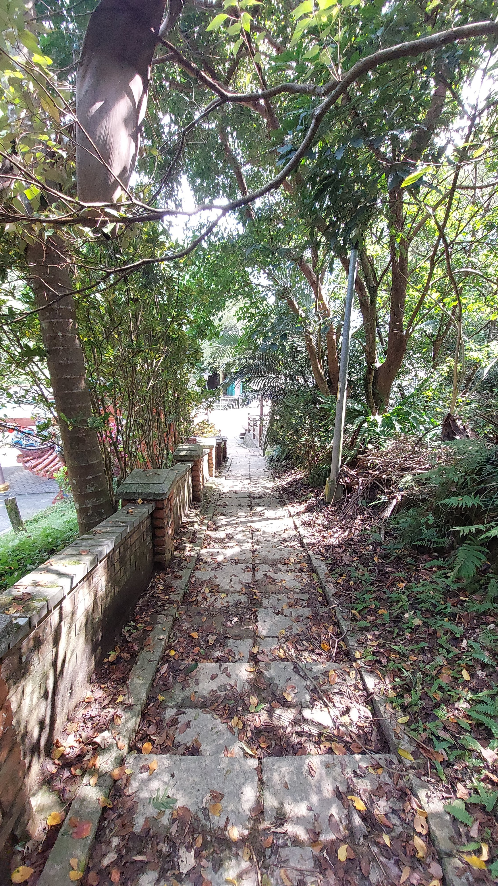
*▲ 沿著被綠樹包圍的古樸石階步道前行，幽靜的林蔭彷彿將時間倒轉回幾十年前礦工們踏著晨光上班的步履。*

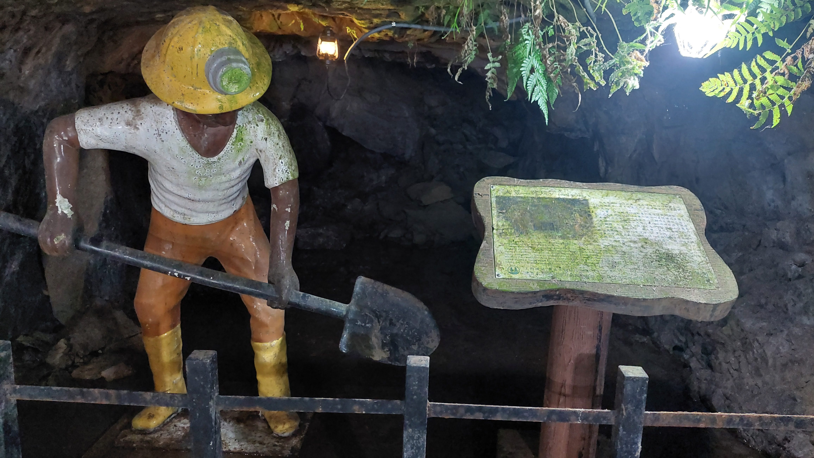
*▲ 蓋淡坑煤礦正門紅磚拱形坑口！保存極為完好，坑內更栩栩如生地重現了當年頭戴探照燈安全帽、推著沉重煤車揮汗工作的採礦實景。*

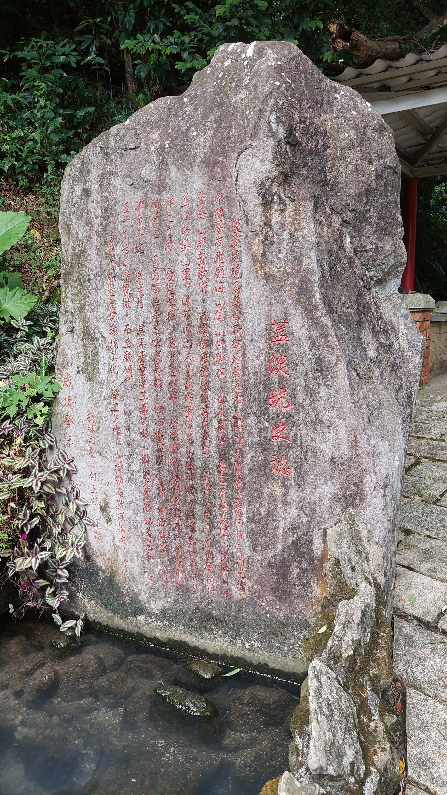
*▲ 坑口旁的巨石史蹟碑以朱紅字體詳細記載了自清同治、光緒年間開採，直至民國73年（1984年）正式封坑的整部山佳採礦百年風雲史。*

站在這座紅磚砌成的坑口前，看著鏽蝕但依然堅固的礦車鐵軌，你能真切感受到這片土地曾經沸騰的脈動與勞動者的尊嚴。

---

## 🎬 完整遊記影片欣賞（YouTube 4K/1080p 實境導覽）

歡迎點擊觀賞由 **[@slashman413](https://www.youtube.com/@slashman413)** 頻道親自採集剪輯的完整 16:9 雙語導覽高畫質遊記影片（全新字幕編碼優化與精確景點導覽版）：



---

## 💡 山佳半日遊實用攻略指南

- **🚗 交通方式**：搭乘台鐵區間車至「山佳火車站」即可抵達（自台北車站出發約20分鐘，自板橋出發僅約10分鐘）。
- **👟 散步路線推薦**：山佳舊站古蹟 ➔ 老街彩繪巷 ➔ 鐵道地景公園 ➔ 鹿角溪親水步道 ➔ 古蹟站房細賞 ➔ 天然岩窟洗衣坑 ➔ 蓋淡坑煤礦遺址（全程步程約 1.5 至 2 小時，平緩好走，老少咸宜）。
- **🍜 在地美食建議**：散步完別忘了在車站前吃一碗傳統切仔麵或老牌排骨飯，配上一杯古早味紅茶，這才是最地道的台灣鐵道慢活日常！

走訪山佳，你會發現最好的旅行往往不是飛到地球另一端，而是在城市的轉角，發現那些被歲月溫柔封存的歷史與人情味。快挑個晴朗的週末，跳上火車來山佳走走吧！
