如果你問資深旅人：「去沖繩玩，哪個月份最舒服、最震撼、最能避開人潮暴曬？」十個裡有九個會毫不猶豫告訴你：**「3月初，絕對是沖繩的黃金神仙檔期！」**

這段專門鎖定在 **2027 年 3 月 3 日（週三）至 3 月 7 日（週日）** 的春季檔期，坐擁三大不可複製的完美條件：
1. **座頭鯨（大翅鯨）交配繁殖的最顛峰黃金期**：目擊率高達 **98% 以上**，親眼看著長達 15 米、重達 30 噸的海中巨獸躍出海面擊浪！
2. **春風拂面、微涼乾爽的健行氣候**：平均氣溫約 **18.5°C ~ 19.5°C**，完全沒有盛夏的酷暑暴曬與悶熱蚊蚋，是攀登本島石灰岩尖峰、穿梭亞熱帶原始雨林的最佳時節。
3. **歷史性的重要里程碑**：毀於祝融的琉球王國象徵——**「首里城正殿」於 2026 年秋季完成全木造正殿重建工程**！2027 年 3 月初正是親眼見證全新落成、金碧輝煌之歷史奇蹟的第一波黃金時機！

這篇文章為你整理最詳盡、數據最齊全的**沖繩 2027 初春全島旅遊調研總整理**。包含三大賞鯨港口評比、四大名峰健行指南、全島精選 20 處核心景點營業與機場開車時間、雨天就近 15 分鐘室內備案矩陣，以及 5 套針對不同族群量身打造的 5 天 4 夜完整企劃！

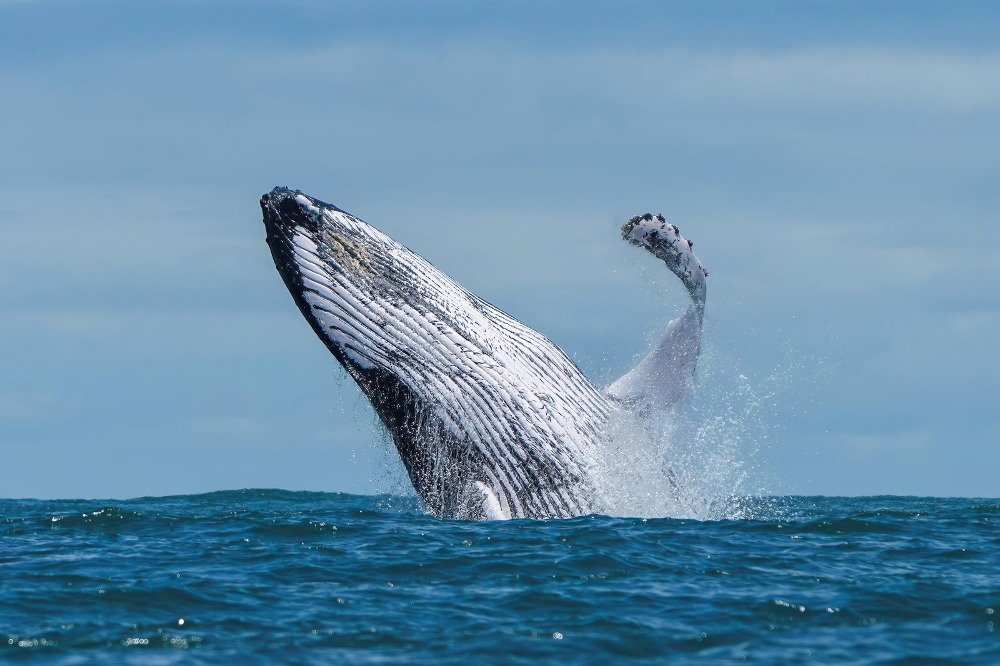
*▲ 每年初春，數以百計的野生座頭鯨自北太平洋白令海南下慶良間與本部海域交配育幼，近距離目擊率超過 98%！*

---

## 🧭 第一章 2027 年 3 月初 沖繩氣候、穿著與自駕全指南

在出發前，先掌握 3 月初沖繩的氣候特色與自駕技巧，能讓行程順暢度提升 200%：

| 分析維度 | 2027/3/3 ~ 3/7 實質調研狀況 | 實務因應與行前建議 |
|:---|:---|:---|
| **氣溫與體感** | 平均氣溫 **18.5°C ~ 19.5°C**，日間最高溫約 21°C ~ 23°C，夜間與清晨低溫約 15°C ~ 17°C。涼爽舒適、不悶熱。 | 採取「洋蔥式穿法」：短袖或薄長袖內搭 + 輕保暖帽T/薄毛衣 + 防風防潑水連帽風衣外套。 |
| **海風與風浪** | 海風平均風速 5~7 m/s，空曠海岬（邊戶岬、殘波岬）與出海時風力較強，體感偏涼。 | 出海賞鯨必備防風墨鏡、固定帽子防飛夾繩、長褲與運動鞋；避免穿裙裝與易吹落飾品。 |
| **降雨機率** | 降雨機率約 30% ~ 40%，處於冬末春初鋒面過渡期（うりずん），偶有短暫陣雨，多為陣雨型態，甚少連日暴雨。 | 戶外登山行程需隨時掌握日本氣象廳 (JMA) 預報；隨身攜帶折疊傘，各戶外行程備妥就近室內備案。 |
| **日照時間** | 日出約 06:45，日落約 18:30。每日約有 **11.5 小時明亮白天**。 | 白天行程充裕，建議登山健行安排於 08:30 ~ 15:30 之間；17:30~18:30 安排於海景餐廳或海灘看夕陽。 |
| **海況與水上活動** | 海水表面溫度約 21°C ~ 22°C。本島各大沙灘海水浴場通常於 3 月下旬至 4 月中旬才陸續「開海」（海開き），3 月初沙灘未開放游泳；但**搭船賞鯨正值全年最巔峰**，浮潛與潛水（穿著 5mm 厚防寒衣）照常開放！ | 3 月初不宜規劃沙灘游泳；水上活動應以「搭船賞鯨」為核心，若體驗浮潛或潛水須跟隨專業教練並著全套防寒衣。 |
| **租車與自駕** | 日本右駕左行（右大轉、左小轉）。沖繩主要幹道為「國道 58 號」與「沖繩自動車道（高速公路：那霸IC至許田IC，長約57公里）」。 | 強烈建議租用油電車或 SUV，並務必加裝 **ETC 卡** 與中文語音導航。高速公路那霸IC至許田IC普通車單程過路費約 ¥1,040。 |

---

## 🐋 第二章 【重磅專題一】野生座頭鯨（大翅鯨）大航海尋鯨深度調研

每年 12 月底至 4 月初，野生座頭鯨（Humpback Whale）自北方白令海峽南下遷徙至沖繩周邊溫暖水域。**3 月初正值母子鯨活動與求偶競逐的最顛峰時期，全島出海目擊率高達 98%+！**

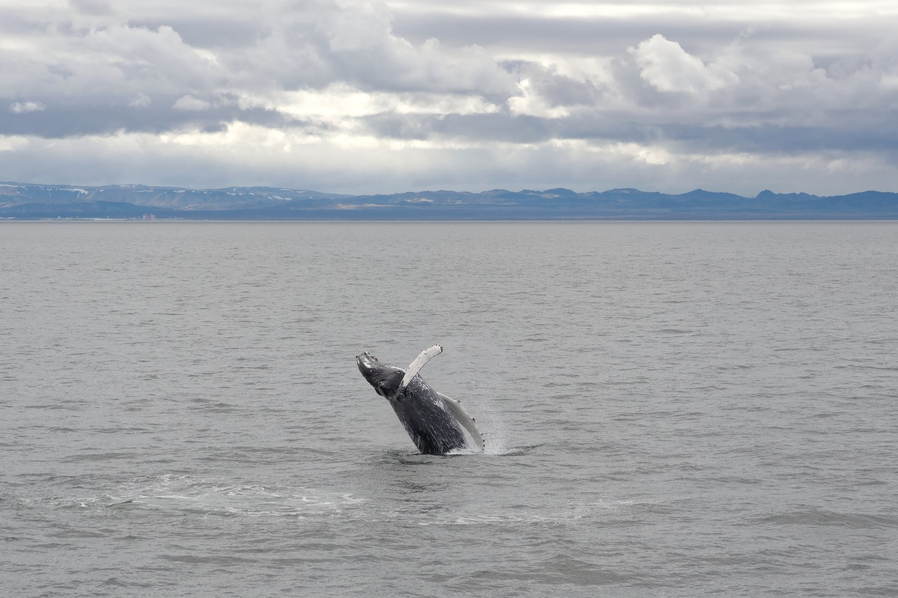
*▲ 座頭鯨長達 5 米的黑白雙色尾鰭（Fluke），每一次揚起拍水都是大自然最壯闊的詩篇。*

### 1. 三大主要出發港口橫向評比

沖繩本島主要有三大港口營運賞鯨船，各自具備不同的地理與海象特性：

| 項目指標 | 那霸港 / 三重城港出發 | 北谷港 / 濱川漁港出發 | 本部港 / 渡久地港出發 |
|:---|:---|:---|:---|
| **地理位置** | 那霸市西側海岸（鄰近市中心） | 中部北谷町（緊鄰美國村） | 北部本部町（鄰近美麗海水族館） |
| **代表營運業者** | Marine Club Berry, Cerulean Blue, Joy Create | Chatan Uminchu Wharf, Island Message, Total Pro | Marine Support Tida, 本部町觀光協會協同船隊 |
| **每日出發班次** | 上午場：08:30集合 09:00~12:00<br>下午場：13:00集合 13:30~16:30 | 上午場：08:30集合 09:00~12:30<br>下午場：13:00集合 13:30~17:00 | 上午場：08:45集合 09:15~11:45<br>下午場：13:15集合 13:45~16:15 |
| **預估費用 (成人)** | **¥5,500 ~ ¥6,500** (約合 NT$1,150~1,350) | **¥6,000 ~ ¥6,800** (約合 NT$1,260~1,430) | **¥6,000 ~ ¥7,000** (約合 NT$1,260~1,470) |
| **預估費用 (兒童)** | 3-11歲: ¥4,500~¥5,500；0-2歲免費或¥500 | 3-11歲: ¥5,000~¥5,800；0-2歲約¥1,000 | 3-11歲: ¥4,500~¥5,500；0-2歲免費 |
| **是否需預約** | **必須預約**（出發前 2~4 週線上預約） | **必須預約**（出發前 1~2 週線上預約） | **必須預約**（出發前 2 週預約，船位較少） |
| **那霸機場開車時間** | **約 7.2 公里，車程僅 15~18 分鐘** | **約 21 公里，車程約 40~50 分鐘** | **約 85 公里，車程約 80~95 分鐘** (走高速公路) |
| **航行海域與海象** | 慶良間群島（Kerama）外海，海域深、湧浪較大 | 宜野灣與慶良間北部，多大型雙體遊艇 | 伊江島與水納島平緩海峽，多為母鯨育幼避風區 |
| **抵達鯨區所需航程** | 出港需航行約 40~50 分鐘抵達鯨點 | 出港需航行約 35~45 分鐘抵達鯨點 | **僅需 15~20 分鐘即可接觸鯨魚！** |
| **未看見補償機制** | 3月若未見鯨魚提供「全額退款」或「發放重乘券」 | 多數發放「再乘券」或精美紀念品補償 | 贈送美麗海水族館門票或再乘券 |
| **最大亮點與適合對象** | 離市區最近，部分業者附市區飯店免費接送 | 下船直接逛美國村；適合住中部飯店旅客 | **航程最短、浪最小、最不易暈船！長輩幼童首選** |

### 2. 賞鯨實戰防暈船與必備須知
1. **防暈船藥物黃金期**：請於日本藥妝店購買知名**「アネロン (Aneron)」**長效型暈船膠囊，務必於**「開船前 30~45 分鐘」**服用。開船前切勿空腹，亦不可食用高油脂油炸物或飲用純牛奶與濃拿鐵。
2. **天候停航與改期策略**：賞鯨活動嚴格受海象風浪高度（浪高超過 3 公尺即停航）管制。若當日風浪過大取消，船公司 100% 全額無條件退款。強烈建議將賞鯨排在**旅程第 2 天或第 3 天**，若遇海象不佳停航，第 4 天尚有彈性改期緩衝。
3. **攝影建議**：相機務必繫上手腕帶或頸帶防脫手墜海；鏡頭建議使用 70-200mm 以上望遠焦段；手機錄影建議開啟 4K 60fps 格式，事後再截取跳水高清截圖。

---

## ⛰️ 第三章 【重磅專題二】沖繩四大名峰與神級森林步道健行調研

初春 3 月氣候微涼，沒有盛夏酷曬與大量蚊蚋，正是探訪沖繩特殊古生代與喀斯特石灰岩地貌的黃金期！沖繩山嶽海拔雖然多在 200~450 公尺之間，但因為四面環海，登頂後的 **360 度海天全景** 震撼度完全不輸高山。

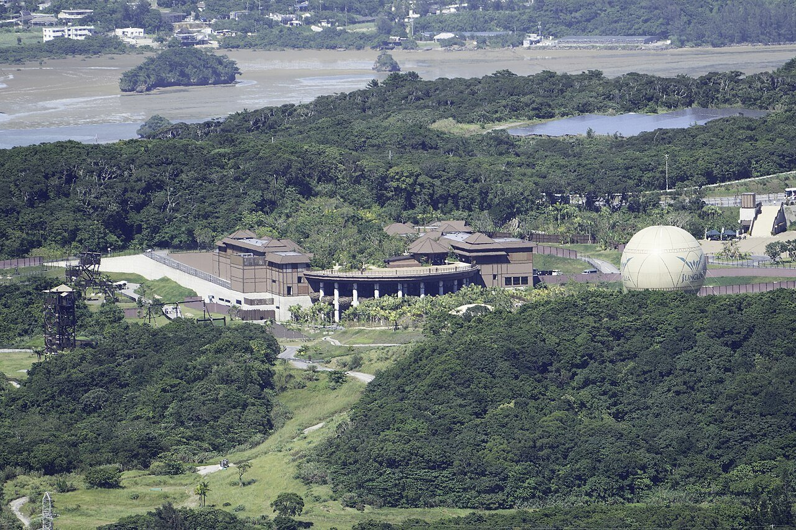
*▲ 攀登名護名峰「嘉津宇岳」，山頂為刀削般的石灰岩尖岩，坐擁 360 度無死角俯瞰東海與名護灣之壯麗盛景！*

### 1. 沖繩四大熱門登山與健行步道詳盡對比

| 步道 / 山峰名稱 | 嘉津宇岳 (Mt. Katsuu) | 大石林山 (Daisekirinzan) | 石川岳 (Mt. Ishikawa) | 塔滝溪谷 (Ta-Taki Falls) |
|:---|:---|:---|:---|:---|
| **地理位置** | 北部 名護市勝山 | 北部 國頭村（本島極北端） | 中部 宇流麻市石川 | 北部 大宜味村平良 |
| **標高 / 地貌** | 標高 452 公尺（尖銳圓錐岩峰） | 標高約 250 公尺（古生代奇岩巨石） | 標高 204 公尺（熱帶闊葉林與溪谷） | 沿溪谷涉水溯溪（落差 10m 瀑布） |
| **路線難度** | **中等挑戰（初中級攀登）** | **輕鬆至初級（老少咸宜）** | **A線初級 / C線冒險挑戰** | **中級涉水健行** |
| **步道長度 / 耗時** | 單程 750m，往返約 **45~60 分鐘** | 4大步道共 3.5km，遊覽約 **1.5~2.5小時** | 1.5~3.2km，往返約 **1~2.5 小時** | 單程 750m，往返約 **1.5~2 小時** |
| **路況特徵** | 石灰岩嶙峋、粗壯樹根、拉繩坡段 | 完善無障礙木棧道、碎石階梯、巨木林 | 泥土小徑、樹根階梯、拉繩攀壁、渡溪 | 水深及膝至腰、攀爬溪石、涉水前進 |
| **門票與費用** | **完全免費入山**（停車無料） | **成人 ¥2,500 / 兒童 ¥1,200** | **完全免費入山**（停車無料） | 溪谷免門票；停車¥500 / 鞋租¥500 |
| **開放時間與預約** | 24小時（建議 08:00-16:00 白天）<br>**免預約，自由出入** | 09:30 - 17:30 (最後入場 16:30)<br>**免預約，現場購票** | 08:30 - 17:00<br>**免預約（青少年の家填入山表）** | 08:00 - 17:30 (日照時間)<br>**自遊免預約；嚮導團需預約** |
| **那霸機場開車距離** | **約 76 公里，車程約 80~90 分鐘** | **約 115 公里，車程約 115~130 分鐘** | **約 44 公里，車程約 50~55 分鐘** | **約 86 公里，車程約 85~95 分鐘** |
| **登頂核心景觀** | **360度極致全景！** 俯瞰名護灣、本部半島與伊江島，如立於世界之巔 | 琉球開闢神話聖地、日本最大御石巨榕、美麗海展望台俯瞰邊戶岬與大海 | 沖繩最窄地峽中央！山頂同時飽覽西側東海與東側太平洋金武灣 | 穿梭原始亞熱帶雨林，抵達壯觀飛瀑，享受負離子清涼跳水體驗 |
| **裝備需求** | 抓地力佳之登山鞋/越野跑鞋、防滑手套、長褲、飲用水 | 休閒運動鞋、遮陽帽、輕便防風外套 | 防水防滑鞋、登山杖、備用衣物（走C線） | 專用毛氈底防滑溯溪鞋、救生衣、防水袋 |
| **下雨天可行性** | **嚴禁雨天攀登！** 石灰岩遇水極度濕滑，拉繩處危險 | **小雨尚可**（園區提供愛心傘與雨衣，木棧道平穩，大雨天能見度差） | **雨天不宜！** 泥土路濕滑易摔倒，C線溪水可能暴漲 | **大雨嚴禁進入！** 山區降雨易引發溪水暴漲（山洪），封閉管理 |
| **適合對象** | 熱愛戶外挑戰者、體能良好青年 | 三代同堂家庭、長輩、文化地貌愛好者 | 野外冒險愛好者、體力充沛旅客 | 喜愛水陸動態冒險的年輕朋友、情侶 |

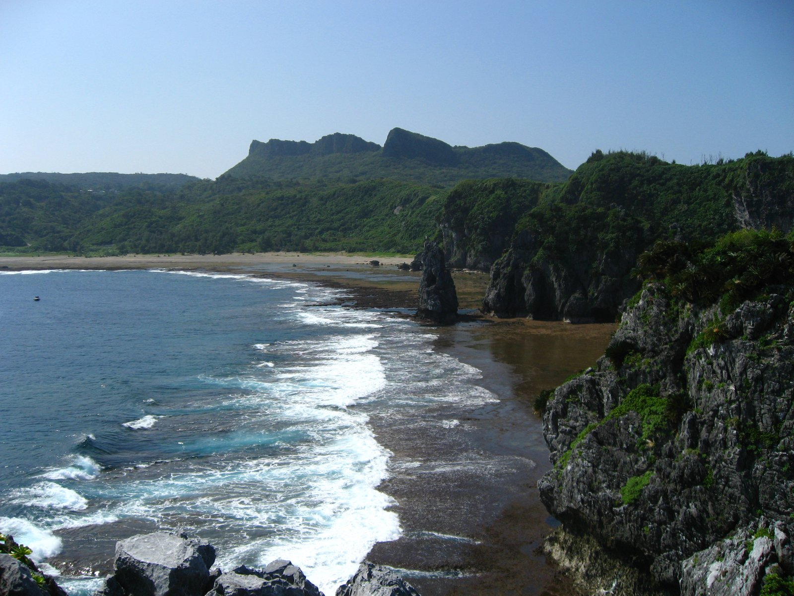
*▲ 國頭村「大石林山」是兩億年前形成的喀斯特地形，園區鋪設平緩好走的木棧道，穿梭於神聖奇岩與巨榕森林之中。*

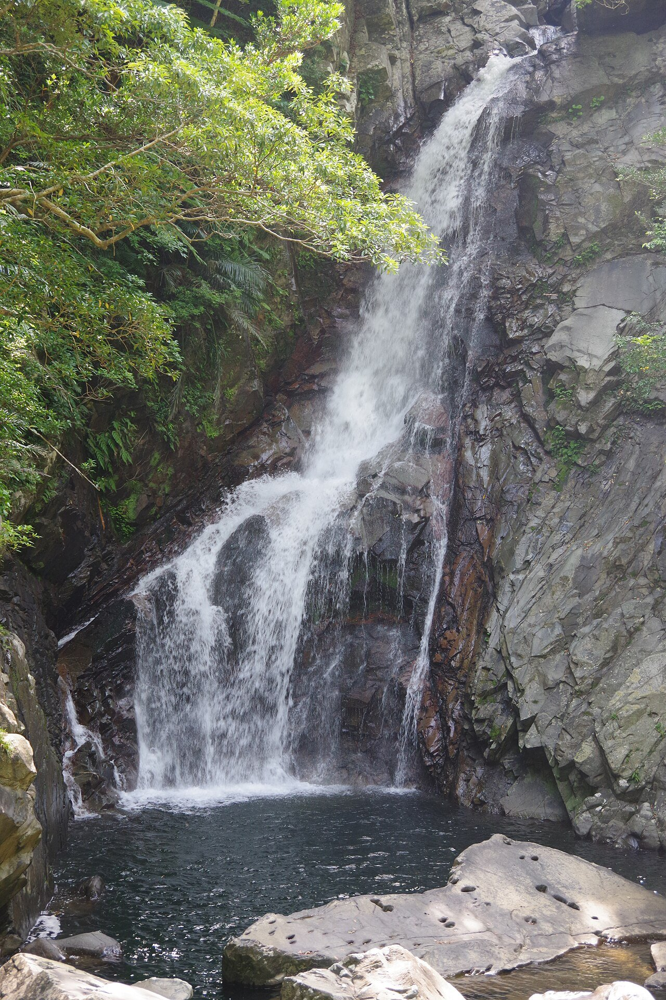
*▲ 大宜味村的「塔滝（Ta-Taki）」溪谷溯溪，踏入清涼的潺潺溪水，穿過熱帶藤蔓攀爬至落差 10 公尺的壯麗飛瀑。*

### 2. 備選悠閒級健行與自然步道
- **備瀨福木林道步道（本部町）**：全長約 2 公里平坦白砂古道，數萬棵百年老福木綠蔭蔽日，步行約 45~60 分鐘，直通備瀨崎海灘。全年齡適合，小雨可打傘漫步。距離機場約 92 公里（95~110分鐘）。
- **今歸仁城跡石階步道（今歸仁村）**：登上世界遺產北山王國雄偉石灰岩城垣，往返約 1.5 公里，步程約 1 小時。門票成人 ¥600。可居高臨下遠眺東海。距離機場約 88 公里（90~105分鐘）。
- **勝連城跡登頂步道（宇流麻市）**：螺旋石階直上古城一之曲輪，耗時約 1 小時，頂層 360 度俯瞰海中道路與中城灣。門票成人 ¥600。距離機場約 38 公里（45~55分鐘）。
- **邊戶岬海岸步道（國頭村）**：本島最北端海角步道，全長約 1 公里，觀賞太平洋與東海巨浪撞擊 200 米海崖。免費參觀。距離機場約 118 公里（120~135分鐘）。

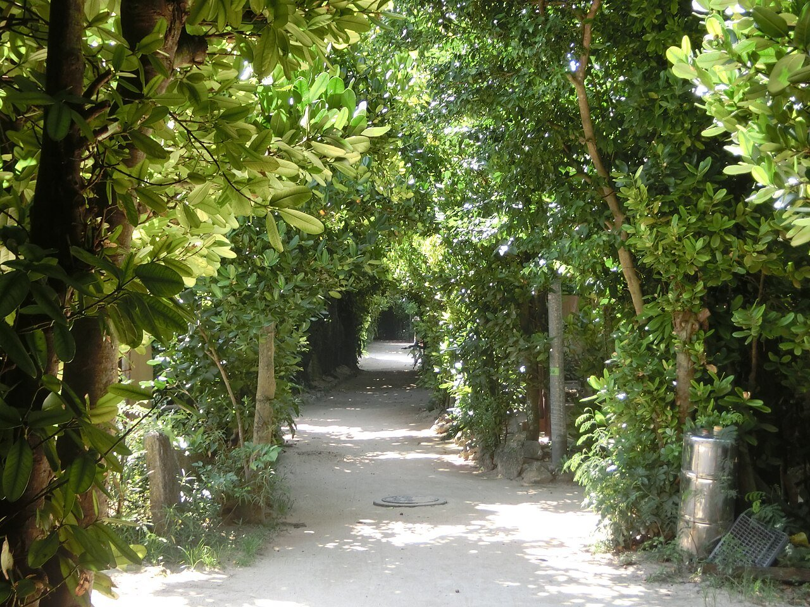
*▲ 本部町備瀨福木林道，老樹成蔭、白砂鋪地，漫步其中彷彿時光凝結。*

### 3. 沖繩登山安全四大守則
1. **山原毒蛇（波布蛇 Habu）防範**：沖繩山區棲息有劇毒波布蛇。3 月氣溫雖涼，但在晴天中午波布蛇可能於岩石上曬太陽。**嚴禁走入未修剪之密草深處；嚴禁用手探入看不見內部的石縫或樹洞！**
2. **古生代石灰岩防滑**：沖繩山地石灰岩稜角極其銳利且表面多青苔，**嚴禁穿著涼鞋或光滑底球鞋**攀登嘉津宇岳與石川岳。
3. **通訊與離線地圖**：國頭村與名護山區部分路段手機訊號微弱，出發前請預先下載 Google Maps 或 AllTrails 離線圖資。
4. **天候驟變撤退原則**：山區天候多變，若遇降雨應立即果斷下撤，切勿在濕滑岩稜逗留。

---

## 🏛️ 第四章 全島精選活動與景點資料庫（按區域與動線分類）

針對 2027 年 3 月初的氣候與自駕動線，精選全島最值得走訪的 20 處核心景點：

### 1. 北部區域（名護市、本部町、今歸仁村、國頭村）

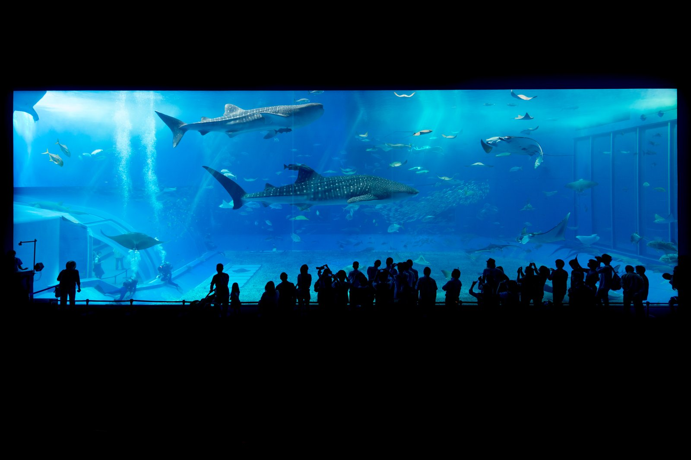
*▲ 沖繩美麗海水族館全球頂級的壓克力大水槽「黑潮之海」，看巨大鯨鯊與鬼蝠魟優雅共游。*

1. **沖繩美麗海水族館**（海洋博公園內）
   - **屬性**：100% 全室內空調（全天候）
   - **營業時間**：08:30 - 18:30（最後入館 17:30）
   - **門票**：成人 ¥2,180 / 高中生 ¥1,440 / 中小學 ¥710（超商購預售票約 ¥1,950）
   - **是否需預約**：免預約，現場購票或持電子票入場
   - **那霸機場開車距離與時間**：約 90 公里，車程約 90~105 分鐘（經許田IC轉國道449號）
   - **特色看點**：世界最大級「黑潮之海」大水槽、鯨鯊餵食秀、深海生物館；戶外海豚秀與海龜館免費參觀。北部必訪名勝與最佳雨天備案。

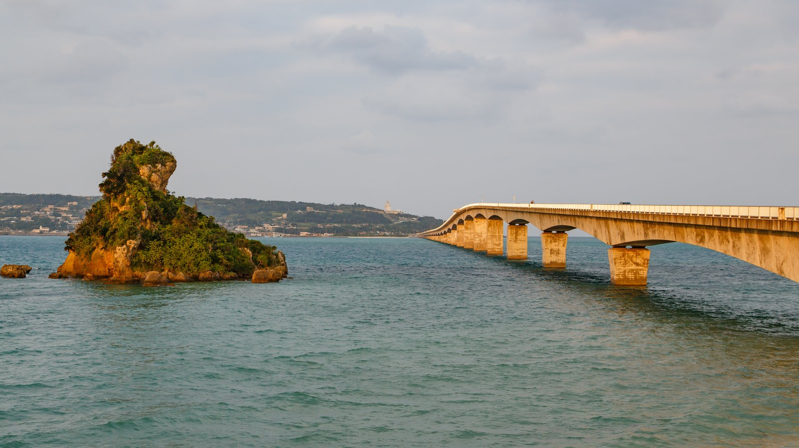
*▲ 全長近 2 公里的古宇利大橋，筆直奔向有「神之島」之稱的古宇利島，橋兩側是透徹的果凍碧藍海水。*

2. **古宇利島 & 古宇利大橋**
   - **屬性**：戶外海景兜風
   - **營業時間**：大橋 24 小時；古宇利海洋塔 10:00 - 18:00
   - **門票**：大橋免費通行；海洋塔門票 成人 ¥1,000 / 兒童 ¥500
   - **是否需預約**：免預約
   - **那霸機場開車距離與時間**：約 88 公里，車程約 90~100 分鐘
   - **特色看點**：全長 1,960 公尺跨海大橋，直通碧藍古宇利島；島上有心形岩（Heart Rock）與古宇利海洋塔高空咖啡。

3. **名護鳳梨園 (Nago Pineapple Park)**
   - **屬性**：複合型（全自動雨棚電動車，室內為主）
   - **營業時間**：10:00 - 18:00（最後入場 17:30）
   - **門票**：成人 ¥1,200 / 兒童 ¥600
   - **是否需預約**：免預約
   - **那霸機場開車距離與時間**：約 72 公里，車程約 75~85 分鐘
   - **特色看點**：搭乘全遮雨棚鳳梨造型自動電動車遊覽熱帶植物園與恐龍探險區；室內鳳梨酒試飲與現烘甜點。北部頂級避雨首選！

4. **Orion 啤酒名護觀光工廠 (Orion Happy Park)**
   - **屬性**：100% 全室內觀光工廠
   - **營業時間**：09:00 - 17:00（專人導覽場次）
   - **費用**：成人 ¥500（含試飲生啤2杯）/ 兒童 ¥200（附軟飲）
   - **是否需預約**：**必須事先預約**（官網線上預約場次）
   - **那霸機場開車距離與時間**：約 70 公里，車程約 70~80 分鐘
   - **特色看點**：參觀沖繩國民啤酒全自動化釀造產線，導覽後享用剛出廠新鮮生啤酒（駕駛提供無酒精飲料）。高 CP 值精緻室內行程。

---

### 2. 中部區域（恩納村、讀谷村、北谷町、宇流麻市、北中城村）

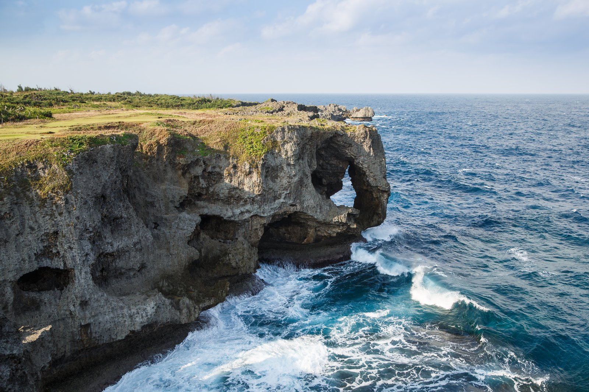
*▲ 恩納村萬座毛象鼻奇岩！新落成的 3 層樓全空調遊客中心提供極佳的室內海景視野。*

1. **萬座毛 (Cape Manzamo)**
   - **屬性**：複合型（戶外象鼻奇岩步道 + 3層樓全新全空調景觀中心）
   - **營業時間**：08:00 - 19:00
   - **門票**：戶外觀景步道 ¥100 / 遊客中心商場免費
   - **是否需預約**：免預約，現場購票
   - **那霸機場開車距離與時間**：約 50 公里，車程約 55~65 分鐘（經屋嘉IC）
   - **特色看點**：如象鼻形狀隆起珊瑚礁斷崖，俯瞰極致蔚藍大海；新落成商場全空調、室內海景落地窗景觀絕佳。

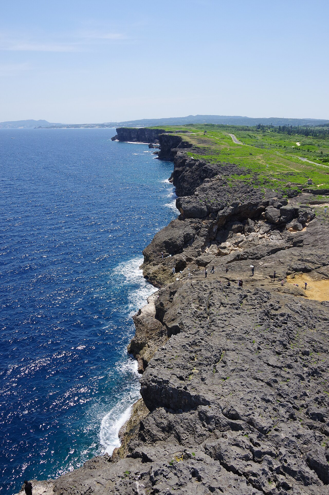
*▲ 讀谷村殘波岬燈塔矗立於 2 公里珊瑚礁斷崖之巔，洶湧海浪拍擊岩壁，日落夕陽氣勢磅礡。*

2. **殘波岬燈塔 & 絕壁公園**
   - **屬性**：戶外海岸海角
   - **營業時間**：公園 24 小時開放；登燈塔 09:30 - 16:30
   - **門票**：公園免費；登上燈塔頂端 ¥300
   - **是否需預約**：免預約
   - **那霸機場開車距離與時間**：約 35 公里，車程約 50~60 分鐘
   - **特色看點**：沖繩最高 31 米白色燈塔，沿 2 公里珊瑚礁斷崖矗立，驚濤拍岸，日落夕陽氣勢雄渾。

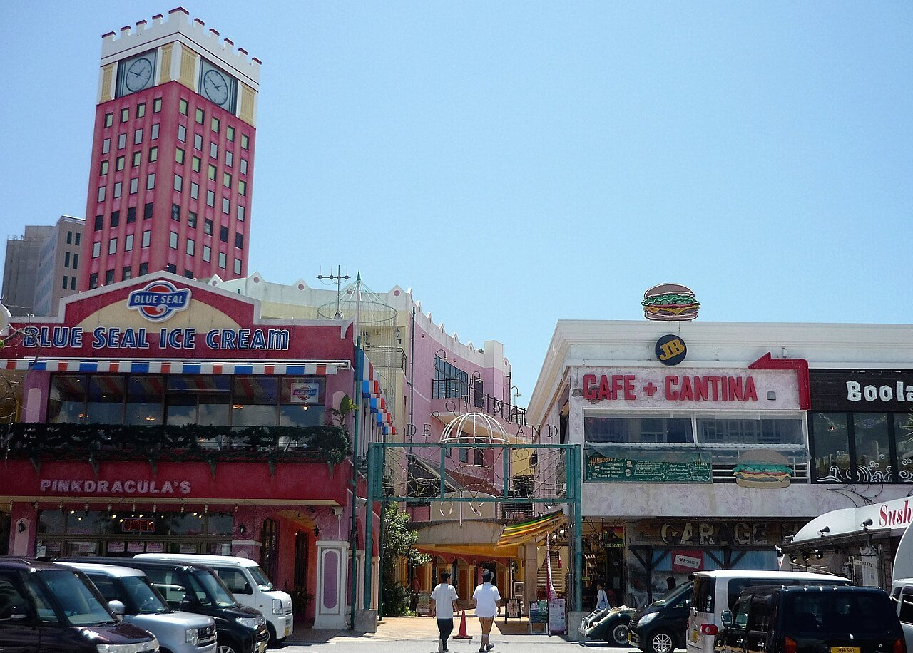
*▲ 北谷美國村日落海灘濱海步道與異國風情建築群，傍晚散步浪漫滿分。*

3. **北谷美國村 (American Village)**
   - **屬性**：半戶外複合商圈（多騎樓與特色室內店家）
   - **營業時間**：商場街道全天開放；店家約 10:00 - 22:00
   - **門票**：免費自由漫步（大型免費停車場）
   - **是否需預約**：免預約
   - **那霸機場開車距離與時間**：約 21 公里，車程約 40~50 分鐘（走國道58號）
   - **特色看點**：美式復古風情建築、日落海灘濱海木棧道、摩天輪打卡街區、異國海景餐廳與特色古著雜貨店。

4. **永旺夢樂城沖繩來客夢 (AEON MALL Okinawa Rycom)**
   - **屬性**：100% 全室內多層購物中心（抗雨避風神殿）
   - **營業時間**：10:00 - 22:00（餐飲區至 23:00）
   - **門票**：免費入場（附設 4,000 台大型免費停車位）
   - **是否需預約**：免預約
   - **那霸機場開車距離與時間**：約 24 公里，車程約 35~45 分鐘（經北中城IC）
   - **特色看點**：沖繩規模最大購物中心！中庭設有 100 噸「Rycom 大水族箱」展示近千尾熱帶魚，超過 200 家品牌專櫃與美食街。

5. **琉球村 (Ryukyu Mura)**
   - **屬性**：複合型（戶外傳統老民家 + 大型室內體驗圓頂穹頂）
   - **營業時間**：09:30 - 17:00（最後入場 16:00）
   - **門票**：成人 ¥1,500 / 兒童 ¥600
   - **是否需預約**：免預約（手作工藝現場報名）
   - **那霸機場開車距離與時間**：約 38 公里，車程約 50~60 分鐘
   - **特色看點**：移築多座百年有形文化財紅瓦古厝，體驗三線琴、傳統琉裝拍照、彩繪風獅爺。中央設有全遮雨大圓頂。

---

### 3. 南部區域（豐見城市、南城市、糸滿市）

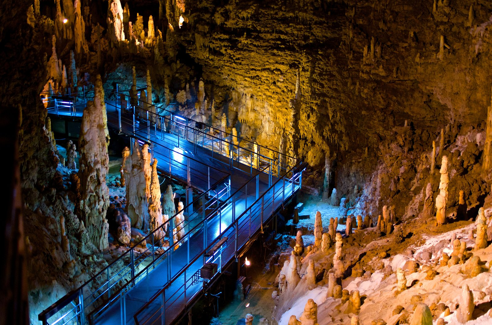
*▲ 南城市玉泉洞長達 890 公尺的地下鐘乳石觀景步道，恆溫 21°C，百萬鐘乳石倒映在碧藍青泉中。*

1. **沖繩世界文化王國 & 玉泉洞**
   - **屬性**：複合型（玉泉洞全地底室內、戶外有挑高雨棚）
   - **營業時間**：09:00 - 17:30（最後入場 16:00）
   - **門票**：全區套票 成人 ¥2,000 / 兒童 ¥1,000
   - **是否需預約**：免預約，可線上買電子票快速掃碼入場
   - **那霸機場開車距離與時間**：約 18 公里，車程約 30~35 分鐘（走南風原IC）
   - **特色看點**：日本第二大鐘乳石洞「玉泉洞」（890m 地底步道，恆溫 21°C 免受任何風雨影響）、琉球古王國村落、太鼓 Eisa 震撼大秀。

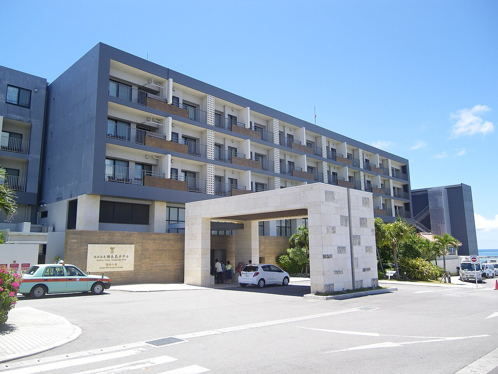
*▲ 豐見城市瀨長島 Umikaji Terrace，依山傍海的純白階梯露台，坐擁絕美日落與飛機低空掠過景觀。*

2. **瀨長島 Umikaji Terrace & 龍神之湯**
   - **屬性**：純白階梯露台商場 + 室內天然海景溫泉
   - **營業時間**：商場 10:00 - 21:30；溫泉 06:00 - 24:00
   - **門票**：商場免費自由進出；溫泉平日 ¥1,400 / 假日 ¥1,700
   - **是否需預約**：免預約
   - **那霸機場開車距離與時間**：**僅約 4.5 公里，車程約 10~12 分鐘！**
   - **特色看點**：「沖繩小聖托里尼」，欣賞飛機極低空呼嘯降落，享受夕陽晚霞；龍神之湯邊泡天然金黃色海底溫泉邊看落日。

3. **DMM Kariyushi 水族館**
   - **屬性**：100% 全室內高科技數位水族館
   - **營業時間**：09:00 - 20:00（最後入場 19:00）
   - **門票**：成人 ¥2,400 / 青年 ¥2,000 / 兒童 ¥1,500
   - **是否需預約**：免預約
   - **那霸機場開車距離與時間**：**僅約 6 公里，車程約 12~15 分鐘！**
   - **特色看點**：沉浸式投影結合真實海洋生物，透明玻璃地板俯視大水槽鯊魚、近距離觸摸池、與樹懶和巨嘴鳥互動。與 iias 購物中心室內直通。

4. **知念岬公園**
   - **屬性**：100% 戶外海景公園步道
   - **營業時間**：24小時開放
   - **門票**：完全免費（附免費大型停車場）
   - **是否需預約**：免預約
   - **那霸機場開車距離與時間**：約 25 公里，車程約 40~45 分鐘
   - **特色看點**：三面環抱太平洋的海角綠茵步道，擁抱 270 度蔚藍無死角海景與神之島「久高島」。

---

### 4. 那霸市區與近郊（那霸市、浦添市）

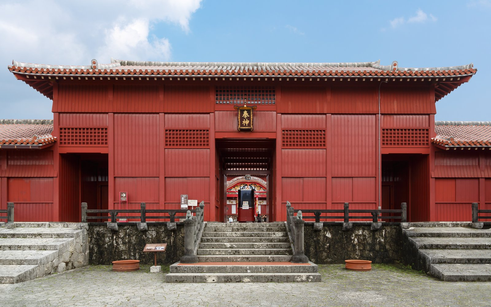
*▲ 琉球王國精神象徵「首里城」！歷經數年精工修復，2026 年秋季正殿主體完工，2027 年 3 月迎來嶄新風貌。*

1. **首里城公園 (Shurijo Castle Park)**
   - **屬性**：複合型（城郭步道戶外 + 殿堂室內展覽）
   - **營業時間**：08:30 - 18:00（收費區最後售票 17:30）
   - **門票**：收費區 成人 ¥400 / 高中生 ¥300 / 中小學 ¥160
   - **是否需預約**：免預約
   - **那霸機場開車距離與時間**：約 10 公里，車程約 25~30 分鐘（單軌電車首里站下車）
   - **特色看點**：琉球王國精神象徵！**正殿於 2026 年秋季完成主體重建工程，2027 年 3 月正是親眼目睹嶄新金碧輝煌正殿復興的歷史時刻！**

2. **國際通商店街 & 第一牧志公設市場**
   - **屬性**：複合型（周邊平和通、市場本通皆為加蓋遮雨棚拱廊，全天候不淋雨）
   - **營業時間**：商圈全天；公設市場 08:00 - 22:00
   - **門票**：免費自由逛街採買
   - **是否需預約**：免預約
   - **那霸機場開車距離與時間**：約 5.5 公里，車程約 15~20 分鐘
   - **特色看點**：全長 1.6 公里熱鬧大街；新落成第一牧志公設市場一樓買現撈夜光貝、龍蝦、石斑，二樓代客熱炒現烹享用。

3. **SAN-A 浦添西海岸 PARCO CITY**
   - **屬性**：100% 全室內頂級濱海大型商場
   - **營業時間**：10:00 - 22:00
   - **門票**：免費入場（附設 4,000 台大型室內停車位）
   - **是否需預約**：免預約
   - **那霸機場開車距離與時間**：約 11 公里，車程約 20~25 分鐘（沿西海岸道路直達）
   - **特色看點**：沖繩最新最大級購物中心！250 家知名專櫃、落地海景美食街、巨幕影城。距離那霸市區僅 15 分鐘之終極室內抗雨神殿！

---

## ☔ 第五章 【雨天必備】戶外行程就近室內備案快速對照矩陣

初春在沖繩自駕遇到鋒面降雨，最忌諱毫無準備臨時在車上盲目搜尋。這份矩陣提供所有戶外景點 **車程 5~20 分鐘內** 的無縫室內切換方案：

| 原始戶外景點 / 行程 | 所屬分區 | 雨天受阻原因與風險 | 第一推薦室內備案 | 備案特點與核心看點 | 距原景點車程 | 備案營業時間與費用 | 第二備用室內方案 |
|:---|:---|:---|:---|:---|:---|:---|:---|
| **嘉津宇岳 (登山攀岩)** | 北部名護 | 石灰岩遇水極度濕滑，拉繩處泥濘，山頂完全無遮蔽易摔傷 | **名護鳳梨園** | 全自動雨棚自駕電動車、恐龍園區、酒廠試飲與甜點 | 車程約 12 分鐘<br>(約 6.5 公里) | 10:00-18:00<br>成人 ¥1,200 / 兒童 ¥600 | Orion啤酒名護工廠 (全室內見學試飲，車程15分) |
| **大石林山 (奇岩健行)** | 北部國頭極北 | 木棧道視野受阻，遠眺邊戶岬展望差，海風大雨勢強 | **邊戶岬觀光案內所 Asumui Cafe** | 二樓全落地玻璃觀景咖啡廳，室內舒適欣賞巨浪驚濤拍岸 | 車程約 5 分鐘<br>(約 3.2 公里) | 10:00-17:00<br>自由入場 (飲品約 ¥500) | 國頭村山原秧雞生態館 (室內展館，車程25分) |
| **古宇利島 & 心形岩** | 北部今歸仁 | 沙灘風浪大無法親水，海色轉陰灰失去「古宇利藍」通透感 | **古宇利海洋塔** | 全自動無人雨棚電動車登塔、萬件貝殼博物館、室內海景甜點 | 就在島上<br>(車程約 3 分鐘) | 10:00-18:00<br>成人 ¥1,000 / 兒童 ¥500 | 今歸仁村歷史文化中心 (城跡旁室內博物館，車程18分) |
| **備瀨福木林道** | 北部本部 | 小雨可打傘，大雨地面白砂泥濘積水，海風強勁 | **沖繩美麗海水族館** | 巨型室內黑潮之海大水槽、鯨鯊餵食秀、深海生物觸摸池 | 車程約 3 分鐘<br>(約 1.2 公里) | 08:30-18:30<br>成人 ¥2,180 / 兒童 ¥710 | 海洋博公園熱帶夢幻中心 (全遮蔽溫室蘭花園，隔壁) |
| **塔滝溪谷 (溯溪健行)** | 北部大宜味 | 山區暴雨極易引發溪流暴漲與山洪危險，大雨天封閉管理 | **DINO 恐龍公園山原亞熱帶之森** | 禦菓子御殿名護店內，半遮蔽亞熱帶恐龍步道與紅芋塔工廠 | 車程約 25 分鐘<br>(約 18 公里) | 09:00-18:00<br>成人 ¥1,000 / 兒童 ¥600 | 名護市役所周邊傳統茶屋或特色咖啡館 |
| **石川岳 (登山過溪)** | 中部宇流麻 | 泥土稜線濕滑極易滑倒摔傷，C路線溪谷水流湍急無法徒步通過 | **永旺夢樂城沖繩來客夢 (AEON)** | 沖繩最大全室內商場、中庭巨型水族箱、200+品牌與美食街 | 車程約 20 分鐘<br>(約 14 公里) | 10:00-22:00<br>免費入場 (免費停車4,000台) | 琉球村「沖繩之驛」室內文化工藝穹頂 (車程15分) |
| **萬座毛 & 殘波岬** | 中部恩納/讀谷 | 海邊斷崖強烈陣風與暴雨，撐傘易翻，巨浪危險且步道濕滑 | **萬座毛新遊客中心** | 3層樓全新空調商場、全景落地窗眺望萬座毛象鼻岩、海景餐廳 | 原地即為室內展館<br>(零距離) | 08:00-19:00<br>商場免費 / 步道 ¥100 | Gala 青之海 (讀谷村鹽業工坊、室內吹玻璃，車程20分) |
| **勝連城跡 (古城登頂)** | 中部宇流麻 | 頂層無護欄，強風吹襲且古石階濕滑難行，登頂視野被雨霧遮蔽 | **阿麻和利公園展示館** | 勝連城山腳下全新落成現代化室內博物館，動態投影與歷史劇院 | 原地山腳下<br>(步行1分鐘) | 09:00-18:00<br>成人 ¥600 (含城跡門票) | 海中道路「海之驛 Ayahashi 館」(室內海文化館，車程10分) |
| **知念岬公園** | 南部南城 | 海岬空曠無遮蔽物，大雨無法撐傘，太平洋狂風吹襲 | **沖繩世界文化王國 (玉泉洞)** | 天然地底 890 米壯麗鐘乳石洞穴步道、室內太鼓秀大帳棚、玻璃村 | 車程約 12 分鐘<br>(約 7.8 公里) | 09:00-17:30<br>套票 成人 ¥2,000 / 兒童 ¥1,000 | 南城市物產館 (室內海景伴手禮中心，就在知念岬入口) |
| **瀨長島露天階梯** | 南部豐見城 | 露天純白階梯全無遮雨棚，地面積水且無法坐在戶外觀看落日 | **DMM Kariyushi 水族館 & iias** | 現代數位沉浸水族館 + 大型多層購物中心，室內相通免淋雨 | 車程約 8 分鐘<br>(約 4.5 公里) | 水族館 09:00-20:00 (¥2,400)<br>iias 10:00-21:00 | 琉球溫泉龍神之湯 (瀨長島島上室內海景溫泉泡湯) |
| **首里城公園 (城郭漫步)** | 那霸市區 | 石板步道起伏大，下雨撐傘參觀較為費力狼狽 | **沖繩縣立博物館·美術館 (OkiMu)** | 全室內現代建築，完整展出沖繩自然史、珊瑚礁、琉球歷代國寶 | 車程約 10 分鐘<br>(約 4 公里，新都心) | 09:00-18:00<br>常設展 成人 ¥530 / 大學高校 ¥270 | SAN-A 那霸 Main Place (新都心超大型室內商場，步行3分) |
| **波上宮 & 市區海灘** | 那霸市區 | 海灘風浪大禁止靠近，露天神社參拜階梯易滑 | **浦添西海岸 PARCO CITY** | 沖繩最大級海景室內購物中心，250家品牌專櫃、巨幕影城 | 車程約 15 分鐘<br>(約 8.5 公里) | 10:00-22:00<br>全館免費入場 (大型室內停車場) | 第一牧志公設市場室內二樓美食街 (車程10分) |

---

## 📅 第六章 五大版本 5 天 4 夜 完整行程規劃（均含賞鯨）

針對不同旅遊風格、同行成員體能與偏好，精心設計 5 套由南往北順暢推進、絕不走回頭路的 5天4夜 完整企劃：

---

### 🌟 版本一：【經典全景與家庭休閒版】（Classic Highlights & Family Fun）
> **客群定位**：初訪沖繩、家庭親子、長輩同行、偏好節奏均衡之旅客。  
> **核心亮點**：美麗海水族館 + 那霸港上午座頭鯨賞鯨 + 嘉津宇岳輕鬆登頂輕健行 + 美國村夕陽夜景 + 2026年全新完工之首里城正殿。

```
D1 (3/3 週三): 機場抵達 → 瀨長島看飛機海景 → 浦添 PARCO CITY 購物美食 (宿那霸市區)
D2 (3/4 週四): 那霸港賞鯨 (09:00-12:00) → 泊港魚市場海鮮午餐 → 殘波岬燈塔 → 美國村夕陽夜景 (宿北谷美國村)
D3 (3/5 週五): 嘉津宇岳輕健行 (360度名護海景) → 百年古家阿古豬 → 美麗海水族館 (鯨鯊) → 備瀨福木林道 (宿本部町/名護)
D4 (3/6 週六): 古宇利跨海大橋 → 萬座毛象鼻岩 → 首里城公園 (全新正殿) → 國際通第一牧志公設市場晚餐 (宿那霸市區)
D5 (3/7 週日): 波上宮崖上神社祈福 → 國際通免稅採買 → 機場還車返台
```

- **Day 1（3/3 週三）：落地初見沖繩藍，悠閒海景商場**
  - **下午**：抵達那霸機場，辦理取車手續（約 14:00 取車完成）。驅車 12 分鐘（4.5km）前往【瀨長島 Umikaji Terrace】，漫步純白露台，近距離感受飛機呼嘯降落的震撼，品嚐幸福鬆餅或義式冰淇淋。
  - **傍晚**：開車 25 分鐘（13km）前往【SAN-A 浦添西海岸 PARCO CITY】，逛街採購防風外套、補給品，在落地玻璃海景美食街享用敘敘苑燒肉或和牛漢堡排。
  - **住宿**：那霸市區飯店（如：那霸凱悅酒店或嘉新酒店）。
  - **雨天備案**：直接在 PARCO CITY 全室內商場活動，或在瀨長島龍神之湯室內海景溫泉放鬆。

- **Day 2（3/4 週四）：大洋座頭鯨巡禮，漫步美式夕陽街區**
  - **上午**：08:30 抵達那霸三重城港（車程15分），參加【座頭鯨賞鯨大航海（09:00-12:00）】。航向慶良間群島海域，近距離觀賞重達 30 噸的座頭鯨翻騰、拍水與噴氣，震撼人心！
  - **中午**：下船後前往【泊港漁市場（Tomari Iyumachi）】，享用新鮮現剖海膽、鮪魚生魚片丼飯與焗烤龍蝦。
  - **下午**：開車 55 分鐘（35km）前往讀谷村【殘波岬燈塔＆絕壁公園】，欣賞 31 米白色燈塔與壯烈拍岸浪濤。
  - **傍晚**：開車 25 分鐘（15km）抵達【北谷美國村】，日落海灘觀賞浪漫晚霞，逛街淘寶，晚餐享用 Red Lobster 海鮮或美式漢堡。
  - **住宿**：北谷美國村海景飯店（如：Vessel Hotel Campana）。
  - **費用預估**：賞鯨約 ¥6,000/人；殘波岬登上燈塔 ¥300/人。
  - **雨天備案**：若海上風浪取消賞鯨，當日上午改走南部玉泉洞；殘波岬大雨改逛永旺夢樂城來客夢 AEON。

- **Day 3（3/5 週五）：嘉津宇岳輕登頂，黑潮鯨鯊與百年古道**
  - **上午**：開車 65 分鐘（60km，經許田IC）抵達名護市勝山【嘉津宇岳登山口】。攀登 750 公尺石灰岩陡坡（手腳並用抓樹根），約 25~30 分鐘即可攻頂（452m），享受 360 度俯瞰名護灣與本部半島之壯麗環景！
  - **中午**：開車 20 分鐘抵達名護百年老宅【百年古家 大家（Ufuya）】，在潺潺流水與瀑布庭園中品嚐阿古豬生姜燒與沖繩黑糖冷麵。
  - **下午**：開車 25 分鐘（18km）前往【沖繩美麗海水族館】。於黑潮之海大水槽前靜看巨型鯨鯊與鬼蝠魟悠游，參觀深海生物館與海豚劇場。
  - **傍晚**：車程 5 分鐘前往【備瀨福木林道】，租借自行車或步行穿梭萬棵老福木綠色隧道，漫步至備瀨崎海灘。
  - **住宿**：本部町/名護海景渡假村（如：奧利安酒店本部度假村 Hotel Orion Motobu）。
  - **費用預估**：嘉津宇岳免費；美麗海水族館 ¥2,180/人；自行車租借 ¥500/人。
  - **雨天備案**：嘉津宇岳若下雨路滑取消，改去名護鳳梨園搭室內電動車；美麗海水族館本身為頂級室內場館。

- **Day 4（3/6 週六）：古宇利藍巡禮，見證新首里城歷史**
  - **上午**：開車 30 分鐘（22km）穿越古宇利跨海大橋抵達【古宇利島】，搭乘自動遊園車登上【古宇利海洋塔】俯瞰果凍海，參觀心形岩。
  - **中午**：品嚐島上超人氣美食【古宇利蝦蝦飯（Shrimp Wagon）】蒜香奶油蝦。
  - **下午**：沿西海岸公路南下（車程55分），短暫停留【萬座毛象鼻岩】。隨後走沖繩自動車道（車程50分）返回那霸【首里城公園】。親眼見證 2026 年秋季全新修復完成的「首里城正殿」金碧輝煌之歷史風貌！
  - **傍晚**：前往【國際通 & 第一牧志公設市場】，在一樓挑選生猛石斑魚、夜光貝、龍蝦，直上二樓代客熱炒現煮享用豐盛晚餐。
  - **住宿**：那霸市區國際通商圈飯店（如：JR九州Blossom那霸）。
  - **費用預估**：古宇利海洋塔 ¥1,000/人；萬座毛 ¥100/人；首里城 ¥400/人；高速過路費約 ¥1,040。
  - **雨天備案**：萬座毛可在新商場室內落地窗觀景；首里城戶外步道改為新都心沖繩縣立博物館·美術館室內展覽。

- **Day 5（3/7 週日）：波上宮參拜祈福，滿載收穫返台**
  - **上午**：早餐品嚐牧志市場旁的超人氣【波多馬（Potama）豬肉蛋飯糰】。隨後開車 10 分鐘（3km）前往座落於斷崖之上的【波上宮】參拜，祈求旅途平安並購買開運御守。
  - **中午**：於國際通加蓋雨棚的平和通商店街購買最後免稅伴手禮（元祖紅芋塔、石垣牛仙貝、黑糖年輪蛋糕）。
  - **下午**：開車 15 分鐘（6km）前往那霸機場周邊租車公司還車，搭乘接駁車至航廈出境返台。

---

### 🌿 版本二：【自然野趣與山海深度探索版】（Wild Nature & Yanbaru Forest Adventure）
> **客群定位**：熱愛原始自然、地質奇觀、森林溯溪、追求不走尋常路之旅人。  
> **核心亮點**：北部本部港出航賞鯨（離鯨群最近、航程最短）+ 國頭村世界自然遺產大石林山神聖巨石步道 + 邊戶岬斷崖 + 塔滝溪谷溯溪 + 勝連城跡。

```
D1 (3/3 週三): 機場出發直奔北部 → 許田休息站黑糖甜甜圈 → 本部海灣日落 (宿本部/今歸仁)
D2 (3/4 週四): 本部港近海賞鯨 (09:15-11:45) → 本部牛燒肉午餐 → 大石林山 4大奇岩森林步道 → 邊戶岬斷崖 (宿國頭/名護)
D3 (3/5 週五): 塔滝溪谷 (Ta-Taki) 溯溪涉水探險 → 前田食堂大宜味麵 → 今歸仁城跡石階登山 (宿恩納村)
D4 (3/6 週六): 萬座毛自然步道 → 勝連城跡 (360度俯瞰海中道路) → 知念岬公園太平洋步道 (宿那霸市區)
D5 (3/7 週日): 識名園皇家迴遊庭園 → 那霸新都心採買 → 機場還車
```

- **Day 1（3/3 週三）**：抵達機場取車，直上沖繩自動車道一路北上至許田IC（70km，65分），在許田休息站品嚐現炸黑糖三矢甜甜圈。傍晚抵達北部本部海灣，晚餐在「海人料理 海邦丸」享用在地生魚片與海葡萄丼飯。宿本部町海景飯店。
- **Day 2（3/4 週四）**：上午 08:45 本部港集合，搭乘【北部近海賞鯨船（09:15-11:45）】。出港僅 15 分鐘即在伊江島平緩海域遇見座頭鯨母子，少浪完全不暈船！午餐享用「燒肉本部牧場」黑毛和牛燒肉定食。下午前往本島極北世界自然遺產【大石林山（Daisekirinzan）】，耗時 2 小時挑戰奇岩巨石、御石巨榕與美麗海展望台。傍晚漫步【邊戶岬海角斷崖步道】感受太平洋與東海浪濤咆哮。宿國頭村山原木屋或名護市。
- **Day 3（3/5 週五）**：前往大宜味村挑戰【塔滝（Ta-Taki Falls）溪谷涉水溯溪（往返1.5~2小時）】。換上毛氈溯溪鞋，涉入及膝清泉攀過巨石，直達 10 米高飛瀑，享受大自然負離子。中午在「前田食堂」品嚐堆成小山般的黑胡椒牛肉豆芽沖繩麵。下午前往世界遺產【今歸仁城跡】，攀登萬里長城般的古石灰岩城垣。宿恩納村渡假溫泉飯店。
- **Day 4（3/6 週六）**：萬座毛步道晨遊 → 前往宇流麻市攀登【勝連城跡（登上一之曲輪頂層，360度俯瞰海中道路與中城灣）】→ 沿海中道路兜風 → 南下前往南城市【知念岬公園】海天一線步道。傍晚返回那霸，晚餐品嚐「傑克牛排館（Jack's Steak House）」厚切紐約客牛排。宿那霸市區。
- **Day 5（3/7 週日）**：探訪世界遺產【識名園】，漫步於琉球王室最大迴遊式庭園的拱橋與林蔭步道。新都心採購後前往機場還車返程。

---

### ☕ 版本三：【慢活療癒、海景咖啡與文化文青版】（Slow Living, Ocean Cafes & Ryukyu Heritage）
> **客群定位**：夫妻情侶、閨蜜好友、美學愛好者、追求極度放鬆與質感體驗之旅人。  
> **核心亮點**：北谷港出航賞鯨（毗鄰美國村免奔波）+ 讀谷村星野磐石咖啡 + 恩納村海景懸崖放空 + 瀨長島龍神之湯天然溫泉看夕陽 + 壺屋通手作陶藝。

```
D1 (3/3 週三): 機場抵達 → 港川外人住宅街甜點散步 → 入住恩納村海景渡假村放空聽濤 (宿恩納)
D2 (3/4 週四): 悠閒早餐 → 星野 Banta Cafe 巨石海景放空 → 北谷港午後賞鯨 (13:30-17:00) → 美國村海邊散步晚餐 (宿北谷美國村)
D3 (3/5 週五): 備瀨福木林道水牛車巡禮 → 本部懸崖吊床咖啡 → 古宇利海洋塔下午茶 (宿恩納)
D4 (3/6 週六): 首里城公園漫步 → 壺屋通陶瓷街尋寶 → 瀨長島龍神之湯海景溫泉看飛機夕陽 (宿瀨長島)
D5 (3/7 週日): 牧志公設市場傳統早餐 → 平和通文創小店 → 優雅還車登機
```

- **Day 1（3/3 週三）**：機場取車後開車 20 分鐘（11km）前往浦添【港川外人住宅街】。在白色美軍平房聚落中漫步，品嚐「oHacorté」當季草莓水果塔與可麗露。傍晚入住恩納村高級海景渡假村（如：Halekulani Okinawa），在陽台沙發放空聆聽海浪聲。
- **Day 2（3/4 週四）**：睡到自然醒後，開車 25 分鐘前往讀谷村【星野集團 Banta Cafe】。坐落於海岸懸崖與天然礁石間的階梯露台，點杯沖繩香檸氣泡飲發呆看海。下午 13:00 抵達北谷港，搭乘大型雙體帆船展開【午後座頭鯨尋訪之旅（13:30-17:00）】。傍晚在美國村濱海木棧道散步，享用 Seaside Ristorante 義大利海景晚餐。宿北谷美國村海景酒店。
- **Day 3（3/5 週五）**：前往本部町【備瀨福木林道】，搭乘慢速水牛車穿行在綠意盎然的百年林道中。午餐在「亞熱帶茶屋」躺在戶外吊床上享用泰式海景打拋飯。下午前往【古宇利島海洋塔】頂樓咖啡座品嚐熱帶百香果刨冰。宿恩納村渡假村。
- **Day 4（3/6 週六）**：前往那霸市區，參觀【首里城公園】金碧輝煌之新正殿。隨後漫步於百年石板古道【壺屋通陶瓷街】，在古樸老屋間尋覓職人手工柴燒陶杯與可愛風獅爺。下午入住【瀨長島溫泉酒店】，傍晚於【龍神之湯】享受天然金黃色立湯，一邊浸泡溫泉，一邊眺望夕陽沉入東海與飛機掠過天際。晚餐在瀨長島頂樓「POSILLIPO」享用柴燒拿坡里披薩。宿瀨長島。
- **Day 5（3/7 週日）**：悠閒退房，在第一牧志公設市場品嚐傳統花生豆腐與「步莎翁」現炸開口袋沙翁甜點。漫步加蓋雨棚的平和通挑選工藝伴手禮，前往機場輕鬆還車返台。

---

### 🏃 版本四：【雙峰健行與冒險挑戰極限版】（Peak Trekking & Active Adventure）
> **客群定位**：戶外運動迷、登山好手、體能充沛、渴望收集沖繩名峰之旅人。  
> **核心亮點**：石川岳（204m C線涉溪攀繩）+ 嘉津宇岳（452m 石灰岩徒手拉繩登頂）雙峰連登 + 國頭極北邊戶岬狂風 + 本部/那霸極限尋鯨 + 玉泉洞地底探幽。

```
D1 (3/3 週三): 機場落地直奔中部 → 石川岳 C 路線 (涉水溯溪+拉繩攻頂 2.5小時) → 恩納溫泉放鬆 (宿恩納)
D2 (3/4 週四): 名護嘉津宇岳登山攀岩 (452m 360度環景) → 宮里蕎麥麵 → 本部港出海尋鯨 (宿名護/北谷)
D3 (3/5 週五): 國頭大石林山全步道疾走 → 邊戶岬 200m 斷崖海風健行 → 東海岸景觀公路南下 (宿那霸市區)
D4 (3/6 週六): 沖繩世界文化王國玉泉洞 (890m 地底鐘乳石健行) → 知念岬公園步道 → 國際通居酒屋慶功 (宿那霸市區)
D5 (3/7 週日): 波上宮崖上海岬快步健走 → ASHIBINAA 暢貨園區採購戶外裝備 → 機場還車返航
```

- **Day 1（3/3 週三）**：機場取車後直奔中部宇流麻市【石川岳登山步道】。直攻難度最高之「C 路線（探險環線，3.2km，耗時 2~2.5 小時）」。穿過亞熱帶雨林，脫鞋涉渡清涼溪流，攀爬岩壁垂直繩索登頂（204m），在山頂同時遠眺西側東海與東側太平洋金武灣！傍晚前往恩納村溫泉舒緩肌肉，享用在地居酒屋石蒜天婦羅與生啤。宿恩納村。
- **Day 2（3/4 週四）**：清晨出發前往名護【嘉津宇岳登山口】。攀登單程 750 公尺陡峭古生代石灰岩山徑，抓緊樹根手腳並用登頂（452m），站立於刀削般的岩石尖端，飽覽名護灣與伊江島城山震撼景觀。午餐在名護市品嚐「宮里蕎麥麵」招牌排骨麵。下午前往本部港參加【座頭鯨賞鯨出海巡航（13:30-16:00）】。宿北部名護市。
- **Day 3（3/5 週五）**：全速前進沖繩最北端世界自然遺產【大石林山】，健行完成奇岩巨石、神木巨榕與美麗海展望台 4 大步道。隨後徒步前往【邊戶岬海角斷崖步道】，頂著強烈陣風俯瞰太平洋與東海交會的咆哮白浪。下午沿東海岸公路南下返回那霸。宿那霸市區。
- **Day 4（3/6 週六）**：上午前進南部【沖繩世界文化王國·玉泉洞】。展開長達 890 公尺的地底鐘乳石天然步道徒步，欣賞千萬年形成的鐘乳石筍與地下暗河。下午前往【知念岬公園】強風海角快步漫遊。傍晚在國際通居酒屋享用黑毛和牛炭火燒肉慶祝雙峰攻頂成功。宿那霸市區。
- **Day 5（3/7 週日）**：晨間慢跑至【波上宮】崖頂神社參拜。隨後前往沖繩 Outlet 購物城 ASHIBINAA 採買 Columbia、The North Face 等機能登山裝備，前往機場還車賦歸。

---

### 🛡️ 版本五：【全天候抗雨＆三代同堂舒適無障礙版】（All-Weather Rainproof & Multi-Gen Accessible）
> **客群定位**：三代同堂、嬰幼兒推車家庭、行動較不便長輩、極度重視舒適避雨之旅人。  
> **核心亮點**：挑選平穩抗浪大型雙體遊艇賞鯨（全空調景觀沙發艙）+ 沖繩雙室內水族館（美麗海＋南島DMM）+ 玉泉洞無障礙平穩地底步道 + 永旺來客夢全室內商城。

```
D1 (3/3 週三): 機場僅15分抵達 → DMM Kariyushi 現代數位水族館 → iias 室內購物美食 (宿那霸無障礙飯店)
D2 (3/4 週四): 那霸三重城港搭平穩大船賞鯨 (09:00-12:00) → 玉泉洞地底步道 (恆溫避雨) + 太鼓秀 (宿那霸市區)
D3 (3/5 週五): 美麗海水族館 (黑潮之海大水槽景觀餐廳) → 名護鳳梨園搭雨棚自駕電動車 (宿北部無障礙飯店)
D4 (3/6 週六): 琉球村室內工藝穹頂 (手作體驗) → 全島最大永旺夢樂城來客夢 (全室內大水族箱+購物) (宿那霸市區)
D5 (3/7 週日): 首里城公園 (搭無障礙電梯參觀正殿) → 機場航廈免稅採買 → 平安舒適返國
```

- **Day 1（3/3 週三）**：抵達那霸機場取車（租用後車廂寬敞之油電七人座或配備輪椅升降設備之休旅車）。開車僅 15 分鐘（6km）抵達【DMM Kariyushi 現代數位水族館】。全館 100% 室內全空調無障礙，推嬰兒車或輪椅暢行無阻；走在透明強化玻璃地板上看巨大鯊魚在腳下遊動，近距離餵食樹懶與巨嘴鳥。隨後在室內連通的【iias 沖繩豐崎商場】享用天丼金子半之助或沖繩黑豬料理。宿那霸無障礙友善星級飯店（如：那霸諾富特酒店）。
- **Day 2（3/4 週四）**：前往那霸三重城港，搭乘大型抗浪雙體賞鯨遊艇（配備室內空調豪華沙發艙，09:00-12:00）。長輩與幼兒可在室內透過大型景觀窗平穩觀鯨，或走上寬敞甲板拍照。下午前往【沖繩世界文化王國·玉泉洞】。玉泉洞地下步道全程設有平緩防滑金屬扶手與緩坡，地底恆溫 21°C，冬暖夏涼完全無風無雨；出洞後在挑高大雨棚劇場舒適觀看太鼓舞震撼表演。宿那霸市區。
- **Day 3（3/5 週五）**：驅車前往北部【沖繩美麗海水族館】。車輛停放於立體 P7 停車場，經室內無障礙坡道直達場館。在「Ocean Blue」大水槽正前方特等咖啡席一邊享用午餐，一邊悠閒靜賞鯨鯊進食。下午前往【名護鳳梨園】，全家人乘坐配備全包覆雨棚的自動電動車遊覽園區，完全免除長輩走路勞累，在室內伴手禮區品嚐免費鳳梨甜點與現烤蛋糕。宿北部無障礙渡假飯店（如：奧利安酒店本部度假村）。
- **Day 4（3/6 週六）**：前往【琉球村】，全區地面平坦好走，進入中央大型室內體驗圓頂穹頂，舒適坐著體驗三線琴演奏教學或全家彩繪專屬風獅爺陶偶。下午前往全島最大室內購物中心【永旺夢樂城沖繩來客夢（AEON MALL Rycom）】。全棟室內連通，設有無障礙電梯與親子洗手間，欣賞中庭 100 噸巨型水族箱熱帶魚，一站購齊免稅藥妝、童裝與伴手禮。宿那霸市區飯店。
- **Day 5（3/7 週日）**：上午探訪【首里城公園】，利用無障礙木棧道與電梯輕鬆登上御庭，近距離欣賞 2026 年秋季全新完工金碧輝煌之首里城正殿。隨後前往那霸機場，在全空調航廈內採購免稅伴手禮，輕鬆辦理還車登機，全員舒適返台。

---

## 📊 第七章 結構化 Excel 調研報表與多維度資料

為了方便自駕旅行者隨身查閱與動態調整，本專案將全島調研成果完整整理為專業的結構化 Excel 試算表（`.xlsx`），包含六大獨立專業分頁：
- `01_調研總覽與3月指南`：氣候特徵、穿著指南、兩大主軸定位與自駕交通須知。
- `02_賞鯨專題全面調研`：橫向對比三大出發港口、班次、費用、預約管道、機場距離與防暈船實戰。
- `03_爬山健行專題調研`：收錄嘉津宇岳、大石林山、石川岳、塔滝溯溪等之標高、難度、耗時、門票、營業時間與雨天限制。
- `04_全島景點總庫(分類排序)`：精選全島 20 處核心景點，按區域分類排序，包含室內/戶外屬性、營業時間、費用、預約與機場距離。
- `05_戶外行程雨天備案庫`：12 組戶外活動與 15 分鐘內就近室內備案（水族館、商場、工坊、鐘乳石洞）對照表。
- `06_五大版本行程規劃(5天4夜)`：5 套完整版本每日時間軸、景點內容、開車時間、費用預估、推薦餐食與雨天切換方案。

---

## 🎒 第八章 行前 Check List 與精明提醒

1. **賞鯨預約黃金期**：3 月為賞鯨最高峰，名額極為搶手，請於**出發前 30 天**完成線上預約；務必排在旅程第 2 天或第 3 天，預留因風浪取消的免費改期天數。
2. **登山安全三件套**：抓地力極佳的專業登山鞋（防石灰岩濕滑）、透氣長袖長褲（防波布蛇與刺藤）、防風防水連帽薄外套。
3. **租車取車確認**：取車時確認配備 ETC 卡與中文語音導航；出發前確認已投保免責補償險（CDW/NOC 全險）。
4. **雨天切換不驚慌**：隨時打開本文「第五章」之就近雨天室內備案矩陣，即可在 5~15 分鐘內輕鬆切換至全空調抗雨神殿！

---

## 🗺️ 更多精選旅遊筆記
- 🚆 [新北隱藏版百年鐵道小鎮！山佳古蹟車站、黑金煤礦坑與彩繪村慢活半日遊](/blog/shanjia-travelog/)
